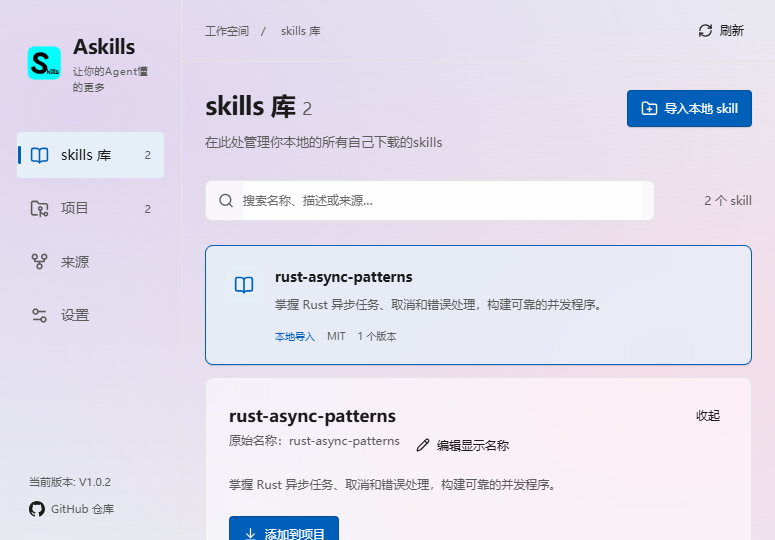
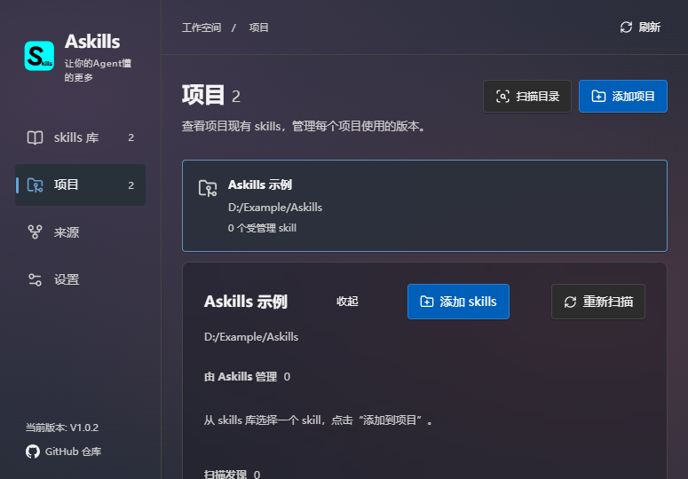

# Askills

中英文 Agent Skills 管理器，为本地 skills 库、项目部署和 GitHub 来源提供图形界面。作者：Candquarzy。当前支持 Windows x64。

## 使用

安装后，在 ZTools 搜索 Askills、skills库、skills项目、skills来源或skills设置。支持导入、显示名称、Markdown 阅读、固定版本部署、升级回滚、库迁移、中英界面及透明主题。

与桌面版共用 %LOCALAPPDATA%\asklils 中的数据。切换前退出占用同一库的另一实例；出现 LibraryBusy 时关闭另一实例后刷新。

## 构建与源码

payload/ 是经过本机 ZTools 验证的插件内容，包括预编译的 Windows x64 Rust helper。中心构建执行 node build.mjs，逐文件验证 SHA-256 后将 payload/ 复制到 dist/；最终插件不包含源码快照或构建材料。

source/ 包含完整的 React、Rust、锁文件、测试和构建脚本，来自 Askills commit 2cae1ce27c1467466840bea918f9e4ca9c845d24。source-manifest.json 记录来源提交与每个运行文件的摘要。preload.js 和 bridge.cjs 保持可读。

重新编译需要 Windows x64、Node.js 24、pnpm 11.22.0、Rust stable 和 MSVC。在 source/ 执行 pnpm install --frozen-lockfile，然后 pnpm build:ztools；生成 source/artifacts/ztools/Askills/ 与 Askills.zpx。Rust helper 可以单独执行 cargo build --manifest-path src-tauri/Cargo.toml --locked --release --bin askills-ztools。

## 许可证

应用源码采用 MIT，见 LICENSE。界面使用本机字体，不内置字体文件；图标文字相关的 MiSans 原始许可见 payload/licenses/MiSans.LICENSE.txt。来源下载不会执行 skill 脚本，项目写入需要用户选择目录和确认。

## 界面演示

以下截图使用 1.0.2 演示数据及模拟宿主背景，不含个人库或项目信息。

