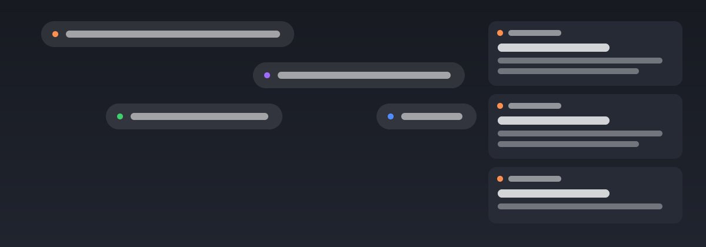

# cafe-notice 通知美化



> 把 Windows 系统通知重新展示为跨屏弹幕或角落卡片：原生弹窗太吵、太容易错过、通知中心翻起来麻烦，这个插件给你第二种看法。

**仅支持 Windows**（10 1709+ / 11）：采集依赖系统通知库 `wpndatabase.db`、注册表与 WinRT toast；feature 已声明 `platform: win32`，其他平台不会显示该入口。

## 更新日志

### v1.0.0 - 2026-10-29
- 首次发布：系统通知采集 + 弹幕/卡片双形态重展示、按应用配置与接管原生横幅、历史留存与导出

## 使用场景

- 写代码/开会时不想被原生弹窗打断，但又不想漏掉构建结果、IM 消息、系统告警
- 原生 toast 一闪而过，想让它多飘一会儿、或者排成队列慢慢看
- 双显示器用户希望通知从左屏连续飘到右屏，而不是只在一块屏上闪
- 想按应用区别对待：某个应用静音、某个应用只飘弹幕、某个应用接管掉原生横幅

## 如何使用

1. 安装后在 ZTools 设置里勾选「跟随主程序启动」（插件声明了后台常驻）
2. 主输入框输入 `通知` / `弹幕` / `cafe notice` 进入配置页
3. 配置页分双栏：通用/通知内容、弹幕/卡片，下方是按应用配置表
4. 点「发一条测试通知」立即看效果（测试通知使用独立身份 `cafe-notice 测试`，不占用真实应用名字）
5. 「历史」页查看最近 N 条通知，支持搜索、按应用过滤、导出 CSV/JSON

## 功能特性

- **采集**：增量轮询 Windows 通知库（wpndatabase.db 三件套副本），不依赖包身份/WinRT 授权；通知仍保留在系统通知中心
- **弹幕**：速度、方向（左→右 / 右→左）、位置（上/中/下）、跨所有显示器连续飘屏、轨道数、字号、底色/透明度、边框、emoji 挂件；恒定速度 + 轨道占用调度，同轨不追尾
- **卡片**：显示器与四角位置、停留时长、宽度、同时上限（超出排队等位不丢弃）、底色/透明度；悬停暂停计时、点击展开完整正文、手动关闭
- **内容**：应用名/时间开关、字体颜色（留空按底色自动反色）
- **按应用**：显示名、颜色、形态（弹幕+卡片/仅弹幕/仅卡片）、静音、接管原生横幅（写 ShowBanner=0，关闭开关即恢复原值）
- **应用名解析**：内置表 → 注册表 AppUserModelId DisplayName（覆盖 IntelliJ IDEA 等生成 AUMID）→ 推导兜底
- **防刷屏**：同应用 N 秒内超过 M 条合并为「+N 条」，M=0 关闭
- **稳定性**：多 preload 实例 leader 选主（心跳锁），浮层僵尸窗自检自清理；弹幕穿透鼠标不挡操作

## 安装与开发

```bash
npm install
npm run dev      # 开发：ZTools 加载 http://localhost:5173
npm run build    # 产物输出到 src-ztools/dist（含浮层 overlay.html）
```

浮层窗口只接受 file:// 地址，因此浮层改动需 `npm run build` 后重启 ZTools 生效；配置页走 dev 热更新。

## 数据存储

- 历史与配置存于本地 SQLite：`<ZTools userData>/cafe-notice/history.db`（notice / app_config / config 三张表）
- 默认留存 30 天、上限 5000 条，可在配置页调整或一键清空
- 导出文件落在系统下载目录
- 除读取本机通知库与注册表外不联网

## 技术栈

Vue 3 + Vite + TypeScript、Element Plus（按需引入）、node:sqlite、Electron 浮层窗口（createBrowserWindow）

## 许可证

MIT
