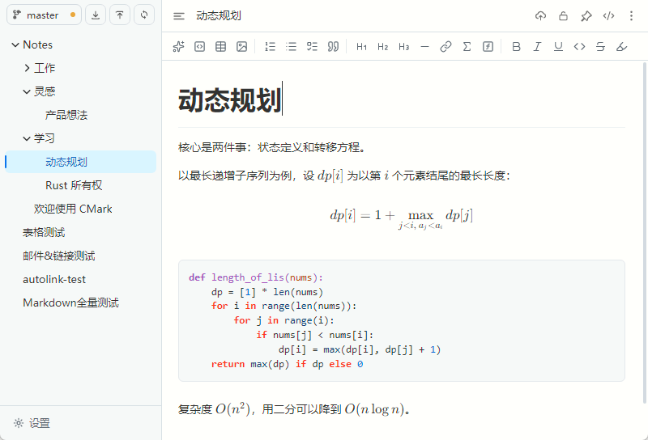
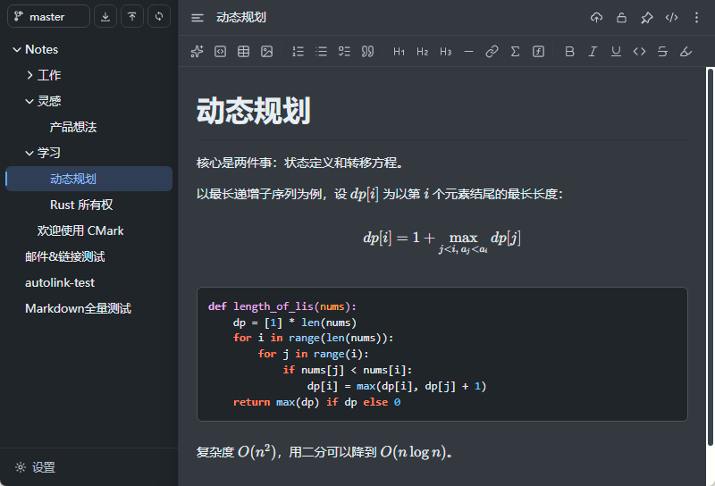
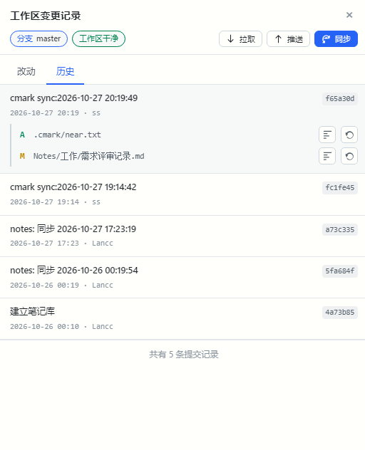
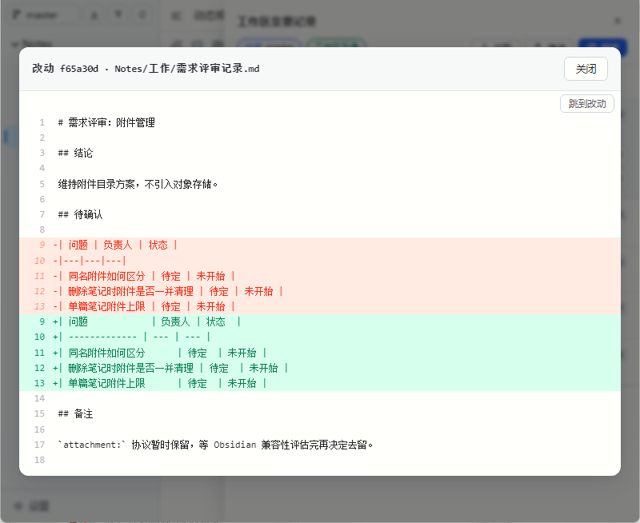
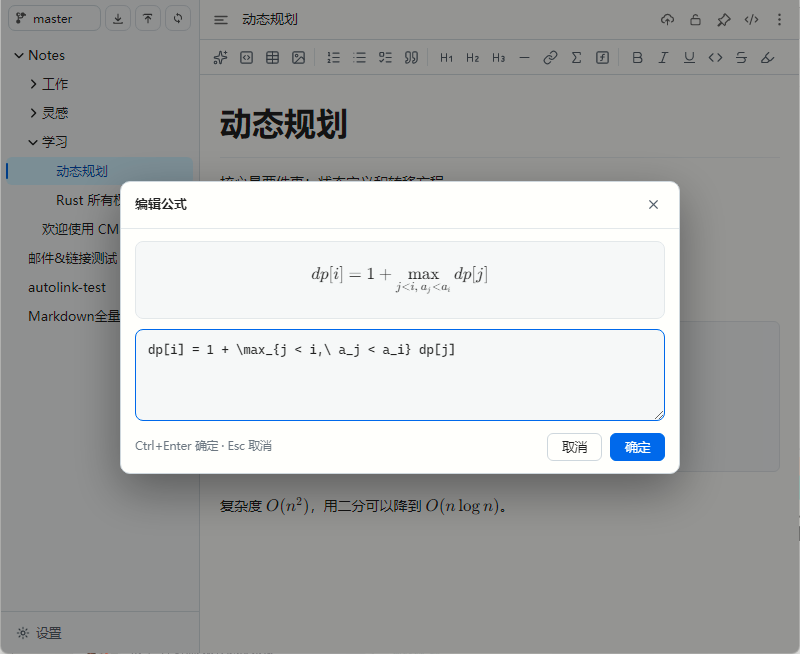

# CMark

本地优先的 Markdown 笔记插件：笔记就是磁盘上的 `.md` 文件，版本用 Git 管理，内容始终在自己手里。

  

## 适合谁用

- 已经有一批 Markdown 文件，希望插件直接读写这些文件，不导入、不转换、不建私有仓库
- 想用 Git 做版本回溯与多端同步，但不想记 Git 命令
- 不希望为了记笔记注册账号、把内容放进第三方云端

## 功能

**编辑**

- 所见即所得，另提供带行号的源码模式
- 表格可视化编辑：增删行列、调整对齐
- 代码块语法高亮，可切换语言、一键复制
- 数学公式：行内与块级，基于 KaTeX
- 图表：内置 mermaid 与 ECharts，在编辑区直接渲染
- 任务列表、高亮、上下标
- 图片可直接粘贴，自动存入笔记库并按内容去重；拖动边缘即可缩放，尺寸写回 Markdown

**组织**

- 目录树直接映射磁盘目录，支持拖拽移动、重命名、新建笔记与文件夹
- 全文搜索：标题与正文，命中高亮，方向键逐条跳转

**导出**

- Markdown（连同正文引用的图片一起导出，引用改为相对路径）
- HTML（单文件，样式与图片内嵌，任何浏览器可打开）
- PDF
- 长图

**版本与同步**

- 内置 Git：查看提交历史、打开任意一次提交的全文、逐行 diff
- 定时自动提交并推送，失败时自动暂停并保留原因
- 支持 GitHub / Gitee / 自建仓库

## 界面

  

  
  

  

## 安装与首次使用

在插件市场搜索 `cmark` 或 `markdown` 安装。首次打开时：

1. 选择一个笔记目录（可以是你已有的 Markdown 目录，插件不会移动或改写已有文件）
2. 需要版本管理时，在设置里初始化本地仓库；要同步到远端，再填写 GitHub / Gitee / 自建仓库地址
3. 需要自动同步时，打开「定时提交并推送」

不需要版本管理也可以只用编辑与搜索功能。

## 数据存放

- 笔记正文就是你选择目录下的 `.md` 文件，没有私有格式；用任何编辑器都能打开
- 图片保存在仓库根目录的 `.cmark/attachments/`，随仓库一起提交
- `.cmark/` 下只有排序、只读标记、图片附件这类元数据
- 插件不会上传笔记内容；是否推送、推送到哪里由你的 Git 配置决定
- 卸载插件不会删除笔记

## 运行环境

- ZTools 3.x
- 已在 Windows 11 上完整验证；macOS 与 Linux 未做完整验证，如遇问题请在下方反馈

## 反馈

问题与建议请提交到 [GitHub Issues](https://github.com/LanccBy2016/cmark/issues)。

## 许可

MIT，第三方组件见 [THIRD-PARTY.md](THIRD-PARTY.md)。