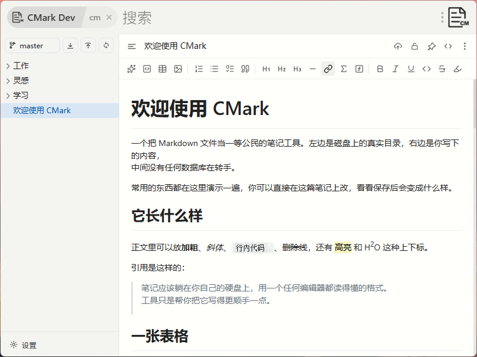
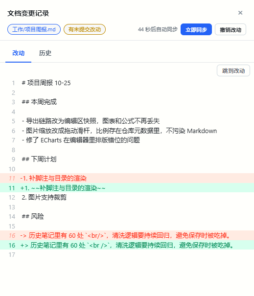
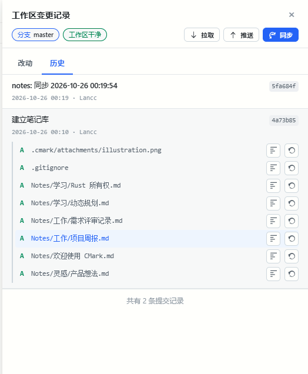
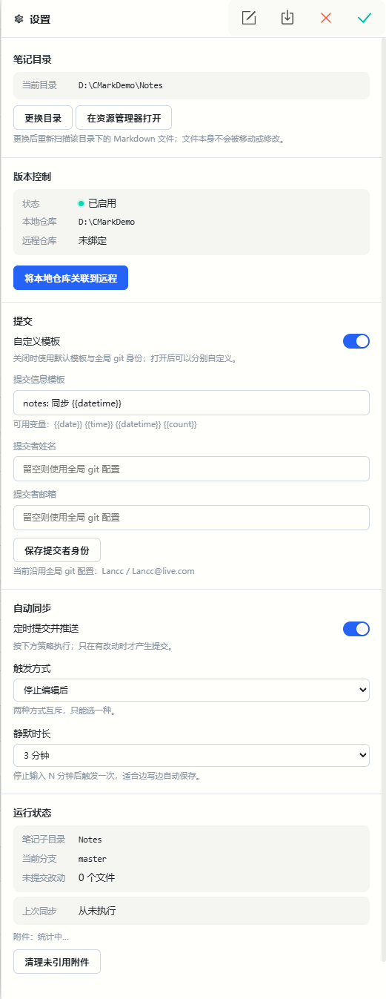

# CMark

Obsidian 的轻量替代。本地 Markdown 笔记，文件是你的，版本用 Git 管，随时能带走。

跑在 [ZTools](https://github.com/ztools) 插件体系里。

<p align="center">
  <a href="https://github.com/LanccBy2016/cmark/blob/main/docs/screenshot.png">看一篇覆盖全部语法的笔记，导出成长图的样子</a>
</p>

## 为什么用它

### 笔记就是文件

磁盘上的 `.md`，没有数据库、没有私有格式、没有云端账号。

用任何编辑器都能打开，用 Git 就能同步、回溯、协作。哪天真不想用了，直接删掉软件，
笔记一篇不少 —— 这一点从第一行代码起就没打算妥协。

### 版本回溯不用装插件、不用记命令

写完一段发现改坏了，翻开提交历史，点开任意一次提交就是那篇笔记当时的完整内容，
可以直接照着补回来。

想看具体改了什么，逐行 diff 摆在那儿；只想撤回一个文件的改动也行，不用连带其他。
整个过程在侧边栏里点几下，不用切终端、不用理解 Git 的分支模型。

### 自动同步到你自己的仓库

定时自动提交并推送到 GitHub、Gitee 或自建服务器，配置一次之后就不必再管。

连续失败会自动暂停并留下原因，不会在后台无声地失败。本地另留一份快照轮转，
误删也有兜底。

## 界面

### 编辑区

左边是磁盘上的真实目录和当前分支，右边是编辑区，格式工具栏在上方。

<p align="center">
  
</p>

### 版本与改动

侧边栏里就能看逐行 diff、撤销单个文件的改动，或者切到提交历史。

<p align="center">
  
  
</p>

### 设置

笔记目录、自动同步、提交选项都在一个面板里。

<p align="center">
  
</p>

## 功能对比

### 编辑

| 能力 | Obsidian | CMark |
|---|---|---|
| 所见即所得 | ✓ | ✓ 全程所见即所得 |
| 源码模式 | ✓ | ✓ 带行号 |
| 表格编辑 | 插件支持 | ✓ 可视化增删行列、调对齐 |
| 代码块 | ✓ | ✓ 高亮，27 种语言，可切换语言、可复制 |
| 数学公式 | ✓ | ✓ 行内与块级，KaTeX |
| 图表 | 插件支持 | ✓ 内置 mermaid、echarts，编辑区直接渲染 |
| 任务列表 | ✓ | ✓ |
| 高亮 / 上下标 | 插件支持 | ✓ `==高亮==` `^上标^` `~下标~` |
| 图片粘贴 | ✓ | ✓ 自动入库、按内容去重 |
| 图片缩放 | 插件支持 | ✓ 拖动调整 |

### 组织与检索

| 能力 | Obsidian | CMark |
|---|---|---|
| 文件树 | ✓ | ✓ 直接映射磁盘，支持拖拽、改名、新建 |
| 全文搜索 | ✓ | ✓ 标题与正文，命中高亮，上下键跳转 |
| 标签 `#tag` | ✓ | — |
| 双链 `[[笔记]]` | ✓ | — |
| 反向链接 | ✓ | — |
| 关系图谱 | ✓ | — |
| 大纲 / 目录 | ✓ | — |
| 书签 | ✓ | — |
| 模板 | ✓ | — |
| Canvas 白板 | ✓ | — |

### 版本与同步

| 能力 | Obsidian | CMark |
|---|---|---|
| Git 版本控制 | 插件支持 | ✓ 内置，侧边栏操作 |
| 历史版本查看 | 插件支持 | ✓ 点任意提交看该版全文 |
| 差异对比 diff | 插件支持 | ✓ 工作区改动与单次提交都可看 |
| 自动同步 | 插件支持 | ✓ 定时提交推送，失败自动暂停 |
| 回收站 | ✓ | ✓ 内置git版本回溯 |

### 导出

| 能力 | Obsidian | CMark |
|---|---|---|
| 导出 PDF | ✓ | ✓ |
| 导出 HTML | 插件支持 | ✓ 单文件，图片内嵌 |
| 导出长图 | 插件支持 | ✓ |
| 导出 Markdown | ✓ | ✓ |

## 定位

CMark 不跟 Obsidian 抢生态。它只解决一件更窄的事：

手上已经有一堆 Markdown 文件，或者只想用 Git 把它们管起来，不想为此再搭一整套
工作区、插件市场和同步服务。这类需求下，Obsidian 的那些长处 —— 双链图谱、标签体系、
上千个插件 —— 用不上，但配置成本照样要付。

所以 CMark 把 Obsidian 里要靠插件才能做到的三件事做成了原生功能：
表格可视化编辑、图表渲染、Git 版本控制与自动同步。上面标「—」的那些能力
是有意不做的，换来的是不用建 Vault、不用挑插件、不用理解 Git 命令。

## 安装

### 方式一：npm（推荐）

ZTools 3.3.0-beta 起内置了 npm 安装入口，不用等市场审核、也不用导入安装包：

1. ZTools → 设置 → 已安装插件 → **从 npm 安装**
2. 填包名 `@lancc/cmark`（带 scope，`@lancc/` 不能省）
3. **不要**勾「使用国内镜像」：官方源可直连，勾了可能因镜像同步延迟装到旧版本
4. 装完重启 ZTools，搜索框输入 `cmark` 或 `markdown` 打开

升级走同一个入口，重装即覆盖，笔记与配置都保留。

### 方式二：插件市场

ZTools 里搜 `markdown` 或 `cmark`，装上即用。

### 方式三：离线安装包（GitHub Releases）

适合市场审核期间、内网环境，或者想锁定某个版本。

1. 到 [Releases](https://github.com/LanccBy2016/cmark/releases) 下载最新的 `cmark-<版本>.zpx`（或 `.zip`）
2. 打开 ZTools → 设置 → 插件 → 右上角「更多」→ 导入本地插件
3. 选中刚下载的文件，确认安全提示后安装
4. 首次打开会让你选一个笔记目录：选空文件夹即可，选已有 `.md` 的目录也能直接接管

两种包内容完全一样，装一个就够：

- `.zpx` —— asar 的 gzip 压缩包，体积小（约 4 MB）
- `.zip` —— 解压后就是插件根目录（约 10 MB）

两条渠道装的是同一个插件位（插件名相同），后装的会覆盖先装的，**插件数据（配置、历史）保留**。

### 方式四：从源码构建

```bash
npm install
npm run dev                # 本地调试（vite 热更新）
npm run build              # 前端构建，产物在 app/
node scripts/pack.mjs      # 把 plugin.json / preload 复制进 app/
node scripts/register.cjs  # 打成 asar 并注册到本机 ZTools（执行前先退出 ZTools）
```

打离线包（需要 `@electron/asar`，可用 `ASAR_CLI` 环境变量指定路径）：

```bash
node scripts/pack-zpx.mjs        # 产出 release/cmark-<版本>.zpx
node scripts/pack-zpx.mjs --zip  # 同时产出 .zip
```

### 方式五：uTools

同一份产物同时支持 uTools 和 ZTools —— `preload/host.js` 会自动识别宿主（`window.utools` / `window.ztools`）并补齐缺失的那个全局对象，其余代码不用分支。

```bash
npm run build
node scripts/pack.mjs       # 准备 app/（plugin.json 的 main 指向 index.html）
npm run pack:upx            # 产出 release/cmark-<版本>.upx
```

上架走的是**导入源码工程**，不是传 upx：

- uTools 开发者中心 → 插件详情 → 「导入源码工程」→ 选 `app/plugin.json`（`app/` 本身就是完整插件工程：`plugin.json` 的 `main` 指向 `index.html`，同级有 `index.html` / `preload.js` / `preload/` / `logo.png` / `assets/`，10.6 MB，不含 node_modules 与 src）
- 导入后在开发者工具里点「打包」生成上架用的 upx；`npm run pack:upx` 产出的 `.upx` 适合本地分发/离线测试

改完代码要让 uTools 里的工程更新：`npm run build && node scripts/pack.mjs`（`app/` 会被重建，开发者工具会自动重载）。

宿主识别结果可在控制台查看：`window.__CMARK_HOST`（`utools` / `ztools` / `browser`）。

## 首次使用

1. 选笔记目录（可以就是你已有的 Markdown 目录）
2. 建仓库有两种方式：
   - **一键建仓**（设置 → 一键建仓）：GitHub 点「授权建仓」，浏览器里输入 8 位码即完成；Gitee 粘一个私人令牌。向导会自动建仓、绑定远程并推送首次提交。
   - 手动：在左侧「版本控制」里初始化仓库，填远程地址（GitHub / Gitee 都行），或只建本地仓库
3. 打开「定时提交并推送」，插件会按设定间隔自动 commit + push

笔记就是磁盘上的 `.md` 文件，没有私有格式。`.cmark/` 只存排序、只读标记、图片附件这类元数据，随仓库一起提交。图片尺寸以 `` 写回 Markdown 本身，Obsidian / Typora / VS Code 打开同一份文件看到的大小一致。

### 把常用笔记挂成 ZTools 指令

编辑器工具栏里点「设为全局搜索」后，这篇笔记会注册成 ZTools 的一个指令，指令名就是笔记标题。

- 在 ZTools 搜索框直接输入标题回车，一步打开那篇笔记（不会只停在面板上）
- 也可以在 ZTools 设置里给它配全局快捷键
- 再点一次按钮即取消，`.cmark/near.txt` 里记着哪些笔记挂过

## 卸载

卸载插件不会删笔记（笔记在你自己选的目录里）。`~/.cmark-config.json` 记录着笔记目录路径，删掉它等于重新走首次引导。

## 许可

[MIT](LICENSE)。第三方组件见 [THIRD-PARTY.md](THIRD-PARTY.md)。
