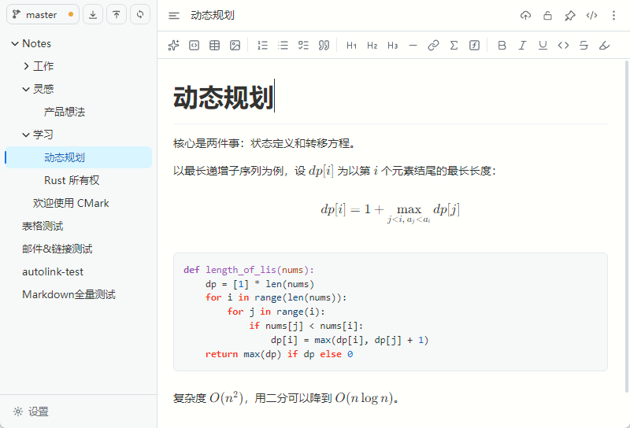
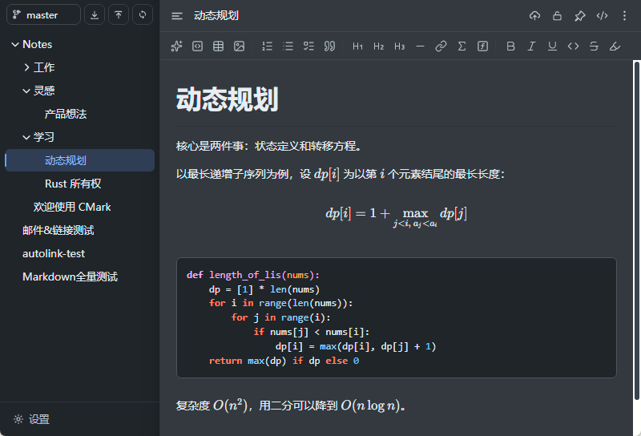
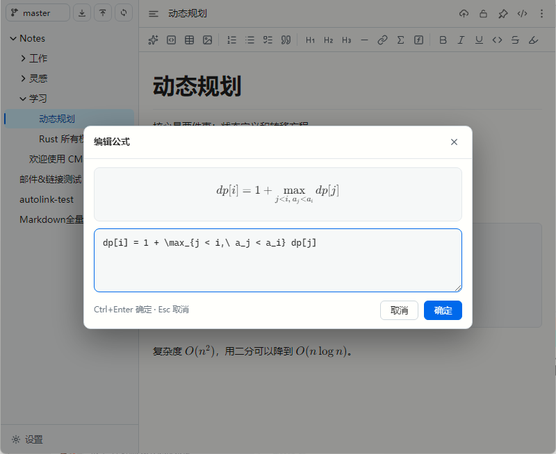
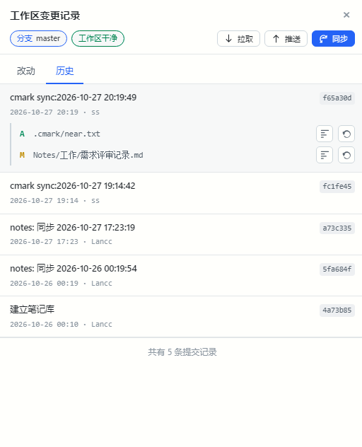
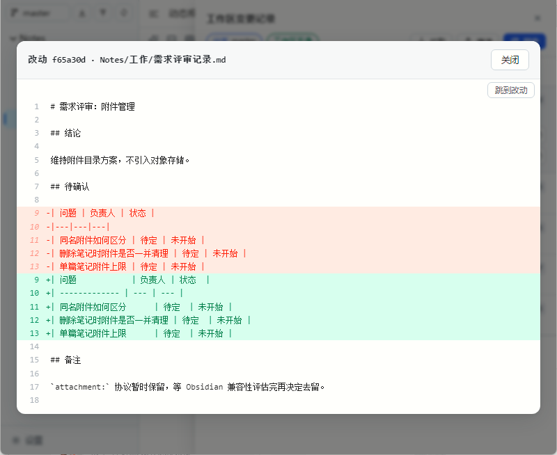
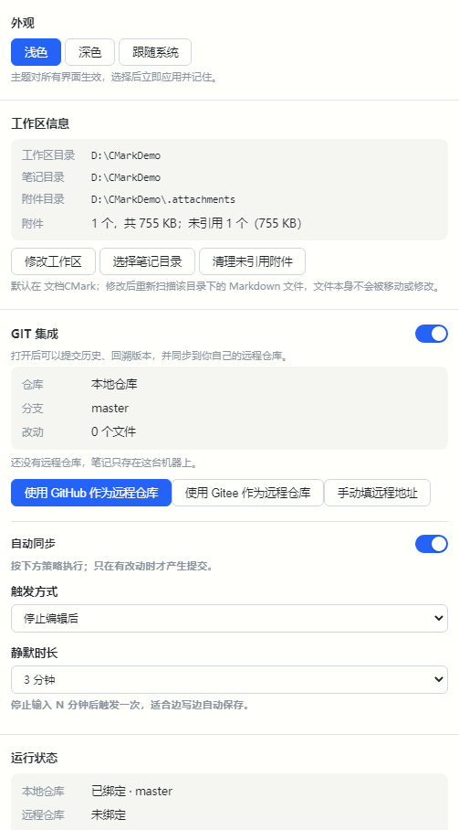

# CMark

Obsidian 的轻量替代。本地 Markdown 笔记，文件是你的，版本用 Git 管，随时能带走。

<p align="center">
  
</p>

## 为什么用它

**笔记就是文件。** 磁盘上的 `.md`，没有数据库、没有私有格式、没有云端账号。用任何编辑器都能打开，用 Git 就能同步、回溯、协作。哪天真不想用了，删掉软件，笔记一篇不少 —— 这一点从第一行代码起就没打算妥协。

**版本回溯不用装插件、不用记命令。** 写完一段发现改坏了，翻开提交历史，点开任意一次提交就是那篇笔记当时的完整内容，可以直接照着补回来。想知道具体改了什么，逐行 diff 摆在那儿；只想撤回一个文件的改动也行，不用连带其他。

**自动同步到你自己的仓库。** 定时提交并推送到 GitHub、Gitee 或自建服务器，配置一次之后就不必再管。连续失败会自动暂停并留下原因，不会在后台无声地失败；本地另留一份快照轮转，误删也有兜底。

## 界面

### 编辑区

<p align="center">
  
</p>

### 公式与代码

<p align="center">
  
</p>

### 版本与改动

<p align="center">
  
  
</p>

### 设置

<p align="center">
  
</p>

## 功能

### 编辑与导出

| 能力 | Obsidian | CMark |
|---|---|---|
| 所见即所得 | ✓ | ✓ 全程所见即所得 |
| 源码模式 | ✓ | ✓ 带行号 |
| 表格编辑 | 插件支持 | ✓ 可视化增删行列、调对齐 |
| 代码块 | ✓ | ✓ 高亮，27 种语言，可切换语言、可复制 |
| 数学公式 | ✓ | ✓ 行内与块级，KaTeX |
| 图表 | 插件支持 | ✓ 内置 mermaid、echarts，编辑区直接渲染 |
| 任务列表 | ✓ | ✓ |
| 高亮 / 上下标 | 插件支持 | ✓ |
| 图片粘贴 | ✓ | ✓ 自动入库、按内容去重 |
| 图片缩放 | 插件支持 | ✓ 拖动调整，尺寸写回 Markdown |
| 导出 PDF | ✓ | ✓ |
| 导出 HTML | 插件支持 | ✓ 单文件，图片内嵌 |
| 导出长图 | 插件支持 | ✓ |
| 导出 Markdown | ✓ | ✓ |

### 组织与检索

| 能力 | Obsidian | CMark |
|---|---|---|
| 文件树 | ✓ | ✓ 直接映射磁盘，支持拖拽、改名、新建 |
| 全文搜索 | ✓ | ✓ 标题与正文，命中高亮，上下键跳转 |
| 标签 `#tag` | ✓ | — |
| 双链 `[[笔记]]` | ✓ | — |
| 反向链接 | ✓ | — |
| 关系图谱 | ✓ | — |
| 大纲 / 目录 | ✓ | — |
| 书签 | ✓ | — |
| 模板 | ✓ | — |
| Canvas 白板 | ✓ | — |

### 版本与同步

| 能力 | Obsidian | CMark |
|---|---|---|
| Git 版本控制 | 插件支持 | ✓ 内置，侧边栏操作 |
| 历史版本查看 | 插件支持 | ✓ 点任意提交看该版全文 |
| 差异对比 diff | 插件支持 | ✓ 工作区改动与单次提交都可看 |
| 自动同步 | 插件支持 | ✓ 定时提交推送，失败自动暂停 |
| 回收站 | ✓ | — |

## 定位

CMark 不跟 Obsidian 抢生态。它只解决一件更窄的事：

手上已经有一堆 Markdown 文件，或者只想用 Git 把它们管起来，不想为此再搭一整套工作区、插件市场和同步服务。这类需求下，Obsidian 的那些长处 —— 双链图谱、标签体系、上千个插件 —— 用不上，但配置成本照样要付。

所以 CMark 把 Obsidian 里要靠插件才能做到的三件事做成了原生功能：表格可视化编辑、图表渲染、Git 版本控制与自动同步。上面标「—」的那些能力是有意不做的，换来的是不用建 Vault、不用挑插件、不用理解 Git 命令。

## 安装

| 渠道 | 适合 | 入口 |
|---|---|---|
| npm（推荐） | 想装最新版、不想等审核 | ZTools → 设置 → 已安装插件 → 从 npm 安装 |
| 插件市场 | 最省事 | ZTools 搜索框输入 `markdown` 或 `cmark` |
| 离线包 | 内网环境、锁定版本 | Releases 下载 `.zpx` / `.zip` → 导入本地插件 |
| uTools | 用的是 uTools | uTools 开发者中心 →「导入源码工程」选 `app/plugin.json` |

## 首次使用

1. 选笔记目录（可以就是你已有的 Markdown 目录）
2. 建仓库有两种方式：
   - **一键建仓**（设置 → Git 集成）：GitHub 点「授权建仓」，浏览器里输 8 位码即完成；Gitee 粘一个私人令牌。向导会自动建仓、绑定远程并推送首次提交
   - 手动：初始化本地仓库后填远程地址（GitHub / Gitee / 自建都行），或者只建本地仓库
3. 打开「定时提交并推送」，插件会按设定策略自动 commit + push

### 把常用笔记挂成 ZTools 指令

编辑器工具栏里点「设为全局搜索」后，这篇笔记会注册成 ZTools 的一个指令，指令名就是笔记标题。

- 在 ZTools 搜索框直接输入标题回车，一步打开那篇笔记（不会只停在面板上）
- 也可以在 ZTools 设置里给它配全局快捷键
- 再点一次按钮即取消，`.cmark/near.txt` 里记着哪些笔记挂过

## 笔记存在哪

笔记就是磁盘上的 `.md` 文件，没有私有格式。`.cmark/` 只存排序、只读标记、图片附件这类元数据，随仓库一起提交。

图片以内部协议存进 `.cmark/attachments/`，尺寸以 `` 写回 Markdown 本身 —— Obsidian / Typora / VS Code 打开同一份文件，看到的大小一致。

卸载插件不会删笔记（笔记在你自己选的目录里）。`~/.cmark-config.json` 记录着笔记目录路径，删掉它等于重新走首次引导。

## 开发与打包

```bash
npm install
npm run dev                # 本地调试（vite 热更新）
npm run build              # 前端构建，产物在 app/
node scripts/pack.mjs      # 把 plugin.json / preload 复制进 app/
node scripts/register.cjs  # 打成 asar 并注册到本机 ZTools（执行前先退出 ZTools）
```

打离线包（需要 `@electron/asar`，可用 `ASAR_CLI` 环境变量指定路径）：

```bash
node scripts/pack-zpx.mjs        # 产出 release/cmark-<版本>.zpx
node scripts/pack-zpx.mjs --zip  # 同时产出 .zip
```

给 uTools 打包：

```bash
npm run build
node scripts/pack.mjs       # 准备 app/（plugin.json 的 main 指向 index.html）
npm run pack:upx            # 产出 release/cmark-<版本>.upx
```

## 许可

[MIT](LICENSE)。第三方组件见 [THIRD-PARTY.md](THIRD-PARTY.md)。
