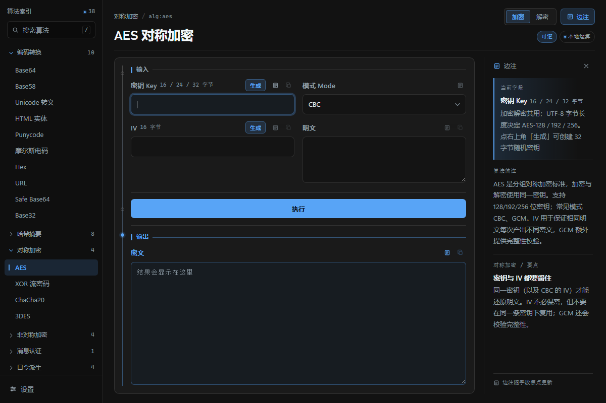
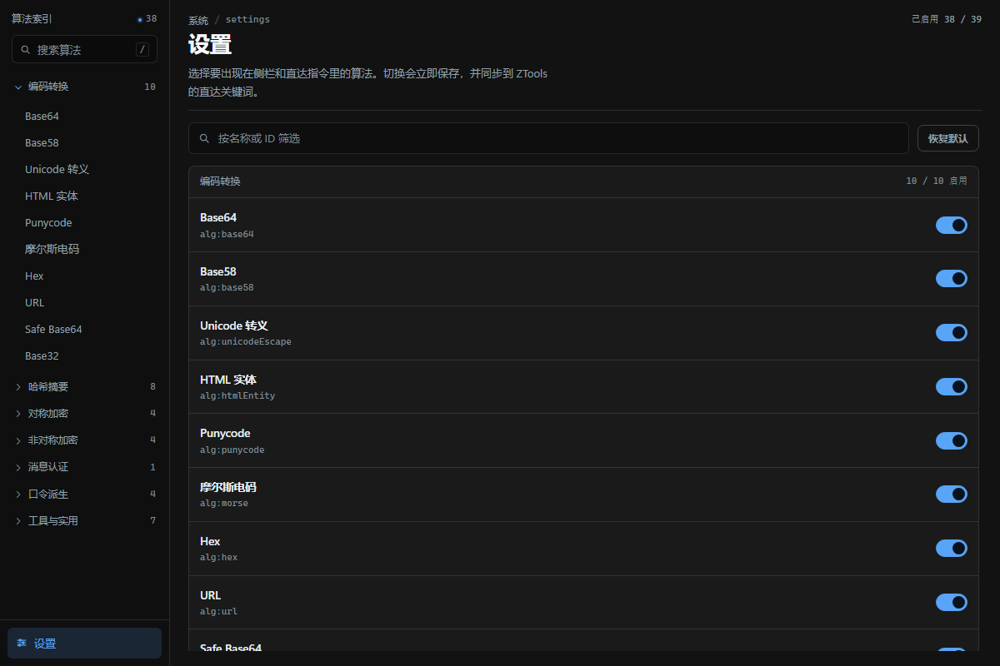

# crypt-tool

> 加解密工具，高颜值，可自定义，UI 和谐统一，带加密算法的简要指引

基于 **React 19 + Vite 6 + TypeScript** 构建的 ZTools 插件，提供 39 种常用编解码、哈希、加解密与口令派生算法。

# 为什么选择`crypt-tool`?

1. 现代化界面设计，和ZTools原生设计风格一致，原生软件般体验
2. 支持算法广泛，可自定义界面功能

## ✨ 功能概览

### 友好的交互设计`一目了然`



### 根据自己的需求定制内容



### 后续支持算法

[DEVELOP.md#后续算法计划](DEVELOP.md#后续算法计划)

## 📁 项目结构

```
.
├── public/
│   ├── logo.svg                  # 插件图标
│   ├── plugin.json               # 插件配置
│   └── preload/
│       ├── services.js           # 向渲染进程注入 crypt 服务
│       └── crypt/                # Node.js crypto 实现（编码、哈希、加解密、KDF）
├── src/
│   ├── main.tsx                  # 入口
│   ├── App.tsx                   # 加载设置、主题、聚焦搜索与 onPluginEnter
│   ├── hooks/
│   │   └── useZtoolsTheme.ts     # 宿主主题色/深浅色 -> CSS 变量
│   ├── shell/                    # 信号台外壳
│   │   ├── Shell.tsx
│   │   ├── Sidebar.tsx           # 分类索引 + 本地搜索
│   │   ├── AlgorithmHost.tsx     # 标题、方向切换、信号路径与边注容器
│   │   ├── NotesPanel.tsx        # 右侧边注（字段说明 / 算法简注 / 类别要点）
│   │   └── SettingsPage.tsx      # 算法启停设置
│   ├── registry/                 # 算法注册表与分类
│   │   ├── types.ts
│   │   ├── categories.ts         # 七大类别
│   │   └── algorithms.ts         # 39 个算法 + 筛选帮手
│   ├── config/                   # dbStorage 设置 + 动态直达指令同步
│   │   ├── settings.ts
│   │   └── features.ts
│   ├── shared/                   # 跨算法复用 UI
│   │   ├── Field.tsx             # 字段、复制反馈、字段边注上下文
│   │   ├── FieldNoteContext.ts
│   │   ├── Icon.tsx
│   │   └── crypt-shell.css       # 信号台视觉系统（深浅色 + 响应式）
│   ├── algorithms/               # 每种算法的 meta + ui + barrel
│   │   ├── codec.ts              # runCodec / showError / showData
│   │   └── <39 个算法目录>
│   └── types/crypt.ts            # CryptResult 类型
├── docs/
│   ├── images/                   # README 截图
│   └── superpowers/              # 架构设计与实现计划
└── package.json
```

## 🚀 快速开始

```bash
npm install
npm run dev      # 开发模式，ZTools 自动加载 localhost:5173
npm run build    # 构建到 dist/
npm test         # 运行 vitest 全套测试
```

命令行直达（开发模式下可在 ZTools 搜索框触发）：`base64`、`hex`、`url编码`、`md5`、`sha256`、`aes加密`、`rsa加密`、`hmac`、
`pbkdf2`。

## 🧩 如何新增一种算法

1. **Preload 实现**：在 `public/preload/crypt/` 新增 `<algo>.js`，用 `envelope.js` 的 `ok/fail/tryCrypt` 包裹并暴露
   `{ ok, data/error }` 结果；在 `index.js` 中挂载导出。
2. **类型**：在 `src/env.d.ts` 的 `Window['services']['crypt']` 中追加对应方法签名。
3. **算法模块**：在 `src/algorithms/<algo>/` 下创建 `meta.ts`、`ui.tsx`、`index.ts`，导出 `AlgorithmModule`。
4. **注册**：在 `src/registry/algorithms.ts` 的数组中加入新模块。
5. **同步**：`syncFeatures` 会自动将它注册为直达指令 `alg:<id>`。

详细设计见 `docs/superpowers/specs/2026-09-22-crypt-tool-design.md`。

## 📦 脚本

| 命令                                      | 作用                   |
|-----------------------------------------|----------------------|
| `npm run dev`                           | 启动 Vite 开发服务器        |
| `npm run build`                         | tsc 类型检查 + Vite 生产构建 |
| `npm test`                              | 运行 vitest 单元测试       |
| `npm run build` 成功后会输出到 `dist/`，可直接用于分发 |

## 📄 协议

MIT License
