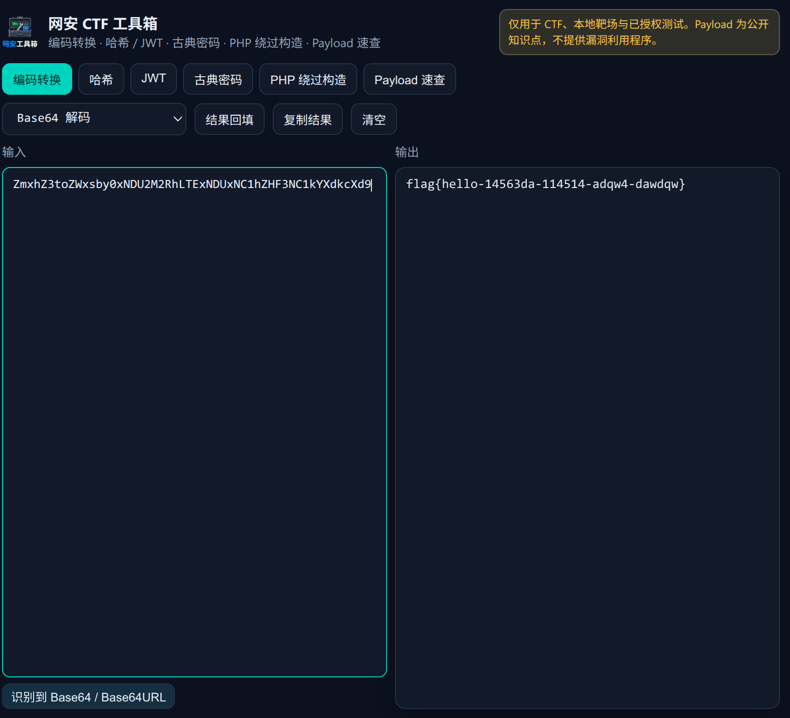
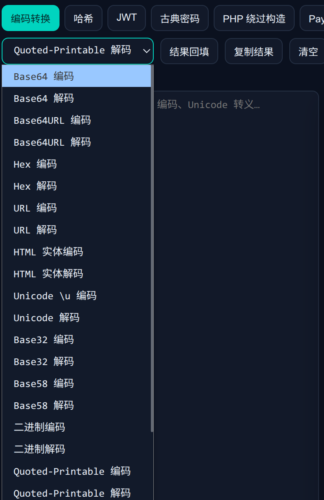
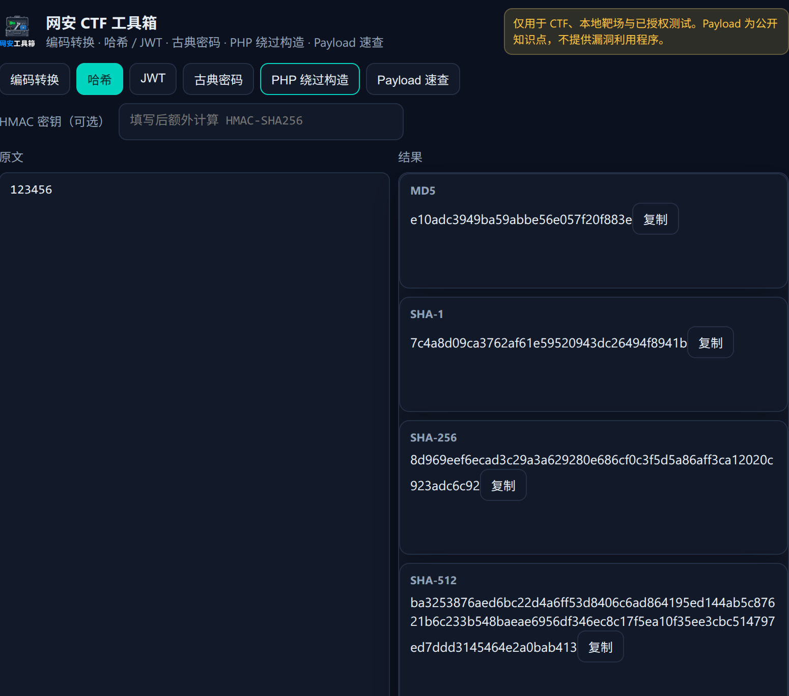
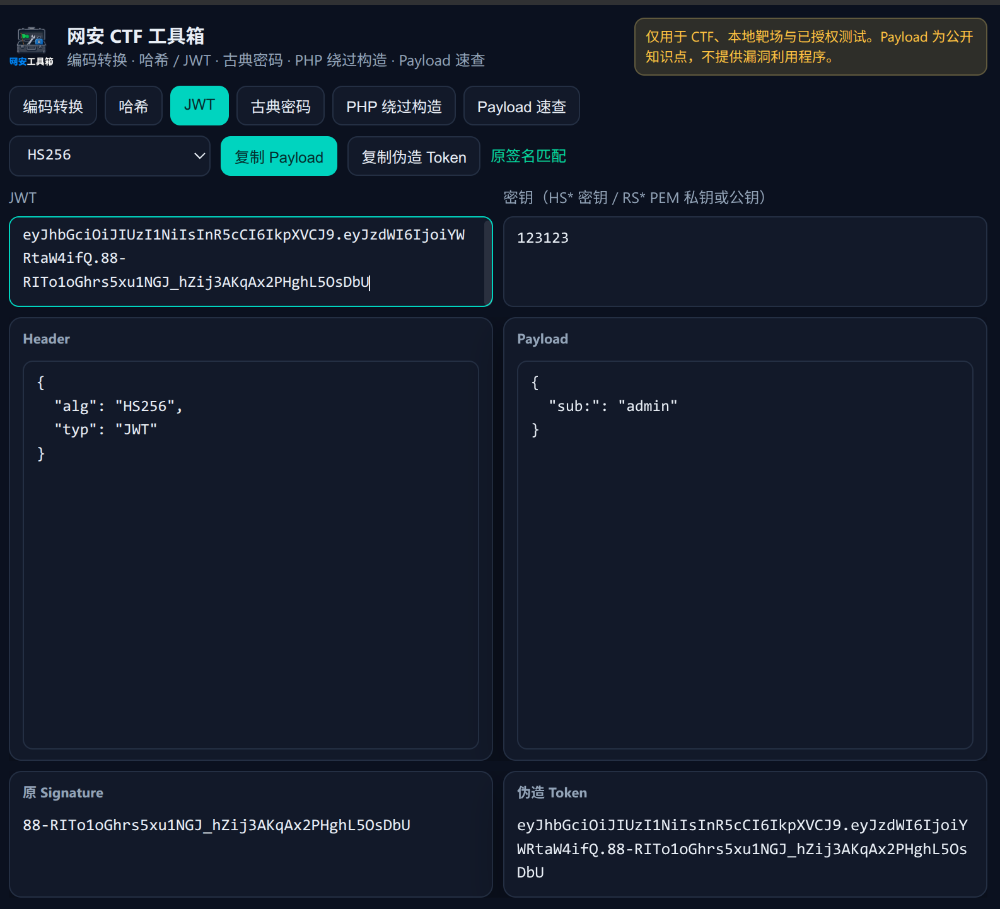
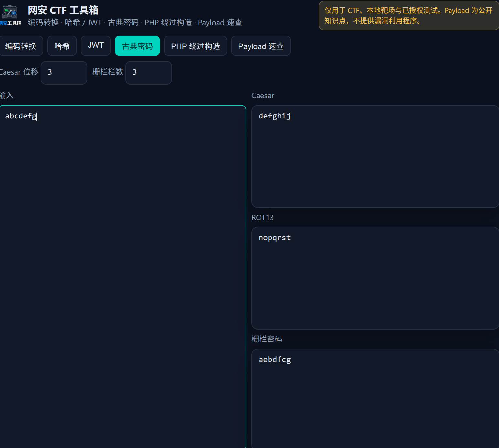
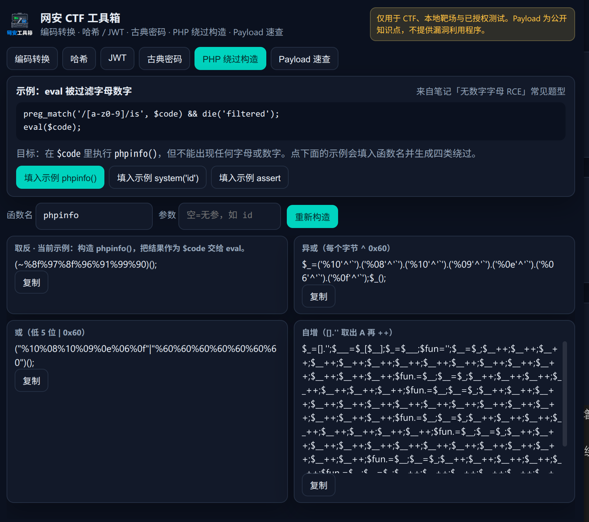
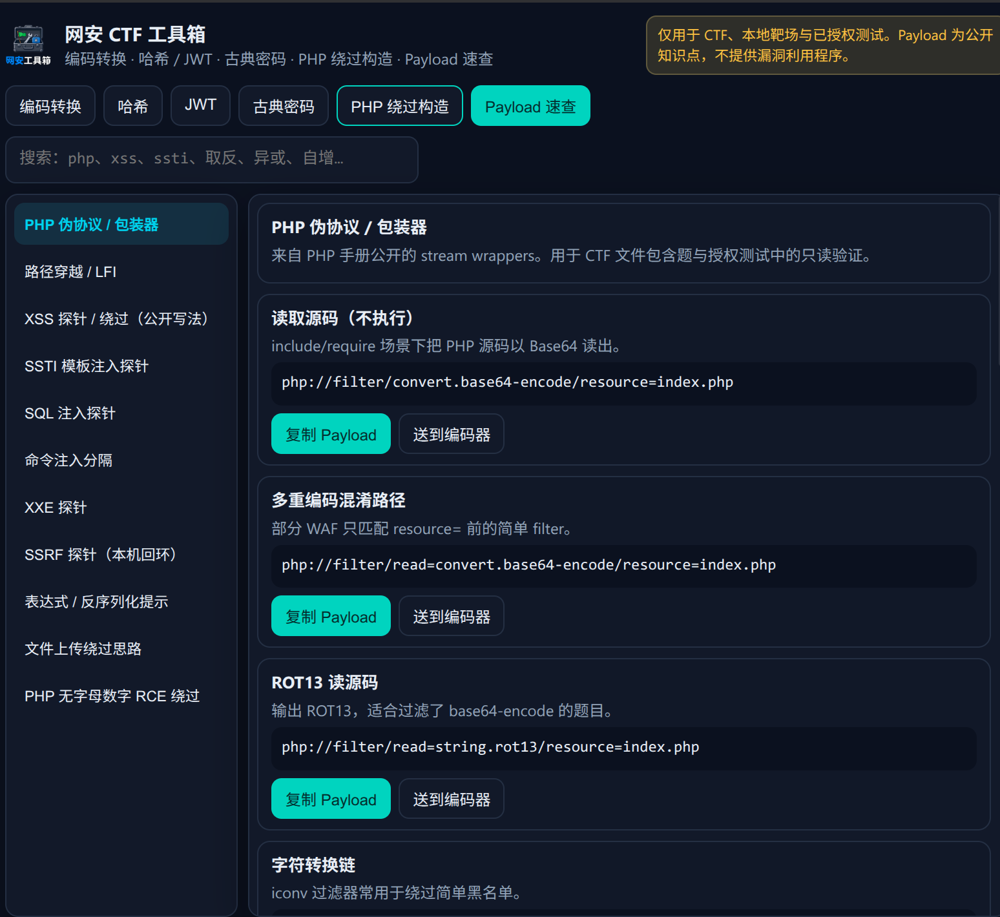
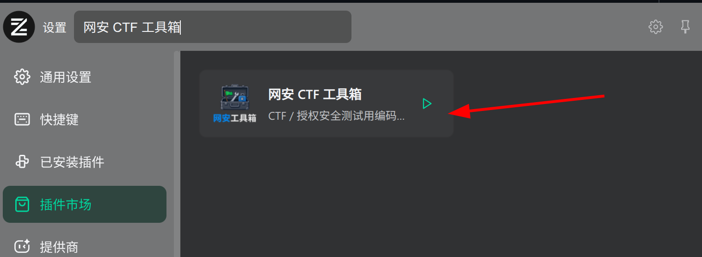
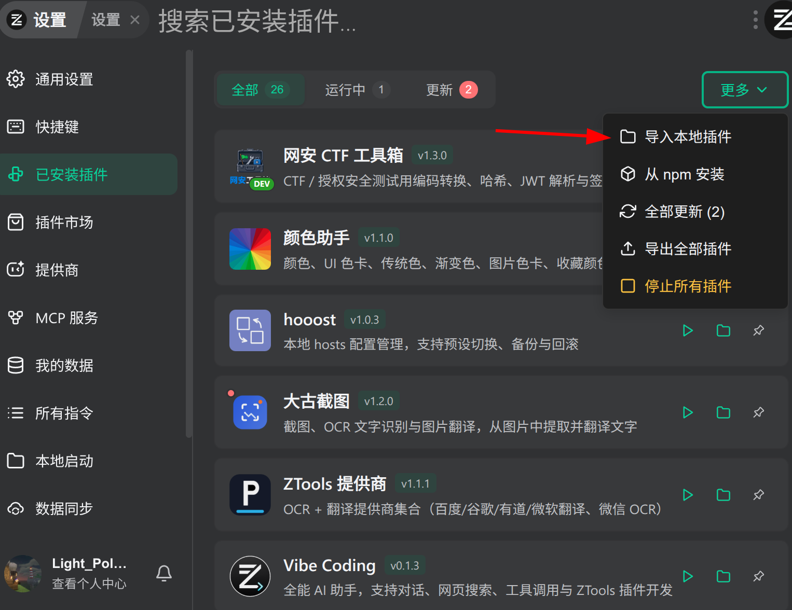
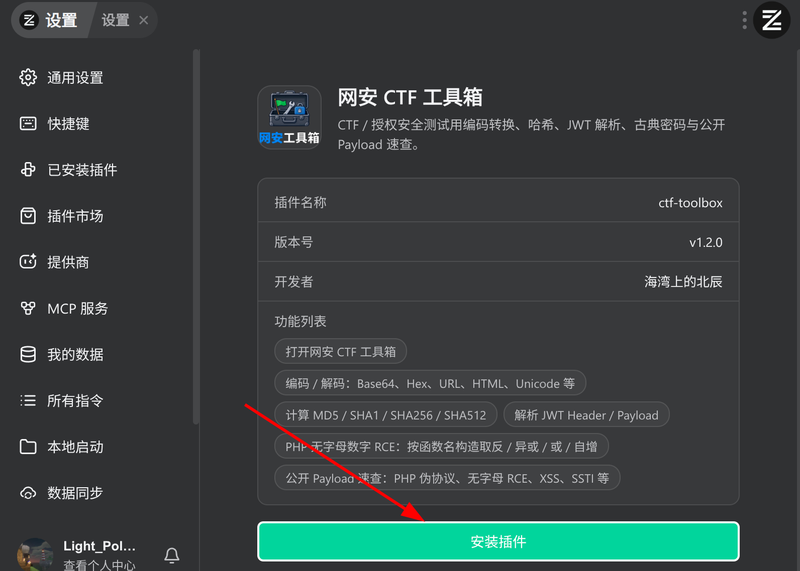

一款面向 <a href="https://github.com/ZToolsCenter/ZTools">ZTools</a> / <a href="https://www.u-tools.cn/index.html">uTools</a> 插件：编码转换、哈希、JWT 解析、古典密码，以及公开 Payload 速查。

<strong>仅用于 CTF、本地靶场和已获得书面授权的安全测试。</strong>

## 功能

- 编码 / 解码：Base64、Base64URL、Base32、Base58、Hex、URL、HTML 实体、Unicode、二进制、Quoted-Printable、ROT13、Caesar、Morse

- MD5 / SHA1 / SHA256 / SHA512，可选 HMAC-SHA256

- JWT Header / Payload 解析，none / HS256·384·512 / RS256·384·512 伪造签名（含弱密钥、算法混淆）

- 古典密码：Caesar、ROT13、栅栏

- PHP 绕过构造（独立栏目）：输入函数名，即时生成取反 / 异或 / 或 / 自增

- Payload 速查：PHP 伪协议、LFI、XSS、SSTI、SQLi、XXE、SSRF、上传绕过

## 开始

### 安装

#### 方法一：在插件市场安装

在 ZTools 或 uTools 插件市场搜索 **网安 CTF 工具箱**，下载即可。

#### 方法二：在 Releases 下载已经打包好的插件包安装

在 [Releases](https://github.com/LightPolarisCN/ctf-toolbox-web/releases) 下载插件包，下载好后点击导入本地插件。

选择下载的插件包，点击安装即可。

