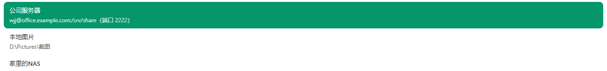
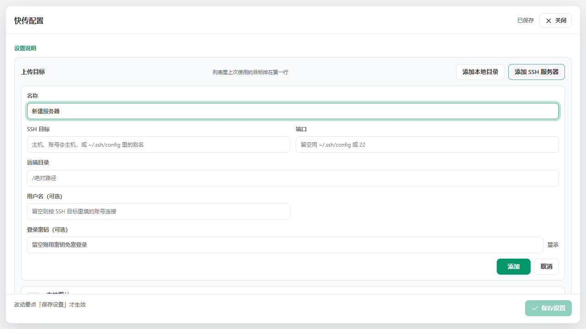
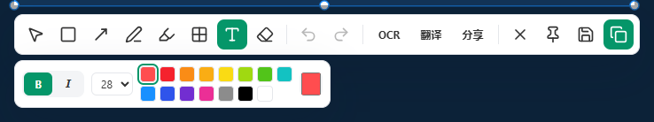

# 大古快传

一个运行在 ZTools 里的文件快传插件：**选目标 → 回车 → 地址进剪贴板**。把图片或文件传到本地目录、SSH 服务器，或者从 SSH 服务器把文件取回本机。

常见用法举几个例子：

- 截完图想直接放到服务器上 → 在大古截图的工具条点「分享」，列表里回车就上传，远端路径已经复制好。
- 想把一张图存进固定文件夹 → 把图片粘贴到 ZTools，选「分享图片」，选本地目录目标。
- 想把一个文件传到服务器 → 把文件粘贴到 ZTools，选「分享文件」；手头只有文件路径（比如从别处复制来的）→ 粘贴路径，选「分享本地文件」。
- 想把服务器上的文件拿到本机 → 在 ZTools 里输入或粘贴远端路径，选「下载远端文件」，选服务器回车；或者输入「下载文件」，选服务器后粘贴路径。
- **远程 vib coding，想让 AI agent 看你本地的图** → 本地图片直接塞给远程开发会话里的 agent 不方便，先「分享本地文件」传到你的 SSH 服务器，把复制到的目标路径发给 agent（例如 Claude Code），它就能从服务器上读到这张图；截图同理，在大古截图点「分享」后把路径贴给 agent 即可。

## 如何使用

| 指令 | 作用 |
|---|---|
| `分享图片` | 粘贴图片到 ZTools 后出现，上传这张图片 |
| `分享文件` | 粘贴文件到 ZTools 后出现，上传这个文件（一次一个） |
| `分享本地文件` | 在 ZTools 里输入或粘贴一个本地文件路径时出现，上传这个文件 |
| `下载远端文件` | 在 ZTools 里输入或粘贴一个以 `/` 开头的远端路径时出现，选服务器即可下载 |
| `下载文件` | 先选服务器，再输入远端路径 |
| `快传配置` | 管理上传目标与下载目录 |

输入或粘贴路径时，两条路径指令出现在 ZTools「最佳匹配」那一排：上传是向上箭头的图标，下载是向下箭头的图标。ZTools 内置的「前往文件夹」也会同时出现，而默认选中的是使用次数多的那个——直接回车打开的可能是文件夹，按 `→` 或点一下图标选中快传的指令再回车。

上传时是一个下拉列表：上面是 ZTools 的搜索框，可以输入名称过滤；下面是各个目标，**上次使用的排在第一位并默认选中**。

- 回车或点击：上传到该目标。成功后弹出通知，目标路径已复制到剪贴板，窗口自动收起。
- 上传失败：窗口保留并显示原因，回车重试，或者回车前先选「打开配置」。

下载有两种走法：

- 手头有远端路径：直接在 ZTools 的搜索框里输入或粘贴它，选「下载远端文件」。列表上方显示要下载的路径，选服务器回车就开始。
- 从「下载文件」进：先在列表里选服务器（回车），然后在顶部搜索框里粘贴或输入远端文件的绝对路径，回车下载。输入过程中下面一行会显示将保存到本机哪里。

在搜索框里粘贴后，ZTools 会把粘贴的内容显示成输入框旁边的一个标签而不是填进输入框，这是 ZTools 的行为；直接按回车即可，快传会取剪贴板里的路径。

下载到本机的下载目录，成功后本机路径已复制，列表里回车可以打开所在文件夹。

## 界面

分享列表：上次使用的目标排在第一行并默认选中，回车即上传。



配置页：管理本地目录与 SSH 服务器目标（主机、端口、远端目录、可选的用户名与登录密码）和下载目录。



界面与大古截图是同一套卡片样式，并且和它一样跟随 ZTools 的深浅色与主题色。

## 配置

在「快传配置」里管理两类上传目标：

- **本地目录**：上传就是复制到这个目录。
- **SSH 服务器**：填 `user@host` 或 `~/.ssh/config` 里的别名、远端目录（绝对路径），端口可留空；需要密码登录的服务器再填「登录密码」，留空就是免密登录。

配置页上的改动（增删改目标、改下载目录、改密码、开关同步）都要点底部的**「保存设置」**才生效；有未保存的改动时标题栏会提示，不保存就关闭的话改动会丢弃。目标的名字不能重复；列表的顺序就是配置里的顺序，可以用上下箭头调整。下载目录留空时使用系统默认的下载目录。

上传和下载都会自动生成不重复的文件名（`原名-日期-时间-随机后缀`），不会覆盖已有文件。远端目录需要事先存在，插件不会去创建。

界面与大古截图是同一套卡片样式，并且和它一样跟随 ZTools 的深浅色与主题色。

## 配合「大古截图」使用

大古快传与截图插件**大古截图**是天然搭档：在大古截图的标注工具条上点「分享」，当前截图直接进入本插件的上传列表，回车选目标就传完，目标路径自动复制到剪贴板——不用先存文件、再找到文件去传。



大古截图把截图、标注、OCR 文字识别与翻译做成一条路：按下「截图」，全屏冻结直接框选，画形状、打马赛克、加文字，然后复制、固定到屏幕，或交给 OCR / 翻译。还没有安装？在 ZTools 插件中心搜索「大古截图」即可。没装大古快传也不影响截图：点「分享」会留在截图界面并提示，截图不会丢。

## 关于 SSH 认证

传输使用系统自带的 OpenSSH `scp`，需要 9.0 及以上版本的 OpenSSH（Windows 11 自带，Windows 10 需要手动升级）。

- **没填密码**：免密登录，走 `~/.ssh/config`、SSH Agent 或已加载到 Agent 的私钥。
- **填了密码**：上传和下载都按密码登录（目前只支持 Windows）。密码交给系统自带的 scp 去用，不写进命令行，也不落盘；密码错误只尝试一次，免得被服务器封禁。

登录密码的保存方式与大古截图的密钥一致：默认**只保存在本机**；打开配置页里的「同步密钥」后，才会额外写一份随 ZTools 备份同步的副本（该存储未声明端到端加密，请只在你信任的同步环境里开启）；关闭开关会删除这份副本，本机密码保留。插件不管理 SSH 私钥文件。

## 为开发者准备的信息

```bash
npm install
npm run dev:transfer      # 开发服务器，ZTools 开发者工具里添加本目录的 plugin.json
npm run build:transfer    # 构建到 dist/
```

preload 文件是 `preload.cjs`，不要改成 `preload.js`：项目根目录的 `package.json` 是 ES 模块类型，`.js` 会被 Electron 当成 ES 模块，开发模式下页面就拿不到 Node 侧能力。

开发模式下，页面代码是实时加载的，但 ZTools 登记的指令清单（`plugin.json` 里的 `features`）是点「安装（开发模式）」那一刻的快照。改了清单，要在开发者工具里先点「卸载（开发模式）」、再点「安装（开发模式）」：那里没有重载按钮，重启 ZTools 也不会更新清单。

图标 `icon.png`（上传）和 `download.png`（下载）由 `npm --prefix transfer run logo` 生成，用系统已安装的 Chrome 栅格化。

更完整的需求与测试说明见仓库根目录的 `docs/requirements-transfer.md`。

## 许可

MIT
