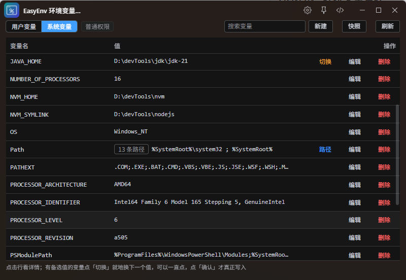

# EasyEnv · 环境变量管理

> Windows 环境变量的可视化管理器：告别「设置 → 系统 → 高级 → 环境变量」那个又深又小的对话框。

系统自带的编辑器把 PATH 显示成一长串分号，改错一个字符就可能让 `java`、`node`、`git` 全部失效；没有 diff、没有备份、没有回滚；换个 JDK 版本要手动改半天。EasyEnv 把这些都做成了可视化操作。



- 变量逐条看，长值点一下就复制
- PATH 拆成一条条改，无效路径当场标红
- 同一个变量存多个候选值，点一下就切换
- 写系统变量只弹一次 UAC
- 每次修改前自动快照，改错一键回滚

## 功能

### 双作用域

| 作用域 | 位置 | 写权限 |
|---|---|---|
| 用户变量 | `HKCU\Environment` | 不需要管理员，直接写 |
| 系统变量 | `HKLM\...\Session Manager\Environment` | 读取免权限，写入弹一次 UAC（ZTools 本身是管理员则零弹窗） |

### 列表与详情

- 列表只有「变量名 / 值 / 操作」三列，点击任意一行打开详情
- 详情里能看到：完整值（点击即复制）、类型说明（悬浮显示）、`%引用%` 展开后的实际生效值、待确认的新值
- PATH 这类多路径变量在详情里用表格逐条展示，标出每条路径「存在 / 缺失」，缺失的整行标红
- 值本身是路径时，详情页底部可以直接「打开目录」；PATH 的每一条也能单独打开

### PATH 专项编辑器

- 按分号拆成一条条，支持拖动排序、上移/置顶、删除
- 一键去重（大小写、末尾斜杠不敏感），重复路径会被识别出来
- 每条实时校验：把 `%JAVA_HOME%` 这类引用展开后检查目录是否存在，不存在标红
- 可以直接「选文件夹」追加一条，不用手打路径
- 保存前预览最终的分号串；可显式选择存成 `REG_EXPAND_SZ`（值里的 `%变量%` 会被展开）

### 备选值 + 快速切换

最典型的用法是 JDK 版本切换：

1. 打开 `JAVA_HOME` 详情 → 底部「备选值」→ 添加另一个版本路径（也可以选文件夹）
2. 列表里这一行出现「切换」按钮，**点一次值就地换成下一个候选**，可以连续点着比较
3. 看中了点同一行的「确认」才真正写入；不点确认不写注册表，「撤销」直接回到原值

三个概念要分清：

| 概念 | 说明 |
|---|---|
| 原值 | 注册表里**当前生效**的值，不占备选列表的位置，但永远参与轮换 |
| 备选值 | 你显式保存的候选；确认写入后，被替换掉的旧值会自动补进来，切几次都不会丢 |
| 切换候选 | `去重(原值 + 备选值)`，只有 ≥ 2 个时候才显示「切换」 |

### 变更确认与提权

所有改动先进「待确认」队列，列表上会标出待确认的新值。点底部「查看变更并应用」先看 Diff（新增 / 修改 / 删除分类），确认后一次性写入：

- 用户变量直接写
- 系统变量合并成一次写入，**只弹一次 UAC**
- 每一行也可以单独点「确认」，只保存这一行

### 快照与回滚

| 类型 | 何时产生 | 存了什么 | 回滚效果 |
|---|---|---|---|
| 单项快照 | 应用修改、切换备选值之前自动生成 | 只存被改动的那几项（改前 / 改后） | 只把这几个变量改回去，其它变量不动 |
| 整份快照 | 手动点「立即快照」 | 全部用户 + 系统变量 | 整体恢复到那一刻 |

单项快照体积很小（实测 1 项 ≈ 200 字节，整份 ≈ 4KB），所以自动快照可以放心攒着。回滚前系统还会自动存一份反向快照，回滚本身也可回滚。快照可以查看内容、搜索、导出 / 导入 JSON。

## 使用

- 触发指令：`环境变量` / `env` / `easyenv`
- 顶部切换「用户变量 / 系统变量」，搜索框按变量名或值过滤
- 右上角「新建 / 快照 / 刷新」

两个常见场景：

**换 JDK**：详情里给 `JAVA_HOME` 加好 jdk8 / jdk17 / jdk21 三个候选 → 列表点「切换」→ 点「确认」→ 重开终端 `java --version` 验证。

**修 PATH**：点 PATH 行的「路径」→ 找到标红的失效条目删掉 → 需要新目录就「选择文件夹」→ 保存 → 底部应用。

> 生效规则：写入后会广播 `WM_SETTINGCHANGE`，资源管理器和新开的终端立刻能读到；**已经打开的终端 / IDE 读到的还是启动时的环境，必须重开**。

## 安装与开发

```bash
npm install     # 安装依赖
npm run dev     # 开发模式（vite → http://localhost:5173）
npm run build   # 构建，产物输出到 src-ztools/dist
```

`src-ztools/` 是完整的插件目录：`plugin.json` + `preload/services.js` + `dist/`。

## 数据与隐私

- 备选值、快照都存在 ZTools 本地 `dbStorage`（键名 `easyenv_presets` / `easyenv_snapshots`），不联网、不上传
- 写系统变量时会在 `C:\ProgramData\easyenv` 放临时操作清单与结果文件，用完即删（提权子进程与插件进程的共享回读目录）

## 技术栈

- Vue 3 + TypeScript + Vite，Element Plus（按需引入，暗色跟随系统）
- preload 层用 Node.js `child_process` 调 PowerShell（`-EncodedCommand`，免引号转义）直接操作注册表
- 写入时保留值类型：`REG_EXPAND_SZ` 的 `%变量%` 引用用 `DoNotExpandEnvironmentNames` 读原值、带 kind 写回，绝不会被展开成死值

## 已知限制

- 仅支持 Windows（macOS / Linux 的环境变量走 shell 配置文件，逻辑完全不同）
- 已打开的终端需要重开才能读到新值
- 不提供 `REG_BINARY` 的编辑

## 许可证

MIT License
