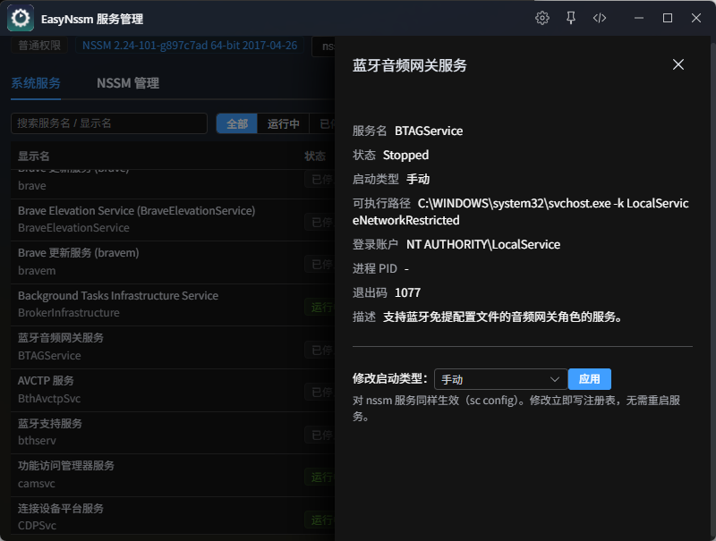
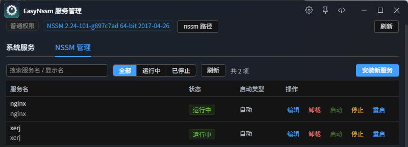

# EasyNssm 服务管理

> nssm 的友好图形界面 + Windows 系统服务管理



## 为什么需要它

- **nssm 难用**：命令行参数难记（`nssm set xxx AppStdout ...`），自带 GUI 还是上世纪的 Win32 对话框
- **services.msc 难搜**：列表巨大、改个启动类型要点多层属性框
- **EasyNssm**：把 nssm 变成表单，把服务管理变成一搜一点

## 功能

### 系统服务

- 全量服务列表（中文名称/状态/启动类型），支持搜索与状态筛选，行内**启动 / 停止 / 重启**
- 点击行打开详情抽屉：可执行路径、登录账户、PID、退出码、描述一目了然
- 修改启动类型：自动 / 自动(延迟) / 手动 / 禁用，系统服务与 nssm 服务通用
- 启停后自动追踪「启动中 / 停止中」等中间状态，直到落定才定格，无需手动刷新
- nssm 托管的服务自动打上标签，一键跳转编辑

### NSSM 管理



- nssm 路径自动探测（where / 已注册 nssm 服务的路径反查 / 常见安装位置），也可手动填写或浏览选择
- 表单式安装新服务，分「基础 / 日志 / 高级」三个页签，路径类字段均支持浏览选择
- 编辑已有服务：配置直接读注册表回填表单，保存后提示重启生效并可一键重启
- 高级参数全部带中文注释：日志重定向与轮转、退出动作、重启延迟、崩溃节流、进程优先级、停止方式、环境变量
- 行点击查看详情，直接查看 stdout / stderr 日志尾部（最后 200 行，自动 GBK 兜底）
- 卸载服务需输入服务名二次确认

## 使用须知

- 触发指令：`nssm` / `服务` / `svc`
- 插件**不内置 nssm 二进制**（避免杀软误报），首次使用请从 [nssm.cc](https://nssm.cc/download) 下载，在顶部「nssm 路径」中配置（保存前会自动验证）
- **推荐以管理员身份运行 ZTools**：所有写操作零弹窗；普通权限下写操作会走系统提权（若你的 UAC 设为「从不通知」则同样静默完成）
- 只读操作（服务列表、nssm 配置读取、日志查看）不需要任何权限
- `nssm set` 本质写注册表，运行中的服务需重启后新参数才生效
- 仅支持 Windows

## 开发

```bash
npm install
npm run dev    # 开发（plugin.json development.main 已指向 localhost:5173）
npm run build  # 构建到 src-ztools/dist
```

## 数据存储

- nssm 路径配置保存在插件本地存储（dbStorage），无联网行为

## 技术栈

Vue 3 + TypeScript + Vite + Element Plus（按需引入，暗色适配）；preload 通过 PowerShell（CIM 查询）与 sc.exe / nssm.exe 完成系统交互，提权走 PowerShell `Start-Process -Verb RunAs` + 临时文件回读。

## 许可证

MIT
