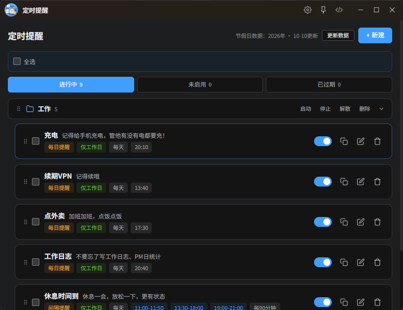

# 定时提醒

> ZTools 插件 - 灵活可靠的定时提醒工具



## 更新日志

### v1.4.0 (2026-10-29)

**新增**
- 提醒支持分组：表单里选组或直接输入新组名，顶层列表只显示分组入口和未分组任务，点击分组原地展开组内任务
- 组头支持启动 / 停止 / 解散 / 删除：启动和停止批量作用于组内任务，解散只移除组、删除会连同组内任务一起删除
- 列表支持多选批量操作：多选工具栏常驻在状态 Tab 上方，含全选；选中后才出现移入/移出分组、启用、停用、删除
- 分组与任务支持拖拽排序：任务可拖到其他分组改归属，分组也可拖动调整顺序
- 提醒支持一键复制，副本的配置、启用状态和所属分组与原任务一致

### v1.3.2 (2026-10-19)

**修复**
- 修复同一计划时刻触发两次、重复弹提醒的问题（时钟被回拨时定时器提前唤醒，先触发一次、重排后又对同一个计划时刻触发一次）：触发前先校验是否真的到点，早于计划时刻超过 1s 就重新等待；并按 `lastFiredSlot` 对同一计划时刻去重，跨时钟跳变或多份调度器都只提醒一次
- 修复编辑一次性提醒时初始日期会错一天（原先用 `toISOString()` 按 UTC 换算，本地 00:00–07:59 的提醒显示成前一天）
- 系统日志时间戳改为 `2026-10-19 16:30:00.020`（原来只有时分秒），跨天排查不再分不清日期

**优化**
- 清理死代码：preload 里未使用的 `readFile`/`writeTextFile`/`writeImageFile`/`notify`/`sendNotification` 及 `fs`/`path` 依赖、`useReminders` 未使用的导出、三个表单组件里没有监听方的 `defineEmits`、提醒页未被使用的 `enterAction` 属性、`OnceForm.getData()` 多余字段

### v1.3.1 (2026-10-16)

**修复**
- 修复「电脑重启、ZTools 自启后提醒任务不启动」：调度改为显式 `init()` + 快速重试 + 30s 看门狗兜底，插件视图一创建就把任务调度起来；此前只在 preload 加载那一刻排一次程，读到空数据/宿主未就绪就永久停摆
- 触发时存储写入或通知抛错不再打断调度链（记 `[异常]` 日志并退避重试）
- 睡眠/休眠唤醒、系统时间跳变后错过的触发由看门狗补偿：5 分钟内补发，超过则跳到下一次
- 一次性提醒在状态写库失败时不再重复通知

**新增**
- 系统日志新增 `[启动]` 记录（就绪时刻、提醒条数、下次触发时间、宿主是否已注入）
- 首页底部显示调度状态：`调度中 · 下次 今天 11:00`，悬浮可见自启设置路径
- `plugin.json` 声明 `pluginSetting.backgroundRunning: true`，后台隐藏视图不再被节流

**优化**
- 节假日数据后台每小时自检一次，长期驻留也能跨年自动补数据
- 进入插件时立即重排一次调度

### v1.3.0 (2026-10-15)

**新增**
- 首页分 Tab 展示提醒：「进行中 / 未启用 / 已过期」三类分开显示，Tab 上带数量
- 新建/编辑每日提醒、间隔提醒时，「提醒星期」支持一键全选/取消全选
- 列表项描述移到标题同一行显示，列表更紧凑
- 间隔提醒多时间段标签去冗余：覆盖全部已选星期的时间段不再重复罗列星期
- 节假日数据状态行移到顶部标题行，列表区域更清爽

**优化**
- 新建提醒时默认全选星期
- 系统日志精简重构：去掉每次调度重算产生的「[调度] 定时器」刷屏，只在任务新建/修改/启停/删除时记录一条状态（含下次触发时间），任务触发时记录一条执行记录；同时修复渲染层与调度器重复记录同一事件的日志翻倍问题

### v1.2.0 (2026-09-21)

**新增**
- 间隔提醒支持「触发对齐」：按开始时间对齐（9:00–18:00 每小时 → 9:00、10:00…准点触发，新建时默认）或按创建时间起算；历史数据行为不变
- 列表中「随创建时间」的间隔提醒显示标签
- 间隔提醒「统一时间」开关真实生效：开启时所有选中星期共用同一组时间段，关闭后可分别为每个星期设置不同的时间段
- 提醒时间段标签、「统一时间」开关增加鼠标悬浮说明；三种提醒类型选择框下方新增说明文字

**优化**
- 「调试日志」更名为「系统日志」
- 定时提醒的默认提醒日期由第二天改为今天

### v1.1.0 (2026-09-21)

**新增**
- 提醒支持按「法定工作日 / 法定节假日」过滤触发（每日提醒、间隔提醒可用，一次性提醒不适用）
- 节假日数据自动从 timor.tech API 获取并缓存，含调休补班日，次年安排公布后自动更新，无需手动维护
- 首页展示节假日数据覆盖状态，支持手动「更新数据」

### v1.0.1 (2026-08-27)

**修复**
- 修复安装编译包后打开白屏问题

### v1.0.0 (2026-08-27)

**新增**
- 三种提醒模式：间隔提醒、每日定点提醒、一次性定时提醒
- 调度器运行在 preload 层，插件后台也能稳定触发通知
- 支持自定义提醒标题和内容
- 间隔提醒支持多时间段、自定义间隔
- 每日提醒支持选择星期几和具体时间
- 一次性提醒支持选择日期和时间，触发后自动禁用
- 提醒列表支持启用/禁用开关
- 调试日志面板（默认关闭），方便排查问题

**优化**
- 动态调度算法，精确计算下次触发时间，偏差 < 20ms
- 系统通知标题显示任务名，内容显示描述
- 数据持久化存储，随账号同步

---

## 功能

### 三种提醒模式

| 模式 | 说明 | 适用场景 |
|------|------|---------|
| **间隔提醒** | 在指定时间段内，每隔 X 分钟提醒一次 | 久坐提醒、喝水提醒、眼保健操 |
| **每日提醒** | 每天固定时间提醒（可指定星期几） | 起床、吃药、会议提醒 |
| **一次性提醒** | 在指定日期时间触发一次，触发后自动禁用 | 倒计时、临时事项提醒 |

### 后台运行

调度器运行在 ZTools preload 层，插件窗口关闭或隐藏到后台时，定时器依然正常运行，到点自动弹出系统通知。

**开机自启后仍要提醒（重要）**：ZTools 只在「创建插件视图」时才执行 preload.js —— 即用户打开插件，或勾选了「跟随主程序同时启动运行」。所以电脑重启、ZTools 随系统自启之后，本插件也需要自启，否则提醒任务不会开始调度：

1. 在 ZTools 搜索框输入 `提醒` 打开本插件
2. 点右上角设置按钮 → **插件设置** → 勾选 **跟随主程序同时启动运行**

勾选后 ZTools 启动时会在后台预加载本插件（`plugin.json` 已声明 `backgroundRunning`，后台视图不会被节流），提醒任务随之启动。首页底部的「调度中 · 下次 …」可确认调度器已就绪，「系统日志」里也会有一条 `[启动]` 记录。

### 法定工作日 / 节假日触发

新建或编辑提醒时可选择「触发日」：**不限 / 仅工作日 / 仅节假日**。判断依据国家法定节假日安排（含调休补班），数据来自 [timor.tech](https://timor.tech) 节假日 API：

- 进入插件时检查本地缓存，缺哪年就自动拉取一次（当年全年数据；12 月起顺带补次年），已有数据则不发起请求
- 断网时使用本地缓存判断；缓存也未获取到时退化为按自然周（周一至周五为工作日）近似

### 触发对齐（间隔提醒）

间隔提醒可选择触发点的计算方式：

| 对齐方式 | 行为 | 示例（09:00–18:00，每小时） |
|---------|------|--------------------------|
| **按开始时间对齐** | 触发点 = 开始时间 + N × 间隔，与创建时刻无关，错过自动回到下一格 | 10:30 创建 → 11:00、12:00…准点触发 |
| **按创建时间起算** | 从创建时刻起每隔一个间隔触发 | 10:30 创建 → 11:30、12:30… |

### 通知格式

- 标题：提醒任务名称
- 内容：提醒描述文字

### 分组管理

新建或编辑提醒时可在「分组」下拉里选择分组，也可以直接输入新组名创建分组。一个提醒最多归属一个分组，未选择即为未分组。

列表默认只显示分组入口（组名 + 当前分类下的任务数）和未分组任务，点击分组向下展开组内任务，再次点击收起。组头提供四个操作：

| 操作 | 行为 |
|------|------|
| **启动** | 批量启用组内全部任务 |
| **停止** | 批量停用组内全部任务 |
| **解散** | 只移除分组，组内任务保留并转为未分组 |
| **删除** | 连同组内全部任务一起删除（确认框会提示任务数） |

### 多选批量操作

多选工具栏固定显示在状态 Tab 上方，不会随勾选出现/消失：

| 操作 | 行为 |
|------|------|
| **全选** | 选中/取消当前可见的任务（未分组任务 + 已展开分组内的任务） |
| **移入分组** | 选择已有分组，或直接输入新组名 |
| **移出分组** | 将所选任务转为未分组（仅有已分组任务时显示） |
| **启用 / 停用** | 批量切换启用状态 |
| **删除** | 批量删除所选任务，弹窗确认 |

未选中任务时工具栏只显示「全选」；选中后才出现上述操作按钮。切换状态分类、收起分组（该组内已勾选的任务会从选择中移除）、完成一次批量操作后，选中状态会相应清理。

### 拖拽排序

- **分组排序**：拖动组名左侧的六点手柄，放到另一分组的上/下半区即可调整分组顺序。
- **任务排序**：拖动任务左侧的六点手柄，可在同一列表内上下调整顺序。
- **改分组**：把任务拖到其他分组行上，会移入该组并自动展开；拖到其他分组的任务上，会按落点位置插入；拖到未分组任务上则移出分组。

### 复制提醒

列表项右侧的复制按钮可一键复制任务。副本的配置、启用状态和所属分组与原任务一致，标题追加「（副本）」，触发记录重置，相当于一条全新的任务。

---

## 使用方式

### 触发

在 ZTools 搜索框输入以下指令之一：

- `提醒`
- `定时提醒`

### 新建提醒

1. 点击 **+ 新建** 按钮
2. 选择提醒类型（间隔 / 每日 / 一次性）
3. 填写提醒标题和内容
4. 按需选择分组（可选已有分组，或直接输入新组名）
5. 配置具体时间参数
6. 按需选择触发日（不限 / 仅工作日 / 仅节假日）
7. 点击 **保存**

### 管理提醒

- **开关**：列表右侧开关可随时启用/禁用提醒
- **复制**：点击复制图标得到配置、状态、分组一致的新任务
- **编辑**：点击编辑图标修改提醒参数，包括调整所属分组
- **删除**：点击删除图标移除提醒
- **分组**：点击分组行展开/收起组内任务；组头可批量启动/停止、解散或删除整个分组
- **多选**：Tab 上方的工具栏常驻显示，支持全选；选中后批量移入/移出分组、启停、删除
- **拖拽**：拖动六点手柄可调整分组或任务顺序，任务拖到其他分组即改变归属

---

## 开发

### 技术栈

- Vue 3 + TypeScript
- Element Plus UI
- Vite 构建
- ZTools API

### 本地开发

```bash
# 安装依赖
npm install

# 启动开发模式
npm run dev

# 构建生产版本
npm run build
```

构建产物在 `dist/` 目录，复制到 ZTools 插件目录即可使用。

---

## 常见问题

### 后台不提醒？

确认 ZTools 系统通知权限已开启。调度器运行在 preload 层，窗口隐藏后仍会触发。

### 重启电脑后不提醒？

需要勾选「跟随主程序同时启动运行」（见上文[后台运行](#后台运行)）。ZTools 只在创建插件视图时执行 preload.js；未勾选自启时，重启后必须手动打开一次插件，调度器才会开始工作。打开插件后可在底部看到「调度中 · 下次 …」，或在「系统日志」里确认 `[启动]` 记录。

### 通知不显示？

检查系统通知权限是否允许 ZTools 发送通知。

### 数据会丢失吗？

提醒数据存储在 ZTools 云端，开启数据同步后不会丢失。

---

## 许可

MIT License