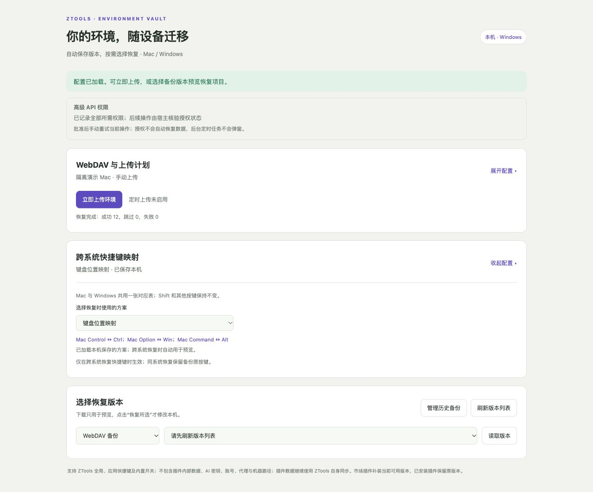

# 环境备份与恢复 · 0.0.2

独立 ZTools 插件，适用于 macOS / Windows，要求 ZTools 3.3.0-beta.2 或更新版本。安装包不含原生模块，不依赖单独安装 Node.js。

手动或定时上传独立备份；下载与恢复始终由用户手动选择。非官方插件，自愿安装，MIT 开源。

## 使用与授权

1. 从插件市场安装，或通过 ZTools 开发者功能加载本目录的 `plugin.json`；仓库 PR 构建产物也可用于测试。
2. 搜索“环境备份”“环境恢复”或“WebDAV 备份”打开插件。
3. 填写 WebDAV 目录、用户名、密码、设备名称后保存。目录应预先存在。
4. 首次点击上传或读取备份版本，宿主弹窗一次申请全部 33 项所需权限。完整批准后重试操作；批准本身不会自动执行恢复。
5. 后续备份、预览、查询市场、安装缺失插件、恢复设置和快捷键无需另开授权流程。部分批准、拒绝、撤销或整体停用时停止任务，不跳过检查。后台定时任务从不申请权限。

没有单独的“授权备份”按钮。申请清单见 `permissions.cjs` 的 `ALL`：包括设置读写、禁用状态、当前主快捷键、市场/指令查询、安装插件、快捷键注册/注销及设置立即应用接口；不申请完全授权，不自行修改授权名单，也不申请权限管理接口。即使当前只恢复某个设置，首次申请仍包含完整功能所需清单。

保存普通配置与映射无需授权。保存定时计划也不会弹窗；首次手动任务完整获批后维护本插件后台启动列表。已有完整授权时，调整计划立即同步该列表。ZTools 必须运行，插件必须保持后台运行，休眠/退出期间不执行任务。

## 上传与历史管理

- 手动上传创建独立 ZIP，文件名包含 UTC 时间、设备、系统和随机标识。
- 定时上传可选 5/15/30/60 分钟、3/12/24 小时；内容未变化时跳过，手动上传总是创建版本。
- 仅操作配置目录下的 `ztools-environment-v1/`，不覆盖其他设备或旧备份，不自动删除历史。
- 临时上传后回读校验，通过 MOVE 发布，再次回读确认；未完成文件不会出现在版本列表。
- “管理历史备份”管理当前来源（WebDAV / 本机恢复前备份），删除前显示具体时间、设备和文件名并要求确认。删除无法撤销，云端删除后校验文件已移除。
- 删除只允许本插件命名格式的正式备份，不删除连接配置、临时文件或其他路径。删除当前预览会使其失效；删除其他版本保留预览。

## 恢复

刷新版本列表，选择版本后读取，仅用于下载/校验/预览。卡片按 ZTools 原有设置分类和顺序排列，支持折叠、点击选中、分组全选、一键全选、搜索和只看差异，信息图标单独显示详情。

卡片直接展示具体值、中文枚举、单位、快捷键选项或插件版本；橙色表示有差异，紫色表示选中。有差异时补充本机值，较长内容缩小字号/显示重点名称，可打开详情看完整内容。

点击恢复后，先保留本机恢复前 ZIP，再补装所选缺失市场插件并应用所选设置。已有插件保留当前版本；缺失插件安装市场当前可用版本，不强制安装历史版本，不卸载本机其他插件。部分设置在重启时生效，结果逐项说明。

本机恢复前备份可以恢复旧设置与旧绑定，不自动卸载新装插件，也不自动删除旧快照中不存在的新绑定。

## 一份双向快捷键映射

配置始终可见、可折叠，有效配置保存在本机，完成后默认收起；不再选择或保存方向，两个系统共用一张对应表。反向恢复由程序反转该表。

| 方案 | Control（Mac） | Option（Mac） | Command（Mac） |
| --- | --- | --- | --- |
| 标准功能映射 | ↔ Ctrl | ↔ Alt | ↔ Win |
| 键盘位置映射 | ↔ Ctrl | ↔ Win | ↔ Alt |
| 自定义映射 | 选择对应的 Windows 键 | 选择对应的 Windows 键 | 选择对应的 Windows 键 |

自定义仅允许这三个修饰键，必须全部填写且 Windows 键不能重复。Shift、字母等其他按键保持不变。`CommandOrControl` 先按备份系统解释，再按对照表转换。AltGr 跨系统不支持，明确阻止相关项。

映射只在跨系统恢复中对选中的主唤起键、全局/应用快捷键生效；同系统恢复保留原键，其他设置和内置快捷键启用开关不受影响。键盘位置方案自然将 `Command+Space ↔ Alt+Space`。修改方案重新计算预览和冲突，不自动恢复；未配置有效映射而选择跨系统快捷键时，会展开并引导配置，后端同样拒绝写入。

目标指令必须存在；缺失市场插件须同时选中安装，安装后再次核对指令。与本机其他绑定、主唤起键或内置应用键冲突的项目不能恢复。系统/其他应用占用在实际注册时确认，失败逐项报告。快捷键先更新运行绑定，再保存并回读，失败尝试恢复原绑定/列表，补偿失败也明确报告。

Mac 界面显示 Option / Command / Control，Windows 显示 Alt / Ctrl / Win。Electron 内部的 Alt 在 Mac 上就是 Option，不从按键文本猜测操作系统。

旧版偏好兼容：同义的双向配置合并成一份；单份反向自定义转为统一表；两份不一致时不猜选，提示重新确认。旧“标准”规则统一调整为上述三键一一对应关系。旧环境备份仍可读取，备份的按键原值不被改写。

## 数据与凭据

备份含通用设置白名单、已安装插件清单、插件行为名单、禁用状态和 ZTools「快捷键」页中的主唤起键/插件指令快捷键/四项内置开关。不包含插件二进制或安装路径，窗口材质仅同系统恢复。

不包含账号、登录令牌、AI 密钥、代理、终端命令、壁纸文件、系统路径、高级 API 授权、插件内部数据或剪贴板历史。插件内部数据继续使用 ZTools 自身同步。本插件的 WebDAV 配置和映射偏好仅在本机保存，不进入 ZIP 或官方同步。

ZIP 固定含 manifest.json、settings.json、plugins.json，使用 SHA-256 校验，限制内容大小，不解压到任意路径，不加密。

默认密码仅在本次运行内存中，重启后须重新填写并保存。勾选记住后，明文保存在本机插件目录的 webdav-local.json；macOS 使用 0600 权限，Windows 继承用户目录权限。

WebDAV 使用 Basic 认证，建议 HTTPS，支持 MKCOL、PROPFIND（Depth 1）、GET、PUT、MOVE（Overwrite F）和 DELETE。不跟随重定向、不关闭证书验证。

粘贴配置严格使用英文键名和冒号，每项一行，点击“识别并填入”才处理；仅填表，不自动保存或连接：

```text
url: https://dav.example.com/backup/
user: alice
password: your-app-password
```

允许中文用户名；拒绝缺项、重复项和未知字段，不改写密码内容。识别成功清空粘贴区。

## 本次验证与边界

66 项自动化测试通过。使用固定 beta.2 权限处理/审批/鉴权源码，Electron 窗口和宿主数据边界替换为隔离夹具。覆盖首次完整申请、部分批准、拒绝、撤销、整体停用、后台不弹窗、真实 preload 加载、统一映射双向互逆、本机偏好迁移、备份/恢复/删除、回读和失败补偿。

隔离浏览器走通首次申请 33 项权限、一次批准后预览/安装插件/全选恢复（12 项成功），审计确认仅一个授权弹窗；未启动真实 ZTools，没有接触用户数据库、真实 WebDAV 或自动更新。以上为 Codex 的隔离验证范围；用户另已确认在本地 ZTools 客户端实际加载测试。不能据此声称完成 Windows 实机验证，实际系统注册及市场安装仍需对应环境验收。

安装包按宿主原始解包准备逻辑检查，并在解包代码上运行同一测试集。插件使用有授权管理的内部接口，后续宿主升级可能需要适配。

## 开发方式与使用边界

整个插件通过 **Codex Vibe Coding** 完成。代码编写、修改、自动化验证及本次发布材料均由 Codex 完成；没有人工编写代码或进行代码审核。人工参与仅包括功能测试与功能细节调整。AI 检查及自动化测试不等于人工安全审计，也不构成无缺陷保证。

本插件通过宿主授权的高级 API 访问本机设置，并使用用户自行配置的 WebDAV。高级 API 授权不保证内部设置结构长期兼容；升级 ZTools 后可能需要适配。恢复涉及多项独立操作，不具备全局事务；可能部分成功，务必检查逐项结果及恢复前备份。已安装插件清单不等于插件数据或原版本安装包备份。

完整 API 权限、读取数据及写入边界见 [PERMISSIONS.md](PERMISSIONS.md)。不会要求用户绕过授权机制。

## 源码验证

运行测试需要 Node.js >= 22.13（建议使用本次验证的 22.22.3）和 npm：

```sh
npm ci
npm test
```

测试仅使用临时目录、内存宿主与 127.0.0.1 WebDAV，不需要真实账号或真实备份；权限夹具来源及差异见 `tests/fixtures/host-beta2/README.md`。源码没有额外编译步骤，官方仓库构建脚本安装依赖后打包插件根目录。



截图为 0.0.2 的隔离演示，不是 Windows 实机测试证据。

详细验证方法与证据边界见 [docs/VERIFICATION.md](docs/VERIFICATION.md)。
