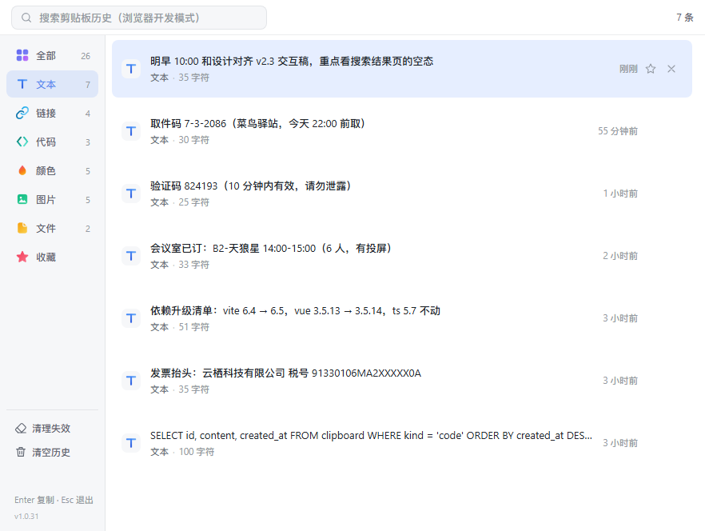
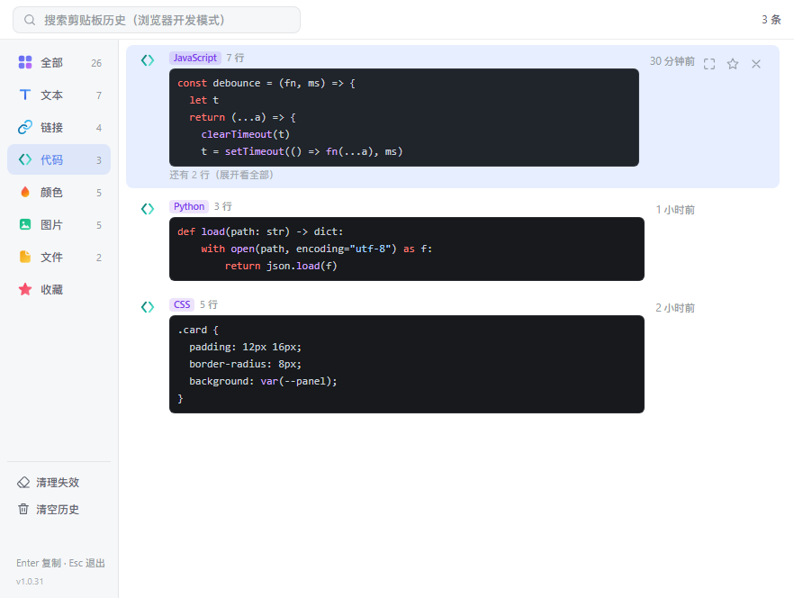
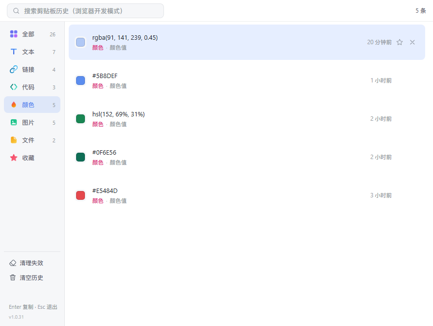

# 极速剪贴板

> ZTools 剪贴板历史管理插件 · Vue 3 + TypeScript + Vite

分类清晰、响应飞快的剪贴板管理：文本 / 链接 / 代码 / 颜色 / 图片 / 文件自动分类，支持收藏、搜索与全键盘操作。

## 演示

> 截图均来自演示模式（开发服务器加 `?demo=1`），数据全部是编造的假数据，不包含任何真实信息。

### 全部

### 文本

### 链接

### 代码

### 颜色

### 图片

### 文件

### 收藏

