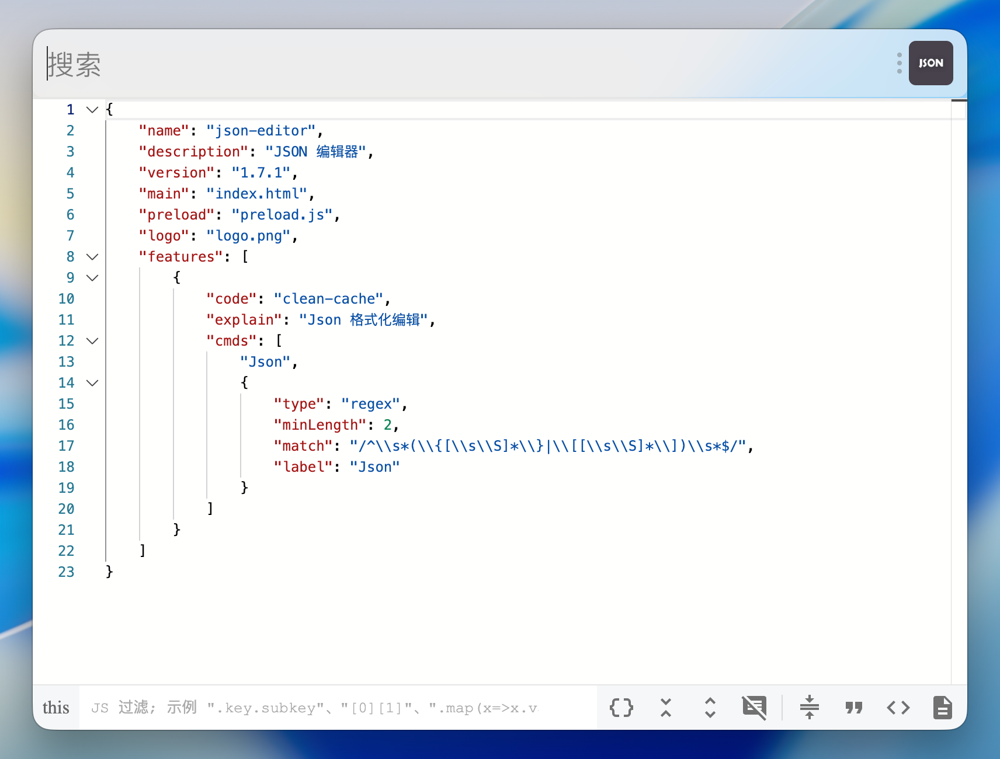

# JSON 编辑器



URL Params、XML、YAML 粘贴自动转为 JSON 格式

支持：JSON 转 XML、JSON 压缩、JSON 转义、JSON 转 TypeScript

底部输入框使用 Javascript 语法快速对 json 数据进行过滤
## 本地开发

```bash
npm ci
npm run dev
```

在 ZTools 开发者工具中导入 `src-ztools/plugin.json`，通过 `Json` 指令打开插件。

`npm run build` 将页面构建到 `src-ztools/dist/`。整个 `src-ztools/` 是插件安装目录。

`npm test` 使用 Node.js 22 运行单元测试。真实 ZTools 端到端测试通过 `npm run test:e2e` 运行，宿主路径由 ZVC 环境的 `ZTOOLS_E2E_EXECUTABLE_PATH` 提供。
