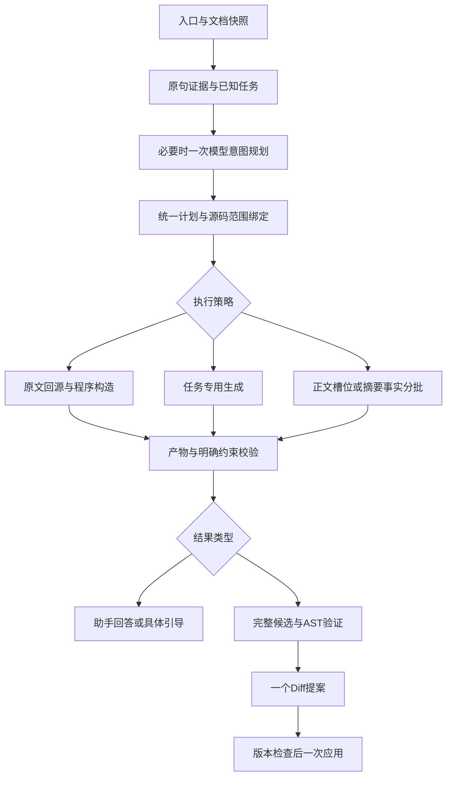

# Live Markdown AI 编辑执行技术方案

状态：核心改造已实施并形成候选包；实现、模型观察与未完成的原生平台验收见[验收报告](./ai-harness-execution-v2-acceptance.md)。适用范围为 AI 编辑全链路，覆盖新增、定位替换、润色校对、结构转换、续写、摘要和问答。以 B27 源码为迁移基线，复用已有执行与文档保护能力。下述准入目标仍是目标，不代表各模型自由任务与各平台已全部达标。

方案目标是让模型负责必要的语义理解与内容创作，让程序持有源码位置、固定 Markdown 结构、明确参数和最终写回。执行流程统一，任务策略按类型区分；支持任意表述的能力仍须由独立评测证明。

1. 设计依据与必须保持的行为

当前[多场景对照报告](../.cache/acceptance/paired-ai-b28-20261027/reviewed-comparison.txt)覆盖 19 类场景、21 组对照及 35 次补测。原始自动评分保留，语义结论使用独立审定结果。

| 已确认问题 | 对应设计 |
| --- | --- |
| 同一简单任务在简短提示下成功，在当前正文提示或全文干扰下失败 | 保留原始指令；任务专用提示；按依赖组装上下文 |
| 意图操作正确，但正文的标题、函数名错误 | 计划携带明确内容约束；生成、渲染、验证共用产物规格 |
| “水果”“LaTeX”参数被当作完整字面内容 | 区分产物参数与完整内容；所有产物类型执行完整性合同 |
| 问答过度澄清、引用中的动作被当成任务 | 一次规划同时判断 edit、answer、no_op、clarify；语气证据与编辑动作分离 |
| 新旧句式触发不同编译路径 | 编译器消费字段规格，词法分析集中处理有证据的参数，不在编译器继续匹配整句 |
| AST 或格式检查通过，却未完成任务 | 分别评测范围、结构、明确参数、任务质量；不以格式通过替代语义成功 |

保持以下产品约定：

- 无选区的润色、校对等范围操作默认当前文件全文；明确要求选区但没有有效选区时停止并引导，不能扩大范围。
- `/ai`、快捷菜单 AI 创作与选区 AI 创作只打开侧栏。润色、总结按钮直接携带对应 Skill 任务；未配置模型时进入模型选择。
- 摘要与问答默认在助手回答；明确要求“追加摘要到文末”才创建写入提案。新增任务不替换原文。
- 无选区且未指定位置的新增任务采用文末默认值，并在操作摘要显示；有选区时“底部”指向不明，则提供全文末尾或选区末尾的具体选择。
- 普通自然语言至多一次意图模型调用；结构化入口或完整、无冲突的确定性操作可以零规划。固定文字与固定结构不调用正文模型。
- 无自动重试、无隐藏的失败修复调用、无静默换模型、无失败后缩小范围。预先规划的多段调用属于同一任务执行。
- 生成期间允许继续编辑；完整结果形成一个 Diff，确认时检查原文版本，一次事务、一次撤销。取消、过期或部分失败不写回。
- ZIP 与解压插件资源分别不超过 15,000,000 字节；引擎、模型和评测依赖在包外。Windows、macOS、Linux 共享执行核心，宿主差异留在 adapter。

2. 在现有入口统一执行计划



在 `plannedTaskRunnerCore.ts` 现有 `resolveKnownIntent / planAiIntent / bindAiIntent` 接缝组装一份不可变的 `ExecutionPlan`。模型 wire 输出仍是不可信草案。程序完成证据验证、默认值决议和源码绑定后才产生可执行计划；后续不再各自重猜格式或位置。

概念模型如下；实施使用有判别字段的联合类型，保证 answer/no_op/clarify 不持有可写 target 或 patch。

```ts
type ExecutionPlan =
  | { kind: "edit"; operation: "insert" | "replace_exact" | "rewrite" | "transform";
      target: BoundTarget; artifact: ArtifactSpec; content: ContentRecipe;
      context: ContextRecipe; mutation: MutationPolicy; budget: TaskBudget }
  | { kind: "answer"; readScope: BoundReadScope; artifact: ArtifactSpec;
      content: ContentRecipe; context: ContextRecipe; budget: TaskBudget }
  | { kind: "no_op"; message: string }
  | { kind: "clarify"; missing: MissingField; choices: ClarificationChoice[] };

type ContentRecipe =
  | { mode: "literal"; source: InstructionRef | DocumentRef }
  | { mode: "compose"; fields: ArtifactFields }
  | { mode: "source_transform"; sourceRefs: DocumentRef[]; task: TaskId }
  | { mode: "generate"; task: TaskId; requirements: Requirement[] };
```

`BoundTarget` 复用现有 documentId、revision、UTF-16 范围、expectedText、定位依赖；模型不能填写源码偏移或修改快照。`transform` 是显式授权范围内的格式转换，内部映射为受约束的替换；首期仍只允许一个文档操作，不接受任意多步骤操作数组。

`ArtifactSpec` 至少区分 prose/markdown、heading、code、table、math、mermaid、list。code 的语言和块内结构分开表示；table 有列、行及单元格来源；list 有顺序、条目及图标；math 有展示方式与公式来源；Mermaid 有已支持的图类型、节点与边关系。嵌套采用有界结构，例如 code(markdown) 的 body 可以是 heading，不构造无限递归的 Markdown AST。

语言标签仅在用户明确要求时成为硬约束；未指定语言的合法代码围栏可以接受，不为补标签额外澄清或臆测语言。“创建Markdown一级标题”与“创建Markdown代码块，内含一级标题”是不同规格。链接、图片、脚注等首期复用现有 Markdown 路径，继续验证引用与渲染边界；不因未设专用 serializer 就改写成另一产物。

每个明确字段记录来源：用户原句引用、当前文档引用、按钮或 Skill、可解释默认值、模型生成。参数引用还记录角色，如“语言”“列名”“标题文字”，不能因为某个词出现在原句中，就把它当作完整产物。引用存在仅证明来源可回溯，不证明语义关系正确。

3. 意图理解与通用字段提取

所有入口先进入同一计划构建流程。“先理解意图”是逻辑阶段，不等于每次都增加模型调用。

- 按钮和 Skill 已明确的任务直接组装计划；显式固定文本、唯一目标、完整参数且无否定或复合冲突的操作，可用程序绑定。
- 普通自然语言使用一次短规划，同时返回任务性质、操作、目标引用、产物类型和未决参数；不再先调分类模型、再调规划模型。
- 规则只提供引号、否定、序号、范围、字面内容等证据及合法别名映射。未识别保持未知；同义表达由规划模型处理。新增整句白名单不作为主要扩展方式。
- 保留原始用户指令及其来源映射。模型选择程序提供的 literal/heading/source ID，长文字不要求模型复述；规划器不计算源码偏移。
- 用户显式要求优先于入口默认值；用户明确冲突必须呈现。角色提示只影响允许的写作风格，不覆盖操作、范围或格式。
- schema 只锁定已证明的值，不把词法未识别误当缺失、不把整个任务提前缩成 clarify。answer 不要求写入位置；纯否定可为 no_op；“解释‘底部加hello’”是 answer。
- 澄清须对应确实缺失且影响执行的字段。例如多个同名章节、缺少要求的选区、范围冲突。不会只返回泛化的“请明确操作”。

参数规格与任务性质分别验证：完整的代码块模板可零正文调用；只拿到语言 markdown 或标题文字 hello 时，须继续完成整个 code 规格，不能执行为普通文字追加。

4. 根据任务选择执行方式

| 任务族 | 处理策略 | 自然语言的目标调用形态 |
| --- | --- | --- |
| 原样追加、精确替换 | 从原句回源，程序定位与构造补丁 | 0～1 次规划，0 次正文 |
| 字面标题、表格、JSON、图标列表、给定公式或简单图结构 | 提取有来源的字段，程序序列化 | 0～1 次规划，0 次正文 |
| 根据原文生成表格、流程、提取信息 | 模型选择或提出来源记录，程序核验关系与值后渲染 | 至多1次规划，加必要的来源处理批次 |
| 写函数、续写、技术方案、开放写作 | 模型生成绑定规格内的内容；程序持有可确定的外层结构 | 至多1次规划，加正文调用 |
| 润色、校对 | 复用正文槽位执行器，保护固定结构，逐段处理 | 至多1次规划，加N批 |
| 摘要、按全文回答 | 复用事实账本和覆盖策略；答案与写回分离 | 至多1次规划，加N批必要处理 |
| Markdown 格式转换 | 明确可变节点及范围，提取内容后按目标结构渲染 | 至多1次规划，加必要转换调用 |

这些是调用形态目标；N 在执行前由计划确定，不代表已验证的成功率。普通问题不应为了进入事实账本而强制扫描全文。

结构化新增的示例路径：

- “代码块，markdown，一号标题 hello”解析出 code/language=markdown/heading.level=1/text=原句引用；程序生成标题与适当长度的代码围栏。
- “列是水果、价格，苹果8元、香蕉5元”解析为有角色的列、行关系；程序处理竖线、换行、列数与单元格转义。
- “根据原文列出水果价格”使用原文关系记录，核验苹果—8—元是一组；不能分别找到数字和水果后重新配对。
- “生成 Python add(a,b)”仍需要模型写函数。程序持有 python 围栏及明确函数名要求；检查函数名存在不等于证明函数行为正确。
- 明确给出的公式可原样包成公式块；模型推导公式、任意代码行为与复杂图语义不由通用 AST 校验兜底证明。

关系的确定性核验限定为可绑定到同一原文记录或明确句段的字段和值；跨段或隐含的关系只能作为候选，标记不确定并交由审阅，不宣称程序已证明语义关系。严格来源要求仍须满足，不能用相同数字存在于文中代替来源对应。

代码生成可让模型只返回代码主体，由程序生成围栏；JSON 产物使用 JSON 数据序列化。响应格式依供应商能力选择小型 schema 或受限文本协议，所有响应仍经解析。无法识别的封套不猜测截取、不补齐失败内容。

`literalMarkdownArtifact.ts` 保留确定性构造能力，逐步改成消费 `ArtifactSpec`；旧句式测试迁移为“字段提取”和“规格渲染”两组测试，避免编译器、规划器和验证器重复扫描原句。

5. 上下文、提示词与模型适配

`ContextRecipe` 明确需要哪些材料、谁拥有写权限、允许如何引用。生成上下文和验证源码分开：少传材料不意味着减少最终范围检查。

文稿、代码、候选标题和来源材料中的嵌入指令默认作为数据，不能改写用户任务、操作范围或权限。用户明确要求按文稿模板创作时，可以把模板作为内容要求；它仍不授予额外写入范围或工具权限。

| 依赖类型 | 模型看到的内容 |
| --- | --- |
| 自包含新增 | 原始指令、产物规格、必要的简短任务示例；不附全文或空上下文模板 |
| 继续当前段落 | 标题路径、当前段及有限前文；新内容只写入已绑定插入点 |
| 根据原文转换 | 选定章节或来源记录；要求“全文所有”时必须检查覆盖范围 |
| 润色与校对 | 本批可改正文槽位、必要相邻语境；固定节点由程序保管 |
| 文档问答与摘要 | 授权范围内的相关来源；需要全局覆盖时遍历所有必要主块 |
| Markdown 用法等通用问答 | 原始问题和任务提示；只有问题依赖文档时才附文稿 |

保留用户原句，不再仅传入被删词的“内容要求”。正文提示按新增代码、表格转换、保守校对、摘要、问答、开放写作分别构造；格式任务避免泛化的创作角色覆盖格式要求。最多使用与当前产物有关的小样例，不发送整套 Markdown 教程。

统一预算公式：`系统提示 + 原始指令 + 必要上下文 + 输出预留 + 协议开销 + 安全余量 <= 实际上下文上限`。schema 若未作为 prompt 传输不重复计入，但单独限制字节和深度。能取得实际 tokenizer 统计时使用；否则保守估算并保留余量。

本地当前 4096 上限继续尊重实际运行时限制。模型能力档记录结构化输出支持、上下文上限、完成/截断信号、取消能力及实测任务表现；供应商不暴露的能力记为未知，不假定参数可以强制生效。小模型短段档以现有粒度为起点，通过评测调整，不仅按参数量决定能力。

用户模型选择保持不变。能力不足时展示具体限制及用户可选动作；不额外调用全局判官模型，也不静默切换云端。

6. 长文分片与完整组装

复用 `aiChunkPlanner`、`markdownChunker`、`requestBudget` 和 `AiTaskExecution`。分片以任务语义为单位，优先标题章节、自然段、句子；按完整提示和输出预算装批。每个主范围只有一个 owner，相邻语境只读；不能用上下文重叠拼接结果后再凭文本相似度删重。

- 润色/校对：使用现有 AST 正文槽，原位回填；代码、公式、脚注、链接目标、frontmatter 等固定材料原样保留。跨段重构走显式 rewrite/transform，不伪装成校对。
- 摘要：复用来源事实候选和账本，保留实体、否定、金额、单位、日期之间的关系，程序归并相同来源；不把每段自由摘要再反复摘要。要求改述或严格字数时单独验证，不能默默换成抽取原句。
- 全文问答：收集与问题有关的来源，核验覆盖并回答；未覆盖全部范围时不能声称全文没有某信息。引用回源与答案语义相关性分别检验。
- 来源转换：按来源块提取记录，再一次渲染表格或图；保留记录 ID，避免跨片重复行、错配数值和节点。
- 不可分割的大代码块、表格、公式等若超过预算，执行前说明具体节点与能力限制；不在围栏、公式或 UTF-16 代理对、CRLF 中间任意切开。

先排出完整批次、调用数和输出预算，再开始模型调用，额度包含规划和最终回答等必要调用。沿用当前每任务 64 次、300 秒等上限作为首期约束；调用数或token预算超限时在启动前呈现章节/范围选择，不执行一半才发现静态配额不足。耗时只能估计，实际超时仍按完整任务失败处理。任意长文本不作无限自动处理承诺。

默认一个活动推理请求，后台串行推进；每批结束检查取消与快照。接通两个正文执行器已有的 `isSnapshotCurrent` 回调，让已过期任务尽早停止，不仅依赖最终写回校验。

所有回执先暂存在任务私有结果中；ID 必须完整、唯一且对应当前快照。全部批次成功才构造一次完整候选；分片失败不生成可应用的部分 Diff。进度显示“第i/N批”，已完成阶段可保留作诊断草稿，不能冒充完成或自动续跑。

7. 校验从通用拒绝改成按任务验证

| 层次 | 必须验证的内容 | 失败处理 |
| --- | --- | --- |
| 传输与生命周期 | 超时、取消、已知截断、响应上限、任务身份 | 停止，不接受半截响应；保留指令 |
| 计划与来源 | 操作、范围、只读状态、来源绑定、参数角色与完整性 | 具体澄清或指出字段冲突 |
| 产物合同 | 围栏/表格/公式/图的结构；明确语言、级别、名称、列、值、条目 | 指出实际值与要求；结果为不可应用草稿 |
| 完整文档 | 授权范围外不变、策略允许的 AST 变化、引用关系、最终体积 | 不创建可应用提案 |
| 内容质量 | 相关性、表达质量、自由生成的行为与事实正确性 | 展示可审阅结果及具体疑点；独立评测，不用关键词硬判 |

`MutationPolicy` 按操作决定允许变化：新增保持原文前后缀；保守校对保持固定节点；显式格式转换允许目标范围内对应节点变化。不能对“转换成表格”仍要求原段落 AST 完全相同。

明确且可从用户要求确定的约束作硬校验，如 H2、标题字面内容、Python 函数名、JSON 字段、列和行数据。复杂代码行为、数学推导与“写得更好”不作伪确定性证明；默认不增加第二次模型审判。

原文重叠按内容来源与任务分类处理：literal/compose 使用来源证明；摘要允许合法来源引用；源转换允许已授权内容进入目标产物；普通新增对未经要求的整篇复制作明确失败处理。短标题、常见术语、合法代码/公式复用不能只因相似度较高而阻断；部分重叠且无法确定问题时给审阅提示。重复检测不可绕过范围、完成度或结构校验。

解码仅移除被完整响应协议证明的单层封套；不丢掉未知尾部、不全局删围栏。格式渲染与验证完成后不再追加会改变 literal、代码或公式的自动排版步骤。插件不执行生成代码；已有渲染安全边界继续保留。

8. 用户可见结果与性能边界

每个任务明确结束为 answer、no_op、ready_for_review、needs_clarification、failed、cancelled 或 stale。安全停止和无改动不能计为编辑完成。

- 展示“将向全文末尾新增一个 Markdown 代码块”等操作摘要；有明确要求时显示语言、标题级别等关键参数。
- 失败说明对应阶段，例如“要求二级标题，模型返回一级标题”，并保留原指令和可查看草稿；输入框始终可修改。只保留修改指令、选择目标/模型等具体动作，不增加重试按钮。
- 普通结果可进入现有 Diff，明确未满足硬约束的结果不可确认写回。用户主动编辑草稿后按新的显式内容重新验证，范围和文档校验始终生效。
- AST、分片、渲染与 Diff 的较重处理复用现有 Worker；流式状态限频更新，避免每个 token 重解析全文。
- 文档索引按 documentId/revision 缓存；模型或能力档变化使计划缓存失效。最终写回仍检查 revision 与 expectedText，不凭缓存授予写权限。
- 每任务仅允许当前 jobId 更新界面；取消后的迟到回调、旧任务完成、切换文档或模型不会覆盖新任务或恢复旧按钮状态。
- 日志默认记录阶段、模型、构建、预算、调用数、耗时和失败码。完整指令、文稿和响应只在本地显式调试导出中携带；不默认持久化正文。

9. 模块复用与迁移顺序

| 归属 | 改造与边界 |
| --- | --- |
| `intentTypes / intentSchema / intentOutputSchema / intentPlanner` | 增补产物字段/引用协议，保留一次规划 adapter；模型草案不直接执行 |
| 新 `executionPlan` 与 `artifactSpec` 模块 | 统一最终计划与产物合同；复用 `InstructionContract`、`BoundIntent`，不再建第二个总控器 |
| `instructionSpeechAct / instructionConstraints / intentPlanValidation / intentBinder` | 保留证据与源码绑定；修复过度澄清、否定、问答、参数角色；不承担正文生成 |
| `resolvedIntentContract / programIntentPolicy` | 保留完整确定性路径；其产物和模型路径统一进入同一计划组装 |
| `generationRequirements / intentGenerationRequirements / intentArtifactContent` | 将重复推断收敛到计划构建；迁移后下游只读 artifactSpec，逐步移除重复规则 |
| `literalMarkdownArtifact / aiTableArtifact` 与产物 renderer | 保留、泛化纯构造能力；共用合同，不各自扫描整句 |
| `plannedTaskRunnerCore / aiTaskRunner` | 前者协调绑定、执行与提案；后者执行已知策略；按钮和Skill也适配同一最终计划 |
| 现有正文、摘要、分块模块 | 复用 source ownership、槽位和事实账本；接通快照回调与统一预算，不新建平行 chunker |
| `aiOutputContract` 与按产物拆分的 validator | 共用计划合同，保留通用边界；独立职责不继续堆入单文件 |
| `editProposal / aiEditTransaction / 助手任务状态` | 复用 Diff、写回、撤销；接入具体阶段错误、草稿与过期状态 |

所有新代码文件不超过 500 行；实施前检查文件归属。wire 协议需要扩展时使用有版本的适配边界；v1 测试保留用于迁移对照，默认执行只走一个选定版本，不在用户任务中双跑模型。

| 阶段 | 可独立交付内容 | 必须先通过的验收 |
| --- | --- | --- |
| P0 合同和评测 | 冻结按任务族的语义量表、ExecutionPlan 类型、来源/参数完整性与比较工具 | 正确/错误样例的评分器自测；旧能力逐项映射 |
| P1 统一规划与入口 | 一次计划构建、自然语言/按钮/Skill 接入、明确问答与范围 | 参数不能冒充完整内容；answer无写入；真实歧义才澄清 |
| P2 产物执行与上下文 | 程序构造标题/表格/列表/公式等；任务提示、最小上下文、明确参数验证 | 多类型正向任务与近似错误变异均符合合同 |
| P3 长文与生命周期 | 复用执行器，完整预排、来源覆盖、早停与错误状态 | 首中末段质量、全覆盖、失败无部分写回、过期取消 |
| P4 集成和候选验收 | 类型/单测/集成/浏览器、真实模型对照、宿主与平台、包体 | 分层证据齐全；未测平台不得标通过 |

阶段按依赖推进；各阶段允许 Luna worker 执行独立模块，根 Agent 独立审查关键接口、diff 与验收。派单限定分支和 worktree，禁止并行写同一文件，不创建 Git 提交或推送。

10. 验收量表与发布条件

冻结 B28 作为历史基线；新的覆盖集包含新增结构、精确编辑、润色/否定、摘要/全文问答、格式转换、续写/开放写作、异常与竞态七个任务族。每个用例写明预期任务性质、操作范围、产物参数、允许变化和调用形态。

- 表达变体覆盖中英文、口语、倒装、省略、无空格、引号、Unicode、CRLF、重复片段、多约束及未提供内容。变体按字段维度设计，不围绕一条完整句式造样本。
- 确定性回归覆盖 H1/H2、代码语言与函数名、表格列/值/单位、JSON、公式、Mermaid、图标清单、原样文字、唯一/全部/最后匹配、选区与章节；合理的表格标题不能误判失败。
- 受控响应验证空响应、非法/截断协议、部分分片失败、预算超限、取消后迟到、旧请求覆盖、新版本文档、只读、切换模型及一次撤销；加入文稿内命令试图扩大范围、改变任务的样本；这类故障优先不用真实模型制造。
- 长文样本包含开头、中间、末尾独有事实、重复背景、相同金额不同主体、否定和跨段关系；润色还要检查实际纠错与可读性，全部 unchanged 不能冒充完成。
- 问答按来源事实、矛盾、无依据推断和回答范围独立审定。关键词齐全不算语义正确；LLM评分只作辅助，不用同一生成提示自评。

两套比较分开执行：体验比较使用同一模型/运行时/任务/源码，交错运行直调与新 harness，分别记录各自真实上下文与调用成本；直接调用不借用 harness 的计划或事实。受控因子实验单独固定输入范围、提示、采样和输出上限，供应商无法控制的参数明确记录。

门禁比较冻结相同原始输出，离线重放同一来源与要求；不借用另一流程的事实账本。正确输出误拒、错误输出放行分别统计。已知截断或未发起推理的响应不作为可验收正文。结构通过、内容完成、安全停止分别计数。

候选准入目标如下，均为拟定门槛，不是当前结果：

- 冻结的确定性合同和变异集全部通过；明确参数错误不可生成可应用提案；取消、失败、陈旧版本与未映射选区无写回。
- 各任务族分别报告“正确完成、模型质量失败、错误澄清、合同拒绝、范围保护停止”，不得用大量安全拒绝抬高成功率。
- 真实模型代表集以预先冻结的语义量表比较 B27、新版和直调；核心任务必须有成功样本且不回退。候选质量目标可定为宏平均完成度至少80%、每个宣称支持的生成任务族至少70%；小样本只作候选门槛，不推断总体可靠率。自由创作质量不足的能力保留实验状态。
- 正常调用没有自动重试；字面/compose路径正文调用数为0；规划最多1次。模型调用数、输入量、首字延迟、总耗时、取消停止时间、编辑响应与内存均记录，不能用少做任务换取速度结论。
- 测试方案预先设真实调用额度，优先复用代表样本，探测性35次补测不作为每次发布必跑。额度耗尽标未完成，不删除失败或变更分母。
- 执行项目已有 typecheck、unit、preload、integration 和浏览器检查；随后分别完成所选真实模型、ZTools原生宿主、Windows/macOS/Linux实机和安装包验证。每项绑定源码、构建产物、模型及运行时身份；macOS或浏览器通过不能外推其他平台。

实施交付物为：统一计划与产物合同、已迁移的单一执行路径、分层回归和原始对照记录、候选包、按模型/宿主/平台分开的验收结果。实际完成状态以验收报告和对应原始证据为准。
