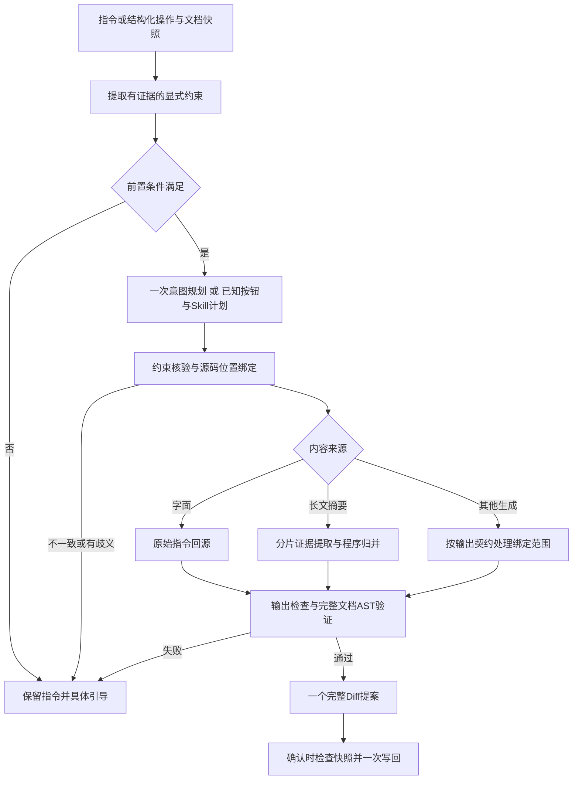

# Live Markdown AI Harness 优化方案

状态：以下保留 2026-10-23 确认的设计基线；已开展实施和多轮独立验证，当前交付候选版，尚未全量验收。[实施结果与已知限制](./ai-harness-optimization-results.md)为实际状态依据。原设计依据：[96 场景评测与独立复核](./ai-multiscenario-evaluation.md)。

目标：让程序准确约束编辑范围与字面操作，让小模型处理必要的理解和生成；长文通过可回溯证据保留事实。执行顺序为 **评测对齐 → 意图和范围修复 → 长文事实保留 → 输出格式与能力扩展 → 宿主、平台及包体验收**。

## 1. 基线、约束与目标

| 已确认基线 | 方案对应动作 |
| --- | --- |
| 80 条真实任务严格评分 30/80；含同义表达误差、内部 task 枚举差异 | 保留 v1 原始结果；修正评分规范后重新建立可比较基线 |
| 49 条提案中 19 条位置、范围或字面内容不符合指令，未实际写回 | 在正文调用前校验显式约束；提案生成前再验证精确源码范围 |
| 无选区的“选中的 hello”可退化为全文替换 | quote-aware 约束解析；明确选区要求不能退化为全文 |
| “第 3 处”及 last draft 被 schema 排除 | schema、解析器、绑定器使用同一份序号证据 |
| G09/G10 各 13 次 map、4 次 reduce，最终丢失三组事实 | 替换自由归并链，使用原文证据账本与程序归并 |
| 表格被放入 markdown 代码围栏；新增内容重复原文及指令 | 按 answer / 新片段 / 原范围改写制定输出契约 |
| B17–B22 合法显式编辑被保护策略阻断 | 区分安全拒绝与任务完成；分节点开放受限精确编辑 |
| 16 条受控执行保护全部通过 | 保留取消、过期、预算、非法输出和偏移检查，扩展集成回归 |

保持既有产品约束：

- 安装包与解压后插件文件总量分别 **≤15,000,000 字节**；模型、引擎、测试缓存独立存放。此次基线 ZIP 为 607,766 字节，仅代表该旧产物。
- 用户选择的供应商和模型保持不变；优先评估当前 0.6B 的改进，不自动下载、升级模型或切换云端。
- 无选区默认处理当前文件全文；明确要求选区但没有有效选区时请求补充，不按全文执行。
- 自然语言最多一次意图规划；字面编辑 **0 次内容生成**。明确前置条件不成立可在规划前停止；按钮和 Skills 使用已知结构化操作。
- 没有自动修复重试、没有重试按钮；失败保留指令并允许修改。语义不明确才澄清，无歧义操作只经过现有 Diff 确认。
- 生成期间可以编辑；写回前验证 documentId、revision、原文及定位依赖，一次事务、一次撤销。
- 所有新代码文件及被拆分目标文件 ≤500 行；新增职责放入可独立测试的 Module。

## 2. 统一执行路径与职责



主入口继续为 `runPlannedAiTask`，共用现有 `AiTaskExecution`。正文调度留在 `aiTaskRunner`，摘要流程提取为独立 Module；位置绑定继续由 `intentBinder` 负责，不让摘要或格式处理自行决定光标、选区与 EOF。

三个可测试 Interface：

1. **指令契约**：`deriveInstructionContract(instruction, context)` 返回显式条件及原句证据；`validatePlannedIntent(intent, contract)` 检查模型计划。schema 只投影这份契约，不独立扫描原句。
2. **摘要执行**：`runSummaryTask(request, snapshot, execution)` 返回完整结果或明确未完成原因，内部封装分片、证据定位、去重和覆盖检查。
3. **候选验证**：`validateTaskCandidate(bound, output, contract)` 返回最终可展示的片段和检查证据；验证后不再执行会改变内容的格式修复。

以上是拟建 Interface，函数名可在实施时按仓库命名规范微调，输入不变量与职责不得分散到调用方。

## 3. P0：显式意图约束与绑定一致性

### 3.1 提取一次可追溯的指令契约

拟建 `instructionConstraints.ts`，类型放入同职责的 `intentContract.ts`：

```ts
type InstructionSpan = { from: number; to: number; raw: string };
type Constraint<T> =
  | { state: "explicit"; value: T; evidence: InstructionSpan[] }
  | { state: "unknown" }
  | { state: "ambiguous" | "conflict"; alternatives: T[]; evidence: InstructionSpan[] };

interface InstructionContract {
  effect: Constraint<"edit" | "answer" | "no_edit">;
  operation: Constraint<"insert" | "replace_exact" | "rewrite">;
  target: Constraint<IntentTarget>;
  scope: Constraint<"document" | "selection">;
  occurrence: Constraint<IntentOccurrence>;
  layout: Constraint<"inline" | "block">;
  findLiteralId?: string;
  writeLiteralId?: string;
  heading?: { text: string; ordinal?: number; relation: "heading_end" | "section_end" };
}
```

示意中的 `IntentTarget`、`IntentOccurrence` 复用现有类型。来源分两类：指令证据证明用户说了什么；快照证据证明选区、光标、标题与匹配位置实际存在。两类证据不可互相冒充。

- 统一扫描中英文引号、反引号与转义，记录 UTF-16 半开区间；引用内部的“删除、最后、第3处”等默认作为数据，只有操作子句能产生约束。
- 仅规范化指令分析视图里的空白与有限位置表达，并保留回源映射。字面 payload 的空格、Unicode 码点、换行、标点完全不规范化。
- 支持有明确语法依据的选区、全文、正文开头、光标、标题/章节、行内、全部/最后/序号表达；“未识别”保持 unknown，不等价于 EOF 或 single。
- 区分否定子句和正向操作；“不要改标题，只在文末加 hello”保留正向追加。询问一句命令含义不执行引用中的动作。
- 只提取已识别的硬约束；开放式自然语言仍由一次模型规划处理。该有限解析器不承诺穷举所有同义表述或证明所有语义正确。

### 3.2 schema、解析、绑定共用契约

| 指令条件 | 规划与程序行为 | 关联 case |
| --- | --- | --- |
| 明确正文开头、光标、选区末尾 | schema 缩小兼容目标；计划目标不符则停止，不能改用 EOF | L05/L06/L08–L11/L29/L30/L34/L37 |
| 指定标题后或章节末尾 | 根据 AST 标题及用户给出的名称/序号唯一定位；缺失/同名未消歧返回具体问题 | L12–L15、B13/B14、G13 |
| 没有有效选区却明确要求选区 | 不生成全文编辑计划；提示重新选择或明确全文 | B07/B08 |
| 有选区而明确要求全文 | 使用全文；不能因为存在选区而缩小范围 | L07/L23 |
| 第 3 处 / 第3处 / 第三处 | 共享一个数值及证据，传给 schema 与绑定器；实际只有2处时明确说明，不改用 single | L19/L20、B12 |
| last draft / 最后一处 hello | last 绑定到同一替换子句的查找目标；和“文末插入”分别建模 | L16/L17、B24 |
| 唯一、全部、最后、序号不能确定 | 保留兼容的语法分支，再按实际匹配数定位；重复且无消歧则询问，不能伪造 single 约束 | B10/B11 |
| 可证明的固定新增/替换内容 | schema 只允许回源 literal/literalId；禁止转为生成全文或摘要 | L01/L24/L25/L30/L40 |

候选标题列表截断不代表目标不存在；先用指令中的明确标题在本地完整 AST 上核实。超预算仍无法唯一表达时明确说明，不选可见的其他标题。

计划解析后先验证契约，再绑定。绑定结果携带 `contract + snapshot + expectedText + dependency`；提案检查操作、位置、替换次数与字面内容均一致。复核必须由程序使用原句证据和源码完成，不让同一模型给自己的计划打分。

语义冲突时不“修正”成另一个未被用户确认的计划，也不自动再问一次模型。可从 schema 约束减少错误；仍然冲突则引导修改或选择具体目标。任何前置拒绝均与正向任务失败分别统计，不能以全部拒绝验收。

## 4. P1：长文证据账本与分片优化

### 4.1 来源完整的分片

目前公开 chunk 只有 text/mask/protectedValues 等字段，摘要不能通过全文 `indexOf(chunk.text)` 推算位置，重复背景会映射错误。

- 为摘要使用的原始、未掩码 chunk 计划提供 `ownedRange:{from,to}` 和只读 `contextRanges`；范围在切分时产生，映射回原始 UTF-16 源码。
- 按标题、段落、句子边界切分，超长段再按预算安全细分；不切开代理对、CRLF 和必须原样保留的节点。
- 主范围不重叠，每段只有一个 owner。相邻窗口只用于理解，初始不超过现有每侧120字符；上下文不作为本段输出证据，避免重复抽取。
- 开头、中段、末尾以全文范围与明确源标记定位，不让每个 chunk 将自己都当成整篇文章。

### 4.2 用原文事实代替自由归并

拟建 `summaryFactLedger.ts`，事实核心为原文完整关系句：

```ts
interface SourceFact {
  id: string;
  chunkId: string;
  source: { from: number; to: number; quote: string };
  category: "decision" | "owner" | "amount" | "date" | "other";
  relationGroup?: string;
  normalizedValue?: string;
  sourceVerified: boolean;
}
```

1. 程序先给原文句子/显式字段分配候选 ID；模型每段返回相关候选 ID、分类及可验证的引用。不得自由生成可信源码偏移或凭空填 XXX/日期。
2. 只有引用精确落在 ownedRange、实际文本一致且边界安全，才能进入账本；重复引用需要明确候选 ID，不能取第一次匹配。
3. 主语、负责人、金额、日期以原始关系句和关系组保存，例如“苍鹭站点由许宁负责”。归并不能只保留散落的名字和数字再重新配对。
4. 金额、日期保留原始写法。只对已支持的单位和日期格式做无损规范化，未知格式保留 raw；不能凭猜测换算、跨币种合并或把“未提取到”写成“原文没有”。
5. 程序对相同来源/同一可证关系稳定去重；相同数字但主体、单位、时间不同不能合并。冲突记录保留并停止自动生成结论。
6. 用户明确指定的类别、区域、数量，以及源码中已识别的显式决策/字段，形成覆盖要求。缺项或候选含混要报未核验，不静默省略。

`sourceVerified` 仅表示引用与当前源码相符，不表示来源本身真实、分类一定正确或重点已穷举。**可验证的引用真实性，不等于已穷举全部重要事实。** 任意自然文稿的“所有重点”不能完全由规则证明。已标注测试资料可做关系级完整性验收；自由文稿仍要评估相关性、遗漏与可读性，不能只凭关键词或数字齐全标为合格。

### 4.3 收口输出与调用数

0.6B 长文摘要首期采用保守的抽取式结果：程序将选定的来源关系句排成简洁摘要，不再多层模型 reduce。这样不会在归并阶段重新改写金额、人物归属和日期。

最多允许一次额外收口调用，用于返回有界的事实 ID 顺序/分组；事实内容仍由程序从账本回填，不让最后一次自由写作重新配对实体或删掉必需事实。未要求此类组织时直接程序输出，不调用。自由改写成长段叙述属于后续单独能力，必须另证事实保留，不能默认沿用 v1 自由 reduce。

用户显式要求“用自己的话”“100字以内”“3条”等时，这些要求进入输出契约，不能默默用原句列表替代。程序可以满足条数、分组及有余量的长度限制时，仍须保留必需事实并验证最终结果；长度的精确/约数口径在v2量表中提前冻结，不截句凑字数。自由改写能力未通过验证，或字数/条数与事实保留冲突时，明确说明并允许用户改为保留关键原句、调整限制或主动选择已验证支持该能力的现有模型；该次任务记未完成，不自动换模型或重发。

- `answer`：只在助手回答，无编辑提案。
- 明确追加总结：所有片段完成后生成一个绑定位置的补丁；G10 只有一次 EOF 追加，原文前缀不变。
- 摘要结果不能拼成全文润色的替换文本。润色/校对仍走保守分片，全部通过后合并一次；G11 任一片段失败不输出部分替换，也不放宽遗漏内容保护以凑通过率。
- 任一抽取/覆盖/预算检查失败，保留指令并说明具体缺项，不自动重试或失败后偷偷缩小范围。

调用目标为 N 次内容提取 + 0～1 次组织，共享一次规划后的剩余额度。在同样13个主块的 G09/G10 上，内容调用从17次降至13～14次是拟定目标，不是已测结果。证据清单超预算时停止或请求明确范围，不能重启 reduce 压缩掉必需事实。

## 5. P1/P2：输出契约与精确修改能力

### 5.1 按操作检查结果

拟建 `aiOutputContract.ts`，操作模式、格式和保护策略由已核验指令、按钮或 Skill 确定。模型返回 task=custom 不关闭保护，也不将明确校对变成回答。

| 输出模式 | 必须检查 |
| --- | --- |
| literal | 直接回源；不跑盘古空格、寒暄清洗或语法补全；保留空白与行尾 |
| answer | 只使用授权读取范围；不生成可写提案；选区外哨兵、事实不得混入 |
| 新增片段 | 不重复完整上下文/用户指令；格式满足用户要求；插入边界不能进入原有代码、YAML、列表等结构 |
| 保守改写 | 保留未授权结构和事实、片段顺序；恢复保护节点后放回完整文档校验；范围外字节不变 |
| 表格/代码/公式/图表 | 检查真实节点类型及内容关联，不只搜到几个关键词；渲染与语义分别验收 |

生成结果整体恰是一个 `markdown/md` 外围栏，且用户要的是实际表格等片段时，可在解析确认后只解包一次，再验证内部 AST。用户要求展示 Markdown 源码或提供字面围栏时不解包。不通过补闭合围栏、删除大片内容等猜测性修复掩盖截断。

复述检测要区分新增/续写与抽取式摘要：新增/续写拦截长段重复、用户指令回声；摘要允许引用选定事实，但不能复制整份文档或重复全部标题。规则分数只作为信号，有效摘要还要关系级和人工量表复核。

保留 raw 与最终候选用于开发验收。生产常规日志仅记录阶段、错误码、耗时、调用数、大小、版本和哈希，不默认持久化完整文稿。

### 5.2 受保护节点不做全局放开

默认保守润色仍完整保护代码、表格、URL、frontmatter、公式和脚注。额外能力通过明确的 `MutationPolicy` 指定获准改变的节点与精确范围：外部内容及未授权节点必须相同，节点类型/父结构保持，完整候选语法成立。

| 显式请求 | 第二阶段能力范围 |
| --- | --- |
| 代码正文、表格单元格、公式中的精确字面替换 | 仅修改已绑定位置；不能引入围栏断裂、表格扩列或公式不闭合；不执行模型代码 |
| 修改链接目标 | 精确目标替换并复核链接 AST；不发起网络请求验证链接 |
| 修改 frontmatter 字段 | 首批只支持可可靠解析的单行标量；保留其他字段与格式，复杂 YAML 明确暂不支持 |
| 修改脚注定义正文 | 保护 ID 与引用关系；检查其他结构 |
| 脚注 ID 重命名 | 需要同时验证/更新全部引用与定义的原子操作，作为独立后续任务；不能只改定义后留下不一致引用 |

B17–B22 同时报告“保护策略是否生效”和“用户请求是否完成”。能力尚未开放时给具体原因，不把安全拒绝标成任务完成。新能力的期望在 v2 清单提前声明，不能覆盖 v1。

## 6. 性能、设备与交互边界

- 保持最大1个模型、1个活跃推理请求；指令与源码只解析必要次数。按 documentId/revision 缓存只读 AST 和源索引，短期缓存有条数/大小上限，版本变化即失效。
- 复用4096 token上下文预算、输出上限2048、安全余量160；分片时计入实际进入prompt的系统提示、指令、候选、只读窗口和输出，不截断原指令。独立传输的schema按字节、深度和节点上限检查，不将其重复算成prompt token。
- 复用1 MiB输入、50个chunk、64次调用、300秒总时限；规划保留现有15秒/384 output tokens/4 KiB约束。抽取的结构化输出同样有字节数、条目数和深度上限，超限明确停止。
- 初拟账本上限256条、单条完整引文512 UTF-8字节、序列化账本256 KiB；引文过长可在调用前按语义句边界划分候选，仍超限就说明限制，不能截断成不完整证据。数值作为待压测预算统一放入配置常量，v2试验前冻结。
- managed规划沿用已接通的schema与temperature=0；其他后端仅在能力已验证时发送对应约束字段，始终执行本地核验。内容采样使用生产配置；A/B不得另改采样或先失败再切换模式重调。
- 规划前预估 N+可选最终调用，写入同一个 `AiTaskExecution`；不按阶段重置预算。停止、关闭和换模型隔离迟到输出，保持 E01–E16 的保护能力。
- 一次源快照、按范围取片段，避免每个chunk重复携带全文。事实优先使用候选ID回源，不反复传完整引文；不做无条件全篇embedding或额外判官模型调用。
- 记录规划、每块处理、验证、首个可见进度与总耗时。目标是在同机同模型同配置下减少请求和重复上下文；不得以减小处理范围或遗漏事实换速度。
- 典型约12k字符文稿的非模型处理增量初拟 P95≤50ms；1 MiB边界用例还要实测编辑响应。若同步解析使编辑持续阻塞，应移至已有异步执行机制或独立Worker，不能仅因架构偏好先引入重依赖。这些是待验证预算。
- UI 继续显示“理解指令 / 处理第n段 / 检查结果”，错误使用稳定code映射为具体文案，保留输入、修改指令、停止和最终Diff；不向普通用户展示schema、正则或内部JSON。
- 在现有跨平台 TypeScript/宿主适配路径实现，不向用户新增 Python、Docker、编译器或数据库安装要求；评测用Python AST属于开发工具，不进入插件或运行依赖。

## 7. 评测修订与验收门槛

### 7.1 先建立公平的 v2 基线

1. v1 case/source/records/report 保持只读。当前脚本路径硬编码v1且校验live等于快照，不能改代码后仅换run ID就声称完成新版本验证。
2. 评测工具新增明确 case-set/source-root/config 参数和快照读取模式，路径限定插件目录，拒绝覆盖。以上参数为待实现功能，目前不得照此假设执行。
3. 抽取 UI 实际请求构造为共享纯函数，精确复用 `ROLE_PRESETS.find(role => role.id === activeRoleId) || ROLE_PRESETS[0]` 的角色查找/默认回退，以及 `customSystemPrompt?.trim() || activeRole.systemPrompt`，同时复用action/Skill、provider预算和输出路径。分别冻结通用角色、自定义角色与按钮/Skill配置；测试自己的提示词只作为另一个实验配置。
4. v2 修正 B04/G07 同义表达、B06/B22错误身份；保留内部task路由分与用户任务完成分；G04用真实支持的Mermaid解析/渲染检验中文ID和箭头，G01/G05增加复述、指令回声和可读性复核。
5. 在实施产品修复前，以v1产品快照、v2评分器、生产默认配置建立 A 基线；优化后的 B 使用完全相同的 v2输入/量表/配置/模型和运行时。原始30/80不直接作为B的提升分母。
6. 提前冻结新变体与留出集：选区指代/引号/否定，空格/中英文序数，重复/缺失标题，实体归属互换、相同金额不同主体、中文日期金额、跨chunk句子、overlap重复及1 MiB预算。不把新增测试专用人名、日期写入产品规则。

### 7.2 分层门槛

| 维度 | 验收要求 |
| --- | --- |
| 显式约束与提案 | 已确认19类错误提案及其变体中，错误范围/位置/字面内容提案为0；缺失目标不降级 |
| 正向完成 | 40条字面编辑按真实精确补丁验收；首轮优化目标至少38/40，正式宣称全部受支持须40/40；拒绝不计完成 |
| 边界 | 缺失/重复/只读/无效选区按具体预期引导；B17–B22按能力声明独立记覆盖，不将拒绝折算为成功编辑 |
| 事实与生成 | G09/G10三组关系事实全部保留、无新增实体金额日期、G10只追加一次；其他格式能力逐项验实际节点/渲染、事实关系与用途 |
| 分片 | G11按冻结的实际chunk计划完成所有可编辑块，纠正错字、保留C01–C08顺序/代码/范围外字节并生成一个可应用提案，才算任务通过；受保护块可直接保留。拒绝仅算保护通过。G15纯保护块0次内容调用；不静默使用部分结果 |
| 执行保护 | E01–E16及新增取消/预算/过期变体全部通过；选择变化与全文任务依赖分开 |
| 可比较性 | 同v2量表重评A/B，任务完成、安全拒绝、错误提案、能力限制、未跑/阻塞分列；保留全部失败及人工分歧 |
| 性能与包体 | 同机/同模型/同后端/同配置对比调用数、耗时和峰值内存；包与解压目录各≤15,000,000字节，无模型/引擎/测试缓存混入 |

关键事实测试有标注答案，关系级正确率不能用任意正文的“自动事实完整率”替代。真实模型每次运行保留一次失败，不自动重试；可按预先冻结方案做3个独立轮次检验波动，全部计入结果，不能挑最好一次。

### 7.3 浏览器、宿主与平台

源码级评测通过后，再验证浏览器真实UI：默认/自定义role、按钮与Skills、仅打开助手、全文/选区/光标、Diff、确认与单次撤销、继续编辑/取消/过期/只读、失败后修改指令。

随后导入对应最新产物，在真实ZTools验证相同场景。平台优先覆盖 macOS Apple Silicon、Windows x64、Linux x64，包含CPU兼容路径、中文/空格路径、CRLF、低可用内存、离线已缓存、CPU/GPU失败边界。Intel Mac、Windows ARM64、Linux ARM64分别实测后才进入已支持名单；没有设备或运行资源的组合标记待验证，不推断全部通过。

当前一台macOS真实推理、浏览器和原生宿主结论分开；不以健康检查、类型检查或受控provider通过代替模型质量与原生验收。

## 8. 实施任务、归属与验证

以下为待派单清单，当前没有启动实施。每个Worker同时只拥有列出的职责；必要单测随归属走。主Agent负责冻结Interface、接线、关键diff审查与独立验收，Worker不派生子代理。

| ID/阶段 | 责任与拟归属文件 | 依赖、验收与命令 |
| --- | --- | --- |
| T0/P0 评测对齐 | Worker：`scripts/ai-scenario-eval`版本参数、配置和评分；主Agent：拟建`aiTaskRequest.ts`及`useAiTaskSession.ts`共享请求构造 | 先完成v2冻结及A基线，保留v1。Node24语法检查、source/hash及模块逃逸检查、UI请求参数等价测试 |
| T1/P0 指令契约 | Worker A：拟建`intentContract.ts`、`instructionConstraints.ts`及单测；超500行前按有意义的引号扫描职责再拆 | 依赖T0契约冻结。quote/否定/UTF-16/字面空白/明确位置变体；`npm exec vitest run tests/unit/instructionConstraints.test.ts` |
| T2/P0 约束投影 | Worker B：`intentOutputSchema.ts`、`intentOccurrenceGrounding.ts`、`intentSchema.ts`及相关单测 | 依赖T1 Interface；只消费统一证据，不重复识别原句。L17/L20/B12及非法输出；`npm exec vitest run tests/unit/intentOutputSchema.test.ts tests/unit/intentReplacementSchema.test.ts` |
| T3/P0 计划与绑定 | Worker C：拟建`intentPlanValidation.ts`、`intentBinder.ts`及单测；主Agent串行接入`intentPlanner.ts`、`plannedTaskRunner.ts` | 依赖T1/T2；19类提案逐项核验，预期正向不得靠拒绝达标。`npm exec vitest run tests/unit/intentPlanner.test.ts tests/unit/intentBinder.test.ts` |
| T4/P1 来源与账本 | Worker A：`aiChunkPlanner.ts`摘要范围输出、拟建`summaryFactLedger.ts`及单测 | 依赖T1范围类型；重复原文/关系/数值单位/CRLF及证据假引用。`npm exec vitest run tests/unit/aiChunkPlanner.test.ts tests/unit/summaryFactLedger.test.ts` |
| T5/P1 摘要执行 | Worker B：拟建`aiSummaryPipeline.ts`及单测；主Agent负责`aiTaskRunner.ts`中summarize接线 | 依赖T4；N～N+1内容调用、无自由reduce、覆盖不足停止、共享execution。`npm exec vitest run tests/unit/aiSummaryPipeline.test.ts tests/unit/aiTaskRunner.test.ts` |
| T6/P1 输出契约 | Worker C：拟建`aiOutputContract.ts`及格式/复述检查单测；主Agent接入提案创建与`finalizeAiTaskOutput.ts` | 依赖T3，T4提供摘要引用白名单；G01/G03–G08/G13–G16、literal不变及验证后不可再变换；`npm exec vitest run tests/unit/aiOutputContract.test.ts` |
| T7/P2 精确节点能力 | 单独Worker：拟建`markdownMutationPolicy.ts`、`markdownAstIntegrity.ts`及单测；主Agent传入已绑定策略 | 依赖T3/T6；先支持可证明的代码/表格/URL/简单YAML/公式字面编辑，脚注ID重命名单独后续任务；不得全局放开保护。`npm exec vitest run tests/unit/markdownMutationPolicy.test.ts` |
| T8/验收与交付 | 主Agent串行整合上述调用方；独立Reviewer审核；Worker维护v2用例、浏览器及产物检查 | 每批跑相关单元与`npm run typecheck`；最终产物执行一次`npm run package`，复用现有构建链内的unit/preload/typecheck/verify:dist/integration/e2e，避免无改动重复跑全套；另做真实模型与ZTools验收，分别记录平台与包体 |

并行顺序：T0完成并冻结Interface后，T1先行；T2/T3按依赖接入，T4/T5与P0分支可独立开发；T6等待范围契约稳定。T7属于第二阶段功能扩展。共享入口文件始终由主Agent串行修改，不让多个Worker同时写runner、hook或AST校验器。

任务表中的新单测文件和评测参数均须实施后才可执行，不能报告为已通过。新版本冻结路径、模型权限和平台资源需由T0工具真实支持后使用；v1命令不会自动变成v2命令。

## 9. 本方案交付边界

方案包含问题到Module的映射、约束与证据Interface、分片与输出策略、任务依赖和验收标准。本轮不提交Git、不发布、不部署、不下载模型，也不改变v1记录。

首个可交付里程碑为 **T0–T3：统一评测配置并消除已知显式范围、位置、序号和字面操作缺陷**。通过后推进T4–T6的长文与输出质量，最后按能力完成T7和宿主、平台验收。任何阶段只提升保护率而正向任务完成率下降，都不能宣称该阶段完成。
