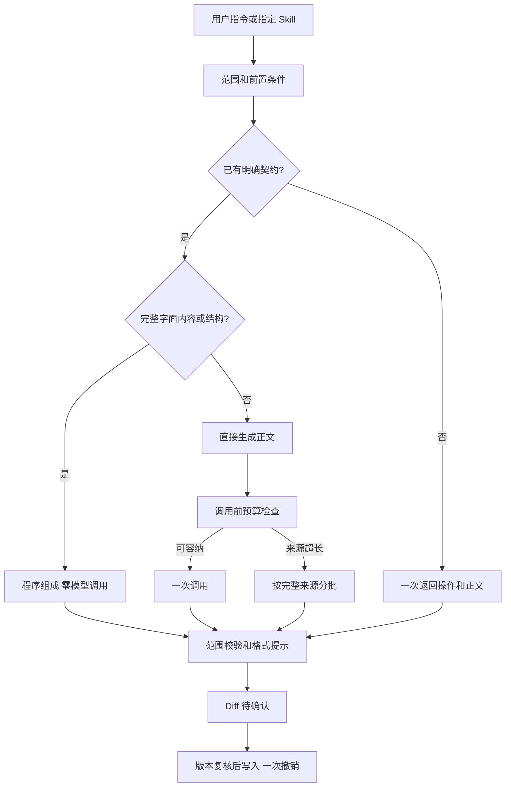

# AI 默认薄执行层 B30

普通请求不再先完成独立意图模型调用，再生成正文。程序能够从现有指令契约确认范围和操作时直接生成；完全明确的原样内容或可渲染结构由程序组成。剩余小型请求使用一次 JSON 响应同时返回操作及正文。模型不能指定任意源码偏移，程序仍负责定位和创建提案。

程序前置条件、授权范围、只读权限、来源版本、Unicode/CRLF 边界、已知传输失败、取消和输出体积仍是硬边界。候选 Markdown 围栏、标题、语言或 AST 结构不符作为提示交给用户审查，不再仅因结构变化拒绝合法的格式转换。可审查不代表答案或代码正确；用例评估单独检查显式值和开放语义。

长文的处理依据调用前预算。能放进一次请求就一次生成；来源依赖的长问答和摘要使用现有来源分批流程，长改写按连续源码范围切分、按原顺序拼装，任一分片失败不形成部分提案。服务报错后不会改提示词再次调用。未知请求如果仅凭一次响应已超过本地预算，在首次推理之前选择完整流程；结果记录实际策略。

三路对照通过同一生产入口选择：`direct` 使用同样的范围绑定和短提示词，但关闭内容编译；`thin` 为默认策略；`full` 保留当前源码内的旧完整流程。三者是端到端管线比较，不是严格隔离单个变量的模型实验。共享解析器修正也作用于 full，不能把它描述成 B29 二进制复刻。schema 调用使用生产传输的 temperature=0，非 schema 调用沿用后端默认值；本轮未提供固定 seed。

真实模型比较器：`scripts/ai-scenario-eval/run-thin-execution-comparison.mjs`。它只读缓存模型，禁止下载；冻结 src/preload 及本轮矩阵、评分器和脚本，保留每次提示词、schema、原始输出、失败、耗时和估算 token。所有文稿是测试样本，运行不写用户文件。其他平台和 ZTools 原生宿主的验收不由浏览器或核心测试推断。
