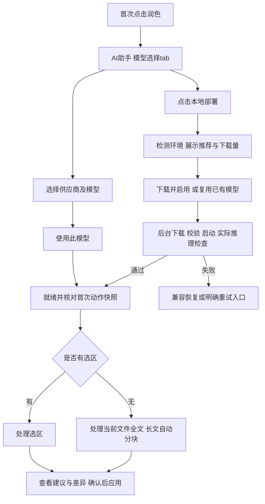

# Live Markdown 本地 AI：一键启用与 15MB 包体设计

日期：2026-10-21。状态：设计稿，尚未实现或完成性能、设备验收。

首次点击“润色”等AI功能时，打开AI助手并定位到“模型选择”tab，供用户选择供应商及模型，或进入“本地部署”。只有进入本地部署后，才检查环境并展示推荐方案及下载量；点击“下载并启用”后，后台自动下载、校验、启动并执行实际推理检查，期间可继续编辑。日常使用保留“润色、校对、总结、续写”及“应用、放弃、停止”。供应商与模型名称正常展示，线程、端口和运行后端放在高级设置中。

## 1. 必须成立的约束

- 最终发布安装包、解压后的插件文件总量，**分别不超过 15,000,000 字节**，采用十进制 MB。开发依赖不进入发布物。
- 推理引擎、模型和可选加速库是启用功能后下载的独立资源，不塞入插件包；首次启用明确展示额外下载量、安装占用和临时空间峰值。
- 如果“15MB”同时包含引擎、模型和全部运行资源，本地生成式小模型方案不成立。本设计的 15MB 指插件发布物，不指安装 AI 后的总磁盘占用。
- 没有启用 AI、离线、部署失败或资源不足时，编辑、保存、导出继续可用；打开编辑器不下载模型、不启动推理进程。
- 使用用户明确选择的供应商及模型。有选区时默认处理选区；没有选区时默认处理当前文件全文，来源是当前编辑缓冲区，包含尚未保存的修改，不扩展到工作区其他文件。
- 本地部署模式不上传文稿；用户选择云端供应商时明确标示处理位置，请求只发给所选供应商，不在失败时自动切换。生成建议与实际写回分离，全文处理仍需确认后应用。
- “无脑”指无需用户选择技术参数；首次下载告知、系统必要的安全确认和文稿修改确认仍然保留。

## 2. 用户实际看到的流程

| 场景 | 界面 | 用户操作与系统行为 |
|---|---|---|
| 第一次点击“润色”等功能 | 打开AI助手的“模型选择”tab，展示供应商、可用模型和“本地部署”入口 | 不直接下载或发送文稿；用户选择供应商/模型，或点击“本地部署” |
| 选择供应商 | 当前可用的供应商及其模型，标示本机或云端处理；缺配置时显示设置入口 | 点击“使用此模型”保存选择并恢复有效的首次动作；不要求安装本地引擎 |
| 点击“本地部署” | 检查环境后展示“适合你的电脑”、推荐模型、下载X、安装后Y、临时空间Z | 主按钮“下载并启用”；次入口“返回模型选择”，高级设置折叠 |
| 本地部署中发现已有合适的Ollama模型 | “已发现本机可用模型，无需下载” | 主按钮变为“直接启用”；通过连接与实际推理验证后可用 |
| 正在后台部署 | “下载中 / 校验中 / 正在准备 / 正在验证” | 显示总进度与分项体积；可继续编辑、收起助手，部署不中断；只有显式取消部署才取消该任务，重试复用有效进度 |
| 部署完成 | “本地助手已就绪” | 本地仍为用户当前选择且首次动作仍有效时启用；仅在原文档、版本、处理范围快照均未变化时恢复该动作，否则提示就绪并等待重新触发 |
| 后续点击“润色”等功能 | 默认复用已选择且可用的模型，随时可回“模型选择”tab切换 | 配置失效则返回模型选择；不在每次调用前重复要求选模型 |
| 日常生成 | 有选区显示“正在润色选中内容”；无选区显示“正在润色当前文件全文”，长文展示分段进度 | 默认不写原文；完成后展示差异，点击“应用修改”形成一次可撤销操作 |
| 结果过期或局部失败 | “原文已变化，请重新生成”或“部分段落未完成” | 保留建议供复制；不错误覆盖、不把残缺结果标为成功 |
| 不再需要 AI | “释放内存”；“移除下载资源（X GB）” | 释放内存不删模型；移除只处理插件管理的资源，用户文档和已有 Ollama 保留 |

下载告知示例：“将下载约 X，安装后占用约 Y；准备过程中最多需要 Z 可用空间。下载完成后，写作内容在本机处理。”所有数值来自固定版本资源清单和现有缓存，不使用写死的宣传值。Y为已有托管资源加计划新增的最终资源；Z为相对当前磁盘状态还需新增的峰值文件、暂存、副本及余量，不能再次扣减已被系统可用空间统计计入的旧资源。

## 3. 运行方式与跨平台范围

模型选择tab包含供应商模型接入与本地部署两个分支，记住用户最近一次明确选择，不预先替用户固定供应商。本地部署分支由插件管理固定版本的 llama.cpp 独立进程及 GGUF 模型，兼容已有Ollama，不要求用户自行安装Python、Docker、编译器或配置环境变量。

仅在用户进入本地部署后，按以下顺序推荐：已验证且满足本地模式的现有模型 → 已缓存的插件自有模型 → 推荐下载计划。不能仅因某个端口有响应就复用，也不扫描用户整块磁盘寻找模型。供应商分支只展示确实可用的适配器和模型，配置占位不能伪装成已接通。

| 平台目标 | 首选路径 | 兼容路径与必须验证项 |
|---|---|---|
| macOS Apple Silicon | Metal | 同模型 CPU；系统最低版本、签名与动态库依赖 |
| macOS Intel | CPU | CPU 指令集与系统最低版本；不承诺 Intel GPU 加速 |
| Windows x64 | 经验证的 CUDA / Vulkan；否则 CPU | 提供不依赖 GPU 库的 CPU 路径；驱动、运行库、中文及空格路径 |
| Windows ARM64 | 原生 ARM64 CPU | 单独验证发布包，不默认使用 x64 仿真或承诺 NPU |
| Linux x64 / ARM64 | 经验证的 GPU 路径；否则 CPU | glibc/系统库、权限与发行版差异；默认不依赖 systemd 或 sudo |

上表是开发目标，不是当前通过名单。发布清单以 OS、最低系统版本、架构、CPU 指令集、后端、系统库为兼容键；没有通过验证的组合显示“此设备暂不支持自动安装”，保留连接本机现有服务的入口。旧系统和 32 位系统不承诺自动支持。

GPU 探测成功还需短推理测试；驱动存在不等于可运行。自动下载前生成完整计划，包含必需的 CPU 兼容资源和已选择的加速包；不为每台电脑下载全部平台、全部显卡版本。

## 4. 模型与配置自动选择

首批候选为 Qwen3 0.6B / 1.7B / 4B 的固定 4 位量化版本。它们是待评测候选，不把参数量、下载成功或健康检查当作编辑质量合格。

| 用户档位 | 初始候选 | 默认用途与约束 |
|---|---|---|
| 省资源 | 0.6B | 短句与简单校对；必须明确质量限制，复杂重写不默认交给它 |
| 均衡，推荐 | 1.7B | 选区或全文润色、校对、摘要、续写；全文按预算分块，资源预算满足后才加载 |
| 更高质量 | 4B | 用户主动升级且实测合格；显示额外下载与内存需求 |

不按总内存简单打标签。推荐依据：可用内存与内存压力、可用显存、CPU/后端能力、磁盘、近期短测结果。模型下载大小不等于运行内存。

建议初始策略：

1. 先尝试均衡档预算；需要同时容纳权重、所选上下文的 KV 缓存、计算缓冲，并为宿主及编辑器保留余量。预算数据来自该固定构建的实测档案。
2. 将“额外预留 max(1.5 GiB, 总内存的 20%)，模型预算再乘 1.25”作为保守起点，后续按设备数据调整；统一内存机器不重复计算 RAM/VRAM。压力信息不可得时采用更保守档位。
3. 均衡档不满足时推荐省资源；省资源仍不满足则停止部署，保留普通编辑功能。不要强行加载后依赖交换内存撑住。
4. 默认最多一个模型、一个生成请求。上下文先从 2048/4096 token 两档评测，包含系统提示、输入、上下文和输出预留；不按模型宣传的最大上下文加载。
5. 输出初始上限为短校对/续写 512 token、普通段落改写 1024 token，均不得挤占已分配输入预算；被截断的改写不是可应用结果。
6. 默认关闭可关闭的思考输出，并对具体模型模板验证；不把推理标签泄露进文稿。
7. 部署后执行一次使用合成文本的短测试，结果按运行时版本、模型哈希、后端和硬件缓存；升级或后端变化才失效，不在每次启动跑基准。

自动恢复最多两步：先在已下载的 CPU 路径运行同一模型；仍受内存限制时降低上下文并重新分块，或使用已缓存的小模型。任务和内容覆盖范围不得暗中减少。需要新的下载时显示新增体积及“下载兼容资源并重试”，不循环自动下载。

## 5. 15MB 包体预算与资源存储

2026-10-21 对现有 dist 的只读统计：12 个文件，总 **1,393,966 字节（约 1.39MB）**；内存中生成的 ZIP 压缩估算 **424,642 字节**。这不是本轮重新构建后的结果，也不是插件市场实际封装格式的最终大小。当前最大 JS 为 1,234,239 字节。

| 包体内容 | 解压体积软预算 |
|---|---:|
| 编辑器、现有 UI、样式与既有功能 | 3MB |
| 本地助手 UI、请求编排与文档差异处理 | 1MB |
| 可读 preload、平台适配、下载与进程管理 | 1MB |
| 必需的小型依赖、图标、清单与许可 | 1MB |
| 后续功能增长余量 | 4MB |
| 超出软目标后的最终缓冲 | 5MB |

日常目标为解压产物 ≤10MB；超过 10MB 要解释新增依赖，任一最终发布物 >15,000,000 字节阻断发布。不能只看 gzip 后的 JS，实际安装包必须在最终封装后再次计数，计入签名及元数据。

发布采用明确允许清单。排除 node_modules、开发工具、测试录屏/截图、缓存、模型、引擎、平台加速库和 sourcemap；preload 子模块递归完整打包并逐个验证。依赖的许可证随实际分发内容保留。

运行资源位于宿主认可的、按插件隔离的用户数据目录，按 runtime/model/version 分开管理，不放入 dist，也不在更新插件时复制。设置页分别列出“插件大小”“本地 AI 资源”“可清理缓存”。导入外部模型默认仅引用，不重复复制；引用文件不归插件卸载管理。

不能为了体积强行引入浏览器内推理或 WASM/GPU 大依赖，也不从 CDN 加载可执行前端代码。当前单包很小，优先延迟功能初始化；现有 file:// 打包方式没有验证动态 import，不能直接用拆包换取表面优化。

## 6. 安装、下载与进程生命周期

- 资源清单固定版本、文件字节数、SHA-256、平台约束与发布来源；清单随包固定或经受信任公钥验签。只校验下载文件哈希而不认证清单不足以建立信任。
- 流式下载至隔离的 .part 文件并增量计算哈希，不能把 GB 级文件读入内存；同一任务最多两个网络下载，校验与解压限制并发。
- 续传核对资源版本、ETag/长度与 Range 响应；服务端不支持时明确从头下载。校验失败丢弃该文件，不执行半成品。
- 解压禁止绝对路径、路径穿越、符号链接逃逸和超预算膨胀。验证完毕再原子激活；升级保留一个已知可用版本，首次启动失败回滚。
- 安装准入比较“当前可用空间”与“从现在到完成期间同时存在的最大新增文件字节数＋安全余量”。续传只计尚未下载部分；旧版本只计入总占用展示，新建备份副本才增加准入需求；同文件系统原子重命名不虚增一份完整模型。写入过程中仍处理磁盘耗尽；空间不可查询时说明未知并依靠写入错误安全停止。
- 部署有独立的deploymentId。取消立即作废该任务的回调与首次编辑actionId，并停止网络和后续阶段；已进入原子激活时显示“取消中”，完成清理/回滚后才确认取消。迟到的校验、健康检查与激活结果不得启用助手或恢复编辑动作。有效分片可保留用于续传，缓存设总量上限；崩溃恢复不把未提交安装标记为完成。
- 部署任务归实例管理器而非模型选择tab组件所有。收起/关闭助手不取消部署，但作废待恢复的首次编辑动作；再次打开可查看进度。部署期间切换供应商时记录新的选择版本，旧部署完成只通知资源就绪，不能抢回当前模型或发送文稿。插件整体退出暂停任务并保留可恢复阶段，下次进入不自动恢复旧文稿请求。
- 每个数据目录有安装锁、模型加载锁和实例租约，由统一实例管理器协调，重复点击/多窗口不会重复下载或启动。窗口持有自己的请求与租约；持久状态只写部署阶段和恢复信息，不保存正文。
- 进程使用固定可执行路径与参数数组，不拼 shell；不得修改系统 PATH、自动提权、绕过签名或移除系统安全标记。发布前校验分发/执行二进制符合宿主与插件市场政策；若不允许，只开放现有本地服务连接，不能宣称一键自部署可用。
- 自有服务只绑定回环地址，启动时生成认证凭据并核验实例身份；端口冲突换端口，不杀占用者、不误发文稿。前端通过窄 preload 接口通信，不暴露任意 URL、命令或文件写入能力。
- 外部 Ollama 只能连接、检查、请求与取消本次请求。不得改全局设置、停止它的服务、卸载其模型；默认不向外部服务自动拉取模型，缺模型时走插件自有方案或用户自行配置。
- 本地模式只接受确认在本机运行的模型；云模型或服务端执行位置无法确认时，不标为离线本地。请求失败不会切换供应商。
- 窗口退出只取消自己的请求并释放租约；最后一个租约释放且没有任务时，由实例管理器停止自有进程，不能打断其他窗口。异常退出依靠到期租约和可验证的进程身份清理。复用PID或同名进程不能作为杀进程依据。
- 所有客户端都无任务后默认空闲120秒释放自有模型内存；内存压力时优先停止空闲实例。再次使用会冷加载，界面显示“正在唤醒”；外部服务的驻留策略由其所有者控制。
- 下载连续30秒无数据进入有上限的重试；自有服务启动、模型加载、单块生成分别设置初始30秒、120秒、5分钟上限，依最低支持设备实测调整。超时不当作成功，整篇任务可从已验证分块恢复；所有等待均保留取消入口。

## 7. 性能设计：先保证编辑流畅

所有数值是初始工程目标，尚未实测。基准需记录设备、系统、宿主、构建、模型/量化、上下文、输入长度、后台负载及冷热状态。

| 环节 | 方案 | 初始验收目标 |
|---|---|---|
| 不用 AI 时 | 无模型进程；不探测GPU、不扫描模型目录；打开模型选择tab只初始化选择界面，进入本地部署才做环境检测 | 相对同机编辑器基线，首次可输入额外开销 p95 ≤100ms；无网络下载 |
| 正在生成时 | 推理在独立进程；限并发、保守线程数；繁忙/电池模式降低资源档 | 100KB 文档输入到显示 p95 ≤50ms；1MB 压力文档 p95 ≤100ms；不被 AI 主线程工作阻塞 |
| 流式预览 | ref/缓冲队列收 token，50ms 合批，最多约20次/秒刷新；增量显示 | 不逐 token 重算全文 Markdown、Diff 或触发保存；单次同步工作目标 <50ms |
| 统计与大纲 | 按变更范围更新，无法增量时延迟合并；大任务移出渲染热路径 | 不随每个 AI chunk 或每次输入同步解析整篇 |
| 自动保存 | 每文档异步串行，输入停止约800ms后保存；持续编辑最长5秒触发一次 | 旧写入不能覆盖新版本；保存失败保持“未保存”，切换/退出执行可等待的 flush |
| 撤销与历史 | CM6 transaction 为实时撤销来源；长期历史单独采样 | 一次 AI 应用对应一次撤销；不每次输入保存约60份全文副本 |
| 停止 | UI 立即取消当前请求代次并断流；自有服务继续计算时限时中断 | UI p95 ≤100ms确认停止；自有推理目标2秒内停止，最迟5秒结束失控自有实例 |
| 下载与校验 | 固定小缓冲、增量哈希、低并发；解压与重计算不阻塞编辑 | 内存不随模型文件体积线性增长；资源不足可取消且编辑仍可用 |

线程不能直接等于逻辑 CPU 数。可以从 min(4, max(1, floor(可用逻辑线程数/2))) 作为保守初值，但不宣称其等于物理核心数；按短测和输入延迟调优，不为提高 token/s 占满整机。

生成体验按“首个可见结果时间、整段完成时间、输入延迟、进程峰值内存”共同评估，不承诺所有 CPU 达到同一生成速度。0.6B 若未达到编辑质量门槛，宁可限制为简单校对，也不因速度快提升为默认模型。

## 8. 文稿正确性与小模型边界

1. 每次请求绑定requestId、文档ID、revision、scope（selection/document）、from/to、原文快照摘要以及供应商/模型选择版本。有选区时范围是原选区；没有选区时范围固定为当前编辑缓冲区全文，含未保存修改，不能只读磁盘旧内容。空文件提示“当前文件没有可处理内容”，不发送空请求。
2. 停止、切换文档、关闭助手、卸载组件使当前 requestId 失效。旧 chunk、结果、错误和 finally 均不能更新新请求、清空其状态或写回文稿。初始动作使用一次性 actionId，不能被状态变化重复触发。
3. 应用时重新检查文档、版本、目标范围、原文与当前只读状态；首版采用保守策略，任一不符都保留建议并要求重新生成。不尝试按文本首次匹配，不在匹配失败时改写全文。
4. 输入范围和输出动作分开定义：全文润色/校对可以在快照有效时整体替换；总结先展示摘要并让用户选择插入位置，续写默认追加到范围末尾，不因输入全文而擅自用摘要或续写覆盖全文。精确替换原范围、在捕获的光标位置插入、追加到文末通过单次编辑器事务执行，可撤销；AI不绕过正常保存流程写文件。
5. UI 状态区分生成结果、错误、取消、截断和不完整结果；只有完整且校验通过的结果允许“应用”。默认关闭当前自动写回模式，错误提示永远不能作为正文插入。
6. 简单确定性排版使用本地规则，语义修改再使用模型。规则只处理适用的正文节点，不在代码、URL、数学公式或 Front Matter 内盲目加空格和标点。
7. 默认保护代码围栏、链接目标、图片路径、Front Matter、公式和脚注引用；未经明确编辑动作授权的变化要阻止或在差异中单独确认。保护规则基于解析后的结构，不用脆弱的全局字符串替换。
8. 上下文预算计算系统提示、说明、输入、相邻上下文和输出预留；优先使用模型对应 tokenizer。无法精确计数时保守估算，服务端报超限后缩小分块，不能静默丢弃用户选区。
9. 长内容按标题/段落/完整列表分块，建议每块约800–1200 token，具体受总预算约束。代码块和表格不可从中间截断；单块超限时提示缩小范围或改为单独处理。
10. 无选区即自动进入全文处理，不需要再点击额外的“处理全文”入口；界面明确显示当前文件名、全文范围、总段数与完成情况。长文串行分块，润色/校对按原文位置合并并保留受保护块，摘要按分块提炼后汇总，续写在有界上下文中逐步提炼全文并结合末尾内容，不把各块续写直接拼接。原文快照仍有效时可仅重试失败块。首版只允许整个任务完成后一次应用，部分结果只供预览/复制，不支持逐段写回，避免第一段应用改变revision后使剩余补丁基准失效。不能把部分结果称作全文完成。
11. 首版对单次整篇AI任务设置建议上限：UTF-8内容1MiB且最多50个可处理块；超出时在发送前明确提示本次全文任务超限，提供用户主动缩小选区或分次处理的入口，不自动改成当前段落、不静默截取前半篇。此限制针对AI任务，不是编辑器打开文件的限制，发布前依实际基准校正。
12. 输出中的数字、事实、专名和意思可能被改坏；结构检查不能证明语义正确，因此保留差异确认。模型文本不允许触发命令、MCP 写操作、文件访问或自动联网。

## 9. 失败时只给清楚的下一步

| 边界 | 系统处理 | 用户看到的下一步 |
|---|---|---|
| 无网络/下载源不可达 | 保留有效分片；有限自动重试，之后暂停 | “重试下载”或“导入离线资源” |
| 磁盘不足/路径无权限 | 停止写入、不激活半成品 | 显示缺少空间或不可写位置；“更换存储位置” |
| 文件校验失败/系统阻止执行 | 不执行，提供来源与校验诊断 | “重新下载”或按系统正规流程处理，不提供绕过按钮 |
| GPU失败/内存压力 | 同模型已下载CPU路径、缩小上下文或已缓存小模型；恢复有次数上限 | 简短显示兼容模式；需要新下载时明确体积 |
| 外部服务退出/身份不符 | 断开并取消请求；不停止其他程序 | “重新连接”或启用插件自有运行方式 |
| 生成卡住/无有效结果 | 自有实例限时停止后才重试；外部实例仅断开本次连接、屏蔽迟到结果并标记计算结束状态未知，不尝试全局停止 | 外部请求至少间隔5秒后允许手动重试，不自动叠加请求；保留原文 |
| 输入法组字、文档切换、正文变化 | 不在组字中应用；请求作废或待确认结果过期 | “原文已变化，请重新生成” |
| 文件被外部软件/WebDAV修改 | 保存前核对磁盘版本；不覆盖远端新内容 | 冲突比较或另存副本 |
| 自动保存失败/退出中 | 保留dirty与恢复副本，等待保存或明确选择 | “保存失败”，不能显示“已保存” |
| 用户移除AI资源 | 先停止自有任务，验证所有权后删除 | 显示可回收体积；不删文稿、引用文件和外部Ollama模型 |

日志仅记录阶段、耗时、版本、资源用量和错误码，不记录完整文稿、请求正文或启动凭据；诊断导出由用户触发并脱敏。缓存默认不持久化提示或生成结果，正常文稿历史仍由编辑器功能管理。

## 10. 当前代码需要先处理的接入问题

- `src/App.tsx:2581` 的选区替换使用字符串首次匹配，匹配失败会覆盖全文，“插入”实际追加文末。必须先接入带版本与范围的编辑事务。
- `src/components/TyporaAiAssistant.tsx:148–201` 缺少请求代次隔离，停止后的迟到结果仍可能写回；流式输出每chunk更新两份完整状态。拆为生成状态hook和独立预览。
- `src/App.tsx:353–359、493–515` 与 `preload/fs-workspace.cjs:142` 存在全文处理、全文撤销快照与同步写盘。需要串行异步保存及统一撤销，避免本地推理放大卡顿。
- `src/core/host/hostAdapter.ts:260` 的硬编码演示回复不能出现在真实模型失败路径；应明确不可用，不伪造成功。
- `scripts/prepare-dist.mjs:65` 只复制preload顶层文件；`verify-dist.mjs` 固定校验四个模块。必须递归验证发布清单，增加最终包体硬门禁。
- E2E当前依赖个人Mac路径与另一个插件的Playwright。改为可重复的插件内测试配置，并把模拟能力测试与真实设备验收分开记录。

以上为静态检查证据，不代表已测得卡顿幅度。本轮没有修改这些实现。

## 11. 实施边界与发布验收

建议依次交付三个完整阶段：先修复请求/写回/保存边界；再完成CPU及Mac Metal的一键部署纵向流程；最后补齐经过验证的平台与可选加速包、异常恢复和真实发布包测试。每阶段都可独立验证，不把未验证组合显示为可用。

模块按职责拆分：平台能力与资源清单、下载与安装、进程所有权、模型请求、上下文分块、文稿补丁、部署界面、生成预览。现有超大文件先提取相关职责，新文件及本次拆分后的目标文件遵守500行上限；不为凑行数拆无语义碎片。

发布前必须全部满足：

- 对实际市场安装包和解压文件分别执行15,000,000字节硬检查；核实所有模块可加载，无模型/引擎/测试缓存混入。
- 在至少Windows x64、Mac Apple Silicon、Linux x64完成真实部署和离线生成；Intel Mac与两个ARM64变体只有实测后才能加入自动安装名单。
- 真实宿主中测file://加载、下载/推理时中文输入法、编辑、保存、退出；浏览器mock不算宿主通过。
- 覆盖重复点击、多窗口、断点续传、磁盘满、损坏压缩包、GPU失败、内存不足、端口冲突、崩溃恢复、权限拒绝、升级回滚及外部Ollama所有权。
- 验证首次润色定位“模型选择”tab、供应商选择可真实调用、本地部署入口之后才展示推荐和触发环境检测、点击下载后后台准备、收起面板持续部署，以及部署期间切换供应商后不会被自动切回。
- 验证有选区只处理选区，无选区覆盖当前文件全文及未保存修改；空文件不请求，长文分块完整覆盖，超限明确提示；不能仍隐含要求用户点击另一个全文入口。
- 覆盖重复文本选区、选择改变、文档切换、只读切换、连续取消后重试、迟到chunk、部分输出、外部文件修改；错误写回/误覆盖必须为0。
- 编辑质量语料至少60例，覆盖中文润色、错别字、摘要、续写、代码/表格/链接保护和长文分块；结构保护与取消完整性要求100%，普通编辑任务人工合格率目标≥90%。候选不达标则不进入推荐档，不能只凭“可运行”发布。
- 在代表性4/8/16GB设备及有/无GPU环境记录性能；无法达到交互目标的配置应限制任务规模或不推荐该档，不编造统一token/s或声称全平台都流畅。
- 自动化、模拟故障测试、真实模型测试、真实设备/业务验收分别出报告；性能目标与实测值分列。

## 12. 依据与待确认项

- [llama.cpp 构建与后端说明](https://github.com/ggml-org/llama.cpp/blob/master/docs/build.md)：CPU/Metal/CUDA/Vulkan等能力；不等于所有预编译包都支持所有旧系统。
- [Qwen官方1.7B GGUF模型](https://huggingface.co/Qwen/Qwen3-1.7B-GGUF)：用于量化模型和本地服务方案参考，最终分发固定到版本及文件哈希。
- [Ollama macOS要求](https://docs.ollama.com/macos)、[Windows要求](https://docs.ollama.com/windows)、[Linux安装说明](https://docs.ollama.com/linux)：当前系统要求与安装差异；不把Ollama可用等同于插件已适配。
- [Ollama模型档位](https://ollama.com/library/qwen3)：下载体积与模型元数据用于预估，实际界面以选定资源清单为准。

实施前仍须核实宿主/市场的外部可执行程序分发政策、签名与许可路径，并锁定各平台经过测试的构建。最终默认模型由编辑质量与交互延迟共同决定；本设计不声称Qwen3候选是当前所有小模型中的最佳选择。
