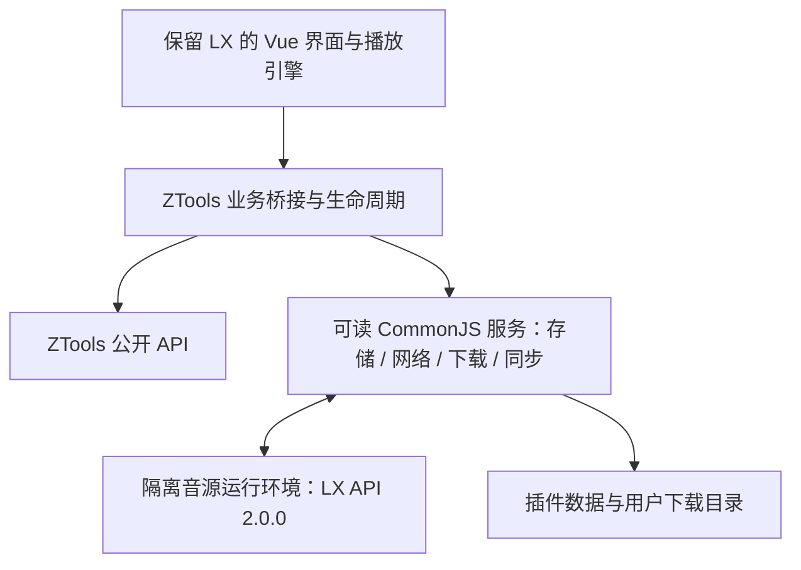

# LX Music 原生 ZTools 插件移植方案

日期：2026-11-09

版本：第二版，依据全部 14 页 ZTools 文档与本地源码重新核对。状态：设计与实施规划，尚未开始产品代码实现；文中的验证门槛是待完成工作，不表示已通过。

实施修订（2026-11-09）：用户指定在现有独立仓库 `D:\user\Documents\基础项目\lx-music-ztools` 实施。P0 已在隔离的已安装 app.asar + Electron 42.3.3 组合通过；细项见 `docs/ztools/host-capabilities.md`。当前不是完整移植交付，已实现/待验证范围见 `docs/ztools/compatibility.md`，下文未完成的门槛仍为待办。

P0 后固定的实现取舍：原 LX 源码作为 vendor/lx 只读基线，产品界面使用独立 Webpack，现有 Vite 保留诊断用途。音源使用可信 loopback frame 启动的 CSP 浏览器 Worker，脚本不进入 frame/插件页面；不采用未能初始化的 guest。结构化数据使用已经实测的 pluginData + 内置 node:sqlite，保留原 LX SQL 数据模型和事务，不附带 better-sqlite3；原“host db 不可变分块 + 活动指针”方案保留为背景比较，当前不实施，256 KiB 分块要求仅适用于未来 host db 方案。存储不跟随 ZTools 云账号切换，设备本地曲库由显式 LX 同步/备份迁移。运行时必须检测 SQLite 可用性，不对未验证宿主声明兼容。

## 需求与已确认选择

用户要求将 `https://github.com/lyswhut/lx-music-desktop.git` 参考 ZTools 官方插件规范移植，仓库允许拉取到当前工作目录。

用户补充并确认：

- 必须支持导入、使用 LX 自定义音源。
- 尽量完整移植，同时保留下载、排行榜、歌单、同步等功能。
- 采用原生插件移植，在 ZTools 内运行，不依赖另装 LX 桌面版。

本方案不将核心播放器演示视为完整交付。各模块可以分阶段实现，但最终应提供功能状态清单，未完成项不能标为支持。

## 当前源码证据

- LX 克隆路径：`D:\user\Documents\基础项目\lx-music-desktop`。
- 上游基线：`323e4bac`，master，package.json 版本 `2.12.6`。
- LX 使用 Vue 3、TypeScript、Pug、Less、Webpack，渲染入口是 `src/renderer/main.ts`。
- `src/common/rendererIpc.ts` 与 `src/renderer/utils/ipc.ts` 封装了前端到 LX 主进程的通信；ZTools 不会注册这些业务 IPC 通道，不能直接复用原通信。
- 搜索、排行榜、在线歌单在 `src/renderer/utils/musicSdk`；自定义音源独立于搜索，主要提供播放地址，不能只移植音源脚本运行器。
- 自定义音源接口版本为 `2.0.0`，原实现位于 `src/main/modules/userApi/renderer/preload.js`，有事件、网络、加密、压缩等能力。
- LX 主进程还负责配置、列表数据库、同步、系统窗口等；数据库使用带 Electron ABI 约束的 `better-sqlite3`。
- 本机 ZTools 源码位于 `D:\user\Documents\code\ztools`，本轮核对 HEAD `76addc6`、package 版本 `3.2.0`，用于只读参考及后续隔离实例验证，不等同于用户已安装客户端。本项目不修改 ZTools 主仓库。
- 已查看的 ZTools 插件视图和子窗口代码固定 `nodeIntegration: false`、`contextIsolation: false`、`webSecurity: false`。不能将音源直接注入插件特权页面，也不能假定传入 BrowserWindow 选项就能恢复 LX 的隔离边界。
- LX 的 `src/renderer/worker/download` 使用 Node 文件/网络模块；移植时不能继续依赖普通 Web Worker 拥有这些能力。
- LX 的列表/歌曲/排序使用 SQL 事务；ZTools `storageRouter.ts` 的 `bulkDocs` 可以逐条 put，不能假设跨文档回滚。当前 `lmdb/syncApi.ts` 的 put 有 1 MiB 文档检查，并可能返回错误结果对象而不抛异常。

## 移植路线比较

### A. 原生插件移植（用户已选择）

复用 LX 界面、音乐平台适配、播放、歌词、列表、下载、同步协议等模块，新增 ZTools 宿主适配层，替换独立应用生命周期及主进程通信。使用时只需要 ZTools。

代价是必须完成真实的宿主、存储、音源隔离和同步适配，不能仅添加 plugin.json。此路线符合用户要求，也使后续对齐上游改动成为可能。

### B. LX 桌面版配套控制插件（未选）

通过 LX 开放 API 或调用桌面程序保留其功能，移植量较小，但仍需单独运行 LX，不满足用户选择。

### C. 重写轻量播放器（未选）

新写小型界面与少量搜索、播放模块，启动快，但需要重新补齐下载和同步等行为，容易形成另一套产品，不符合尽量完整保留的目标。

## 交付形态与技术决定

以下为实施者建议，非用户额外指定：

- 在克隆仓库内开发 `codex/ztools-native-port` 分支，保留原桌面版入口；插件构建使用独立配置和入口。
- 尽量沿用 LX 现有 Vue 界面、导航与数据结构，对 ZTools 的小窗口适配布局，并支持宿主分离窗口。
- 插件 ID 暂定 `lx-music`，显示名暂定 `LX Music`，与 ZTools 插件中心已有名称冲突时再调整，不自动发布。
- 插件包包含 plugin.json、PNG 图标、页面资源、可读的 CommonJS preload 及其依赖源代码、许可与上游说明。
- 新增 preload 与其依赖不做打包、压缩或混淆，遵守 ZTools 规范；普通前端资源可以走构建流程。
- Windows x64 是首个验证目标；首包顶层 `platform` 声明 `['win32']`，这是实施建议。macOS/Linux 保持可移植代码，发布前另行验证。
- 构建环境沿用 LX 的 Node >=22 要求；插件运行时以实际 ZTools 的 Electron/Node 能力为准。文档中的 Node 16.x 描述和本机命令行 Node 版本都不能代替运行时检测。
- 保留 Webpack，插件使用独立 web 构建目标与相对资源路径，最终输出 `dist-ztools/`。不因为插件化更换前端框架。

## 架构与模块边界

### 1. 前端复用与宿主桥接

插件构建以现有 renderer 为基础，新增插件启动初始化。利用构建别名将 rendererIpc 等宿主相关模块换成插件实现，保留音乐业务界面。

提供请求、发送事件、订阅和取消订阅的统一桥接契约，维护 LX 原来的参数和返回值结构；同步 IPC 只读已准备的数据，不把 Promise 伪装成同步结果。桥接只调用插件服务，不将 LX 私有 IPC 发给 ZTools 主进程，不覆盖 ZTools 内部通道。

UI 入口使用 `onPluginEnter`，不用 `window.exports + mode: 'none'`。进入/退出/分离窗口/主题回调统一注册一次，再内部订阅分发；宿主单回调接口不能被各业务模块重复覆盖。保留 LX 主题选择，并增加“跟随 ZTools”，适配透明材质及深浅主题。前端只获得必要业务服务，不获得完整 fs、child_process、ipcRenderer 或任意 require。

整理当前 renderer 使用的 Node/Electron 入口，按类别决定保留在可读 preload 中、通过显式服务暴露、或替换为 ZTools API。不能仅把构建成功当作运行兼容。

### 2. 插件服务与持久化

设置使用 `dbStorage`，结构化数据优先使用 `db`，下载音频存入用户选择目录；脚本正文使用附件或分块，备份由显式导出写入。`getPath('pluginData')` 是本机源码可见、公开文档未详述的能力，仅作为缓存路径在前置验证中核实，基础结构化存储不再把它设为唯一前提。迁移通过显式导入 LX 备份进行，不自动打开原 LX 数据库。

保留 LX 数据服务契约，替换 SQL 后端。必须覆盖列表、歌曲、排序、批量变更、去重、不喜欢列表、下载记录、歌词/URL 缓存及同步快照，不能将接口替换成空返回。避免捆绑绑定单个 Electron ABI 的 better-sqlite3。

跨文档修改使用“不可变数据分块 + 单一活动版本指针”发布：先串行写齐新分块并逐项检查结果，再使用当前 `_rev` 更新活动指针。发布失败时旧版本仍可读；读者固定一个版本读取。保留上一完整版本，垃圾清理不得删除活动/上一版本和正在读取的版本。不能用 bulkDocs 代替事务成功判定。

实施建议：每块序列化 UTF-8 小于 256 KiB，清单/目录也分块，避免接近已知 1 MiB 边界。唯一写入服务接收 UI、下载、同步修改，提交成功后才发业务事件。宿主账号/存储切换时刷新上下文；提交前重新校验存储根标识，避免旧缓存写入新存储。ZTools 自身存储同步与 LX 协议同步分别处理，不视为互相替代。

存储适配器传给宿主的是文档副本，避免其为 `_id` 加前缀时污染应用对象。分块复用未变内容，不能每次播放进度更新都重写整个曲库。活动指针的 `_rev` 冲突判定、宿主账号切换与异步同步导致的“指针先到、分块后到”均属于 P0/P1 验证项：不完整版本不可激活，保持上一完整版本；不能依赖提交前的一次身份检查解决所有竞态。若公开接口无法绑定写入上下文，须在 P0 决定使用可验证的插件本地存储后端或限制存储切换期间写入，并说明行为；不得宣称未经证明的跨账号原子性。

首次运行不得触碰用户真实配置。验证使用独立临时数据目录。导入失败不得覆盖有效列表与设置。

全部备份的恢复必须同时覆盖设置和曲库：设置也按 revision 暂存，只有活动指针发布后才生效；普通 dbStorage 设置键可作为可重建镜像，不能让其提前生效造成新设置与旧曲库混用。

### 3. 音源兼容与隔离

支持本地 `.js` 和用户给定 HTTP(S) URL 导入、脚本信息查看、启用/切换/删除、初始化状态、音质选择及更新提示；保留现有 LX 导入大小约束并统一两种入口行为。

按 LX `globalThis.lx` API 2.0.0 实现：

- `EVENT_NAMES`、`on`、`send`、`version`、`env`、`currentScriptInfo`。
- `inited`、`request`、`updateAlert` 事件及其参数校验。
- `request(url, options, callback)`，包括请求方法、头、body/form/formData、超时、取消和响应对象。
- Buffer 转换、MD5、AES、RSA、随机数、inflate/deflate；行为对照上游，而非仅保留同名函数。
- `kw/kg/tx/wy/mg/local` 的能力和音质声明，播放 URL、歌词、封面返回值校验。

音源运行环境是第一项技术验证。首选验证独立非持久化 Session 的 guest WebContents/webview，保留 LX 的 `contextIsolation:true + 受限 contextBridge` 模式与同步加密工具。本机宿主源码开放 webview，但公开文档未承诺，必须实测 guest 实际配置、宿主 preload 是否注入、导航/弹窗/权限限制，以及失控脚本可终止性。

上一版直接选择 sandbox iframe 的依据不足：宿主关闭 webSecurity，且普通消息桥不能直接保持 crypto/Buffer 的同步返回。若 guest 无法建立隔离边界，备选独立浏览器 Worker + 同步 JS 加密/Buffer 实现；只使用标准 LX API 的脚本必须兼容，依赖 DOM 的脚本另做验证并明确限制。两种方式均不可行时先修订此设计，不改为特权 eval、Node vm 或另启 LX 桌面版。

音源不能访问 ztools、任意 Node 模块、插件存储或本地文件。crypto/Buffer 同步返回、HTTP 回调/取消和 zlib Promise 语义均按上游保持。每次启用生成会话代号，请求带 requestId；切源时取消旧请求并忽略迟到结果，脚本退出销毁上下文。初始化超时和失控脚本由上下文外部控制器终止。不能预先保证任意第三方脚本全部兼容。

超时、无 request 处理器、重复初始化、未知音质和失效 URL 都应显式显示失败，不伪造音源可用。

### 4. 搜索、榜单、歌单、歌词及播放

尽量复用 musicSdk 中现有平台模块及结果转换，保留源需要的歌曲 ID、hash、albumId 等原始字段，以兼容不同音源。实际搜索网络请求通过 preload 网络服务执行，避免浏览器跨域及禁止请求头限制。

保留搜索、分页、平台切换、排行榜、歌单浏览/导入、收藏及列表编辑、播放队列、播放模式、音量/进度和歌词显示。平台 API 故障与插件适配错误分别记录；单平台失败不得使整个界面无法启动。

复用现有音频引擎、AudioWorklet、歌词、音效及本地播放；验证中文路径及实际解码。`pluginSetting.backgroundRunning: true` 和 single 是本机源码可见能力，先验证再用于 manifest。隐藏、退出到后台、切换插件继续播放/下载/同步；强制终止停止。分离窗口和再次进入只保留一个播放器。数据在业务提交时持久化，不依赖强杀前一定能完成异步保存。再次打开恢复数据，不擅自自动发声。

### 5. 下载

保留添加任务、目录选择、并发/队列、暂停/取消/重试、进度、失败原因和记录恢复，复用原命名、歌词/封面及标签写入能力。下载从依赖 Node 的 renderer Worker 迁入 preload 服务，异步流式处理；纯计算 Worker 可以保留，密集转换按性能证据再迁入受控 Node Worker，不全局开启 Web Worker 的 Node 权限。使用任务专属临时文件，校验完成后再发布到目标路径。

处理无效文件名、同名文件、写权限、无 Content-Length、网络中断、重定向和取消。续传必须验证状态码、Range/Content-Range 与资源标识；不支持或资源变化时重下，不拼接损坏文件。未知长度显示已下载量；音源地址失效重新解析须有重试上限。网络头按请求管理，不全局污染宿主 Session。

下载位置由用户选择，插件内部数据与下载文件分开。杀死插件后任务在下次启动可恢复为可重试状态，不显示虚假完成。

### 6. 同步及开放 API

复用 LX 现有同步服务端/客户端协议、鉴权、列表及不喜欢列表事件、设备管理与冲突选择。通过插件服务初始化模块需要的事件总线和持久化契约，替换其中的 Electron 主进程依赖。

保留局域网同步和连接 LX 同步服务的能力；关闭同步、重新配置和终止插件时关闭 socket/监听端口。默认不开放监听端口，用户在设置中开启后才启动。

开放 API 复用现有接口行为并由插件生命周期管理，不擅自占用 LX 桌面版已经使用的端口；端口冲突给出明确提示。

### 7. 系统功能与宿主生命周期

安装器、桌面应用自更新、独立托盘与应用退出不适合原样套用：自更新交给 ZTools；原退出动作映射到退出/终止插件，不能退出 ZTools。窗口操作映射到宿主能力。

桌面歌词、全局快捷键、任务栏按钮、媒体会话与音效等逐项做能力映射。窗口代理只使用实际支持的方法并处理异步返回；播放快捷键使用插件指令及 `redirectHotKeySetting` 交给 ZTools 管理。宿主未提供且无法可靠实现的功能在状态清单中注明并在 UI 中解释，不留下可点击但无效的控件。不调用宿主 internal API。

ZTools 版本及宿主能力在启动时检查，缺少必要 API 显示明确错误。主搜索框命令支持打开播放器、搜索、播放/暂停、上一首、下一首，并保持一个播放实例。

## 验收与证据

最终交付内容：插件源码、独立构建命令、可加载的插件目录及压缩包、中文安装/使用说明、上游归属及许可、功能兼容与验证状态清单。

验证分层，不能混称：

1. 静态/构建：插件配置、资源路径、可读 preload、依赖包含、前端构建和必要类型检查。
2. 自动契约与回归：音源事件、加密/压缩、网络/取消、存储持久化、列表排序、下载中断/续传、同步协议及冲突处理。
3. 隔离 Electron/ZTools 集成：Playwright Electron 启动源码宿主，使用 `ZTOOLS_DATA_ROOT`、`ZTOOLS_LEGACY_USER_DATA_PATH` 临时目录，加载实际插件验证导航、导入音源、搜索到播放、后台继续、下载、重新进入及强制退出；只截插件 WebContentsView。同步至少与一个未修改的 LX 同步实现互通，不能仅用两个移植插件证明协议兼容。
4. 真实外部平台与用户音源：仅在具备有效音源和环境时记录实际结果。用户尚未提供真实音源，不自动搜索或预置第三方音源；可用本地测试音源及受控音频服务器验证完整链路，但必须注明不代表用户真实音源可用。

受控 E2E 使用本地测试音频：验证 loadedmetadata、播放时间推进、暂停/切歌和后台继续，另在实际客户端确认可听输出。下载验证文件哈希；真实平台只做必要低频验证。任何 BLOCKED 都不能当作 PASS。

规模/稳定性验收建议：10,000 首歌曲、100 个列表、连续 30 分钟后台播放和 50 次进入/退出/分离往返，检查监听器/资源增长、排序及重启结果。这些数值为实施建议。安装包还应在脱离源码根目录与开发 node_modules 后加载，避免遗漏运行依赖。

完成标准不是所有按钮可见，而是目标模块有真实实现和对应证据；如果某项因宿主或外部服务受限，需明确指出，不能将残缺版本称作完整移植。

## 实施阶段

| 阶段 | 交付与检查 | 依赖 |
|---|---|---|
| P0 宿主可行性 | 最小原 Vue 入口；音源隔离/同步工具；隐藏/分离/终止；存储返回值、大小边界及半批失败；实际运行时版本 | 无 |
| P1 基础适配 | IPC/Node 依赖清单、统一桥、生命周期、存储一致性、主题及全部路由 | P0 |
| P2 音源与播放 | 本地/URL 音源、搜索、播放、歌词、音效、本地文件、队列、收藏及后台播放 | P1 |
| P3 业务补全 | 排行榜、在线歌单、批量导入、下载/续传/标签、备份与相关设置 | P2 |
| P4 同步与系统集成 | 原 LX 协议互通、开放 API、快捷键、桌面歌词和差异说明 | P3 |
| P5 交付 | 隔离真实宿主全链路验证、完整依赖运行包、中文说明和状态清单 | P4 |

各阶段可单独验证，但不以 P2 作为最终交付。P0 失败必须记录证据并修订技术方案，不能通过 mock 成功隐藏宿主限制。实施计划见 [任务清单](../plans/2026-11-09-ztools-native-port.md)。

## 构建与发布边界

preload 和运行服务以清晰 CommonJS 源码交付，不 bundle/minify/混淆。需复用的上游 TS 主进程模块按原模块边界适配为可读 CJS，保留来源、版权和差异清单；不打包整个 LX 主进程。前端正常编译，Node 运行依赖及传递依赖在 preload 可解析位置组装，并带锁文件。

生产入口为本地 HTML，开发 URL 仅用于 development。插件版本与 LX 桌面 package 版本分别管理。`dist-ztools/` 和压缩包用于本地安装；`ztools publish` 是复制源码并产生远端 fork/提交/PR 的流程，不是本地打包命令，本轮不调用。保留 LICENSE、上游归属及第三方 notices；不自动改变许可证或添加支付/AI 功能。

## 功能完成标准

搜索/播放/音源、原界面与设置、列表/备份、榜单/歌单、下载、同步、开放 API 是正式交付目标。缺失任何一项须明确列为未完成；宿主特有的托盘、安装、自更新由 ZTools 接管。桌面歌词的置顶/穿透、任务栏、媒体键等单列宿主兼容性，不用无效控件冒充支持。

音源不是 ZTools Provider；后者目前用于翻译/OCR。ZTools AI、支付与服务端订单 API 已阅读，但不属于本次音乐移植范围。

## 尚由实施者决定

具体目录与桥接函数命名、按现有模块拆分的实现顺序、测试工具、默认窗口尺寸、样式微调及依赖版本由实施者结合实际代码决定。上述决定不得缩减用户确认的功能范围。

## 参考资料

- https://ztoolscenter.github.io/ZTools-doc/first-plugin.html
- https://ztoolscenter.github.io/ZTools-doc/plugin-json.html
- https://ztoolscenter.github.io/ZTools-doc/preload-js.html
- https://ztoolscenter.github.io/ZTools-doc/plugin-api.html
- https://lxmusic.toside.cn/desktop/custom-source
- 克隆仓库内 LICENSE、README.md 及上述源码。

本轮还完整阅读了 getting-started、file-structure、node-js、plugin-payment、developer-server-api、provider-development-guide、ai-api、ai-plugin-guide、vibe-coding、publish-and-update 页面，共 14 页；阅读副本位于父工作目录 `tmp/ztools-docs-20261109`。文档有入口必填项、feature.platform 和发布是否重放提交等描述差异，按专项页面和目标运行时核对。`pluginData`、backgroundRunning/single、webview 目前只有本机源码证据，不视为所有版本的公开保证。
