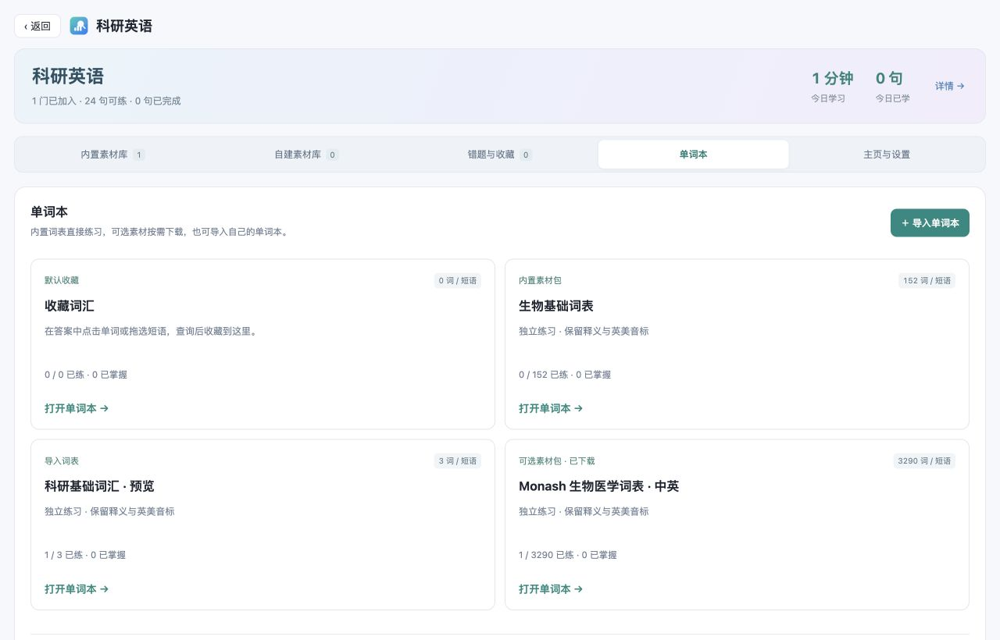
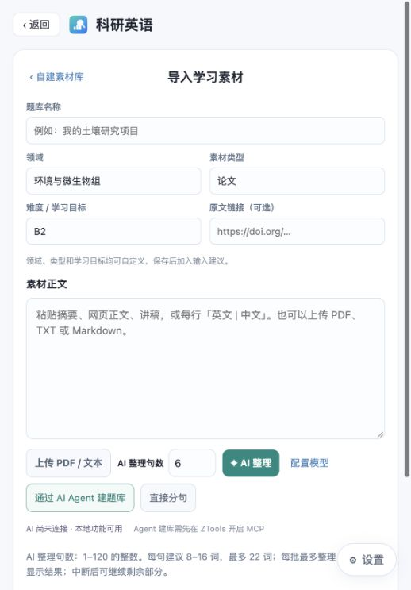

# 科研小盒

把查期刊、选投稿方向、分析文献和练科研英语放在一起的 **ZTools 插件**。

[下载安装包](https://github.com/Asa12138/micro-tools/releases) · [更新记录](CHANGELOG.md) · [反馈问题](https://github.com/Asa12138/micro-tools/issues) · [支持项目 ⭐](https://github.com/Asa12138/micro-tools)

## 快速开始

1. 安装 ZTools，从 Releases 下载科研小盒的 `.zpx` 文件，在 ZTools 插件管理中导入。
2. 在 ZTools 搜索框输入 **科研小盒**，选择需要的工具。
3. 需要 AI 时，打开右下角 **设置 → 连接 AI**，使用 ZTools 已配置的模型，或连接自己的 API / 本地模型。

查期刊、分析 BibTeX 和内置英语练习可直接开始。通过外部 AI Agent 调用工具时，先在 **ZTools 设置中开启 MCP**，再把连接配置添加到 Agent。

> 当前版本：**1.6.13**。安装包与更新说明见 [Releases](https://github.com/Asa12138/micro-tools/releases/tag/v1.6.13)。

## 主要功能

| 工具 | 可以做什么 |
| --- | --- |
| **期刊 · 会议查询** | 按刊名、缩写、ISSN 或会议名称检索，查看影响因子、JCR 分区、JCI 与 CCF 等级。 |
| **投稿助手** | 粘贴摘要，提炼研究特点，结合本地期刊库比较投稿方向，导出可离线阅读的报告。 |
| **文献图谱** | 导入 BibTeX，查看年度趋势、期刊分布、作者合作、关键词共现和研究类型，导出图表与报告。 |
| **科研英语** | 整句听写、拼图、阅读解析、跟读录音；收藏、错题本、单词本与 AI / Agent 自建题库。 |
| **数据库查询** | 快速跳转 NCBI、PubMed、UniProt、PDB、Ensembl 等数据库。 |

也可以在 ZTools 搜索框直接输入 `期刊 Nature`、`ccf CVPR` 或 `数据库 BRCA1`。

## 科研英语：选课就能练

进入 **科研英语**，在内置素材库或自建素材库选择课程，再切换听写、拼图、阅读或口语模式。错题与收藏、单词本、主页与设置各有独立入口。

- **内置入门课**：24 句科研表达，提供中文、结构拆分与 Andrew 美式男声音频。
- **可选素材包**：四包共 240 句，覆盖科研交流与博后面试、生信分析与可复现研究、微生物生态与环境研究、论文精读与学术讨论。点击“下载课程与音频”后加入内置素材，Andrew 音频可离线播放；已有课程可补下载配套音频。
- **练习与复习**：提交整句后统一判定，留空计错；解析提供句子结构、音标、词汇与科研追问。收藏夹、错题本和单词本集中复习，课程与记录长期保留。
- **声音与口语**：五种微软英式 / 美式男女音色附带试听；其他音色与自建新句按需联网生成。在线语音依赖服务和网络，可切换系统声音。口语支持本机录音与回放。

- **单词本**：内置 152 词生物基础词表，可选下载 3290 词 Monash 中英词表；也可导入 XLS / XLSX / JSON。独立打字界面支持顺序 / 随机、词典详情与音效。
- **主页与设置**：整月学习日历与每日记录，侧栏分组管理练习、声音、翻译、素材及备份；最近删除的题库可恢复或确认永久删除。

[查看月历与设置侧栏](docs/images/english-calendar.png)

| 快捷键 | 操作 |
| --- | --- |
| 空格 / Tab | 换词 |
| 方向键 | 移动光标或切换输入框 |
| Enter | 提交听写 / 拼图整句 |
| Alt + P | 播放语音 |
| Alt + A / Esc | 打开或关闭解析 / 关闭浮层 |

### 用自己的素材建课

在 **自建素材库** 中选择入口：

- **自建题库**：上传 PDF、TXT、Markdown，或粘贴正文。名称、领域、类型和学习目标可自定义；点击“AI 整理”旁边的“配置模型”连接 AI，再填写句数、生成、核对并保存。也可用“直接分句”处理英文或每行“英文 | 中文”。
- **导入题库**：导入本地课程 JSON、公开 HTTPS 课程 JSON 网址，或恢复题库与记录备份。
- **通过 AI Agent 建题库**：在素材页点击同名按钮，按步骤连接 MCP，把建库指令交给自己的 Agent。它可使用自己的工具读取 PDF、查找网页或视频字幕，再整理保存。完成后点“刷新 MCP 题库”。

PDF 在本机提取文本；扫描件需先 OCR。AI 支持一次整理 1–120 句，分批显示进度，中断后可继续。生成后先检查译文、解析和原文依据，再保存课程。

## AI 与 Agent 怎么选

**在插件里点 AI 按钮**：使用右下角设置中的模型配置。ZTools AI、自有 API 或本地模型均按所选服务处理请求，费用由对应服务决定。

**让外部 AI Agent 操作科研小盒**：先开启 ZTools 的 MCP 服务，将其提供的地址与认证配置接入支持 MCP 的 Agent。可让 Agent 查期刊、比较投稿方向、分析文献、导出报告或创建英语课程；这条路径使用 Agent 自身的模型，不调用插件配置的模型 API。

可以这样告诉 Agent：

> 使用科研小盒查一下 ISME Journal 的最新内置指标，并注明数据年份。
>
> 用这篇论文制作 12 句科研英语练习，保留真实出处，先校验预览，再保存为新课程。

连接后没有看到科研小盒工具时，检查 ZTools 的 MCP 服务及工具启用状态，并重新连接 Agent。需要支持插件 MCP 工具注册的 ZTools 版本。

## 数据与保存

- **期刊 / 会议指标**：使用本地 JCR 2026 快照（2025 JIF）与 CCF 第七版（2026.3）。这里的分区是 JCR 分区；指标反映所标注年份。
- **英语素材**：内置句子和四包课程为原创教学表达，请按真实项目修改。生物词表来自用户提供的双语文件，保留原表释义与音标；Monash 名称沿用源文件，不表示官方审核。自建课程保留提供的来源。
- **联网范围**：AI 整理会将素材正文发给所选模型；翻译发送所选文字；在线语音发送待朗读句子；课程、词表与配套音频从 GitHub Pages 下载；词典查询发送所选英文到词典服务。
- **本机保存**：学习足迹保存在当前设备；直连 AI 和翻译凭据保存在独立本机凭据文件，重启可继续使用，不进入课程备份。音频与录音保存在当前设备。课程与学习记录使用 ZTools 插件存储，是否同步取决于宿主设置。
- **备份与导出**：在主页与设置中备份题库与记录，录音单独下载。投稿与文献分析结果请及时导出；它们不作为长期历史库保存。

## 常见问题

**下载课程后没有声音？** 先确认选择 Andrew，且配套音频已下载。其他音色、自建新句需要在线生成，网络失败时可重试或切换系统声音。

**另一台电脑能接着学吗？** 题库和记录可通过备份导入；音频需在那台设备重新下载，AI / 翻译凭据需单独配置。录音不包含在题库备份中。

**AI 整理失败怎么办？** 按按钮附近的报错检查正文、模型连接与句数。已完成批次会保留；可以继续生成或保存已完成部分。

**如何反馈？** 在 [GitHub Issues](https://github.com/Asa12138/micro-tools/issues) 附上科研小盒版本、ZTools 版本、操作系统和复现步骤。截图请隐藏密钥及未公开研究内容。

---

作者：[Asa12138](https://github.com/Asa12138) · [第三方语音与词典许可说明](ENGLISH-LICENSES.txt)
