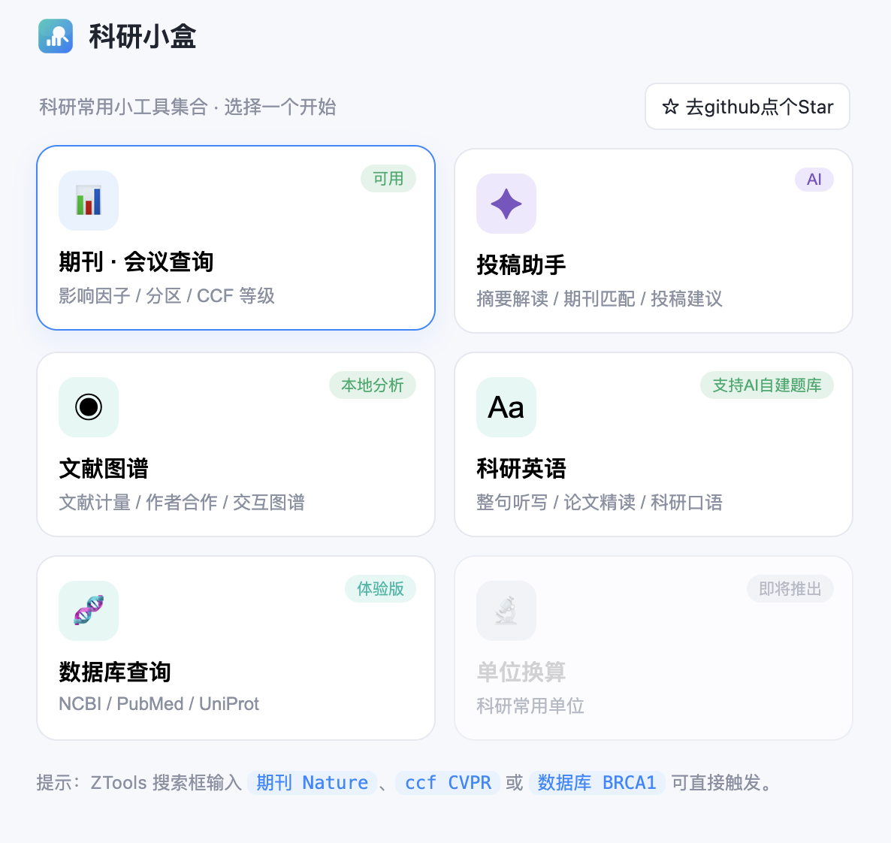

# 科研小盒

面向科研工作者的 **ZTools 工具箱**：查期刊、选投稿方向、分析文献、练科研英语。

[下载安装包](https://github.com/Asa12138/micro-tools/releases) · [科研英语网页版](https://asa12138.github.io/apps/research-english/) · [素材广场](https://asa-english-community.netlify.app/) · [反馈问题](https://github.com/Asa12138/micro-tools/issues) · [去 GitHub 点个 Star ⭐](https://github.com/Asa12138/micro-tools)

当前版本：**1.7.7** · [更新记录](CHANGELOG.md)

## 安装

1. 从 [ZTools 官方下载页](https://github.com/ZToolsCenter/ZTools/releases/latest) 下载并安装适合系统的 ZTools。
2. 从 [科研小盒 Releases](https://github.com/Asa12138/micro-tools/releases) 下载 `.zpx` 安装包，在 ZTools 插件管理中导入。
3. 在 ZTools 搜索框输入 **科研小盒**，选择工具开始使用。需要 AI 时，在 **设置 → 连接 AI** 中选择 ZTools 模型、自有 API 或本地模型。

## 主要功能

| 工具 | 用途 |
| --- | --- |
| **期刊 · 会议查询** | 按名称、缩写或 ISSN 检索，查看影响因子、JCR 分区、JCI 与 CCF 等级。 |
| **投稿助手** | 根据标题与摘要比较投稿方向，结合本地期刊库生成并导出分析报告。 |
| **文献图谱** | 导入 BibTeX，分析年度趋势、期刊分布、作者合作与关键词共现，导出图表和报告。 |
| **科研英语** | 整句听写、拼图、打字练习、跟读录音，以及单词本、收藏与错题复习。 |
| **数据库查询** | 快速前往 NCBI、PubMed、UniProt、PDB、Ensembl 等数据库检索。 |

## 科研英语

- **选素材就能练**：内置科研表达与生物词表，也可从 [素材广场](https://asa-english-community.netlify.app/) 获取课程、单词本，分享自己的文本素材。
- **用自己的材料建课**：导入 PDF、TXT、Markdown 或粘贴正文，交给 AI 整理；也可复制完整提示词给自己的 Agent，生成课程 JSON 后导入，无需 MCP。
- **听读与复习**：微软语音按需生成并缓存，支持五种音色、跟读录音、单词发音、错题与学习足迹。
- **直接在浏览器使用**：[科研英语网页版](https://asa12138.github.io/apps/research-english/) 与 ZTools 共享英语模块源码和版本。微软在线语音目前已验证 Edge 可用，其他浏览器可选择系统声音。

网页版数据保存在当前浏览器，不会自动同步到 ZTools 或其他设备；清除网站数据会删除本地记录，请定期导出备份。详细说明见 [网页版使用与兼容性](https://github.com/Asa12138/micro-tools/blob/main/web/english/README.md)。

## AI 与数据

- AI 功能使用你选择的模型；也可在 ZTools 中开启 MCP，让外部 Agent 查期刊、分析文献或创建英语课程。
- 期刊指标使用本地 **JCR 2026 快照（2025 JIF）**，会议等级使用 **CCF 第七版（2026.3）**；查询结果显示对应数据年份。
- PDF 与 BibTeX 在本机解析。AI 整理会发送素材正文，翻译发送所选文字，在线语音发送待朗读句子。
- 课程与学习记录支持备份、导入和导出；录音需单独下载。反馈问题时请附版本号和复现步骤，并隐藏密钥及未公开内容。

作者：[Asa12138](https://github.com/Asa12138) · [第三方许可说明](vendor/ENGLISH-LICENSES.txt)

素材维护与接入：[素材规范 v1 与 JSON 示例](docs/english-material-spec-v1.md)。
