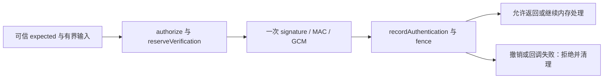

# G3 V2 Crypto 组件接口与使用边界

> 状态：已实现的独立库组件，生产宿主与同步链未接线。审查与运行结果统一见 [EVIDENCE_INDEX.md#v036](EVIDENCE_INDEX.md#v036)；本文界定现有组件，不单独宣称完整 G3 验收。

设计依据为[已接受 G3 crypto ADR](G3_CRYPTO_ADR.md)，受审内容 SHA-256 为 `cdf462681a8170c5e2a92089d23c22817217df9d956b5bcff3edeb498b577d00`；wire 字段和实现映射见 [G3_WIRE_IMPLEMENTATION](G3_WIRE_IMPLEMENTATION.md)。后续可变验证结果由实施状态及根收据维护，不在本页重复测试流水。

## 模块与可信调用方

- `@pasteboard-pro/sync-protocol/v2` 是[严格 wire/schema 入口](../../packages/sync-protocol/src/v2.ts)：结构合法、canonical、版本可理解均不等于内容已认证、来源可信或获得激活许可。
- `@pasteboard-pro/sync-protocol/v2-node` 是[Node crypto 入口](../../packages/sync-protocol/src/v2-node.ts)：实际执行 HKDF/scrypt/AES-GCM、控制签名/MAC、publication MAC 与认证恢复。
- 两个子路径均未自动接入旧 `sync-runtime`、V1 root exports、固定 V1 凭据槽、当前产品调用方或 feature flags。测试存在不表示 `formatSyncV2` 可以开启。
- 原始 key、password、recovery secret、admin seed 仅供未来静态可信 host/helper 持有；本组件不是 renderer 桥。内部确定性执行函数只供同包公开 fixture 测试，未从生产 `./v2-node` 入口导出。

## 创建 codec 的必需依赖

`createV2NodeCodec(options: V2NodeCodecOptions)` 要求 `limits.maxPlaintextBytes`、`authorization` 和 `budget`，其[类型契约](../../packages/sync-protocol/src/v2-node/types.ts)如下：

| 接口 | 必需方法及宿主责任 |
| --- | --- |
| `V2AuthorizationAdapter` | `authorize(request)` 返回 `V2Lease`；`fence(lease)` 检查当前安装、scope、policy、generation 与角色。签 control 必须来自独立 admin 授权。 |
| `V2BudgetAdapter` | `reserveSeal`、`registerAttempt`、`reserveVerification`、`recordAuthentication`。持久域注册、单调 counter、immutable wrapper ID、attempt 唯一性、验证总预算及失败锁定由可信宿主实现。 |
| `V2Lease` | `token` 与 `mode: registered | bootstrap-prepare`。bootstrap 仅允许 root wrapper/keyring seal，不允许普通对象。 |
| `V2AuthorizationRequest` | 操作、冻结 scope、绑定摘要及可选 descriptor/domain/`verificationUnit`；候选字段仅用于有界验证准备，不能自授写权限。 |

缺少必需适配器/方法即 `unavailable`，没有默认 no-op authorizer 或内存持久性替代。运行时故障和 revocation 以固定错误码拒绝。[CodecGate](../../packages/sync-protocol/src/v2-node/gate.ts) 的进程内 counter/wrapper 检测只是补充，不实现 durable registry 或跨重启保护。实际限制取端到端已验证能力最小值，不能把配置上限当 RSS/超时硬限额。

## 实际操作与返回

以下方法均返回 Promise；`root`、`adminSeed`、`recoverySecret` 为可信 helper 内的 32-byte 材料。对象结构见[入口](../../packages/sync-protocol/src/v2-node.ts)及[codec](../../packages/sync-protocol/src/v2-node/codec.ts)。

| 方法 | 输入与输出 |
| --- | --- |
| `sealObject` | `V2SealInput {context,root,plaintext,authority}` → 完整 container bytes。context 为 `V2SealContext`；authority 为已签 control/expected，或限定 bootstrap。生产 attempt/nonce 由 Node CSPRNG 产生，调用方不能指定。 |
| `openObject` | `V2OpenInput {root,envelope,expected}` → `V2OpenResult`：`ok` 含 authenticated plaintext；合法未来 projection 为 `quarantine`，仅保留原 container，不返回 plaintext。其他未知 whole version 停止。 |
| `wrapPassword / wrapRecovery` | seal 输入去掉 plaintext，另给 password 或 recoverySecret → 新 immutable root-wrap container；plaintext 固定 raw root32，revision 固定 `0`，新包装需新 objectId。密码包装 salt 由 CSPRNG 生成。 |
| `unlockPassword / unlockRecovery` | control bytes、`V2TrustedControlContext`、对应解锁材料 → raw root bytes；先验证锚定签名，再 KDF/GCM/root MAC。不会返回 writer/admin 授权。 |
| `signControl` | 不含 rootMac/adminSignature 的 `ControlV2` body、root、adminSeed → 完整 canonical control bytes。 |
| `verifyControl` | `V2ControlInput {control,root,expected}` → 已核签名及 root MAC 的 `ControlV2`。 |
| `signPublication / verifyPublication` | 前者接 body/root/control/controlExpected 返回 canonical publication；后者接 `V2PublicationInput` 返回认证 `PublicationRootV2`。 |
| `verifyControlSuccessor` | previous/next `V2ControlInput`、previousPublicationSha256 → 验证后继 control；同时核对同 epoch key 相等、新 epoch key 不同。 |
| `verifyPublicationSuccessor` | previous/next `V2PublicationInput` → 验证 MAC、revision/previous digest 和 epoch 不回退；升 epoch 本身不授予 admin 权限，仍须已认证控制链。 |
| `recoverPackage` | packageBytes、可信 `expectedPackageSha256` → 仅恢复完整离线锚点。 |
| `recoverPackageToControl` | `V2RecoveryInput`，含可选 `V2RecoveryStep[]` 的 control/publication/keyring bytes → 验证可达后继及历史 keyring 后恢复。不会自行发现或选择远端 HEAD。 |

`V2Expected` 完整绑定 scope、epoch、type、ID、revision、purpose、container SHA；blob 还需 projection 给出的 `blobBinding`。可信 `V2TrustedControlContext` 绑定 admin 公钥、rootId、managementInstanceId、control revision/hash；`V2TrustedPublicationContext` 绑定 publication 与对应 control 的 revision/hash。不得直接把未认证 header/远端自述当 expected。

## 每次认证预算与 fence

[verification](../../packages/sync-protocol/src/v2-node/verification.ts) 对每次实际验证使用独立单位，失败也记录结果；签名准入不是昂贵 KDF，签名必须通过才运行密码 KDF。

- `verificationUnit` 实际值为 `control-signature`、`control-root-mac`、`publication-mac`、`gcm-envelope`。每次都有 reserve 与对应 true/false；恢复循环不能共享一次 begin 预算。
- 验证失败记录 false；crypto 成功后 policy/scope 撤销仍计入真实 true，但不释放材料，不把撤销伪报为 crypto 失败。当前记录 lease 与父恢复 lease 都跨 await 检查；预算或结果回调异常失败关闭。
- 重复实际检查保守重复计费。当前[正式测试](../../packages/sync-protocol/tests/v2-crypto-recovery-security.test.ts)核对：锚点恢复5次，同 control 后继另加3次，新 epoch 包装/control/publication/keyring路径另加7次。它们是当前调用图的例子，不是所有流程的常量。
- unknown、崩溃或失败的预留不退款、不复用。durable 落盘、会话失败锁定和 helper 终止确认仍需宿主适配器，库没有实现这些平台保证。

## 恢复材料与内存边界

[恢复实现](../../packages/sync-protocol/src/v2-node/recovery.ts)校验 package checksum、seed 公钥 fingerprint、签名 control、其绑定 scope/epoch 的 publication MAC，以及后继链和精确 keyring descriptor/digest。checksum 只是损坏检测，不是独立 authority。已认证 epoch/root 关联保留到比较完成，首个 keyring 也不得覆盖锚点；跨 epoch 不得复用已知 root。

恢复结果包含 `status: read-only-recovered`、scope、root、历史 roots、rootId/managementInstanceId、control/publication hashes 和 `freshness: trusted-anchor-only`；不返回 adminSeed 或 writerDomain grant。该标签不隔离持有 raw key 的恶意调用者；未来可信 owner 必须限制材料访问及写权限。恶意服务可隐藏 HEAD，远端已删除的数据不能凭包恢复。

输入 bytes/key/context 采用 owned copy，拒绝 SharedArrayBuffer；GCM update 的未认证 bytes 不输出。临时 root、派生 key、密码/恢复 bytes、失败后已认证中间输出在相应 finally/错误路径尽力擦除；成功返回的 key 由 helper 接管。JS 字符串、复制、GC、Node/OS 缓存无法保证物理抹除。scrypt 仍须在受监督 helper 执行，Node 线程池不是取消、硬内存限额或终止确认。

## 证据与未实施边界

- 独立 Python 输入与 expected bytes：[crypto-v2.json](../../packages/sync-protocol/fixtures/crypto-v2.json)、[生成器](../../scripts/generate-crypto-v2-fixtures.py)、[interop](../../packages/sync-protocol/tests/v2-interop.test.ts)。组件反例另见 [budget/owned 输入](../../packages/sync-protocol/tests/v2-crypto.test.ts)、[恢复控制链](../../packages/sync-protocol/tests/v2-crypto-records.test.ts)和[安全回归](../../packages/sync-protocol/tests/v2-crypto-recovery-security.test.ts)。
- 实际应用、独立探针、限定代码审查与运行证据统一由 [v036 证据索引](EVIDENCE_INDEX.md#v036)关联；proposal review、组件实际验证与完整 G3 验收分别判定。
- counter store、可信 keystore、helper watchdog、current policy、native monitor owner、域/attempt registry、transport、持久 checkpoint、target sourceSeq/CAS activation 均未由本组件交付。
- Windows 实机和 G3 六方向仍未完成；crypto library 测试不能替代系统格式保真、真实 ZTools/ATools、原生 OS、目标应用或完整 G0–G4 验收。
