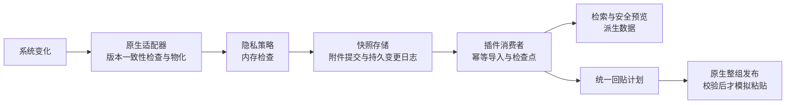

# Paste 格式保真与可靠采集技术方案
v0.32 当前仅在插件目录实现[精确清理身份与回灌抑制](HISTORY_CLEAR_BOUNDARY.md)；[根证据](validation/v032/v032-root-evidence.json)。v0.31 [宿主接线](HOST_V2_INTEGRATION_CONTRACT.md)与[回贴/portable契约](V2_PLANNER_PORTABLE_CONTRACT.md)仍为 NOT-IMPLEMENTED 设计，属于本轮范围外依赖；完整 G0—G4 未通过。
v0.30 历史图片重试轮转与清空串行化说明：[实现记录](HISTORY_IMAGE_RETRY_ROTATION.md)。 机器收据见[v0.30 根证据](EVIDENCE_INDEX.md#v030)。
v0.28根证据：[root evidence](EVIDENCE_INDEX.md#v028)；独立源码review：[review](EVIDENCE_INDEX.md#v028)，结论为有限范围APPROVE；完整G0—G4仍未通过。
v0.29 Windows存储基础源与15项原生探针说明见[Windows基础层](WINDOWS_STORAGE_FOUNDATION.md)：当前仍全部NOT-RUN，Windows store仍在创建目录前失败关闭，不构成G1 durableReady。 本轮范围与未完成项见[根证据](EVIDENCE_INDEX.md#v029)。
Windows 10/11 的105项原生cases仍NOT-RUN；v0.27 Windows source kit本轮未改动。Windows 12及后续版本需另行建立G0—G3门禁。
v0.27根证据与文档审计字段：[root evidence](EVIDENCE_INDEX.md#v027)。根收据记录`gateComplete=false`。

v0.26根证据与文档审计字段：[v0.26 root evidence](EVIDENCE_INDEX.md#v026)。最终字段见根收据。
v0.24历史根证据：[root capsule](EVIDENCE_INDEX.md#v024)。


版本：实现基线 v0.30；v0.31 补充主路径设计候选；日期：2026-10-28。G0—G4完整目标不变，设计不代表实现或验收。
RTF隐私投影的706项定向矩阵和17项package smoke属于v0.24历史，不是本轮重跑。Windows105项NOT-RUN，Mac完整G0/portable/ASan/JS/watchdog没有本轮重跑；生产host/general clipboard/current-policy/target应用与完整G0—G4仍未完成。
v0.23历史根证据：[root capsule](EVIDENCE_INDEX.md#v024)。
v0.21历史根证据：[archived root capsule](EVIDENCE_INDEX.md#v022)
v0.22历史根证据：[archived root capsule](EVIDENCE_INDEX.md#v023)。

## 1. 目标与决策

采用“宿主采集多格式快照、插件管理不可变表示、统一写回”的方案。格式保真与可靠存储同时交付，不能只扩展示类型。

macOS、Windows 10、Windows 11 同为首期 P1 必选平台，同期交付文本、HTML、RTF、表格、标准图片与多文件引用的采集—持久化—回贴闭环。Windows 12 及后续正式版本纳入向前兼容目标，取得正式系统/SDK后独立验收，不凭版本名称承诺已支持。Linux 单独验证 X11/Wayland。

保证范围：对隐私策略允许、格式适配器支持、已持久提交的表示，在保留策略或显式删除生效前保证字节校验、重启恢复及回贴流程不静默降级。系统未观察到且已被覆盖的旧剪贴板值不能追溯恢复。不能承诺所有应用私有格式、所有复制速率、所有目标应用都无损。

核心决策：

1. 一次复制是一份快照，包含有序 item；每个 item 可以同时有文本、HTML、RTF、图片等多个 representation。卡片 kind 只是展示分类。
2. 原始字节、兼容投影和预览分开。预览转换不覆盖原件。
3. 插件不在读取历史时用“当前剪贴板”补旧记录。
4. 写回提交整组表示，不循环调用单格式 writeBuffer。
5. 格式 V2 与旧本地存储、旧同步库隔离；旧数据可导入，新格式不降级回写到旧库。
6. 未支持、超限、权限拒绝、保存失败和部分成功都有明确状态，不能当作完整采集成功。

### 1.1 平台范围与支持声明

| 平台 | 本次方案要求 | 验收基线 |
| --- | --- | --- |
| macOS | 首期P1必选 | Apple Silicon / Intel按宿主正式产物分别冻结OS build和native构建；NSPasteboard多item单独验收。 |
| Windows 10 | 首期P1必选，与macOS同优先级 | 22H2 x64为基础，LTSC/其他功能版本单列；具体edition/build/补丁状态、宿主能否启动和所有P1格式都要有证据。 |
| Windows 11 | 首期P1必选，与macOS同优先级 | 初始x64矩阵包含24H2、25H2、26H2，每项记录edition/build及生命周期状态，不把Home/Pro与Enterprise/Education混为同一支持结论；ARM64与26H1等不同系统分支是独立条件目标，须补齐正式产物和运行验收，不拿x64仿真替代原生。 |
| Windows 12及后续 | 明确的未来正式版本兼容目标 | 保持win32 adapter与能力协商可扩展；取得微软正式版本标识、镜像/SDK和可运行宿主后，补齐同一P1矩阵再标支持。当前状态待确认/NOT-RUN。 |
| Linux | 独立平台扩展 | X11/Wayland、宿主构建和权限各自验证；不由Windows/macOS结果推断。 |

以上是产品兼容目标，不等于微软或Electron的生命周期承诺。2026-10-27核对的微软正式发布目录包含Windows 10 22H2与Windows 11多个版本，未列Windows 12；因此不虚构其build或测试结果。Windows 10生命周期与本插件兼容目标分开管理，不能因其通用支持结束就从需求中删掉。[Windows正式版本目录](https://learn.microsoft.com/en-us/windows/release-health/)、[Windows 10版本资料](https://learn.microsoft.com/en-us/windows/release-health/release-information)、[Windows 11版本资料](https://learn.microsoft.com/en-us/windows/release-health/windows11-release-information)

共享core/schema/journal/同步协议，macOS和Windows各有独立capture/publisher实现。以实际加载成功的adapter、格式codec和合成读写自检协商capabilities；OS名称/build用于证据和兼容策略，不能用“NT 10.0”“Windows>=10”直接放行全部格式。支持清单按OS build×架构×宿主/native构建×格式×目标应用发布，未验证组合明确标待验证。

## 2. 已核实的现状与版本

- 本机macOS宿主实际安装包 ZTools 3.2.0，Electron Framework 41.4.0；Windows包/运行时版本须另行冻结，不能继承本机运行证据；源码工作区 package.json 也锁定 Electron 41.4.0，但宿主 checkout 标注 3.0.1。
- 当前宿主历史主要保存单类型 text/image/file；插件 payload 仅含 text/html、单个 blobId、mediaType、filePaths。
- 当前普通回贴和队列回贴分别实现；HTML 支持一次写 text+html，但没有通用多格式整组写入结果契约。
- Zod 默认解析和 merge.clonePayload 都只保留已声明字段；直接给现有 payload 增加 representations，旧客户端会静默丢字段。
- 当前宿主electron-builder.yml的Windows NSIS/ZIP仅配置x64；resources/lib/win/ztools_native.node经文件头检查为x86-64。Windows ARM64尚无本次核实的原生产物，不能随Windows11目标一并标已支持。
- 宿主原生监听源码未在当前工作区找到，不能假定现有二进制已支持版本标记或多格式批写。
- 原采集审计确认图片补存失败缺乏恢复，宿主写入失败仍推进去重标记；详见[原采集审计](EVIDENCE_INDEX.md#local-raw-artifact-archive)。

Electron latest 文档目前已展示不同的新接口，不能套用于 41.4.0。固定版本源码的 write 接受受限的 text/bookmark/RTF/HTML/image 字段；每次 writeBuffer 建立独立 writer。方案按当前版本实现与能力探测设计。[Electron 41.4.0 实现](https://raw.githubusercontent.com/electron/electron/v41.4.0/shell/common/api/electron_api_clipboard.cc)

## 3. 格式支持与保真等级

| 格式 | 首期目标 | 留存方式与回贴边界 |
| --- | --- | --- |
| Unicode 纯文本 | P1 必须 | 保留原生文本 bytes 与明确编码；用于检索的文本投影另存，避免改变原换行/Unicode。纯文本回贴显式选择该表示。 |
| HTML 富文本 | P1 必须 | 同项保存原生 HTML、plain fallback 与必要片段上下文；标题/链接/列表/表格通过目标应用验收。 |
| RTF | P1 必须 | 原 bytes 与 plain 投影共存；字体/颜色/段落保真通过支持 RTF 的目标应用验收。 |
| 表格 HTML + TSV | P1 必须 | 同次复制的 HTML 与 TSV 各自保存；验证行列、空格、换行与已声明的合并单元格范围。公式、工作簿对象与全部 Excel 样式不由 HTML/TSV 承诺。 |
| PNG/JPEG/TIFF | P1 必须 | OS实际提供原始编码bytes时保存原件；PNG/TIFF像素验证与预览单独进行，不覆盖原件。Windows当前仅实现Classic TIFF 6子集；BigTIFF、未知类型及自定义私有指针图明确unsupported，完整范围见第5.4节。只有解码位图时记录为像素兼容表示，不宣称恢复源文件编码。 |
| PDF/SVG | P2 条件支持 | 需要独立验证原始数据、受限解析/预览和目标应用；当前 UI 的 pdf 分类不代表已具备格式保真。 |
| HEIC/GIF/RTFD 附件 | P2 条件支持 | 只有平台提供可独立物化的数据且 codec 与目标应用验证通过才标支持；动画/色彩/附件不可用时保留明确降级状态。 |
| 多文件/目录 | P1 引用保真 | 保存有序 URL/path 引用与来源设备，检测可用性；不复制文件正文，不同步其他设备无法访问的本地路径为可粘贴文件。文件承诺/虚拟文件另列 P2。 |
| URL/颜色 | P1 | 保留系统提供的表示，UI 的 url/color 是分类；不得把原内容改写为应用自造 JSON。 |
| Office/Figma/Adobe 私有表示 | P2 逐项适配 | 默认只报告未支持；经格式用途、字节结构、同机回贴、安全和实际版本矩阵验证后加入 allowlist。 |
| 任意私有/handle/owner callback | 不承诺通用支持 | 不能把进程指针、句柄或回调当可持久化 bytes；拒绝或经专用 codec 物化，不能直接重放。 |

Windows v0.9增加Classic TIFF 6.0解析：支持LE/BE、多个main IFD页，以及受限的SubIFD/EXIF/GPS/Interop与strip/tile/free/JPEG/typed opaque ICC数据引用图。逻辑长度按最大被引用extent确定；仅允许分配缓冲区末尾全零padding，无法解释的非零尾部按ambiguous拒绝。BigTIFF、未知field type、自定义私有pointer graph不支持。此解析与像素验证不代表全部TIFF变体或色彩外观保真。

保真等级：exact=已保留相应原始表示字节；compatible=已转换为目标平台支持的表示；reference=文件引用；unsupported/partial=存在未获取表示。exact 也不等于所有目标应用都采用该表示。

Windows CF_HTML 含 UTF-8 字节偏移和片段上下文；应保原生表示，跨平台转换时重新生成偏移，不能把 JS 字符索引当字节偏移。[Microsoft CF_HTML](https://learn.microsoft.com/en-us/windows/win32/dataxchg/html-clipboard-format)

HTML 外部资源只保留引用，不自动联网下载；data/cid/本地临时资源只有已被允许的附件 codec 成功归档后才有离线保真。未归档资源标记 partial。RTFD 不能默认压成普通 RTF 后仍标 exact。

## 4. 架构与职责



| 模块 | 归属 | 小接口与责任 |
| --- | --- | --- |
| PlatformCaptureAdapter | 宿主原生 | captureCurrent(expectedRevision, limits)：返回拥有字节所有权的多 item 快照或具体失败原因。 |
| SnapshotJournal | 宿主主进程 | commitCapture / readChanges(after, limit)：持久变更序列、完整 manifest、blob 引用、outcome；不依赖时间戳分页。 |
| FormatCodecRegistry | core/宿主 | 对实际变化的 MIME/UTI/native 类型做验证、存储、投影及发布计划；不暴露任意格式读写给 renderer。 |
| SnapshotRepository | 插件 preload | importChanges / getManifest：幂等导入、附件队列、检查点、旧数据导入与垃圾回收。 |
| PastePlanner + ClipboardPublisher | 插件计划、宿主执行 | plan(snapshotId, mode) / publish(planId)：单条、普通回贴、纯文本和队列都复用。 |
| PreviewProjector | 插件 | 无网络的安全预览与文本索引；不可反向覆盖原 representation。 |
| FormatVaultV2 | 同步 | 版本协商、manifest/多 blob 校验、E2EE、缺附件恢复；不改旧客户端可写库。 |

现有 preload/index.ts、clipboard-store.ts 和宿主 clipboardManager.ts 已经很大；新增能力放独立模块，旧文件只做组合接线。每个新代码文件小于 500 行，不按行数拆无语义文件。

## 5. 快照契约与采集

概念模型；实际严格schema现已定义在 packages/core/src/clipboard-snapshot-v2.ts，宿主存储与生产桥接尚未接入：

```ts
type FormatIdentity = { representationKey: string; formatId: string;
  nativeName: string; mime?: string };
type RepresentationV2 = FormatIdentity & (
  | { state: 'ready'; storage: 'blob'; fidelity: 'exact' | 'compatible';
      byteLength: number; sha256: string; blobRef: string; derivedFrom?: string }
  | { state: 'ready'; storage: 'file-reference'; fidelity: 'reference';
      originDeviceId: string;
      references: Array<{ url: string; isDirectory: boolean;
        observedAvailability: 'available' | 'missing' | 'unknown' }> }
  | { state: 'unsupported' | 'timeout' | 'over-limit' | 'failed' | 'policy-blocked';
      reasonCode: string }
);
type SnapshotManifestV2 = {
  schemaVersion: 2; snapshotId: string; manifestRevision: string;
  source: { hostEpoch: string; platform: 'macos' | 'windows' | 'linux'; osRevision: string;
    capturedAt: string; osBuild: string; architecture: string; adapterVersion: string;
    itemModel: 'macos-items' | 'windows-format-set' | 'linux-clipboard';
    sourceApplication: { kind: 'bundle-id' | 'aumid' | 'executable' | 'unknown';
      identifier?: string };
    attribution: 'trusted' | 'heuristic' | 'unknown' };
  policyReceiptId: string;
  items: Array<{ index: number; representations: RepresentationV2[] }>;
  coverage: { requested: number; captured: number; omitted: number };
  captureState: 'ready' | 'partial' | 'failed';
};
```

representationKey 在一个 manifest 内唯一，日志/发布清单以该 key 定位，不能仅凭 formatId 混淆不同 item。captureState=ready 要求全部请求表示均已持久化且无省略；有可用子集但有省略为 partial，无可用表示为 failed。尚未取得可提交载荷的 pending 是独立 CaptureAttempt/设备导入状态，不伪造 ready manifest。

schema 必须验证 ready/blob 的非负安全整数长度、SHA-256、有效 blobRef，文件引用必须非空且校验 URL、来源设备；失败分支不接受伪造的 fidelity/blob。文件引用的当前可用性由设备状态另存，不修改原始观察记录。

格式 bytes 统一走不可变 blob 引用，不把大 base64 放进 item JSON。item 及表示的原始次序、相同 native type 在不同 item 的关系必须保留。元数据字段限长，格式集合的规范化顺序、编码和哈希算法固定；内容哈希 SHA-256；不沿用旧文本/路径 FNV hash 作为完整格式集合的等价判断。

Windows 首期只有一个逻辑 item，内部保存同一剪贴板对象的格式集合；CF_HDROP 的多个文件是该 item 的引用列表。macOS 则保留真实 NSPasteboardItem 次序。macOS 多 item 无法映射至 Windows 时返回 unsupported-item-model；不静默合并或串联，只允许用户显式选择兼容转换/队列。

### 5.1 采集流程

1. native owner 收到变化，记录 revision/source metadata；先用应用排除与系统 confidential/transient 标记做 preflight，排除内容不落盘。来源归属必须区分可信、前台应用推断与未知；不能把前台应用当作系统保证的剪贴板 owner。严格来源策略遇无法确定来源时拒绝，并显示归属未确认。
2. 枚举 item 与其实际提供类型；只对 codec allowlist 里的可物化格式取 bytes，保留 OS 格式名和对应关系。未支持类型记安全 outcome。
3. 读取前后校验 revision；变化时丢弃混合结果，并仅对仍然当前的版本做有界重试。旧版本已被覆盖就记录缺口，不能给旧记录填当前值。
4. 在内存中完成隐私检查及允许的文本投影，未知载荷默认不落盘/预览/同步/回贴。扫描范围和 not-scanned 处理按第 8 节执行，不能因纯文本通过就放行其他表示。
5. 接受的 bytes 经校验写入 staging；持久化后提交 manifest 与变更日志，之后才通知消费者。失败不会伪装成 ready。

Mac adapter 读取 NSPasteboardItem 逐项 types/data；使用 changeCount 做前后检查，不用会合并不同 item 文本的便捷读取替代 item 层级。writeObjects 的批次能力与 changeCount 不是 OS 事务隔离保证，需 G0 专门验证。[Apple NSPasteboard](https://developer.apple.com/documentation/appkit/nspasteboard)

Windows adapter 在 OpenClipboard 成功后枚举并复制数据，失败有界退避；取得自有 bytes 后及时 CloseClipboard，不能在持有剪贴板期间做磁盘/网络/重转换。注册格式保存稳定名称，不能拿只在本次运行有效的数字 ID 跨设备使用。[OpenClipboard](https://learn.microsoft.com/en-us/windows/win32/api/winuser/nf-winuser-openclipboard)

OS revision 不充当持久日志 sequence。GetClipboardSequenceNumber 的延迟渲染行为也不等于一个完备事件日志。[Microsoft sequence](https://learn.microsoft.com/en-us/windows/win32/api/winuser/nf-winuser-getclipboardsequencenumber)

### 5.2 延迟渲染与性能边界

- 承诺格式可能需要源应用提供数据；native adapter 在可终止的专用 helper/平台事件循环执行，禁止把可能阻塞的格式读取、解码或压缩放在宿主 UI 主线程。
- 超时后返回 timeout/partial，禁止一直重试或从未来剪贴板替换内容。helper 的线程约束、源退出、锁竞争及超时可取消性由 G0 验证。
- 原始 bytes 一旦归属快照，重试只用这份 bytes 或 staging；无法重取的源格式只能报告缺口。
- 起始容量策略（需 G0/G1 压测调优）：每次最多 32 个 item、每项 32 个格式；文本 10 MiB、单格式 100 MiB、单快照 200 MiB。超限按格式明示，不能静默截断。内存队列总量上限 256 MiB，达到阈值返回 over-limit，不能无限堆积。
- 解码/解压另设像素数、展开字节数、CPU 时间和输出上限；不能只限制压缩输入大小。预算在 G0 冻结，超限按格式拒绝。
- native 读取格式本体可能在知道大小前分配内存；若平台无法硬限制，helper 的隔离和 watchdog 是前置门禁，不能宣称额度一定防 OOM。

Windows 的延迟渲染依赖 owner 与消息处理，不是可永久存储的回调引用；句柄类格式必须专用物化。[Windows clipboard operations](https://learn.microsoft.com/windows/win32/dataxchg/clipboard-operations)、[标准格式](https://learn.microsoft.com/en-us/windows/win32/dataxchg/standard-clipboard-formats)

### 5.3 Windows 10/11 首期原生适配

Windows使用有消息循环的专用helper与有效HWND，AddClipboardFormatListener/WM_CLIPBOARDUPDATE触发采集，生命周期结束注销；消息只通知变化，不是保存了所有旧内容的队列。结合当前sequence、同次锁内枚举/物化与第6节持久feed；DWORD序号可能回绕，仅作同次读取等值检查，不当长期单调游标；返回0须区分访问失败与无变化，helper重启或通知缺失后只能补查当前值和已提交feed，不能声称补回已覆盖事件。[格式监听](https://learn.microsoft.com/en-us/windows/win32/api/winuser/nf-winuser-addclipboardformatlistener)

| 内容 | 首期Windows映射与边界 |
| --- | --- |
| Unicode/TSV | CF_UNICODETEXT按UTF-16和终止符处理，保留有效载荷/CRLF，TSV通常是同一文本表示而非虚构CF_TSV。ANSI/OEM只在明确编码codec下转换并标compatible。 |
| HTML/RTF/表格 | 注册格式按稳定名称保存和重新注册：HTML Format、经验证的Rich Text Format；HTML保原始上下文及字节偏移，富格式优先于plain写入，检验Excel/Word实际选用格式。 |
| 标准图片 | 首期必须处理PNG及CF_DIB/CF_DIBV5；CF_BITMAP通过专用codec复制像素并重建对象/标准DIB，标compatible，绝不序列化HBITMAP句柄。JPEG原编码仅在实际提供且codec通过时标exact。 |
| Classic TIFF | CF_TIFF映射到`key=tiff`、`encoding=tiff6-bytes`，保留GlobalMemory逻辑长度与原始bytes；只接受受限Classic TIFF 6结构，Capture持锁复制后关闭再由WIC验证全部main IFD页，Publish在Open前Prepare时深验一次，锁内读回不重复WIC。BigTIFF、未知type和自定义私有pointer graph不支持；资源限额见第5.4节。 |
| 多文件/目录 | CF_HDROP解码为有序Unicode本机引用，回贴前校验可用性；首期仅保复制语义，不重放cut/move效果，不自动上传文件正文。虚拟文件/文件承诺独立P2。 |
| 私有/GDI对象 | 任意私有、owner callback和未实现句柄codec仍unsupported；P1的标准CF_BITMAP不能被笼统推迟为“所有句柄均P2”。 |

原生边界：读取不保留借用句柄/指针，复制后归helper所有；标准memory格式按codec校验有效长度、终止符、DIB头/stride/像素范围和整数溢出，不能把GlobalSize的分配冗余一并当内容落盘。无法确定有效载荷时拒绝或显式转换，exact只指已验证原生有效载荷。未知格式不以HGLOBAL假设通吃。[标准格式](https://learn.microsoft.com/en-us/windows/win32/dataxchg/standard-clipboard-formats)

发布使用有效owner HWND，在一次OpenClipboard中Empty一次，按冻结计划顺序SetClipboardData全部批准格式。需HGLOBAL的格式在打开前准备GMEM_MOVEABLE内存；每次成功后所有权转给系统，失败的未转移资源按codec释放，不能双重释放。每个结果必须检查；部分失败沿用第7节partial-write，不宣称Windows有整组事务或通用回滚。[SetClipboardData](https://learn.microsoft.com/en-us/windows/win32/api/winuser/nf-winuser-setclipboarddata)、[格式优先次序与延迟渲染](https://learn.microsoft.com/en-us/windows/win32/dataxchg/clipboard-operations)

Windows原生构建/签名与Electron 41.4实际运行时分别验证x64/ARM64。不能仅因源码可编译、存在空目录或Windows CI成功就标相应架构可运行；模块不可加载则关闭对应能力并保留明确legacy范围。Windows客户端VM/实体机用于真实回贴，Windows Server构建runner不替代Win10/11验收。

Windows应用排除需使用平台化来源身份：macOS的bundle ID规则不能直接套到Windows；Windows使用可取得的AUMID或经校验的规范化可执行文件身份，并保留owner归属可信度。旧ignoredBundleIds只迁为macOS规则，Windows规则独立保存；前台进程推断不能伪装为可信来源，身份不可得时执行第8节严格来源策略。此项进入G0来源能力与S01验收，不能因显示应用名相同就匹配。来源身份存入加密来源元数据，portable投影仅可传递已获策略许可的bundle ID/AUMID等稳定标识，不上传本机可执行文件路径；缺少可分享身份时明确redacted/unknown，接收端要求可信来源的策略必须拒绝，M05验证不能用前台应用名补齐。

### 5.4 G0实现证据与版本历史

v0.13历史基线：该原型不接生产

- `revision_before_open` / `revision_after_materialization`绑定被捕获的旧内容；返回时`observed_revision`可能已是新内容。宿主不得把新observed版本记成已捕获，或覆盖旧manifest的source.osRevision；需另行排队当前版本，未观察到的中间版本仍显示缺口。
- 发布预检只做一次深度解码；锁内按冻结计划逐项Set及有界读回，不为读回重复WIC解码。发布的`write_revision`与关闭后`observed_revision`分开；读回、Close或关闭后的版本无法确认时不committed，不注入粘贴键，不自动覆盖后来的用户复制。
- Windows会枚举系统合成表示。验证先检查seed和所有实际捕获表示，再冻结完整实际集合重发；不能把固定四项、seed子集或API前缀成功当作完整快照。只有明确的CF_BITMAP可见RGB兼容codec允许等价比较；其他原表示仍要求字节一致。
- 读取前策略区分owner窗口观测、经进程创建时间确认的实例和可信内容来源。owner身份不是内容来源可信证明。进程实例无法确认时，来源排除/strict策略拒绝；显式允许未知来源且没有相关来源规则时，可留存但回执不得伪报身份已确认。
- Windows历史与云控制标记各按其语义处理；云禁止不等于本机禁止，marker的1不覆盖用户策略。当前只有原生预检回执，尚未接入内容扫描、V2持久化、系统回贴标记传播或同步许可执行。
- macOS v0.10 `PBFCaptureWithPolicy`默认`allowUnknownSource=false`，`allowLocalHistory=true`，producer身份始终`unknown`；`NSWorkspace.frontmostApplication`仅是前台bundle提示，不代表剪贴板producer。若hint命中排除项则拒绝；producer未验证时，只要存在任何排除规则便fail closed，即便前台hint不匹配。显式允许unknown且排除列表为空时可继续内存捕获，但source attribution仍为unknown。旧`PBFCapture`仅为私有命名board的G0回读显式启用unknown，不是生产默认。
- 每个PasteboardItem的types须先完整枚举；在首个普通payload读取前对整份snapshot做policy判定。7种deny marker按type presence拒绝整份snapshot：3种通用标记`org.nspasteboard.ConcealedType`、`org.nspasteboard.TransientType`、`org.nspasteboard.AutoGeneratedType`，以及4种legacy标记`de.petermaurer.TransientPasteboardType`、`com.typeit4me.clipping`、`Pasteboard generator type`、`com.agilebits.onepassword`；不读取marker bytes。`org.nspasteboard.source`与`com.apple.is-remote-clipboard`只报告type是否出现，不证明producer可信或授予cloud permission。marker语义是生态约定，不是macOS对应用的强制访问控制。AppKit的`NSPasteboardItem`拒绝直接声明含空格的旧Typinator tag `Pasteboard generator type`，对应fixture使用legacy `declareTypes`/`setData`。现代`item.types`可能返回dynamic UTI；策略仅匹配对四个已知legacy tag通过`UTType`以`nil`和`UTTypeData`查询得到的缓存精确别名，不对`dyn.*`做整类拒绝。later-item marker用例由首个普通item上的真实`NSPasteboardItemDataProvider`与第二个concealed marker构成；普通reader路径下`provider.callbackCount=0`，证明预检发现后项marker前没有请求首项payload。
- Policy receipt只含固定reason code/布尔值，不泄露bundle ID、marker value或payload，`contentScanStatus=not-scanned`。私有G0 probe的capture status `ready`仅表示已在内存取得本次请求的codec bytes；它不等同V2 manifest `ready`或`durable-ready`，也不表示敏感内容已扫描。`captureAllowed`仅放行本次私有探针内存采集；不授权持久化、预览、同步或回贴。正文/HTML等内容检查、当前策略重检与生产接线仍是独立门禁。
- macOS在types枚举、policy计算以及每次普通数据读取前后核对changeCount。所有支持且可物化的表示完成owned copy及原始字节预算检查后，执行最终materialization barrier；barrier前发现revision变化时返回superseded且不带items、summary或byteLength。barrier后PBFValidateOwnedCapture只接收owned NSData，不访问pasteboard；后续board变化不替换也不撤销一致的旧快照，revision仍是captured revision，observedRevision单独报告返回时revision。byteLength只计校验通过的表示，而maxSnapshotBytes计入所有已stage候选bytes，包括之后被校验拒绝的bytes。validator返回false会将表示记录为format_validation_failed并可形成partial；validator异常由捕获边界隔离为无payload的failed结果，不泄露异常文本。frontmost提示与排除列表只能fail closed，producer身份接口仍缺失，因此不是完整可用的已知应用排除功能。
- URI表示由共用语法检查器按[RFC 3986 URI](https://www.rfc-editor.org/rfc/rfc3986)与[RFC 3987 IRI](https://www.rfc-editor.org/rfc/rfc3987)检查绝对引用及percent-encoding等结构；不使用scheme白名单，不做I/O、打开、归一化或percent解码。语法有效只表示可保留候选，不授予打开/执行/预览权限，也不代表scheme特有语义已经验证。捕获与回贴保留原始URI bytes，包括不同Unicode规范化形式。
- macOS `public.url`仍要求严格UTF-8且最多64KiB；`public.file-url`保留专用文件URL约束，不因通用URI语法而放宽。Windows Shell URL A/W各自原生wire bytes（含NUL）≤64KiB；统一文本验证函数`ValidateUrlText`最多接受65535个UTF-16 code units。该code-unit上限不再乘2去限制A wire buffer，避免ANSI表示在UTF-16校验边界被错误砍半。非法percent、控制字符、相对引用等拒绝。
- `FormatPayload.validation_code_page`是可选`UINT`，仅ANSI `A`路径记录helper的`GetACP()`；缺失或变化时拒绝不匹配的发布。它是本次helper验证环境上下文，不证明producer或目标应用的代码页；Unicode `W`表示没有此字段。比较器会比较该上下文，不能把它解释成来源编码证明。
- Windows CF_HDROP发布前先检查引用的本机元数据与权限，不调用`ReadFile`、不改写历史引用payload。检查在所有Prepare之后、`OpenClipboard`/`EmptyClipboard`之前；失败时保持当前剪贴板不变。预检期间若剪贴板revision变化，则以superseded优先并保留新内容。common reparse wire parser已抽出并接入实际Windows path/access调用；SYMLINK/MOUNT_POINT边界、Reserved字段忽略、mount点完整`.`/`..`组件拒绝与relative symlink点组件保留均有33项portable wire/边界测试。新增3项owned-junction原生case覆盖63跳允许、64跳拒绝和cycle拒绝，源码与独立静态review已通过，但Windows SDK/API仍未运行。使用`OPEN_REPARSE_POINT`并请求`OPEN_NO_RECALL`不构成跨全路径事务或“永不触发未知filter/recall”保证；组件/目标可在检查中或之后替换，目标应用也可能无法访问/复制。63是官方跳数上限，实际路径长度可能更低；未知/cloud/virtual reparse拒绝。云/远程driver行为、TOCTOU、真实ACL与系统故障注入仍需Windows实测。
- TIFF classic parser的边界与资源模型：原始bytes最多20MiB；最多32个main frame、256个IFD node、递归深度32、262144个fields、4096个引用；每页最多32M像素、图像单边最多8192像素。所有页的native sample展开估算累计上限为256MiB；所有页的RGBA32展开估算另有独立的256MiB上限；二者不是相加后共同受256MiB限制，目前没有冻结二者联合内存硬限。CPU、壁钟、RSS与实际WIC内存压力尚未冻结，采样/测量不是硬中断或硬配额。WIC逐页核验frame数量、GUID、维度和CopyPixels RGBA32；这只验证解码/像素可读性，不改变或证明16-bit/alpha原始bytes以及颜色渲染外观。
- Windows TIFF只接受tag-specific type/count约束：BitsPerSample接受任意正SHORT（包括6-bit）；Exif/GPS/Interop链接字段为LONG count=1；type 13仅用于SubIFD；PhotometricInterpretation必需SHORT count=1。Compression标签缺省按TIFF默认值1处理，显式出现时只校验SHORT和count=1，不做压缩枚举白名单；实际压缩数据能否解码由WIC逐页验证。Classic TIFF以外的结构明确unsupported。
- 静态PNG/WIC不等于APNG支持。ImageIO/WIC的CPU与壁钟是同步调用前后观察，不能中断调用；外部helper负责超时终止。RSS 256MiB是采样观测阈值，不是内核硬限额，不保证捕获瞬时峰值或防OOM。真实解码压力仍待验证。原生DTO的committed是内存快照检查完成，不是G1 durable-ready；尚无DTO到V2 manifest/policy receipt/outcome的生产映射。

### Windows v0.11逐格式回合收据

Windows报告新增顶层`windowsFormatReceipts`；它与macOS/通用`formatSummary`分离，不能把Mac摘要映射成Windows原生证据。成功的Windows报告必须包含7个固定format group；每个group含source/expected/write/readback/observed revision、helper ACP/OEM code page、`sourceOrigin=unknown`及formats。formats只允许16个固定`key`：`text`、`html`、`rtf`、`png`、`image-png`、`tiff`、`dib`、`dibv5`、`bitmap`、`palette`、`file-list`、`text-acp`、`text-oem`、`locale`、`url-ansi`、`url-wide`。每种format记录固定native name、codec、encoding、fidelity、materialization、comparison，以及planned/readback的byte length和SHA-256；`validationCodePage`与`urlCodePage`按对应ANSI表示分别出现。

| caseId | 必需format keys | 覆盖 |
| --- | --- | --- |
| `receipt-rich-formats` | `text`, `html`, `rtf`, `png`, `image-png` | Unicode文本、HTML Format、RTF、注册PNG与`image/png`。 |
| `receipt-tiff` | `tiff` | Classic TIFF 6的`CF_TIFF`。 |
| `receipt-native-images` | `dib`, `dibv5`, `bitmap`, `palette` | `CF_DIB`、`CF_DIBV5`、`CF_BITMAP`、`CF_PALETTE`。 |
| `receipt-files-wide` | `file-list` | UTF-16 `CF_HDROP`。 |
| `receipt-ansi-oem-locale` | `text-acp`, `text-oem`, `locale` | `CF_TEXT`、`CF_OEMTEXT`、`CF_LOCALE`。 |
| `receipt-url-wide-ansi` | `url-ansi`, `url-wide` | Shell URL A/W。 |
| `receipt-files-ansi` | `file-list` | ANSI `CF_HDROP`与独立`validationCodePage`。 |

此外，`receipt-sha256-known-answers`检查digest known answers，`receipt-invalid-binding-rejected`检查拒绝错误绑定；与七个格式组共计9项新增Windows native case。采集回合先seed Publish并精确Capture；随后冻结Capture到的完整实际格式集合（包括系统合成格式），以捕获的旧source revision发布，再Capture写回；仅在相关Clipboard sessions关闭后对owned logical bytes构造receipt。摘要使用Windows CNG [`BCryptHash`](https://learn.microsoft.com/en-us/windows/win32/api/bcrypt/nf-bcrypt-bcrypthash)计算SHA-256，不含`GlobalSize`分配padding，也不为receipt额外读取剪贴板。

`sourceRevision`必须等于`expectedRevision`；source/write/readback/observed修订均为非零DWORD，write/readback/observed必须一致。revision是非零身份值而非排序序号，不要求递增，允许绕回；0或不一致时不出receipt。默认comparison要求表示字节一致；只有`CF_BITMAP`可以按显式`visible-rgb-compatible`表示可见RGB兼容，因此planned/readback SHA不同也只在此兼容情形可接受。每组最多32行，planned总字节与readback总字节各自不得超过20MiB。

Receipt不得序列化正文、文件路径、source app、PID、raw format ID、任意格式名或系统错误文本；`sourceOrigin`固定为unknown。`helperCodePage`/`helperOemCodePage`只描述helper环境，不是producer编码证明。ANSI URL单独用`encoding=windows-acp-url`和`urlCodePage`；ANSI HDROP只用`validationCodePage`记录路径验证上下文，不与URL字段混用。超出allowlist的metadata、format key、prototype/inherited keys、超额字节、错误hash、revision或context一律拒绝。C++ serializer与JS strict validator共同检查receipt；它不替代Windows SDK、BCrypt KAT、WinAPI、WIC或实际应用运行验收。

### Windows v0.12 Clipboard API故障注入与资源所有权

Windows adapter增加私有`ClipboardApiFaultPlan`与`ClipboardNativeApi`包装，覆盖Open/Empty/Set/Close。未注入故障时包装器转发真实Win32调用；注入故障在调用系统API之前返回失败。每个API的attempt计数与实际native-forward计数分开，因此失败注入验证的是adapter的分支和资源管理，不证明内核调用本身发生了相同故障。

Capture/Publish通过包装器派发剪贴板API，并在本地session生命周期内完成显式Close。Publish实现已拆至`clipboard_publish.cpp`，准备格式的三个RAII方法已拆至`clipboard_prepared_format.cpp`。私有`noexcept` lifetime observer在Open之前供测试观测释放事件：成功的`GlobalFree`/`DeleteObject`实际结果会被记录；所有权已转交Windows的句柄不再由adapter释放；Set失败或从未尝试发布的准备句柄应恰好释放一次。observer不更改Windows资源所有权。

显式Close失败时adapter保守返回失败，即使析构期间第二次Close成功也不改写结果。测试中持续两次Close故障后，仅由私有window station fixture直接调用原始CloseClipboard做清场；该动作不证明系统已成功清理或解除实际内核资源状态。第三参数控制的旧式Set index pre-loop用例仍保留，并与新的Native API wrapper fault cases区分，不能标成真实`SetClipboardData`内核失败。新加15个Windows native case（Publish 12、Capture 3），registry由90增至105项，具体ID和不通过范围见验收矩阵W12。全部Windows SDK/MSVC/WinAPI运行仍NOT-RUN。

### macOS v0.13 materialization 与owned-bytes离线校验

ClipboardCapture.mm先枚举策略与格式，在每次普通读取前后检查changeCount，并将所有允许的支持表示复制到owned NSData；完成最终revision检查后才调用PBFValidateOwnedCapture。因此，在native materialization期间发生的board变化返回superseded且无items；在离线校验或摘要期间发生的新复制只改变observedRevision，不污染已捕获bytes或把它们标记成新revision。流程不会用之后的clipboard bytes补齐旧snapshot。

raw staging预算与可发布摘要分开：每个owned候选representation在validator执行前计入maxSnapshotBytes，即使之后无效也不会从预算中扣回；超出单格式、文本或snapshot限制时会在额外owned copy前按reader提供的长度拒绝。原生reader可能已分配其返回bytes，因此这不构成限制原始provider分配的硬内存上限。摘要中的byteLength只累计校验通过的表示。预算超限在离线validator运行前返回over-limit且不公开阶段payload。无效格式可保留其他已通过表示并返回partial与固定format_validation_failed reason；校验异常返回不含原文或异常细节的失败结果。

新增七项固定Mac反例覆盖materialization顺序、读取期间revision race、离线validator期间新复制、raw staged-byte预算、partial、异常隔离，以及publish readback期间外部写入。Publisher仍在写入前用expectedRevision阻止覆盖已变化的board；写后readback只有确认仍拥有所写revision才可committed。readback期间出现新revision返回partial-write/clipboard_superseded_during_readback，不覆盖外部复制。

本轮Node24.15.0和Electron41.4.0均83/83 PASS，AppKit延迟provider watchdog 2/2 PASS；v0.13 source inventory42，binary SHA-256 ca1f997746f08462865e5f8decd99278172a0692092a0d61e1c98844aa3910a1。当前收据与独立review见[根证据](EVIDENCE_INDEX.md#v013)。
## 6. 持久化、补偿和监控

### 6.1 两个序号与不变量

- snapshotId / osRevision 识别采集对象；持久 changeSeq（64 位十进制字符串）只在日志事务提交后增加，附 hostEpoch 区分日志重建。
- 原始 bytes 与每一版 manifest 都不可变。状态补偿生成新的 manifestRevision；事件base只含hostEpoch/changeSeq/eventType。upsert绑定snapshotId/manifestRevision及完整manifest引用/摘要；outcome只含attemptId和受控原因码，不要求存在manifest；delete只含snapshotId/tombstoneRevision及墓碑引用/摘要，不继续引用被删正文。捕获状态、设备附件可用性、同步导入状态分别存放，不混用一个 ready。
- readChanges 返回持久、按 changeSeq 严格递增的完整事件及 nextCursor、retentionFloor、hostEpoch；事件所指 manifest 在可重放窗口内可读。消费者先提交 durable inbox 后推进 cursor，重放同一事件幂等；按源序号应用更新，旧修订不能覆盖新修订。
- A 的附件较慢、B 已 ready 时，随后 A 的 ready 更新产生新的 manifestRevision/changeSeq；不能被已推进到 B 的 cursor 跳过。查询失败不推进 cursor；hostEpoch 不匹配必须显式恢复/重建，不能比较新旧序号。
- “观察到变化”“拿到 bytes”“持久提交”“写回成功”“目标应用采用格式”分别统计，不能用一个 success 混同。
- outcomeCode固定为policy-denied/unsupported/permission-denied/superseded/over-limit/timeout/capture-failed/storage-failed；底层错误由适配器映射，不能塞入自由错误正文。隐私拒绝只保存不含内容/源敏感元数据的 outcome；默认不持久化原始载荷或日志正文。

### 6.2 blob 提交与消费者

1. bytes 校验后写临时文件并 flush/fsync，原子 rename；目录同步与平台实现差异进入故障测试。
2. 宿主通过 LMDB 事务提交 manifest、引用关系、changeSeq 和 outbox；跨文件系统与数据库用 staging/reconciliation 补偿，不声称两者有同一个 ACID 事务。
3. 宿主发布的事件只是“有新日志”的提示；插件从持久 readChanges 拉取。事件漏送、切换插件和重启可定期补拉。
4. 插件附件 pending 队列先持久化，再推进消费检查点；本地 record 以 snapshotId 幂等。当前宿主源码的 bulkDocs 返回逐文档结果且可能混合成功/错误；V2 target adapter 必须检查每项并提供 durable intent、幂等重放及 sourceSeq/CAS，不能把一次bulkDocs调用当作整组原子成功。
5. 图片本地保存失败不再只保临时路径；记录 pending/failed 并允许重试，其他条目继续处理。
6. retention 必须返回最早可读 seq；消费者落后时显示 cursor-expired 和缺口，不从最新位置无声继续。容量/时间保留仍有效，不承诺永久保存。
7. GC roots 包括 ready manifest、pending 导入/附件、导出租约、同步待发和正在回贴的快照；不能回收活跃引用。

宿主旧 lastSavedHash 只有实际提交成功才更新；自身写入通过 publisher 返回的 revision/token 精确标识。若不能辨识自身写入，宁可记录重复，也不全局忽略接下来 300ms 的外部复制。

指标：observed、policyDenied、unsupported、partial、durableReady、pendingBytes、retryCount、cursorLag、cursorExpired、writeFailed；日志只记录 ID、大小和原因码，不记录剪贴板正文。出现缺口须可见。

## 7. 回贴：同一套计划与发布契约

```ts
type PublishContext = {
  planId: string; snapshotId: string; manifestRevision: string;
  plannedRepresentationKeys: string[]; omittedRepresentationKeys: string[];
};
type PublishResult = PublishContext & (
  | { status: 'committed'; writeRevision: string;
      writtenRepresentationKeys: string[] }
  | { status: 'partial-write'; writeRevision?: string;
      writtenRepresentationKeys: string[]; missingRepresentationKeys: string[];
      clipboardMayHaveChanged: true; reasonCode: string;
      recovery: 'not-attempted' | 'restored' | 'failed' | 'superseded' }
  | { status: 'unsupported' | 'superseded' | 'permission-denied' | 'failed';
      clipboardMayHaveChanged: false; observedRevision?: string; reasonCode: string }
);
```

1. renderer 只给 snapshotId 与 mode，不能提交任意 native 格式名、原始路径或可执行命令。
2. planner 列出本次必需表示和省略项，冻结 planId/manifestRevision；原格式要求缺失时拒绝，用户显式选择兼容或已声明的部分计划后才发布。committed 仅表示该冻结计划完整写回，不把原快照的 partial 变成完整。原格式模式优先使用同平台、适配器验证可写的原始表示；跨平台依据 codec 转换并标 compatible，不直接重放其他 OS 的原始结构。
3. 发布前预取所有 bytes、校验摘要/额度和文件引用可访问性；写回阶段不读网络。
4. Mac 构造全部 NSPasteboardItem 后 clear 一次、writeObjects 一次；Windows 在同一次 OpenClipboard 中清空并设置全部批准格式，再关闭。私有 bytes/句柄类格式必须通过专用 codec，不做通用循环重放。
5. Electron 41.4.0 的一次 write({text, bookmark, html, rtf, image}) 可作受限 typed adapter；该受限单对象接口不能表达任意 native、多 item，后者依赖新增原生 batch adapter。禁止用循环 writeBuffer 组合格式。[固定版本源码](https://raw.githubusercontent.com/electron/electron/v41.4.0/shell/common/api/electron_api_clipboard.cc)
6. committed 必须由 adapter 检查整组写入结果与版本确认后返回。OS 写回没有通用跨平台回滚承诺：清空后任何不完整/无法确认的写入按 partial-write 返回已知已写/缺失表示及版本。UI 提示“剪贴板可能已被部分改写”，队列停在当前项且不模拟粘贴。默认不自动恢复；只有持有预先准备、完整可恢复的旧快照并确认 revision 仍属本次写入时，才允许显式恢复。没有通用 CAS，恢复前后的竞态仍需检测；不能覆盖后来的用户复制或声称恢复必然成功。
7. 仅在目标窗口恢复且当前 revision 仍是本次写入时触发一次粘贴；被外部复制覆盖就 superseded。回贴会话另返回 submitted/focus-failed/superseded/failed，不能与 PublishResult 混同。模拟键发送成功称 submitted，不能冒充目标应用已接受；发送前版本检查也无法提供与目标应用读取之间的全局原子性。
8. 普通单条、纯文本、多选队列复用 planner/publisher。纯文本只生成发布投影，不改保存的原件；混合多选继续逐项队列，不把多份应用私有数据拼成一包。
9. 全部表示已写但Close/最终验证失败时仍不能committed：partial-write可在reasonCode=publication-unconfirmed、written恰好覆盖planned时使用空missing列表。其他partial必须有确切缺失，不伪造missing来满足schema；两种情况都不注入键或推进队列。
10. 失败不自动重复 Ctrl/Cmd+V，防止目标应用重复插入；队列按本地 publish/submitted 明确状态推进，不伪称自动验证了目标应用粘贴成功。

### 7.1 Windows粘贴与会话边界

恢复指定目标窗口后检查revision，再发送一次Ctrl+V；记录输入事件提交结果，与系统格式写回、目标应用接收分开。SendInput受UIPI约束，普通权限不能保证给更高完整性应用注入输入；失败不自动提权、不循环重发，队列不消费当前项，只有提示/触发手动操作时再次确认当前revision仍等于本次writeRevision，才提示可手动粘贴当前项；已被覆盖则superseded并撤销提示。手动执行与目标应用最终读取之间仍可能变化，不承诺原子交付。返回值/错误码未必能准确归因UIPI，不能伪造权限诊断。[SendInput权限与返回值](https://learn.microsoft.com/en-us/windows/win32/api/winuser/nf-winuser-sendinput)

本机桌面是P1基线。锁屏/解锁、休眠/唤醒、helper重启、目标窗口切换需要恢复监听并显示期间缺口；RDP剪贴板重定向、虚拟机共享剪贴板、Win+V/云剪贴板作为条件会话分别验收，外部系统可能转换/过滤表示，不能承诺其传输端无损。不能读取其他用户会话或绕过共享策略；也不以是否启用Win+V作为基本监听的前置条件。

## 8. 安全、隐私与预览

策略收据按 representation 记录规则版本、检查范围和 passed/blocked/not-scanned；“策略允许留存”与“已检查敏感内容”是不同字段。

| 策略 | 默认处理 |
| --- | --- |
| 暂停、排除应用、confidential/transient | 整次复制拒绝；任何表示都不能绕过。来源不明按已冻结的严格来源策略处理。 |
| 启用秘密检测或文本内容规则 | 检查所有纳入范围的文本、HTML/RTF 提取文本及链接/相关元数据；任一命中整次拒绝。无法完成所需检查的表示默认不落盘、不预览、不同步、不回贴，记录 policy-blocked；可留下已通过表示的 partial 快照。 |
| 图片/无文本二进制 | 没有 OCR/元数据检查不能宣称扫描通过；首期未覆盖的检查标 not-scanned。启用需要这些检查的敏感内容规则时默认排除该表示；未启用内容规则时可按标准格式 allowlist 留存，但收据仍标 not-scanned。 |
| 文件引用 | 只对引用 URL/path/文件名元数据应用规则，不读取原文件正文，不宣称文件正文已扫描。要求全文检查的策略下，首期无法满足则 policy-blocked。 |
| 未知/私有格式 | 无批准 codec 时一律 unsupported，不因关闭内容规则而自动允许。 |

接收设备不能信任发送端收据替代本机隐私规则。远端 manifest 先在内存认证/解密并执行本机来源/应用/保密 preflight；通过后按有界内存预算下载、认证、解密所有必需表示，使用接收端当前规则检查全部表示，再决定是否允许明文落盘和 activation。策略尚未通过前，durable inbox 仅保存不含内容的任务ID/进度，不能写原始明文、索引或预览；预算不足时明确 over-limit，不偷偷转存明文。命中则整条在该设备 policy-blocked，既不激活、搜索、预览、回贴，也不再同步该入站副本；不向发送端回写删除/降级。来源未知且本机策略要求可信来源时同样拒绝。

启用更严格策略后，未发布的同步任务和后续回贴都须重新校验收据；不能沿用失效的旧策略许可。原件已存留的历史处置需要另行明确，不声称修改设置能追溯撤回已经同步的内容。

- 应用排除和保密标记在任何落盘前检查；多格式内容统一接受策略，不能只扫描 text/plain 而把同项 RTF/HTML 绕过保存。
- HTML/RTF 的文本投影由受限 worker/codec 提取；不执行内容、不自动加载远端资源。无法扫描的载荷依保守策略标 unsupported/partial，不将未知私有内容自动同步。
- 预览使用独立 sanitized 派生数据或沙箱；禁止脚本、外部请求、file URL、表单、顶层导航与主动 CSS 资源。原始 bytes 不注入主 UI。
- 原始表示留存与允许原样回贴是两个能力；危险/不支持类型默认拒绝回贴，安全兼容转换不能标 exact。
- 文件格式只接受本机可访问的规范化引用；跨设备为引用不可用状态，不能伪造已下载文件。
- 本地格式 blob 与旧内容使用同一现有本地保护边界，本方案不宣称已做本地全盘加密；云同步统一沿用经过验证的 E2EE 算法与唯一 nonce 机制。
- OS 拒绝剪贴板读取时展示 permission-denied；不绕过权限，不通过重试持续触发访问提示。

### v0.14 已实现的 V2 capture-policy gate（仅 core 内存门禁）

packages/core/src/clipboard-content-policy-v2.ts、clipboard-content-policy-v2-types.ts与clipboard-content-policy-bytes.ts提供共享的内存策略门禁。输入来自宿主规范化和trusted codec classification，scanner及current-policy revision通过依赖注入；native DTO adapter、trusted来源/当前策略映射尚缺，不能视为生产采集接线。V2 manifest模型没有因此改变。

source preflight allow只代表可进入后续检查，不计作内容扫描passed。strict输入绑定capturedRevision、preflight capturedRevision、policyRevision、snapshot标识和全部representation；representation key唯一、item顺序单调、itemIndex为0—31、每item最多32项、整份最多1024项。支持kind为text、rich-text、url、image、file-reference；未知native codec保留unavailable，不会因关闭内容规则而自动留存。preflight拒绝优先于native unavailable结果。

所需scope分别是text；rich-text/url的text与links；image的ocr与image-metadata；file-reference的file-reference-metadata及可选file-body。recognized blocked scope会拒绝整次copy且不返回receipt或payload。scanner缺scope、数据无效/不完整或抛错时该representation为not-scanned/不留存，其他安全表示可partial留存；规则关闭时获准标准格式仍标not-scanned。此gate不扫描file-body；要求正文扫描时该file-reference不能获准留存。scanner response最多12行；超限拒绝整次copy，使用scanner-response-over-limit，若检查到requested blocked scope则保留真实命中分类，不凭超限本身伪造命中。

所有输入bytes在首个异步scanner前成为owned copies，scanner另收独立副本；仅admitted bytes计算SHA-256。借助Uint8Array intrinsic读取准确byte span，拒绝SharedArrayBuffer及detached view；Buffer按可见span计数。每格式限制：text/rich-text/url 10 MiB，其他kind 100 MiB；snapshot总计200 MiB。gate在扫描前及扫描/摘要后检查current policy revision，版本变化撤销整次内存admission。

该gate无scan timeout/cancel；scanner不settle时调用持续pending。扫描和解码必须经有界worker/helper执行，不能放在UI线程。最终提交前宿主仍须复核hash并与policy activation串行化。receipt的cloudUploadEligible只转述native preflight，不是sync授权；preview、paste、sync权限固定false。此内存gate本身不提供持久提交；v0.20另有隔离Node-only store组件，但尚无native DTO到production host/preload的接线。G0隐私、生产接线和平台/应用验收仍未完成。

## 9. V2 模型与同步迁移

1. 新建显式 SnapshotManifestV2 校验/codec；旧 PastePayloadSchema 保持 V1 投影。不要只加 optional 字段或只用 passthrough 掩盖兼容问题。
2. 本地 V2 使用宿主管理、旧插件存储 API 无法枚举的独立仓库目录/数据库（独立 storeId=pasteboard-pro-format-v2），不放在 V1 插件数据根下，避免旧插件全库清理碰到 V2；插件适配层文档 ID 使用 pasteboard-pro:v2:snapshot:，type 使用 pasteboard-pro-snapshot-v2，ID/墓碑/游标也独立，绝不落入 V1 的 pasteboard-pro:record: 查询区间。V1 原记录与迁移前备份保留。旧客户端仅访问旧库；导入账本以 V1 record ID+revision 幂等，保留 pinboard/pinned 关系。经典/新版 UI 都只是同一 V2 adapter 的呈现，不代表运行旧插件二进制。
3. 旧 plaintext 不能恢复丢失的 HTML/RTF，标 legacy/plain-only；禁止根据同样文本的未来复制记录猜测补齐旧格式。
4. 现有 merge 的 payload equal/clone、blob 枚举、附件迁移、retention、删除、同步引用都须适配多 representation，不只扩 types.ts。
5. 格式同步使用独立 V2 vault namespace（例如 PasteboardPro/v2），独立版本协商；V1 vault 不接收 V2 记录或投影回写；V2 namespace、密钥派生/加密 AAD 中绑定的 vault/model/object 身份均需明确区分，避免旧 Zod/clonePayload 静默剥除和旧 tombstone 影响新库。
6. 索引/envelope 协议可理解、只有单条 manifest 版本较新时，保留 opaque 加密原件并只读，单条 quarantine，继续其他兼容条目；不能 parse 后回写丢字段对象。若 vault/index/envelope 版本本身无法理解，则停止整个同步轮次、保留本地和远端原件并提示升级，禁止重写索引。
7. 本地完整 SnapshotManifestV2 与远端 PortableSnapshotProjectionV2 分层。后者包含 sourceSnapshotId/sourceManifestRevision、自身投影版本/摘要、批准的 portable 表示及不含敏感原始元数据的省略原因。native 私有表示和本机文件引用默认 local-only，不上传其内容、路径或 blob 引用；没有可同步表示时只在本地保存。
8. 只有远端投影列出的 ready blob refs 才全部加密同步；源完整 manifest 的私有引用不进入远端必需集合。源平台 raw 与转换结果分别标识，跨设备导入不覆盖源完整 manifest，原件摘要不随转换改变。远端投影完整不代表本地完整格式已跨设备保留。
9. 上传先持久提交所有必需加密 blob，再提交投影和索引；下载使用独立 staged-import 状态机，先持久化不含内容的下载任务/重试状态；按第8节先在内存完成认证/摘要校验和接收端隐私检查，允许后才将原件写入隔离 staging。全部必需附件和本机当前策略均通过后，activation 才提交为可回贴记录；activation 前重新读取策略版本，下载/扫描期间策略变化则按新策略重检或中止，策略变更和激活许可串行裁决，不能使用旧收据越过门禁；当前宿主bulkDocs逐项返回结果且不提供整批all-or-nothing成功结论，V2应以durable inbox、commit marker、幂等恢复和逐文档sourceSeq/CAS保护activation，读取者忽略未激活数据。不可沿用现有先applyEntities、再下载blob的顺序。
10. 缺附件时 UI 可显示“同步中/不可回贴”的占位状态，但不能暴露可执行计划或退回截断文本。每台设备单独记录 availability/importState，断网、重启或单附件失败不覆盖源 captureState；恢复后继续校验/激活。GC 保护本地 manifest、远端投影、staged-import 和上传租约各自的引用。
11. 迁移先只读 inventory/dry-run、备份与数量/哈希对账，再切新库；保留回退至 V1 的程序能力，但不得删除 V2 或把 V2 降级覆写旧库。同步发布由后续明确授权执行。

## 10. 工程分工与落地顺序

| 阶段 | 交付物 | 进入下一阶段条件 |
| --- | --- | --- |
| G0 双平台原生可行性 | macOS多item与Windows10/11原生格式并行POC，稳定revision、整组发布、能力矩阵 | 两端分别具备可审计源码、Electron41.4打包/架构验证、超时与partial-write；冻结OS/应用版本和资源预算。单端通过不能标首期跨平台完成。 |
| G1 双平台可靠存储 | 共用journal契约、各平台blob staged commit、pending队列、增量API、补拉 | macOS与Windows文件/进程/锁语义分别故障注入；重启恢复、游标、GC均对账，无永久跳项。 |
| G2 macOS + Windows10/11 格式闭环 | 双端P1 codec、core V2、普通/纯文本/队列、安全预览；Windows架构产物 | 每个必选OS/架构的P1本地矩阵分别通过；旧记录/新旧UI可用。Win10、Win11未验不能以macOS先发布结案。 |
| G3 跨平台格式同步 | V2 vault/E2EE多blob、迁移/混版本阻断 | Win10→Win11、Win11→Win10、Win10→macOS、macOS→Win10、Win11→macOS、macOS→Win11六方向portable往返及本地私有格式隔离；断网/冲突/策略差异通过。无法表示的多item明确拒绝/显式转换。 |
| G4 后续平台与私有格式 | Windows12/后续正式版、Linux、特定Office/设计软件codec | 新系统取得正式环境后重复G0—G3；每个平台/格式独立证据，不把既有Windows通过自动外推未来版本。 |

feature flags 分离：formatSnapshotV2、formatReplayV2、formatSyncV2；只有所需 capability 与 gate 全通过才开启。legacy宿主继续原采集并显示兼容范围，不伪称有完整格式。

建议职责：macOS/native和Windows/native负责人并行负责G0/G1系统读写与持久feed；插件core负责人负责V2、回贴计划、UI和导入；同步负责人负责G3；QA负责真实应用矩阵与故障注入。未来实施前必须分别确认两个仓的开发分支/工作区；本轮没有对宿主 fix/security-protocol-validation 分支做开发。

## 11. 验收与评审状态

详细可执行判定见 ACCEPTANCE.md。硬门禁包括：版本一致捕获、整组写回、有界资源/权限处理、V1/V2隔离、所有格式统一隐私检查、真实目标应用矩阵。

v0.4跨平台设计已通过独立复核；v0.5开始实施G0，v0.6补齐部分标准codec与受看护进程验证；v0.7增加Windows Shell URL/静态PNG源码、读取前策略及计划读回确认；v0.8增加共用URI/IRI语法检查与HDROP发布前元数据检查；v0.9增加Classic TIFF 6/WIC与reparse解析；v0.10加入macOS读取前fail-closed capture preflight和24项固定测试；v0.11增加Windows逐格式回合收据schema、collector与9项固定case；v0.12增加Windows Clipboard API故障注入、资源所有权观察与15项adapter cases；v0.13将Mac materialization barrier与owned-bytes离线校验分离，新增7项固定revision/budget/exception cases。core V2契约与隔离探针已有代码和局部验证，整体G0、Windows SDK/WIC/WinAPI/BCrypt运行、生产宿主、应用回贴及后续阶段尚未完成。当前逐项证据与缺口见 [实施状态](IMPLEMENTATION_STATUS.md)，运行方式见 [G0运行指南](G0_RUNBOOK.md)，代码审查见 [评审记录](REVIEW.md)。设计APPROVE和隔离probe PASS都不代表整个阶段或发布验收通过。

v0.14 core回归：Node24.15.0 full core 135/135（84既有+51新增），Electron41.4.0/Node24.15.0 focused 51/51，workspace typecheck与contract通过；独立review APPROVE、无P1/P2。review后增加的hash阶段policy revision撤销用例包含在最终focused suite。Mac/Windows native没有在v0.14重跑。详见[v014-root-evidence.json](EVIDENCE_INDEX.md#v014)。整体gateComplete=false。

## 12. 当前代码锚点

- packages/core/src/types.ts:9：现有 payload / kind。
- packages/sync-protocol/src/merge.ts:119：逐字段 equality 与 clone。
- apps/ztools/preload/clipboard-store.ts:991：宿主历史单类型规范化。
- apps/ztools/preload/index.ts:634：镜像调度与图片准备。
- apps/ztools/preload/paste-item.ts:17：现有 rich clipboard 写回。
- apps/ztools/preload/paste-stack-runtime.ts:111：队列回贴。
- apps/ztools/preload/sync-runtime.ts:117：Zod解析；:203：单blob引用枚举。
- apps/ztools/preload/sync-repository.ts:349：现有附件关联。

官方资料用于核对能力边界，不代替当前版本 POC：Apple NSPasteboard、Microsoft OpenClipboard/CF_HTML/标准格式，以及固定Electron41.4.0实现（链接位于相关段落）。

## 13. 当前实施入口

- packages/core/src/clipboard-snapshot-v2.ts：严格snapshot/source/representation/coverage。
- packages/core/src/clipboard-content-policy-v2.ts、clipboard-content-policy-v2-types.ts、clipboard-content-policy-bytes.ts：v0.14共享内存capture-policy gate、strict input/receipt schema及owned-byte预算/摘要；未接native adapter或生产存储。
- packages/core/src/clipboard-publish-v2.ts：冻结计划、发布结果、publication-unconfirmed与持久feed分页契约。
- native/clipboard-format/macos/：仅命名pasteboard的capture/publish可行性探针；v0.13 capture物化路径位于ClipboardCapture.mm，owned-byte codec验证/摘要位于ClipboardOwnedCapture.h/.mm，revision与时序cases位于ClipboardCaptureTimingTests.h/.mm及ClipboardCaptureTimingPublishTests.h/.mm；v0.10读取前策略仍位于ClipboardCapturePolicy.h/.mm，共享limits/result位于ClipboardProbeContracts.h/.mm。
- native/clipboard-format/windows/：私有window station的capture/publish/监听探针，含URL、PNG/TIFF/WIC、DIB/DIBV5、BITMAP、PALETTE、HDROP、ANSI/LOCALE、读取前策略、计划读回、逐格式receipt collector/serializer及私有Clipboard API fault plan；固定105项case（原90项加15项adapter fault case）。Publish实现位于`clipboard_publish.cpp`，prepared format RAII实现位于`clipboard_prepared_format.cpp`。Windows SDK/MSVC/WinAPI/BCrypt/WIC实际运行仍NOT-RUN。
- native/clipboard-format/common/与codec-tests/：Windows运行时复用的纯C++字节解析器及可移植反例测试，含URI/IRI、reparse和Classic TIFF 6结构检查；portable通过不能替代WinAPI/WIC验收。
- native/clipboard-format/common/clipboard_reparse.{h,cpp}与codec-tests/reparse_cases.cpp：reparse wire parser及33项portable边界用例；native/clipboard-format/windows/clipboard_reparse_tests.cpp：3项owned-junction 63/64/cycle case已接入但未在Windows运行。路径检查无全路径事务，OPEN_NO_RECALL只是请求。
- scripts/clipboard-format-g0.mjs：有界构建与运行；逐层严格报告、冻结case集合、完整源码/二进制/runtime指纹；gateComplete始终false。
- scripts/lib/bounded-process.mjs与process-rss.mjs：首次有效RSS观测后放行helper；时间、输出与观测内存阈值失败后终止并确认退出。采样不是内核硬内存上限。
- scripts/test-clipboard-native-watchdog.mjs：仅命名board的真实AppKit延迟provider阻塞证据；绑定完整构建收据与测试脚本摘要，不表示general监听或所有源应用通过。

生产feature flags尚未接入或开启。v0.20 Node-only journal/blob组件、v0.21 metadata-only consumer inbox与v0.22逻辑删除均是隔离本地组件；完整G1还要求production owner/current-policy transport与service lease、native DTO/host/preload接线、Windows DACL/目录同步适配、下游幂等应用和完整保留/回收对账。G0仍未通过，G2生产调用链与完整P1 codec/应用矩阵、G3同步、G4后续平台按原要求推进，不能由这些局部组件代替。


- native/clipboard-format/common/clipboard_rtf.h 与 clipboard_rtf.cpp：v0.16共享RTF framing validator。
- apps/ztools/preload/content-html-projector.ts 与 content-css-projector.ts：v0.16 HTML/CSS静态投影；实现与锁定版本见 [IMPLEMENTATION_HISTORY.md](IMPLEMENTATION_HISTORY.md)，当前验证见 [IMPLEMENTATION_STATUS.md](IMPLEMENTATION_STATUS.md)。

## 历史实施记录入口

v0.15—v0.18及v0.20—v0.23的历史实现、预算说明、验证记录与收据链接保留在 [IMPLEMENTATION_HISTORY.md](IMPLEMENTATION_HISTORY.md)：

- [v0.15 有界内容扫描 worker](IMPLEMENTATION_HISTORY.md)
- [v0.16 共享RTF framing与HTML/CSS静态投影](IMPLEMENTATION_HISTORY.md)
- [v0.17 受监督native capture-wire fixture](IMPLEMENTATION_HISTORY.md)
- [v0.18 native codec evidence与CF_HTML扫描](IMPLEMENTATION_HISTORY.md)
- [v0.20—v0.23 G1局部组件历史](IMPLEMENTATION_HISTORY.md)

各项数量、哈希及通过状态只代表对应历史版本。

本次整理不改变资源限制、验收范围或成功标准。当前明确预算为：RTF Worker原始输入10 MiB，native framing上限Windows 2 MiB、macOS 10 MiB；HTML每输入原始字节10 MiB、累计投影10 Mi标量、AST节点10000、深度128。预算不足不得截断后标记passed。RTF完整预算见 [RTF_PRIVACY_PROJECTION.md](RTF_PRIVACY_PROJECTION.md)。

当前实施状态和证据入口：[IMPLEMENTATION_STATUS.md](IMPLEMENTATION_STATUS.md)；未闭合事项：[G0_REMAINING.md](G0_REMAINING.md)；G1组件边界与接口：[G1_DURABLE_STORE.md](G1_DURABLE_STORE.md)。第1—11节及G0—G4完整目标、发布门禁与验收成功标准保持不变。

## v0.19 RTF隐私投影与验证（历史）

新增的有界RTF文本/链接投影运行在既有Node Worker中，不修改原始RTF bytes；不作为预览器、general clipboard读取或production listener。完整语义与限制见[RTF_PRIVACY_PROJECTION.md](RTF_PRIVACY_PROJECTION.md)。

Worker按组恢复uc/font/hidden上下文，合并连续raw/hex编码run并同时检查Unicode及legacy fallback；hidden/visible和UPR旧/新reader各branch分别审计。font charset/cpg、静态HYPERLINK instruction/result/target及文本metadata进入投影；已命中规则仍整次拒绝。

342-byte AppKit固定public fixture含unsigned u35797，由root clang与worker Swift独立生成且逐字节相同：[fixture receipt](EVIDENCE_INDEX.md#v019)。只代表darwin27.0/build26A428/arm64/SDK27.0合成环境，不读取系统clipboard，也不外推其他机器。

footnote/annotation/header/footer使用默认字体复位；non-default inherited uc不完整，annotation辅助atnauthor/atnid/atndate未建模而保持incomplete。object/pict/bin/unknown controls或starred destination/style references/dynamic fields等不声称完整扫描。UPR ANSI分支u有修复后的双分支回归；特殊destination font与孤立annotation辅助组有独立red/green回归日志，三项P1均已修复。

Node24全套458/458（24 files）、Electron41.4 Node模式323/323（15 files），相对v0.18新增119项；日志见[v019 Node](EVIDENCE_INDEX.md#v019)、[Electron](EVIDENCE_INDEX.md#v019)。Node/Electron package smoke各11/11，0 external requests、0 output，真实线程退出和stdout/stderr end+close确认：[Node](EVIDENCE_INDEX.md#v019)、[Electron](EVIDENCE_INDEX.md#v019)。

v0.18 Mac/Electron native G0、watchdog、portable/ASan、JS与native174/max499基线经source hash复核未变，未宣称本轮重跑。Windows105项NOT-RUN；production listener、trusted source/current-policy、host/storage/publish/sync未接线，G0—G4未完成，gateComplete=false。


## v0.20 G1局部存储组件状态（历史基线）

本版本完整历史记录见[IMPLEMENTATION_HISTORY.md](IMPLEMENTATION_HISTORY.md)；保留本标题作为旧引用锚点。

## v0.21 Consumer Inbox 局部实现状态（历史）

本版本完整历史记录见[IMPLEMENTATION_HISTORY.md](IMPLEMENTATION_HISTORY.md)；保留本标题作为旧引用锚点。

## v0.22 G1逻辑删除局部实现（历史）

本版本完整历史记录见[IMPLEMENTATION_HISTORY.md](IMPLEMENTATION_HISTORY.md)；保留本标题作为旧引用锚点。

## v0.23 durable ACK与逐revision payload lifecycle（历史）

本版本完整历史记录见[IMPLEMENTATION_HISTORY.md](IMPLEMENTATION_HISTORY.md)；保留本标题作为旧引用锚点。

## v0.24 RTF隐私投影增量（历史记录）
完整实现边界、定向矩阵和平台限制已迁至[实施历史](IMPLEMENTATION_HISTORY.md)；这是RTF局部投影证据，不代表完整G0或Windows验收。

## v0.25 V1 数据库确认与调用模块拆分（历史记录）
v0.25的checked adapter、附件迁移、测试与未关闭边界见[实施历史](IMPLEMENTATION_HISTORY.md)和[V1数据库确认说明](LEGACY_DATABASE_CONFIRMATION.md)。这一局部修复不关闭宿主枚举P2、V2 durable store或G0—G4。

## v0.26 历史图片入库失败闭环（局部修复）
v0.25实际打包preload的旧CJS图在Node与Electron合成SDK各7项验证中均复现4个缺陷：缺路径、源读取失败、blob写入失败不应推进cursor，以及损坏cache不得作为有效附件；其余3项为正常、隐私排除和暂停场景。红测收据绑定旧preload SHA，见[Node](EVIDENCE_INDEX.md#v026)、[Electron](EVIDENCE_INDEX.md#v026)与[进程收据](EVIDENCE_INDEX.md#v026)。这组红测只描述修复前的v0.25打包图，不是当前实现的失败记录。

v0.26在历史镜像路径对允许保存的图片要求绝对imagePath；规范化缺路径后会返回固定错误，读取、元数据、copy/write或字节校验失败也会拒绝当前镜像操作。暂停或隐私规则排除的记录仍可按策略跳过。cursor仅在整次分页处理成功后提交；已经写入的记录保留，失败项可在后续重试中按fingerprint去重。历史图片只读该item路径，不读取当前全局剪贴板。

图片读取以文件句柄复核路径身份与状态，应用层读取预算为100 MiB并按64 KiB分块；这不是硬RSS上限、wall-clock timeout或native helper监督。v0.26的blob writer检查root及现存祖先/digest-prefix目录链，并在写入边界复核identity与realpath；定向sync/blob验证23/23，独立source review确认P1修复。Node/Electron全工作区各1279 PASS/6 skips，scanner各17/17、preload smoke各6/6、image smoke各10/10，7项build/types/contracts通过；仅owned fixture VM与当前打包产物范围，不代表host/Windows。Windows `O_NOFOLLOW`原生等价性未验证。详见[历史图片入库说明](LEGACY_DATABASE_CONFIRMATION.md)。


## v0.28 V1历史镜像图片失败隔离（§6.2.5局部实现）

仅对隐私允许且可归类的图片持久化错误继续处理后续记录；单次运行累计16次图片失败后跳过后续图片prepare及图像I/O，但继续处理正常非图片。批次仍以固定错误结束、不推进cursor；此前成功写入的record保留，后续按fingerprint去重并重试失败图片。未识别prepare、privacy、host与database异常仍快速中止。

Coordinator失败时best-effort尝试dispatch已确认record变化，刷新异常不覆盖原镜像错误；不发镜像成功事件、不运行retention或启动vault sync。通知无法保证subscriber已收到，变更ID被清空后没有可靠重发。该改动不提供durable pending/failed状态、图片公平轮转或丢失路径恢复，不能视为完整§6.2.5、G1或G0—G4。

Node与Electron全工作区均为144 passed files/5 skipped files、1298 PASS/6 skips；Node 20.28s、Electron 20.91s。两端scanner/preload/image/isolation各17/6/10/7项通过，8个bounded child均exit0、signal null、stdio为空且确认终止。6项build/types/contracts及root types检查通过；15个打包文件中仅dist/ztools/preload.js变化，renderer未改未重建；2个snapshot-store runtime文件保持原样且未重建。独立source review有限范围APPROVE，reviewer未运行测试。

v0.26一份hash-bound Node journal timing JSON正文不可恢复；v0.28新收据不替代旧证明，另一benchmark已恢复原SHA。具体边界见[历史数据库说明](LEGACY_DATABASE_CONFIRMATION.md)与[incident report](EVIDENCE_INDEX.md#v028)。Windows105项NOT-RUN，生产host、general clipboard、目标应用和完整G0—G4仍未验收。
