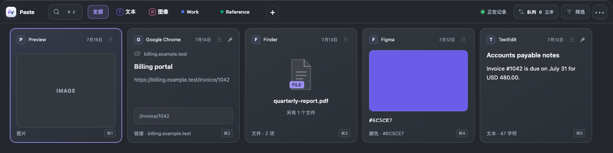
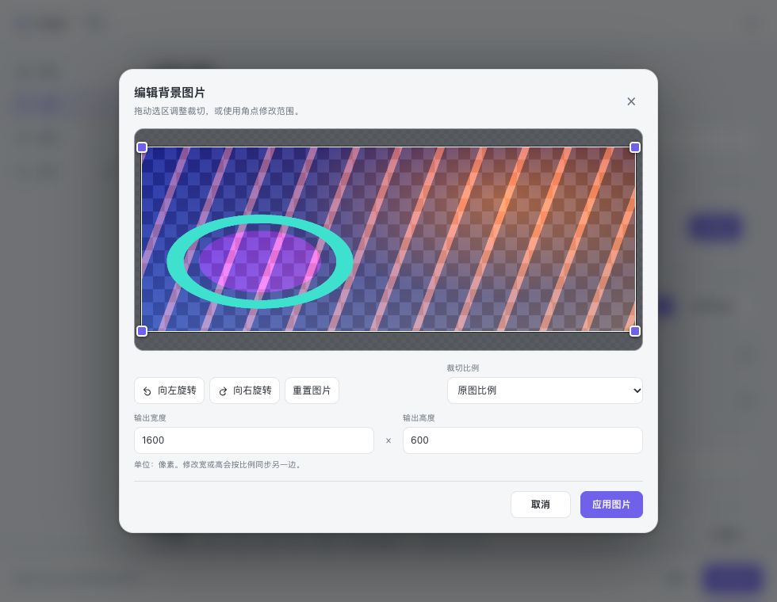

# Paste 1.4.0 本地验证摘要

日期：2026-10-29（America/Los_Angeles）。开发分支 `plugin/pasteboard-pro`。

从 Git 已跟踪文件和非忽略的新文件生成全新插件源拷贝，未复制旧产物、历史 artifacts 或原 node_modules。以 Node 24.15.0、pnpm 9.15.9 和 frozen lockfile 独立安装依赖，缓存、临时文件、编译输出均在插件目录。838 个测试输入源文件与 canonical SHA 一致，后续受控变化逐项记录在 [JSON 收据](v140-summary.json)。

## 当前结果

| 检查 | 结果 |
| --- | --- |
| 默认完整 `pnpm run test`，maxWorkers=4 | 1370 通过、6 跳过、0 失败；155 文件中150通过、5 fixture入口跳过 |
| macOS 原生准备 | 87 个私有命名剪贴板 fixture case 通过，不读取 general clipboard |
| root TypeScript、ZTools Vue、ATools Svelte、视觉类型 | 通过 |
| workspace、双应用 source/package、视觉产物与视觉代码契约 | 通过 |
| Swift Vision helper、ATools 与 ZTools 完整构建、组装 | 通过；helper为 ad-hoc 签名 |
| 归档 verifier 合同测试 | 修正 fixture 后通过，未改 verifier |
| 当前1.4.0打包preload完整CJS入口 | Node 24.15.0与Electron 41.4.0各35/35通过 |
| 22 份 refined spec、125 浏览器用例 | 首轮122通过、1跳过、2旧文案断言失败；修正断言后只复验受影响2例，2例通过；聚合124通过、1跳过 |

6 个单元测试跳过项为5个子进程fixture入口及未启用的真实应用目录 smoke。浏览器跳过项为未提供 macOS native icon addon 的真实图标用例。没有把跳过项计为通过。

## 保留的首轮失败

- 首轮默认高并发完整测试有一个3MiB并发附件写入用例超过原5秒限值。同一文件原限值9/9通过；原全部测试四worker通过后，仅在Vitest配置明确并发预算4，再用默认命令得到1370通过。未改timeout、内部8路并发、skip或断言。
- 归档测试的合成包遗漏当前verifier已要求的两个worker和parser notice，仅补齐三个fixture文件，未降低验证要求。
- 两个新版/旧版独立公告面板仍断言旧标题。只同步当前标题并增加共享版本号可见性检查，原主题、层级和timeout断言保持。原125例报告和两例失败上下文保留，未把聚合结果写成单次125全绿。

当前打包入口验证使用本轮构建的 `dist/ztools` 全部分发文件，记录preload及实际加载的3个chunk哈希，均与当前组装包一致。两端使用合成SDK，VM的 `process.platform` 固定为 `linux`，只证明Node/Electron入口兼容；不代表macOS原生分支、真实宿主或系统剪贴板验收。

完整原始日志与源manifest保留在本机 `artifacts/pasteboardpro/pr-preparation/fresh-validation/`，未随PR复制旧binary或整个artifacts。JSON记录manifest及结果收据摘要，可与本地原件对照；这不是CI或生产验收结果。

## 合成场景截图

以下来自本轮独立fresh Vite与Chrome 156.0.8078.74 / Playwright 1.61.1。内容为公开mock记录及程序生成的背景图，无真实剪贴板、用户照片或凭据；不代表真实ZTools宿主验收。

## 尚未验收

没有Windows 10/11/12环境；既有105项G0与15项存储原生用例仍NOT-RUN。真实ZTools宿主、系统通用剪贴板监控、目标应用回贴、生产签名与完整G0-G4未验收。该范围内仍不能承诺所有剪贴板内容绝不遗漏。

## 提交前尾部格式整理

用户确认提交计划后，13个已批准代码文件各删除一个多余的EOF换行。独立校验fresh旧SHA、canonical新SHA及全部非EOF字节相同，未新增功能或候选文件。原1370单元/集成与浏览器结果仍绑定原实测输入，JSON追加新源摘要及proof哈希，未重写旧manifest或原始日志。

原生源码字面哈希变化后，在全新owned目录重新构建并实际运行私有板自测87/87通过；双应用重新构建成功。ZTools全部15个分发文件与已验证release140图逐字节一致，因此原Node/Electron各35项打包入口结果继续适用，未无故重跑完整测试。真实系统/Windows验收边界不变。

## 发布后 CI 超时与断言优化（2026-10-30）

PR #717 的 Linux ubuntu-latest job 在提交 95fe8855ad969702081ba5ff9355eec5e74b1795 上失败：sync-blob-files.test.ts 的并发写入用例配置限时 5,000ms，Vitest 报告该测试文件耗时 16,097ms。GitHub 返回的文件 blob SHA c1d5d9ad989653b8c4a47856750f9fd69484c181 与本地基线 HEAD 文件 blob 一致；双方源码 SHA256 均为 55c4ab5a0ebc74bacaacac10743613e8fcfe3c5b5644c9c27f9dada4e9018863，确认失败对应原始断言。

单独的 Node 24.15.0 本地阶段计时显示：8 路并发写入 3 MiB 用时约 42.8ms，读取约 0.6ms，而 Buffer.toEqual 全量比较约 2,374.5ms，约占测试体 98%。这是本机诊断计时，不代表 Linux runner 的阶段耗时。原断言版本在 Node 20.19.3 的 4 个独立并发进程中 4/4 触发原 5 秒超时（各进程总耗时 6.748–7.013 秒）；诊断副本只把等价的完整字节比较换为 Buffer.equals 后，同样压力下 4/4 通过。

候选仅改变这一条断言。3 MiB 输入、8 个 Promise.all 写入、5 秒限时及路径、digest、临时文件断言均保持。全量字节负控制确认相同内容通过、单字节变化和长度变化均失败。隔离副本整文件 9 项在 Node 20.19.3、Node 24.15.0 和 Electron Node 模式均通过。以上结果绑定候选源码 SHA256 0aa4c8d66d018b165e984b21357fbce24d579e5eafad3d583db21002f8554e80。

本地收据不能替代 CI。修复后的新 CI 尚未运行，不能称 PR CI 已通过；未修改生产代码、超时配置、worker 数或 skip。此记录只补充发布后失败及断言候选证据，不覆盖上文原验证统计。原始 job 日志、压力测试收据和源码副本位于本机 ignored 路径 artifacts/pasteboardpro/pr-preparation/ci-timeout-audit，不随 PR 提交。未暂存、提交、推送或更新 PR。
