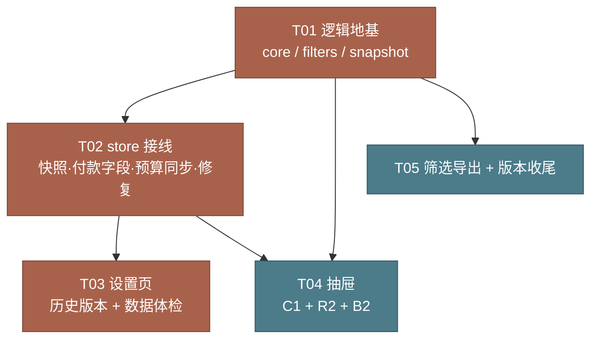

# 项目费用管理 · v1.2 增量设计（Q1 / Q2 / C1 / R2 / B2 / X3）

> 目标版本 **1.2.0**｜基线 **1.1.0**
> 本文只做设计与任务分解。**不含实现代码，不修改 `src/` 下任何文件。**
> 设计前置：已逐行核对 `src/lib/*.js`、`src/views/*`、`src/sheets/*`、`src/App.vue`，并用 node 脚本跑过 `seed.js` 复算基线。

---

## 0. 基线核实（实测，不是引用需求文档）

| 断言 | 实测值 | 结论 |
| --- | --- | --- |
| 费用项 / 明细 / 付款 | 71 / 384 / 88 | ✅ 与需求文档一致 |
| 品类 / 预算键 / 收款方 | 14 / 13 / 14 | ✅ 「其他费用」有意不设预算 |
| 应付 | **246,055.97** | ✅ |
| 已付 | **188,529.11** | ✅ |
| 待付 | **57,526.86** | ✅ |
| 预算合计 | **234,688.00** | ✅ |
| 结余 | **−11,367.97** | ✅ |
| `catRows()` 行数 | 14 | ✅ 预算页 14 行 |
| 空品类 / 空收款方 / 空编号 | 0 / 0 / 0 | ✅ 默认台账干净 |
| 孤儿品类 / 孤儿收款方引用 | 0 / 0 | ✅ |
| 明细合计 ≠ `p.total` | 0 | ✅ |
| 超付（已付 > 应付） | 0 | ✅ |
| 编号重复 | 0 | ✅ |
| **付款无日期** | **6 笔，合计 4,142.00** | ⚠️ **默认台账就有**，见 F3 |
| 单账套快照序列化体积 | 61,844 字节（≈60KB） | 7+3 份 ≈ 620KB，1.5MB 上限留有余量 |

### 四个必须先知道的代码事实

**F1｜`book.totalBudget` 是死字段。**
写入点只有 3 处（`mkBook()` 第 43 行、`resetActiveBook()` 第 432/438 行），**全仓 0 处读取**。所有界面显示的"预算合计"都来自 `calc().totalBudget`，而它是 `Σ book.budget` 现算的。所以「`totalBudget` 与 Σ 品类预算不一致」**在界面上不可见**——这条检查必须做（防止未来读取时踩坑），但不能指望它命中用户抱怨。

**F2｜"预算合计对不上"的真实成因是 `catRows()` 的行名集合。**
`catRows()`（core.js:174）行名 = `union(categories[].name, Object.keys(budget))`，**不包含 `calc()` 用的兜底键 `'未分类'`**。因此只要有一条费用项 `p.cat === ''`：
- 它的应付计入 `calc().payable`（总应付、顶栏、概览都在算），
- 但 `catRows()` 里没有「未分类」这一行 → **预算页看不到这笔钱**。

这就是用户"预算合计 ≠ 14 行加总"的来源之一。默认台账本条为 0（已核实），但 `importState` / `importLegacy` / 手工改 JSON 都容易造出来。设计里给它独立问题码 `cat-missing`。

**F3｜默认台账就有 6 笔无日期付款（合计 4,142.00）。**
`ZX0001` 楼梯辅料 1,500／`ZX0007` 拆改辅料 315／`ZX0009` 管道美化 200／`ZX0052` 墙壁材料 2,000／`ZX0066` 插座+散装灯 7／`ZX0067` 插座+散装灯 120。
→ 结论：**体检在默认台账上必然报 1 类问题**，这是诚实且有用的，不是 bug。回归基线要按"1 类 warn / 0 类可修复"来断言。

**F4｜导出三表共用同一套 `HEADS` + rows 构造函数。**
`exportXlsx` / `exportCsv` / `exportAllCsv` 都调 `projRows(book, ...)`、`detailRows(book)`、`payRows(book)`，表头走同一个 `HEADS` 常量。→ 加付款列只需改 1 处常量 + 1 处 row 构造函数，CSV/XLSX 自动同步。**X3 的"三表一致性"因此可以做成结构性保证，而不是"记得同步"。**

---

## 1. 实现方案

### 1.1 Q1 自动快照与一键回滚（P0 / M）

#### 数据契约

独立键：`ztools_project_cost_snap_v1`（**不加入 `PREV_KEYS`，不在主键里，不进 `state`**）

```js
{
  v: 1,
  items: [{
    id: 's_<ts36>_<rand4>',
    ts: 1761465600000,          // Date.now()
    day: '2026-10-26',          // todayLocal()，用于"当日是否已有日快照"去重
    kind: 'daily' | 'pre',
    reason: 'daily' | 'import' | 'import-legacy' | 'reset' | 'restore-default'
          | 'checkup-fix' | 'before-rollback',
    bytes: 61844,               // 该条 data 的 UTF-8 字节数，淘汰时直接累加
    imgDropped: 0,              // 剥离的凭证图张数（见"边界"）
    stat: {                     // 存储时算好，列表直接显示，回滚后用于比对
      books: 1, name: '自宅装修',
      items: 71, details: 384, pays: 88,
      payable: 246055.97, paid: 188529.11, due: 57526.86,
    },
    data: { books: [...], activeBookId: '...', templates: [...], warnThreshold: 0.8 },
  }],
}
```

`data` 与 `importState(data)` 的入参结构**同构**，也与 `exportJson` 的产物同构 → 快照可以原样当 JSON 备份用、也可以被 `importState` 吃下去。

#### 常量

```js
export const SNAP_KEY = 'ztools_project_cost_snap_v1';
const MAX_DAILY = 7;
const MAX_PRE = 3;
const MAX_BYTES = 1.5 * 1024 * 1024;   // 1,572,864，按 Σ item.bytes 累计
```

#### 触发时机

| 时机 | kind | reason | 位置 |
| --- | --- | --- | --- |
| 启动装载成功后，当日无 `daily` 条目 | `daily` | `daily` | `boot()` 包装层 |
| `importState()` 之前 | `pre` | `import` | store：`importState` 首行 |
| `importLegacy()` 之前 | `pre` | `import-legacy` | store：`importLegacy` 首行 |
| `resetActiveBook(false)` 之前 | `pre` | `reset` | store：`resetActiveBook` 内 |
| `resetActiveBook(true)` 之前 | `pre` | `restore-default` | 同上 |
| `fixCheckup()` 且确有可修项 | `pre` | `checkup-fix` | store：`fixCheckup` |
| `restoreSnapshot()` 之前 | `pre` | `before-rollback` | store：`restoreSnapshot` 首行 |

- **boot 去重**：`items.some(x => x.kind === 'daily' && x.day === todayLocal())` 为真则跳过。不用时间差，避免"一天开两次插件写两份"。
- **boot 不写快照的条件**：`bootInner()` 返回 `ok === false`（数据损坏）时不写，免得把垃圾存成"保险"。
- **`persistNow()` 绝不允许写快照**（见风险 2）。

#### 淘汰策略（纯函数，便于单测）

```js
function pruneTo(items) {
  let list = items.slice().sort((a, b) => a.ts - b.ts);
  // ① 分类限额
  const daily = list.filter(x => x.kind === 'daily');
  const pre   = list.filter(x => x.kind === 'pre');
  while (daily.length > MAX_DAILY) daily.shift();     // 最旧淘汰
  while (pre.length > MAX_PRE)     pre.shift();
  list = [...daily, ...pre].sort((a, b) => a.ts - b.ts);
  // ② 总量上限：先淘汰 daily，都淘汰完了才动 pre
  const sum = (a) => a.reduce((s, x) => s + (x.bytes || 0), 0);
  while (sum(list) > MAX_BYTES) {
    const i = list.findIndex(x => x.kind === 'daily');
    if (i >= 0) { list.splice(i, 1); continue; }
    if (list.length > 1) { list.shift(); continue; }
    break;                                            // 只剩本次这一条，交给外层判超限
  }
  return list;
}
```

- `bytes` 只累加 `data` 体积，不含 JSON 外层键开销 → 实际总写入量约 1.55MB，安全。
- 单条新快照 `bytes > MAX_BYTES` → 直接 `{ ok:false, msg:'快照体积超过上限，已跳过本次快照' }`，**不写**。

#### 写入失败隔离（硬要求）

```
saveSnapshot()
  ├─ JSON.stringify → 失败 → return {ok:false}      ← 只返回，不 throw
  ├─ pruneTo + setItem → 失败 → 降级重试（只留 1 份 pre + 本次）
  │                       └─ 仍失败 → return {ok:false, msg}
  └─ 永不 throw；调用方（importState 等）用返回值决定是否 toast 警告，
     主数据保存流程一律继续
```

调用方约定：`snapshotNow()` 返回 `{ ok, msg }`；`importState` / `resetActiveBook` 把 `snapWarn` 挂到返回对象上，由视图 toast。**store 不 import ui**，避免耦合。

#### 回滚

```js
export function restoreSnapshot(id) {
  const snap = readSnapshot(id);                       // 深读 JSON.parse
  if (!snap || !Array.isArray(snap.data?.books) || !snap.data.books.length)
    return { ok: false, msg: '快照不可用，可能已损坏' };
  snapshotNow('pre', 'before-rollback');               // ← 先给"当前"存档，防二次误操作
  state.books = snap.data.books.map(normalizeBook);
  state.templates = Array.isArray(snap.data.templates) ? snap.data.templates : [];
  state.warnThreshold = snap.data.warnThreshold || 0.8;
  state.activeBookId = state.books.some(b => b.id === snap.data.activeBookId)
    ? snap.data.activeBookId : state.books[0].id;
  clearUndo();                                          // 5 秒撤销对回滚后的状态已无意义
  persistNow();
  return { ok: true, msg: `已回滚到 ${fmtSnapTime(snap.ts)} 的快照`, stat: snap.stat };
}
```

**回滚范围 = `books` + `activeBookId` + `templates` + `warnThreshold`。**
不含 `theme`（在独立键 `ztools_rc_theme`，是 UI 偏好不是账目）、不含快照列表本身。

**副作用清理**：视图在回滚成功后必须 `closeDrawer()`、`ui.selId = ''`——抽屉可能停在一条已被回滚删掉的费用项上（`ItemSheet` 的 `project` computed 会变 `null`，`st` 变 `null`，footer 的 `startPay` 会读数崩）。

**一个免费的好处**：今天的 daily 快照是在 boot 时用"回滚前"的状态写的，所以回滚后用户还能反过来选今天那条"回滚回去"——无需额外设计，写进文案即可。

#### 「导入后撤销」是否与快照共用机制？→ **共用语义，不共用代码路径**

| 层 | 机制 | 寿命 | 实现 |
| --- | --- | --- | --- |
| 秒级 | `pushUndo()` 内存快照 + toast「撤销」 | 5.2 秒 | **新增调用**：`importState` 首行补 `pushUndo()` |
| 跨会话 | `pre` 快照 + 设置页「历史版本」 | 直到被淘汰 | 新增 `snapshotNow('pre','import')` |

理由：`pushUndo` 是内存态、无序列化开销、秒级响应，适合"刚点错立刻反悔"；`pre` 快照需要 `localStorage.setItem` 且要占配额，适合"第二天才反应过来"。两者语义相同（都是"操作前状态"），但**不合并代码**——合并会让 5 秒撤销变成一次 localStorage 写入，反而卡。

`pushUndo()` 的现有实现只存 `books/activeBookId/templates`（不含 `warnThreshold`），**保持不动**。

#### 边界条件

| 边界 | 处理 |
| --- | --- |
| 账套带 base64 凭证图 `p.img` | 快照写入前**剥离 `img`**，记 `imgDropped`，列表显示「不含 N 张凭证图」。理由：`img` 是配额爆掉的元凶，且现有 `persistNow` 的配额兜底本来就优先丢它 |
| 快照键被用户手工清空 | `loadSnaps()` 容错解析，坏数据返回 `{v:1, items:[]}`，不抛 |
| 快照键本身占满配额 | 主键写入失败时既有的"丢 img 重试"逻辑不变；快照写入失败只警告 |
| 同一毫秒写两份 | `id` 带 4 位随机后缀，`ts` 相同时按数组顺序稳定 |
| 回滚到只有 1 个账套的快照，当前有 3 个 | 完全替换，另外 2 个账套消失（已被 `before-rollback` 快照兜住） |
| 列表渲染性能 | 10 条上限，`max-height: 190px; overflow-y: auto`，不撑破 618px |

#### UI 落点

`SettingsView.vue`，「数据概况」卡片之后插入「历史版本」卡片：

```
┌ 历史版本                                    [立即备份] ┐
│ 10-26 08:12  自动          71 项  246,055.97   [回滚] │
│ 10-25 21:40  导入前        70 项  241,300.00   [回滚] │
│ 10-25 08:03  自动          71 项  246,055.97   [回滚] │
│ …（max-height 190px 滚动）                              │
│ 仅备份账目数据（不含凭证图）。单日一份，保留 7 天。      │
└────────────────────────────────────────────────────────┘
```

---

### 1.2 Q2 数据体检与一键修复（P0 / M）

#### 契约

`core.js` 新增纯函数 **`checkup(book)`**（只读，绝不 mutate）：

```js
{
  issues: [{
    code: 'pay-no-date',
    level: 'fix' | 'warn',        // fix = 有自动修复动作；warn = 只提示
    title: '付款缺少日期',
    count: 6,
    unit: '笔',
    amount: 4142.00,              // 「涉及金额」的规模，不是"应付变化量"
    samples: [{ id, no, remark, text }],   // 最多 3 条，仅供定位展示
    fix: 'fill-default' | null,   // 修复动作码（见下表）
    fixLabel: '一键补建档案',
  }],
  fixable: 2, warnable: 1,        // 按类计数
  stat: { payable, paid, due, totalBudget, count, detailCount, payCount },
}
```

#### 问题码表（9 条）

| # | code | level | 判定（全部用 `round2` + 容差 `0.005`） | `amount` 口径 | fix |
| --- | --- | --- | --- | --- | --- |
| ① | `cat-missing` | fix | `!p.cat` → 归入兜底键「未分类」，`catRows()` 无此行，钱在总额里但预算页看不见 | Σ `payableOf(p)` | `ensure-cat`：`ensureCategory('未分类')` 建档，让该行出现在预算页 |
| ② | `orphan-cat` | fix | `p.cat` 非空且不在 `categories[].name` | Σ `payableOf(p)` | `ensure-cat`：按名补建档案（色取 `PALETTE` 未用色） |
| ③ | `orphan-payee` | fix | `p.object` 非空且不在 `payees[].name` | Σ `payableOf(p)` | `ensure-payee`：按名补建 |
| ④ | `total-drift` | fix | `p.details.length > 0 && round2(detailSum(p)) !== round2(p.total)` | Σ `(detailSum − total)` | `sync-total`：`syncTotalFromDetails(p)` |
| ⑤ | `pay-no-date` | **warn** | `payments` 中 `!py.date` | Σ `py.amount` | `null`（不改日期，见下） |
| ⑥ | `overpaid` | **warn** | `paidOf(p) > payableOf(p) + 0.005` | Σ `(paid − payable)` | `null`（可能是预付款/退款，不能动） |
| ⑦ | `dup-no` | **warn** | 非空 `p.no` 出现 > 1 次 | 0 | `null`（编号是用户语义） |
| ⑧ | `budget-orphan-cat` | fix | `Object.keys(book.budget)` 中有名不在 `categories` → **F2 的真凶**，预算页出现灰点无备注的"幽灵品类"行 | Σ `budget[孤儿键]` | `ensure-cat`：补建档案，保住预算金额 |
| ⑨ | `budget-total-drift` | fix | `round2(book.totalBudget) !== round2(Σ book.budget)` | `totalBudget − Σbudget` | `sync-totalBudget`：`syncTotalBudget(book)` |

**⑤ 为什么只提示、不自动修**：自动填今日 = 伪造对账事实，会让 `monthlyPayments()` 凭空多出一笔本月支出，制造**新的账目错误**；强制用户补 = 用户不知道就随手填，同样伪造。正确做法是诚实保留空值 + 高亮 + 持续体检提醒（与 C1 的 5.3 决策一致）。

**⑦ 为什么只提示**：编号是用户在建项目时的业务语义（可能刻意与外面对账单对齐），自动重编号会破坏外部引用。

**关于 ⑨（回应"⑦ totalBudget 与 Σ品类预算不一致"）**：见 **F1**——该字段无任何读取方，所以不一致**在界面上不可见**。仍然要做，因为：① 需求明确要求覆盖；② 未来任何读 `book.totalBudget` 的功能（导出、结算单、模板）会踩坑。为了让这条检查**长期为 0 而不是天天报警**，配套做 **1.3 节的"写时同步"**（`setBudget` / `upsertCategory` / `importState` / `importLegacy` 之后 `syncTotalBudget`），体检只兜底外部导入的脏数据。

**关于 ⑧（回应"预算合计与 14 行加总对不上"）**：这条才是用户在界面上**能看到**的那一类。成因路径：`removeCategory()` 会 `delete budget[name]`（所以正常删品类不留孤儿），但手改 JSON、旧版备份、`applyTemplate` 带的旧 `budget` 与 `categories` 不齐，都会留下孤儿预算键。

#### 修复前是否强制存 Q1 快照？→ **是，且仅在确有可修项时**

```js
export function fixCheckup(codes = null) {
  if (!book.value) return { ok: false, msg: '没有可用项目' };
  const before = checkup(book.value);
  const targets = before.issues.filter(i => i.fix && (!codes || codes.includes(i.code)));
  if (!targets.length) return { ok: true, msg: '没有可自动修复的问题' };   // ← 不写快照
  snapshotNow('pre', 'checkup-fix');                                      // ← 有才写
  const payBefore = round2(calc(book.value).payable);
  const budBefore = sumBudget(book.value);
  const codes_ = targets.map(i => i.code);

  // ① 品类档案类：重新全量遍历（不看 samples 的 3 条）
  if (codes_.includes('cat-missing')) ensureCategory('未分类');
  if (codes_.includes('orphan-cat')) {
    book.value.projects.forEach((p) => { if (p.cat) ensureCategory(p.cat); });
  }
  if (codes_.includes('budget-orphan-cat')) {
    Object.keys(book.value.budget).forEach((name) => { ensureCategory(name); });
  }
  // ② 收款方档案
  if (codes_.includes('orphan-payee')) {
    book.value.projects.forEach((p) => { if (p.object) ensurePayee(p.object); });
  }
  // ③ 总计缓存对齐（有明细时应付不受影响）
  if (codes_.includes('total-drift')) {
    book.value.projects.forEach((p) => syncTotalFromDetails(p));
  }
  // ④ 遗留字段对齐（恒在最后，其余 fix 不碰 budget）
  syncTotalBudget(book.value);
  persistNow();
  return {
    ok: true,
    msg: `已修复 ${targets.length} 类问题，金额未变动`,
    codes: codes_,
    deltas: {
      payable: round2(calc(book.value).payable - payBefore),      // 恒为 0
      totalBudget: round2(sumBudget(book.value) - budBefore),     // 恒为 0
    },
  };
}
```

⚠️ **修复动作一律不使用 `samples`**（只有 3 条），必须重新全量遍历 `book.projects` / `book.budget`。这是最容易写错的地方之一。

#### 关键不变量：**本批所有修复动作都不改变应付/已付/待付**

| fix | 为什么不动金额 |
| --- | --- |
| `ensure-cat` / `ensure-payee` | 只往档案数组里 push，`calc()` 的 `byCat/byPayee` 来自 `projects`，金额不变 |
| `sync-total` | 有明细时 `projectTotal()` **本来就取 `detailSum`**，`p.total` 只是缓存 → 应付一直是对的，修复只让"总计"字段显示值对齐 |
| `sync-totalBudget` | `calc().totalBudget = Σbudget`，回写的正是同一个数 |

→ 这是极强的回归断言：**`fixCheckup` 前后 `stats.payable / paid / remain` 必须严格相等（差 0.00）**。

#### 修复后如何向用户说明"总额变了"？

本批**没有**任何修复会改金额（见上表），所以文案不能说"总额变了"。设计如下：

- 一键修复成功：`toast('已修复 3 类问题，金额未变动')`
- 若 `deltas.payable !== 0`（说明未来新增了会动金额的 fix 码，属异常）：卡片内显示 `应付 246,055.97 → 248,180.00（+2,124.03）`
- 体检卡片的摘要行始终显示当前 `应付 / 预算合计`，让用户自己就能对照修复前后

#### UI 落点

`SettingsView.vue`，「数据概况」之后插入「数据体检」卡片（若空间不足按 **历史版本 → 数据体检 → 导出** 顺序紧挨着放，两者合计约 300px，靠 `.content` 的既有滚动承载）：

```
┌ 数据体检                          [重新体检] ┐
│ 1 类提示 · 6 笔付款缺日期 · 0 类可修复        │
│ ─────────────────────────────────────────  │
│ 付款缺少日期   6 笔  涉及 4,142.00            │
│   仅提示，不改日期以免伪造对账事实            │
│ ─────────────────────────────────────────  │
│ 品类档案缺失   2 项  涉及 3,720.50  [一键补建]│
└────────────────────────────────────────────┘
```

- 折叠态只显示摘要一行 + 「重新体检」；展开态 `max-height: 200px; overflow-y: auto`
- 无任何问题时显示「✓ 未发现问题」，不显示空表
- 问题标题用「问题 / 提示」措辞，**禁用「错误」**

---

### 1.3 写时预算同步（为 Q2 免责，不引入第二真源）

`core.js` 新增：

```js
export const sumBudget = (book) =>
  round2(Object.values(book?.budget || {}).reduce((a, b) => a + (+b || 0), 0));

export function syncTotalBudget(book) {
  if (book) book.totalBudget = sumBudget(book);
  return book?.totalBudget || 0;
}
```

调用点（`store.js`）：

| 函数 | 位置 |
| --- | --- |
| `setBudget` | 末尾 |
| `upsertCategory` | 改名迁移 `budget` 键之后 |
| `resetActiveBook` | 替换 `b.totalBudget = s.totalBudget` / `= 0` 为 `syncTotalBudget(b)` |
| `importState` | `state.books.forEach(syncTotalBudget)` |
| `importLegacy` | 同上 |

**这不算第二真源**：`book.totalBudget` 是被派生的缓存，永远 `== Σ book.budget`，任何时刻可从 `book.budget` 重建。真源仍是 `book.budget`，金额链真源仍是明细。

---

### 1.4 C1 付款流水补全（P0 / S）

#### 数据契约

```js
payment = { date: 'YYYY-MM-DD' | '', method: '微信', amount: 1500, note: '', ref: '' }
```

#### `normalizeBook` 默认值（store.js:63）

```js
p.payments.forEach((py) => {
  py.date = normDate(py.date);
  if (py.note == null) py.note = '';      // ← 新增
  if (py.ref  == null) py.ref  = '';      // ← 新增
});
```

- 用 `== null` 判空（同时兜住 `undefined`），不用 `||`（避免把 `0` 变成 `''`，虽然此两字段不可能是数字，但保持一致习惯）。
- **不补 `date` 默认值**——见 1.5 决策。
- 幂等：重复 normalize 结果不变。

#### `upsertPayment`（store.js:336）

```js
const item = {
  date: normDate(rec.date) || '',
  method: rec.method || '微信',
  amount: round2local(rec.amount),
  note: String(rec.note || '').trim(),
  ref:  String(rec.ref  || '').trim(),
};
// 新增付款 date 必填（放在 store 里做权威校验，不只靠视图）
if (!item.date && index < 0) return { ok: false, msg: '请填写付款日期' };
```

#### 编辑历史无日期记录的保存规则 → **允许保留空 + 高亮提示**

三选一的取舍：

| 方案 | 代价 |
| --- | --- |
| 自动填今日 | 伪造对账事实；`monthlyPayments()` 凭空多出本月支出 → 制造新错误 |
| 强制补填 | 用户不知道就随手填（同样伪造）；且阻塞"我只想改备注"的场景 |
| **允许保留空 + 高亮** ✅ | 诚实；配合体检持续提醒；导出列里看得见 |

落地规则（`ItemSheet.vue`）：

```js
const allowEmptyDate = computed(() =>
  payEditing.value >= 0 && !payments.value[payEditing.value]?.date);

function savePay() {
  if (!payForm.date && !allowEmptyDate.value) { errors.date = true; return toast('请选择付款日期'); }
  …
}
```

- 编辑"原本就有日期"的记录 → 清空后保存要报错（不允许把有日期改成没日期）
- 编辑"原本就没日期"的记录 → 允许空，字段下方 `hint warn`：「历史记录无日期，可补填；留空不计入月度趋势」
- 新增 → 必填

#### seed 的 88 笔历史付款是否补默认备注？→ **不补**

- `seed.js` 顶部注明「勿手改」，改动它等于改基线字节；
- 补 `note: ''` 是空字符串，等价于没补；
- `normalizeBook` 在运行时已补 → 效果完全一致。

⚠️ **验证必须做**：88 笔付款对象当前只有 `{date, method, amount}` 三个键，`normalizeBook` 后应变成 5 键，且**金额合计仍为 188,529.11**。

#### 导出付款表追加 2 列

```js
HEADS.pay = ['项目号','费用备注','支付对象','付款日期','付款方式','金额','备注','凭证号'];
//                                                                 ↑↑↑↑↑↑ 只在末尾追加

payRows: [... , +py.amount || 0, py.note ?? '', py.ref ?? '']
```

CSV 与 XLSX 共用 `HEADS.pay` + `payRows`（**F4**），改一处两处同步。**禁止**在 `exportAllCsv` 里另写一份表头。

⚠️ 回读一致性：CSV 里 `备注` 含逗号/换行时走既有 `csvCell()` 转义，无需额外处理。

---

### 1.5 R2 明细连续录入（P1 / S）

#### 状态机（不新增状态）

```
                 startAddDetail()/editDetail(i)
   view ─────────────────────────────────────► detail
     ▲                                          │  │
     │  保存明细 / 取消                          │  │ 保存并继续
     └──────────────────────────────────────────┘  │
                                                   └──► detail（清空 + 焦点回品名）
```

**决策：`detail` 仍是"单屏表单"，不改成"列表 + 内联表单"。**

理由：392px 抽屉里同时塞 20 条明细列表 + 8 字段表单必然挤；现有 `view` 态已承担列表职责；改成内联等于重写 detail 模板，回归风险高（`amountLocked` 联动、`data-autofocus`、8 字段 grid 都要重排）。需求只要求"保存后不退回查看态"。

#### 实现

```js
const nameInput = ref(null);           // 品名框 ref
function focusName() {
  nextTick(() => { nameInput.value?.focus(); nameInput.value?.select?.(); });
}
function clearDetailForNext() {
  Object.keys(errors).forEach((k) => delete errors[k]);
  editIndex.value = -1;                // ★ 必须重置，否则覆盖刚存的那条
  Object.assign(dForm, {
    name: '', qty: '', price: '', amount: '', craft: '', note: '',
    unit: dForm.unit,                  // 保留上次单位
    est: dForm.est,                    // 保留预估标记
  });
}
function saveDetail(next = false) {
  …现有校验完全不变…
  const r = upsertDetail(project.value.id, {...}, editIndex.value);
  if (!run(r)) return;
  if (next) { clearDetailForNext(); focusName(); return; }   // 不切 mode
  mode.value = 'view';
}
```

- **不清空 `unit` / `est`**：同一费用项内连续录入的明细往往同单位（砂子/水泥＝方或袋、瓷砖＝块），保留能省两次输入。
- **清空 `qty` / `price` / `amount`**：金额必须重算，用户视线必经这两格，单位就在旁边不会忘改。
- **不调用 `resetDetail()`**：它读 `editIndex` 决定填充内容；这里要的是"清空"，用一个语义独立的 `clearDetailForNext()` 更安全。`mode` 值未变 → `watch(mode)` 不触发 → 不会把表单覆盖回去。
- footer（`mode === 'detail'`）在「保存明细」左侧加：

```html
<button class="btn" @click="saveDetail(true)">保存并继续</button>
```

- 裸 `@click="saveDetail"` 会收到 `MouseEvent` 作为 `next`（truthy！）→ **必须写 `saveDetail(false)`**。这是本条最容易写错的点。

#### 合计与总计的同步时机 → **每次保存即时，无需改动**

`upsertDetail` 内部已 `syncTotalFromDetails(p)` → `p.total` 立即更新，`details` / `dSum` / `st` 三个 computed 立即反映。

但 `detail` 态**当前模板不显示任何合计**，连续录入 5 条时用户看不到累计金额 → 无法发现录错。补一行只读提示（放在 detail 表单**顶部**，`class="mini"`，固定 1 行高度）：

```html
<div class="mini" style="margin-bottom: 6px">
  本项已有 {{ details.length }} 条 · 合计 {{ fmtNum(dSum) }}
  <span class="grow" />
  项目总计 {{ fmtNum(st.total) }}
</div>
```

#### 边界

| 边界 | 处理 |
| --- | --- |
| 连续录入中途按 Esc / 取消 | 已保存的都在（每次保存已落库），只是回到 view 态 |
| 编辑既有明细时点「保存并继续」 | 允许：保存后转成"新增下一条"（`editIndex` 归 -1），符合录入节奏 |
| 只填品名不填金额 | 现有校验拦住，不会写入，也不会清空表单 |
| 焦点回填失败（element 未挂载） | `nextTick` + 可选链，静默失败不影响功能 |
| 校验失败时的 `errors` 残留 | `clearDetailForNext()` 开头清 `errors` |

---

### 1.6 B2 抽屉内实时预算剩余（P1 / S）

#### 不复用 `catRows()` —— 新增更轻的纯函数

`catRows(book)` 内部跑全量 `calc(book)`（71 项 × 384 明细）+ 排序 + 构造 14 行，用在"每敲一个数字就重算"的 computed 里没必要。新增：

```js
// core.js，放在 catRows 之后
export function catBudgetHint(book, catName, amount, excludeId = '') {
  const budget = round2(+((book?.budget || {})[catName]) || 0);
  let used = 0;
  (book?.projects || []).forEach((p) => {
    if (p.cat !== catName) return;
    if (excludeId && p.id === excludeId) return;   // ★ 编辑既有费用项时排除自身
    used += payableOf(p);                          // ★ 与 calc().byCat.amount 同口径
  });
  used = round2(used);
  const after = round2(used + (+amount || 0));
  const remain = round2(budget - used);
  const over = round2(Math.max(after - budget, 0));
  let state = 'ok';
  if (!catName) state = 'no-cat';
  else if (budget <= 0) state = 'no-budget';
  else if (over > 0) state = 'over';
  else if (after / budget >= (book?.warnThreshold || 0.8)) state = 'near';
  return { state, budget, used, remain, after, over };
}
```

**口径必须与 `catRows()` 一致**：`calc()` 里 `byCat[ck].amount += payableOf(p)`（core.js:130、134），即 **应付口径**（总计 − 优惠）。

#### 关键口径陷阱：传入的 `amount` 是"应付"不是"总计"

```js
const budgetAmount = computed(() => round2((+form.total || 0) - (+form.discount || 0)));
const budgetHint = computed(() =>
  catBudgetHint(book.value, form.cat, budgetAmount.value, project.value?.id || ''));
```

- 若传 `form.total`：用户填了优惠后，抽屉里"剩余"与预算页会差一个优惠额 → **用户会报案说数字对不上**。这是本条最容易实现错的地方。
- `excludeId = project.value?.id || ''`：新增时为空（不排除），编辑既有费用项时排除自身（否则"本笔后剩"会把自己原来的金额算两遍）。

#### 降级文案

| `state` | 文案 | 颜色 |
| --- | --- | --- |
| `no-cat` | 未选品类，不计入品类预算 | `--muted` |
| `no-budget` | 「X」未设预算 · 该品类已用 ¥12,340.00 | `--muted` |
| `ok` | 「X」预算剩余 ¥12,000.00，本笔后剩 ¥4,000.00 | `--muted` |
| `near` | 「X」本笔后剩 ¥1,200.00（占用 92%） | `--warn` |
| `over` | 「X」本笔后将超支 ¥3,000.00 | `--danger` |

#### 落点

`mode === 'edit'` 表单，插在「总计 / 优惠」grid2 之后、「到期日 / 支付对象」grid2 之前，单行：

```html
<div v-if="!totalLocked || form.total !== ''" class="mini hint" :class="hintClass"
     style="white-space: nowrap; overflow: hidden; text-overflow: ellipsis">
  {{ hintText }}
</div>
```

固定 1 行高度（`.mini` 现有 line-height），不撑破抽屉；超长用省略号截断（品类名最长 6 字，实际不会截断）。

---

### 1.7 X3 按当前筛选导出（P1 / S）

#### 前置改造：日期筛选必须进 `ui`

现状：`ItemsView.vue` 的 `dateFrom` / `dateTo` 是**组件局部 `ref`**（第 19–20 行），导出入口在列表页、但筛选状态在组件里 → 只要组件不卸载就能读到，可一旦引入任何跨组件入口（导出按钮放在 `list-head` 之外）就断。且现状本身不一致：`query/filterCat/filterStatus` 在 `ui` 里跨分区保留，`dateFrom/dateTo` 一切分区就丢。

改造：

| 文件 | 改动 |
| --- | --- |
| `ui.js` | `ui` 增 `filterDateFrom: ''`、`filterDateTo: ''`（紧跟 `filterCat`） |
| `ui.js` | 新增 `clearListFilters()`：清 `query / filterStatus / filterCat / filterDateFrom / filterDateTo` |
| `ItemsView.vue` | 删 `dateFrom/dateTo` 两个 `ref`，模板改 `v-model="ui.filterDateFrom"` / `ui.filterDateTo`；`hasDate`、`clearAll` 改用 ui 字段 + `clearListFilters()` |
| `App.vue` | Esc 分支里的 `ui.query=''; ui.filterStatus=''; ui.filterCat='';` 三行换成 `clearListFilters()` |

⚠️ **有意为之的行为变化**：日期区间现在跨分区保留（与关键词/品类/状态一致）。写进 QA 注意项，不算回归。

#### 新增 `src/lib/filters.js` —— 筛选口径唯一真源

```js
import { statusOf } from './core';

export function filterProjects(projects, f = {}) {
  const q = (f.query || '').trim().toLowerCase();
  return (projects || []).filter((p) => {
    if (f.cat && p.cat !== f.cat) return false;
    if (f.status && statusOf(p) !== f.status) return false;
    if (f.from && (p.date || '') < f.from) return false;
    if (f.to && (p.date || '') > f.to) return false;
    if (q) {
      const hay = `${p.remark||''}${p.object||''}${p.cat||''}${p.no||''}${p.date||''}`.toLowerCase();
      if (!hay.includes(q)) return false;
    }
    return true;
  });
}

export function hasFilter(f = {}) {
  return !!(f.query?.trim() || f.cat || f.status || f.from || f.to);
}

export const FILTER_TEXT = { unpaid: '未付', part: '部分付', paid: '已付' };

export function filterTag(f = {}) { /* 见下 */ }
```

⚠️ **`filterProjects` 必须逐字搬移 `ItemsView.vue` 第 24–43 行的过滤条件**（字段集合、比较方式、大小写处理完全一致），不"优化"、不重排。视图与导出各写一套是"三表对不上"的根因，这里靠"只有一套"来消灭它。

`filterTag()` 生成文件名摘要：

```js
export function filterTag(f = {}) {
  const parts = [];
  if (f.status) parts.push(FILTER_TEXT[f.status] || f.status);
  if (f.cat) parts.push(f.cat);
  if (f.from || f.to) {
    if (f.from && f.to && f.from.slice(0, 4) === f.to.slice(0, 4))
      parts.push(`${+f.from.slice(5, 7)}-${+f.to.slice(5, 7)}月`);
    else if (f.from && f.to) parts.push(`${f.from}_${f.to}`);
    else if (f.from) parts.push(`${f.from}起`);
    else parts.push(`至${f.to}`);
  }
  if (f.query?.trim()) parts.push(`含${f.query.trim()}`);
  return parts.join('_').replace(/[\\/:*?"<>|\s]/g, '').slice(0, 40);
}
```

空筛选返回 `''`（不往文件名里加空段）。

#### `export.js` 签名改造 —— 用"作用域对象"保证三表一致

```js
const scopeOf = (book, projects) => (projects ? { ...book, projects } : book);

export function exportXlsx(book, today, helpers, projects = null, tag = '') {
  const b = scopeOf(book, projects);            // ★ 三张表都只认 b
  const sheets = [
    { name: '支出表', head: HEADS.proj,   rows: projRows(b, helpers.statOf, helpers.statusText) },
    { name: '明细表', head: HEADS.detail, rows: detailRows(b) },
    { name: '付款表', head: HEADS.pay,    rows: payRows(b) },
  ];
  …
  const suffix = tag ? `_${tag}` : '';
  download(blob, `项目费用_${book.name}_${today}${suffix}.xlsx`);
}
export function exportCsv(book, today, helpers, projects = null, tag = '')
export function exportAllCsv(book, today, helpers, projects = null, tag = '')
```

**为什么这样最稳**：`detailRows(book)` 与 `payRows(book)` 内部都遍历 `book.projects`（不改），所以只要传进去的 `b` 是被筛过的，明细表/付款表**结构上不可能**与支出表不一致。不用改 `detailRows`/`payRows`/`projRows` 一行。

`{ ...book, projects }` 对 Vue reactive proxy 做 spread 得到普通对象，`projRows` 等只读 `projects`，安全。

向后兼容：`SettingsView` 的三个调用保持 `(book.value, todayLocal(), helpers)` → `projects` 默认 `null` → 全量导出，行为零变化。

#### 列表页入口

放在 `list-head` 行右侧（该行现状约 280px 内容、714px 可用，余量充足；`filters` 行已满，不宜再加）：

```html
<div class="list-head">
  <span>{{ rows.length }} 条</span>
  <span class="grow" />
  <span>应付 <b class="num">{{ fmtNum(sumPayable) }}</b></span>
  <span style="opacity:.45">/</span>
  <span>待付 <b class="num">…</b></span>
  <button class="btn sm" @click="doExportScope" :disabled="!rows.length">
    <Icon name="download" :size="12" />{{ filtered ? '导出筛选' : '导出' }}
  </button>
</div>
```

```js
function doExportScope() {
  const scoped = filtered.value;                        // 有任一筛选条件？
  const list = scoped ? rows.value.map((x) => x.p) : null;
  if (scoped && !list.length) return toast('当前筛选没有匹配的支出，请调整后再导出');
  const tag = scoped ? filterTag(f.value) : '';
  const r = exportXlsx(book.value, todayLocal(), { statOf, statusText }, list, tag);
  toast(scoped ? `已导出筛选结果 ${list.length} 条 / ${r.rows} 行` : `已导出全部 ${r.rows} 行`);
}
```

**筛选为空时的兜底（两种"空"要分开）**：

| 情形 | 处理 |
| --- | --- |
| `filtered === false`（没有任何筛选条件） | 传 `null` = 全量导出，与现状一致 |
| `filtered === true` 且 `rows.length === 0` | **拒绝导出** + toast 提示。理由：导出一个只有表头的空文件，用户会以为功能坏了 |
| 按钮 `disabled` | `!rows.length` 时禁用，双保险 |

---

## 2. 文件清单（改动点精确到函数名）

### 2.1 新建

| 文件 | 导出 | 行数量级 |
| --- | --- | --- |
| `src/lib/snapshot.js` | `SNAP_KEY`、`loadSnaps`、`listSnaps`、`saveSnapshot`、`maybeDailySnapshot`、`readSnapshot`、`pruneTo`、`snapStatOf`、`fmtSnapTime` | ~150 |
| `src/lib/filters.js` | `filterProjects`、`hasFilter`、`filterTag`、`FILTER_TEXT` | ~60 |

`snapshot.js` **只依赖 `core.js`**（`calc` / `round2` / `todayLocal` / `uid`），不依赖 `store.js`、不依赖 `ui.js` → 无循环依赖。

### 2.2 改动

| 文件 | 函数 / 位置（当前行号为定位辅助，以函数名为准） | 改动 |
| --- | --- | --- |
| `src/lib/core.js` | `calc` 之后（L168 后） | 新增 `sumBudget(book)`、`syncTotalBudget(book)` |
| | `catRows` 之后（L191 后） | 新增 `catBudgetHint(book, catName, amount, excludeId)` |
| | `payeeRows` 之后（L208 后）、`/* 预警 */` 之前 | 新增 `CHECK_CODE` 常量 + `checkup(book)` |
| `src/lib/store.js` | import 头部 L3–6 | 追加 `sumBudget, syncTotalBudget, checkup`；追加 `import { SNAP_KEY, saveSnapshot, listSnaps, readSnapshot, maybeDailySnapshot as maybeDaily } from './snapshot'` |
| | `normalizeBook` L63 | `p.payments.forEach` 内补 `py.note`/`py.ref` 默认值 |
| | `boot` L107 | **改名 `bootInner`**；新增 `export function boot()` 包装：`const r = bootInner(); if (r.ok) try { maybeDaily() } catch(_){} return r;` |
| | `pushUndo` L161 之后 | 新增 `export function clearUndo()` |
| | 撤销段之后 | 新增 `snapshotNow(kind, reason)`、`snapshotList()`、`restoreSnapshot(id)`（三个薄胶水，payload 由 `state` 组装） |
| | `upsertPayment` L336 | `item` 增 `note`/`ref`；新增 `if (!item.date && index < 0) return {ok:false, msg:'请填写付款日期'}` |
| | `setBudget` L390 | 末尾 `syncTotalBudget(book.value)` |
| | `upsertCategory` L360 | 改名迁移 `budget` 键之后 `syncTotalBudget(book.value)` |
| | `resetActiveBook` L422 | `pushUndo()` 后加 `snapshotNow('pre', toSeed ? 'restore-default' : 'reset')`；两处 `b.totalBudget = …` 换成 `syncTotalBudget(b)` |
| | `importState` L445 | 首行 `pushUndo(); snapshotNow('pre','import')`；末尾 `state.books.forEach(syncTotalBudget)`；返回值加 `snapWarn` |
| | `importLegacy` L477 | 首行 `pushUndo(); snapshotNow('pre','import-legacy')`；末尾 `incoming.forEach(syncTotalBudget)` |
| | 文件末尾 | 新增 `export function fixCheckup(codes = null)` |
| | **不改** `persistNow` L73 | ★ 快照逻辑绝不进 `persistNow` |
| `src/lib/ui.js` | `ui` 对象 L6–14 | 增 `filterDateFrom: ''`、`filterDateTo: ''` |
| | `openDrawer` 之前 | 新增 `clearListFilters()` |
| `src/lib/export.js` | `HEADS.pay` L97 | 末尾追加 `'备注','凭证号'` |
| | `payRows` L121 | 追加 `py.note ?? ''`、`py.ref ?? ''` |
| | `exportCsv` L150 / `exportAllCsv` L155 / `exportXlsx` L166 | 签名加 `(…, projects = null, tag = '')`；内部加 `const b = scopeOf(book, projects)` 并把三处 `book` 换成 `b`；文件名加 `tag` 后缀；新增局部 `scopeOf` |
| | **不改** `projRows` / `detailRows` / `payRows` 的遍历逻辑 | 靠 `b` 传导 |
| `src/views/ItemsView.vue` | L19–20 | 删 `dateFrom`/`dateTo` 两个 ref |
| | `rows` computed L24–43 | 过滤段整体替换为 `filterProjects(book.value?.projects \|\| [], f.value)`，排序逻辑原样保留 |
| | L48–64 | `hasDate`/`filtered`/`clearAll` 改 ui 字段 + `clearListFilters()` |
| | `list-head` 模板 L110–116 | 加导出按钮 |
| | script 末尾 | 新增 `f` computed、`doExportScope()`；import `exportXlsx`、`filterProjects/hasFilter/filterTag`、`todayLocal/statusText`、`toast` |
| `src/views/SettingsView.vue` | import | 增 `listSnaps/restoreSnapshot/snapshotNow`、`checkup`、`fixCheckup`、`closeDrawer`、`sumBudget` |
| | 「数据概况」卡片之后 | 新增「历史版本」卡片 + 「数据体检」卡片（模板 + 局部 state `snaps` / `issues` / `checkMsg`） |
| | L161 | 版本文案 `v1.1.0` → `v1.2.0` |
| `src/sheets/ItemSheet.vue` | `payForm` L156 | 增 `note: ''`、`ref: ''` |
| | `resetPay` L160 | 补 `note`/`ref` 默认值（编辑时读 `payments.value[i]`） |
| | `savePay` L172 | 用 `allowEmptyDate` 替换现有 `payEditing.value < 0` 判断；传 `note`/`ref` |
| | 付款表单模板 L429–447 之后 | 新增「备注」「凭证号」两个 `field`（`grid2` 一行放两个） |
| | `dForm` L103 之后 | 新增 `nameInput` ref、`focusName()`、`clearDetailForNext()` |
| | `saveDetail` L127 | 签名改 `saveDetail(next = false)`；末尾按 `next` 分支 |
| | detail 表单模板 L370 之前 | 顶部加"已有 N 条 · 合计 · 项目总计"提示行 |
| | footer detail 分支 L473–477 | 加「保存并继续」，两处 `@click` 都显式传 `false`/`true` |
| | 品名 input L373 | 加 `ref="nameInput"` |
| | script 顶部 import L1 | 增 `nextTick` |
| | L8 | import 增 `catBudgetHint` |
| | edit 表单模板 L350 之后 | 插入 B2 提示行 |
| | script | 新增 `budgetAmount`、`budgetHint`、`hintText`、`hintClass` computed |
| `src/App.vue` | L92–94（Esc 分支） | 三行清空改 `clearListFilters()` |
| `package.json` | `version` | `1.1.0` → `1.2.0` |
| `plugin.json` | `version` | `1.1.0` → `1.2.0` |
| `README.md` | 功能段 | 补 Q1/Q2/C1/R2/B2/X3 六条一句话说明；版本号 |

**合计：新建 2 个 + 改动 9 个 = 11 个文件。**

---

## 3. 数据迁移结论

### 3.1 不升 KEY

- 主键仍为 `ztools_project_cost_v1`。
- **理由**：本批所有新增都是**可选字段或独立键**，没有破坏性结构变更；升 KEY 会带来三重代价（旧键清理、`PREV_KEYS` 链变长、用户降级后数据"消失"的观感），收益为零。
- 新增强制走 `normalizeBook` 默认值补齐：

| 新增项 | 落点 | 老数据兼容 |
| --- | --- | --- |
| `payment.note` / `payment.ref` | `normalizeBook` L63 | 缺失 → `''`，不报错 |
| `ztools_project_cost_snap_v1` | 独立键，首次读取缺失 → `{v:1, items:[]}` | 无影响 |
| `ui.filterDateFrom/To` | 内存态 | 无影响 |

### 3.2 `ztools_renovation_cost_v1` 迁移路径不受影响

`boot()` 的搬迁逻辑（`PREV_KEYS` 循环 + `dropCarried`）**一行不改**。改造方式是"把 `boot` 改名 `bootInner`，外面套一层写快照的 `boot`"：

```
boot()  →  bootInner()  ── 原有全部逻辑（含 PREV_KEYS 循环）原样
            ↓ ok
         maybeDailySnapshot()   ← 新增，失败静默
```

搬迁成功的分支里 `bootInner` 已经 `persistNow()`，快照在它之后写，拿到的是搬迁**后**的数据。**快照键绝不可加入 `PREV_KEYS`**（否则启动时会把快照当主数据装载）。

### 3.3 反向兼容（降级风险，需在 README 提示一句）

v1.2 写出的数据里 payment 多两个字段。若用户降级回 v1.1.0 并**编辑**那笔付款，v1.1.0 的 `upsertPayment` 会重建对象 → `note`/`ref` 丢失。属异常路径，接受，不额外做兼容代码。

---

## 4. 任务列表（实现顺序 = 执行顺序）

> 共 **5** 个任务。划分原则：**按层分组、接口先行**——T01 只出纯函数（可脱离 Vue 单测），T02 只做 store 接线（不碰模板），T03/T04/T05 各管一块界面。这样每个任务都能独立验收，工程师不需要来回切文件。

### T01 逻辑地基：core 纯函数 + filters + snapshot 模块
**P0**｜依赖：无｜新建 2 改 1

| 项 | 内容 |
| --- | --- |
| 文件 | `src/lib/core.js`（加 `sumBudget` / `syncTotalBudget` / `catBudgetHint` / `checkup` / `CHECK_CODE`）<br>`src/lib/filters.js`（新建：`filterProjects` / `hasFilter` / `filterTag` / `FILTER_TEXT`）<br>`src/lib/snapshot.js`（新建：`SNAP_KEY` / `loadSnaps` / `listSnaps` / `saveSnapshot` / `maybeDailySnapshot` / `readSnapshot` / `pruneTo` / `snapStatOf` / `fmtSnapTime`） |
| 完成判据 | ① 三个文件在 node ESM 下可 import（不引用 `window`/`document`）；② `checkup(默认台账 book)` 返回 `issues.length === 1`、`code === 'pay-no-date'`、`count === 6`、`amount === 4142`、`fixable === 0`；③ `checkup` 对同一 book 连调两次结果相同且**不修改** book（`JSON.stringify` 前后哈希一致）；④ `catBudgetHint(book,'泥瓦镶贴工程',8000,'')` 的 `state === 'over'` 且 `over === round2(8000 - (25000 - 该类应付))`；⑤ `pruneTo` 造 8 份 daily → 返回 7 份且删的是 `ts` 最小那份；⑥ `filterProjects` 结果与现有 `ItemsView` 过滤逻辑在默认台账上条数一致（无筛选 = 71 条） |

### T02 store 接线：快照胶水 + 付款字段 + 预算同步 + 体检修复
**P0**｜依赖：T01｜改 1 新 0

| 项 | 内容 |
| --- | --- |
| 文件 | `src/lib/store.js` |
| 完成判据 | ① 冷启动后 `localStorage['ztools_project_cost_snap_v1']` 存在且 `items.length === 1`、`kind === 'daily'`；同日重启插件仍为 1 条；手工把该条 `day` 改成昨天再重启 → 2 条；② `importState(备份JSON)` 后快照列表出现 `reason === 'import'` 的 pre 条目；③ `restoreSnapshot(id)` 后 `stats.payable/paid/remain` 与快照 `stat` 三项完全相等（`toFixed(2)` 字面相同），且列表多出 1 条 `reason === 'before-rollback'`；④ 新增付款不填日期 → `upsertPayment` 返回 `ok === false`；⑤ 88 笔历史付款经 `normalizeBook` 后每笔有 5 个键，金额合计仍 188,529.11；⑥ `setBudget('防水工程', 5000)` 后 `book.totalBudget === sumBudget(book)`；⑦ `fixCheckup()` 前后 `payable` 差值 `=== 0`，且**无 fixable 时不产生新快照** |

### T03 设置页：历史版本 + 数据体检两张卡片
**P0**｜依赖：T02（完成 Q1/Q2 的端到端闭环）

| 项 | 内容 |
| --- | --- |
| 文件 | `src/views/SettingsView.vue` |
| 完成判据 | ① 「历史版本」列出全部快照（时间 `MM-DD HH:mm`、类型标签、`N 项`、应付合计），可滚动，无横向溢出；② 点「回滚」→ `confirm` → 成功 toast 含时间，列表刷新，抽屉已关闭；③ 「数据体检」折叠态摘要为「1 类提示 · 6 笔付款缺日期 · 0 类可修复」；④ 展开后 `pay-no-date` 行显示 `6 笔 / 涉及 4,142.00` 且**无修复按钮**；⑤ 手工把某 `p.cat` 改成不存在的名字 → 体检出现 `orphan-cat` 行 + 「一键补建」按钮，点击后该行消失、预算页行数 +1、应付不变；⑥ 卡片总高不把 618px 撑出双滚动条（`.content` 单层滚动） |

### T04 抽屉改造：C1 付款字段 + R2 连续录入 + B2 预算提示
**P0/P1**｜依赖：T01（`catBudgetHint`）、T02（`upsertPayment` 新契约）

| 项 | 内容 |
| --- | --- |
| 文件 | `src/sheets/ItemSheet.vue` |
| 完成判据 | ① 付款表单出现「备注」「凭证号」，保存后 `payments[i]` 含两字段，抽屉详情页与导出付款表都能看到；② 编辑 `ZX0001` 那笔无日期付款 → 日期可留空保存，出现 warn 提示；编辑有日期的记录 → 清空日期保存被拦；③ 明细态连点 3 次「保存并继续」→ 抽屉仍停在明细录入态、焦点在品名框、单位保留、品名已清空、明细条数 +3、顶部"本项已有 N 条 · 合计"逐次递增；④ 编辑既有明细后点「保存并继续」→ 第二次保存是新增而非覆盖（条数 +1）；⑤ 选预算 25,000、已用 20,000 的品类，编辑其中一条占 5,000 的费用项并把总计改成 8,000 → 提示为「本笔后剩 2,000」而非「超支 3,000」（自身已被排除）；⑥ 填优惠 500、总计 8,000 → 提示按 7,500 计（与预算页口径一致） |

### T05 按筛选导出 + 版本收尾
**P1**｜依赖：T01（`filters.js`）

| 项 | 内容 |
| --- | --- |
| 文件 | `src/views/ItemsView.vue`、`src/lib/ui.js`、`src/App.vue`、`src/lib/export.js`、`package.json`、`plugin.json`、`README.md` |
| 完成判据 | ① 列表页 `list-head` 出现「导出」，无筛选时文案为「导出」、有筛选为「导出筛选」；② 筛出 12 条 → 导出 xlsx：支出表 12 行、明细表行数 = 这 12 条 `details.length` 之和、付款表行数 = 这 12 条 `payments.length` 之和；③ 文件名形如 `项目费用_自宅装修_2026-10-26_未付_防水工程.xlsx`（无非法字符）；④ 筛选结果为空时按钮 disabled 且强行点击有 toast 提示；⑤ 设置页导出仍是全量 71/384/88 行；⑥ 付款表 8 列，前 6 列表头与顺序与 v1.1.0 完全一致；⑦ 日期筛选切分区再回来仍保留；Esc 一次清空全部筛选；⑧ 插件内显示 v1.2.0，`node build.cjs` 产出 `releases/project-cost-1.2.0.zpx` |

### 依赖图



关键路径：`T01 → T02 → T03`（Q1/Q2 两条 P0 端到端）。T04 与 T05 可与 T03 并行（都只依赖 T01/T02 的接口）。

---

## 5. 共享约定

### 5.1 命名

| 模式 | 含义 | 示例 |
| --- | --- | --- |
| `xxxOf(...)` | 纯派生、无副作用 | `sumBudget(book)`、`sumBudget` 的 callers、现有 `paidOf`/`dueOf` |
| `syncXxx(...)` | 把派生缓存回写到对象上（唯一允许 mutate 的一类） | `syncTotalBudget`、现有 `syncTotalFromDetails` |
| `xxxHint(...)` | 返回给 UI 的提示对象（含 `state` 字段） | `catBudgetHint` |
| `checkup(...)` | 只读诊断，返回 `issues[]` | `checkup` |
| `snapshotXxx` / `restoreXxx` | 快照读写 | `snapshotNow`、`restoreSnapshot` |
| `clearXxx` | 重置状态 | `clearUndo`、`clearDetailForNext`、`clearListFilters` |

**禁止**新增 `getXxx` / `setXxx` 形式的函数（与现有风格冲突）。

### 5.2 数值

- 金额一律过 `round2()`（`core.js:21`），**禁止** `toFixed(2)` 后 `parseFloat`。
- 金额比较容差 **`0.005`**（与 `ItemSheet.savePay` 现有的超付校验一致）。
- 金额展示：带符号用 `fmt()`，无符号千分位用 `fmtNum()`，窄位用 `fmtW()`。**不改这三个函数。**
- 内部中间量（如 `used` 累加）先不加 `round2`，只在返回前 `round2` 一次；但 `checkup` 的所有汇总必须 `round2`，否则会出现 `246055.97000000003` 这类显示。

### 5.3 时间

- 存储与比较一律 `YYYY-MM-DD` 本地时区，取"今天"必须用 `todayLocal()`（`core.js:49`）。
- ⚠️ **已知存量缺陷（本批不改）**：`PayView.vue:48` 与 `export.js:147` 用了 `new Date().toISOString().slice(0,10)`（UTC），东八区 08:00 前会得到前一天。它只影响"含逾期 N 笔"文案与 JSON 备份文件名，不影响任何金额。**不要顺手改**——会产生与基线无关的 diff。
- 快照时间戳存 `ts`（毫秒数）+ `day`（`YYYY-MM-DD`），显示用 `fmtSnapTime(ts)` → `MM-DD HH:mm`（手写补零，不用 `toLocaleString`，避免 locale 差异）。

### 5.4 文案

- 中文，**动词开头**，短句：`已回滚到 10-26 08:12 的快照`、`已修复 2 类问题，金额未变动`、`已导出筛选结果 12 条 / 96 行`。
- 体检/快照相关措辞用 **问题 / 提示**，**禁用「错误」「异常」**。
- toast 时长沿用 `ui.toast()` 默认 2200ms；仅"可撤销"类操作传 `{ undo: true }`（5200ms）。
- 金额出现在 toast 里时用 `fmt()`（带 ¥ 与千分位）。

### 5.5 数据访问纪律

- 组件**不得**直接 `localStorage.*`（例外：`App.vue` 的 `ztools_rc_theme` 是存量代码，不动）。
- 组件**不得**直接 import `snapshot.js`；一律通过 `store.js` 的 `snapshotNow / snapshotList / restoreSnapshot` 三个出口。
- **快照列表绝不放进 `state`**（放进去 = 进主键 = 5MB 双份 + 深 watch 死循环）。

---

## 6. 风险与对策

| # | 风险 | 触发条件 | 对策 |
| --- | --- | --- | --- |
| 1 | **localStorage 双键配额竞争** | 主键 ~62KB + 快照 ~620KB，接近 5MB 时主键 `persistNow` 的"丢 img 重试"会失败 | ① 快照总上限 1.5MB（`Σ item.bytes`），淘汰顺序 daily → pre（保留 1 份）；② 快照写失败**只返回 `{ok:false}`，不 throw、不影响主数据**；③ 快照剥离 `img`；④ 淘汰判断用存的 `bytes` 累加，不重新序列化 |
| 2 | **快照递归序列化陷阱**（最危险） | 若把 `snapshotNow` 挂进 `persistNow`，或把快照列表放进 `reactive state` → `watch(state, deep)` 触发 persist → 再写快照 → 死循环 + 主键被快照撑爆 | ① `persistNow` **一行不改**；② 快照列表用 `snapshot.js` 的模块级普通数组，**不进 `state`**；③ payload 用 `JSON.parse(JSON.stringify())` 深拷贝（不存 reactive 引用）；④ `saveSnapshot` 全程 `try/catch` 且**永不 throw**；⑤ 代码评审专门检查这两个"不许" |
| 3 | **修复动作的可逆性** | 用户点「一键修复」把 20 条总计算错后才后悔 | ① 修复前强制 `snapshotNow('pre','checkup-fix')`；② **无 fixable 时不写快照**（避免挤占 3 个 pre 槽）；③ 所有 fix 都不改金额（见 1.2 不变量表），最坏情况只需回滚一次；④ 回滚前再存 `before-rollback`，二次误操作也能退 |
| 4 | **筛选导出三表不一致** | 支出表按筛选、明细/付款表忘了筛选（或反之） | 用 `scopeOf(book, projects)` 造一个作用域对象 `b`，三张表**只认 `b`**。`detailRows/payRows` 内部本来只读 `b.projects` → 结构上不可能不一致。**禁止**在 `exportXlsx` 里对某一张表单独传 `book` |
| 5 | **R2 连续录入覆盖上一条** | `editIndex` 未在保存后归 -1 → 第二次「保存并继续」用旧 index 覆盖刚存的那条 | `clearDetailForNext()` 首行 `editIndex.value = -1`；完成判据 ④ 专门验这条 |
| 6 | **`saveDetail` 的 MouseEvent 污染** | 模板写裸 `@click="saveDetail"` → `next = MouseEvent`（truthy）→ 普通「保存明细」也变成连续录入 | footer 两处都显式写 `saveDetail(false)` / `saveDetail(true)` |
| 7 | **B2 口径错用 `form.total`** | 忽略 `discount` → 与预算页差一个优惠额 | `budgetAmount = round2(total - discount)`；完成判据 ⑥ 专门验 |
| 8 | **B2 未排除自身** | 编辑既有费用项时把自己算两遍 → "本笔后剩"偏小 | `excludeId = project.value?.id`；完成判据 ⑤ 专门验 |
| 9 | **`checkup` 意外 mutate** | 用 `sort()` 直接作用在 `book.projects` 上（`sort` 原地改） | `checkup` 内所有遍历用 `forEach`/`filter`/`map`；`samples` 用 `slice(0,3)` 拷副本；完成判据 T01-③ 用序列化前后比对兜住 |
| 10 | **`book.totalBudget` 长期 drift 导致体检天天报警** | `setBudget` 不同步 | 1.3 的"写时同步"覆盖 5 个写入口；体检只兜底导入的脏数据 |
| 11 | **`catRows()` 与 `catBudgetHint` 口径分叉** | 一个用 `payableOf`（应付）、一个用 `projectTotal`（总计） | 两者都用 `payableOf`；代码注释里互指一句 |
| 12 | **日期筛选搬进 ui 的行为变化** | 切分区后日期筛选不再丢 | 有意为之，写进 QA 注意项；`clearListFilters()` 保证 Esc 一次清干净 |
| 13 | **`fixCheckup` 用 `samples` 做修复** | samples 只有 3 条 → 只修 3 条，剩下的还在报 | 修复必须重新全量遍历 `book.projects` / `Object.keys(book.budget)`；代码注释标注 |
| 14 | **设置页撑破 618px** | 新增 2 张卡片 | 依赖 `.content` 既有滚动；两张卡片内部各 `max-height: 190px/200px; overflow-y: auto`，保证只有一层滚动条 |

---

## 7. 不做清单（本批明确排除，防止顺手扩范围）

| 排除项 | 说明 |
| --- | --- |
| **R1** 明细批量粘贴 / **R3** 品名历史单价联想 / **R4** 费用项复制到其他项目 / **R5** 列表多选与批量操作 | v1.3 排期 |
| **B1** 预估与应付双口径 / **B3** 总预算按占比分配 / **B4** 预算调整留痕 | v1.3 及以后 |
| **C2** 重复付款检测 / **C3** 收款方对账单 / **C4** 批量登记付款 / **C5** 付款作废留痕 | v1.3 |
| **A1** 账龄分桶 / **A2** 品名排行 / **A3** 月度环比 / **A4** 单方造价 | v1.3 / P2 |
| **Q3** 存储占用与配额预警 | 与 Q1 相邻但独立；本批只在快照写入失败时给 toast，不做进度条 |
| **X1** CSV 导入 / **X2** 自家 xlsx 回读 / **X4** 项目结算单 | v1.3 |
| **M1** 提醒忽略持久化 / **M2** 逾期分级 / **M3** 到期日规则可配 | P2 |
| **S1** 编号前缀 / **S2** 术语统一 / **S3** 项目归档 | P2 |
| 升 KEY（`ztools_project_cost_v2`） | 无必要，见 3.1 |
| 新增第三方依赖 | 违反"零运行时依赖"约束 |
| 改 `persistNow` 的配额降级策略（丢 img） | 现有策略正确，不动 |
| 修 `toISOString().slice(0,10)` 的 UTC 缺陷 | 存量缺陷，不影响金额；改了会产生无关 diff |
| 把 `detail` 态改成"列表 + 内联表单" | 见 1.5 决策 |
| 在 `detail` 态显示 `S` 形分节/页签 | 违反 800×618 约束 |
| 图片/凭证附件持久化 | 与 5MB 配额直接冲突（需求池第 4 节已否） |

---

## 8. 回归基线（工程师自测 + QA 验证共用）

### 8.1 硬断言：升级后金额链零差异

在 v1.1.0 数据上升级到 v1.2.0，以下必须**字面完全相同**：

| 断言 | 期望值 |
| --- | --- |
| 费用项数 | `71` |
| 明细条数 | `384` |
| 付款笔数 | `88` |
| 品类数 / 预算键数 / 收款方数 | `14 / 13 / 14` |
| 应付 `stats.payable` | `246055.97` |
| 已付 `stats.paid` | `188529.11` |
| 待付 `stats.remain` | `57526.86` |
| 预算合计 `stats.totalBudget` | `234688` |
| 结余 `stats.balance` | `-11367.97` |
| Σ 88 笔付款金额 | `188529.11` |
| `catRows()` 行数 | `14` |
| 无日期付款笔数 / 金额 | `6 / 4142` |

### 8.2 体检基线

```js
checkup(默认台账).issues  →  长度 1
  [0].code   === 'pay-no-date'
  [0].count  === 6
  [0].amount === 4142
  [0].level  === 'warn'
  [0].fix    === null
checkup(默认台账).fixable === 0
checkup(默认台账).warnable === 1
```

### 8.3 快照基线

| 步骤 | 断言 |
| --- | --- |
| 首次启动（无快照键） | `items.length === 1`，`kind === 'daily'`，`stat.items === 71`，`stat.payable === 246055.97` |
| 同日再启动一次 | `items.length === 1`（去重生效） |
| 把该条 `day` 改成昨天时间再启动 | `items.length === 2`，新的 `day === todayLocal()` |
| 连续造 8 个不同 `day` | `items.filter(kind==='daily').length === 7`，被淘汰的是 `ts` 最小那条 |
| 依次触发 import / reset / restore-default / checkup-fix 四次 | `items.filter(kind==='pre').length === 3`，最旧的 `import` 那条被淘汰 |
| 改一条明细金额 +1000 后 `restoreSnapshot(最新daily.id)` | `stats.payable === 246055.97`；`items` 新增 `reason === 'before-rollback'`；`undoSnapshot` 已清空（点旧 toast 的「撤销」无效果） |
| 回滚后再回滚到 `before-rollback` 那条 | `stats.payable === 247055.97`（+1000 那版回来） |

### 8.4 修复基线（**金额不变**是核心断言）

对默认台账注入 5 类脏数据后跑 `fixCheckup()`：

```
注入：1 条 p.cat='已删除品类'、1 条 p.object='已删除收款方'、
      1 条有明细但 p.total 手改成 99999、1 个孤儿 budget 键「幽灵品类」:3000、
      book.totalBudget 改成 1
断言：
  fixCheckup() 前 payable === 246055.97
  fixCheckup() 后 payable === 246055.97   ← 严格相等，差 0.00（核心断言）
  fixCheckup() 后 paid    === 188529.11   ← 严格相等
  fixCheckup() 后 due     === 57526.86    ← 严格相等
  fixCheckup() 后 checkup().fixable === 0
  fixCheckup() 后 checkup().warnable === 1（仅剩 pay-no-date）
  fixCheckup() 后 catRows() 行数 === 16（原有 14 行 + 补建「已删除品类」「幽灵品类」2 个档案）
  fixCheckup() 后 sumBudget(book) === 237688
  fixCheckup() 后 book.totalBudget === 237688   ← 由 1 回写为 Σbudget
  fixCheckup() 后 stats.balance === -8367.97
```

⚠️ 注意口径：注入的「幽灵品类:3000」会**立即**进入 `Σbudget`，所以修复前 `stats.totalBudget` 就已经是 `237688`、`stats.balance` 已经是 `-8367.97`（`calc()` 一直读 `book.budget`，不读 `book.totalBudget`）。修复**不制造**这个变化，只是把 `book.totalBudget` 这个死字段对齐。判断"修复有没有动金额"只看 `payable / paid / due` 三个数。

### 8.5 导出一致性基线

```
全量导出 xlsx：
  支出表 71 行 + 表头；明细表 384 行；付款表 88 行
  付款表表头 = [项目号,费用备注,支付对象,付款日期,付款方式,金额,备注,凭证号]（8 列）
  付款表前 6 列表头与 v1.1.0 完全相同（逐字比对）
  付款表「备注」「凭证号」列全为空字符串（默认台账未补值）

筛选 status='unpaid' 导出（假设筛出 N 条）：
  支出表行数 === N
  明细表行数 === Σ(这 N 条的 details.length)
  付款表行数 === Σ(这 N 条的 payments.length)
  支出表「应付」列求和 === 列表头部「应付」数字（对到分）
```

### 8.6 交互基线

| 场景 | 断言 |
| --- | --- |
| R2 连续录入 3 条（各 100/200/300） | 抽屉仍为明细录入态；品名框有焦点且为空；单位保留上次值；明细数 +3；费用项 `total` 增加 600；顶部提示"本项已有 N 条 · 合计 X"逐次递增 |
| R2 编辑明细后点「保存并继续」 | 条数 +1（新增），原明细值不变 |
| C1 新增付款不填日期 | 保存被拦，`payments.length` 不变 |
| C1 编辑 `ZX0001` 无日期付款只改备注 | 可保存；`payments[0].date === ''`；`payments[0].note` 已更新；已付仍 188,529.11 |
| B2 预算 25,000 / 已用 20,000，编辑占 5,000 的那条 | 总计改 8,000 → 「本笔后剩 2,000」；总计改 12,000 → 「本笔后将超支 5,000」 |
| B2 未设预算的品类（如「其他费用」） | 显示「未设预算 · 该品类已用 ¥X」 |
| X3 筛选为空 | 按钮 disabled；无筛选时导出全量 |
| X3 Esc | 一次清空 query / 状态 / 品类 / 日期区间 |
| 全站 | 无横向滚动条；`.content` 只有一层纵向滚动；抽屉不出滚动条溢出 |

### 8.7 打包基线

```
npx vite build            → 无 warning（除既有 chunk 体积提示）
node build.cjs            → releases/project-cost-1.2.0.zpx
插件内左下/设置页版本文案   → v1.2.0
plugin.json version       → 1.2.0
```
