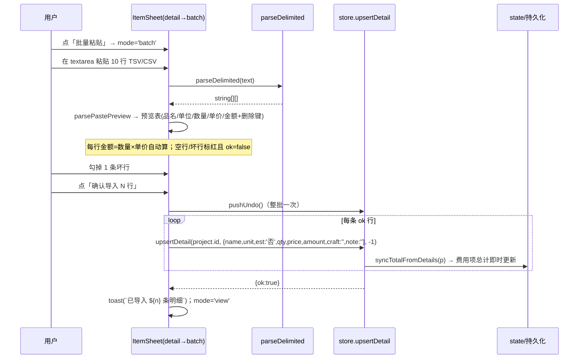
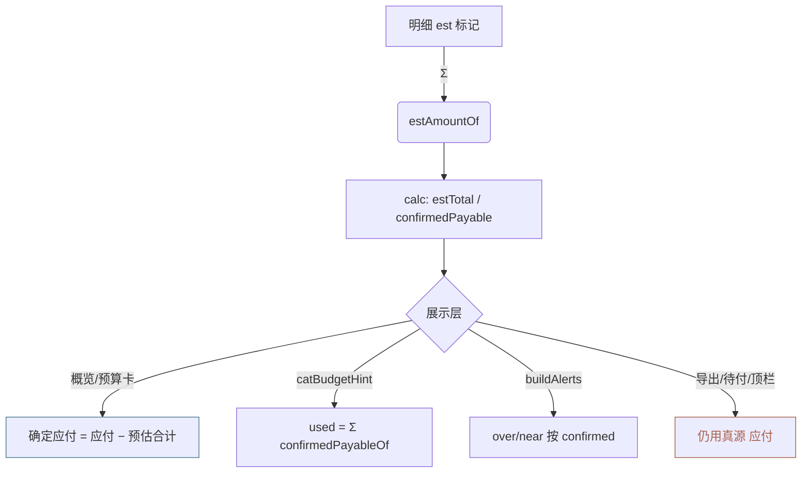
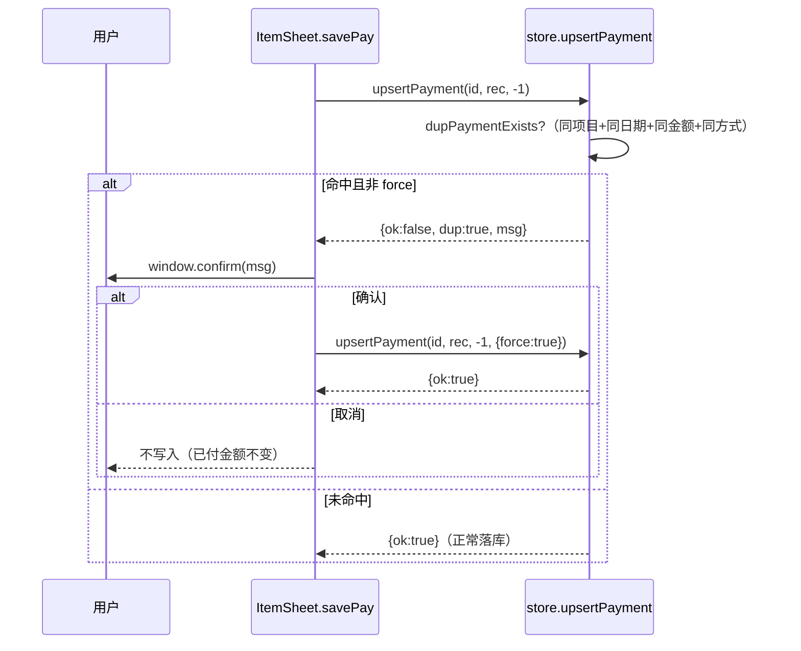
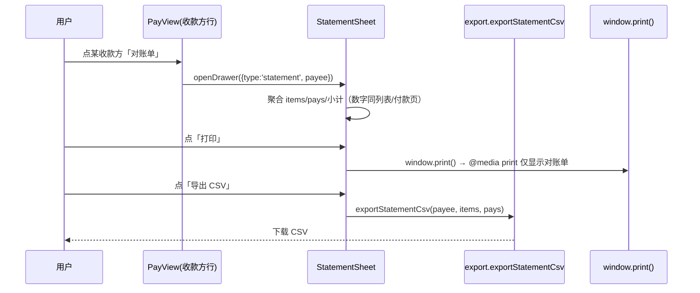
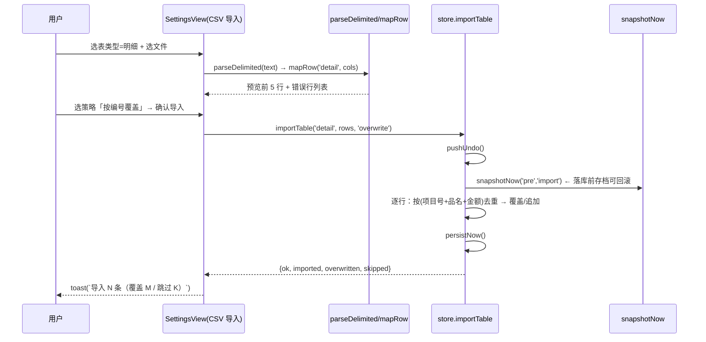
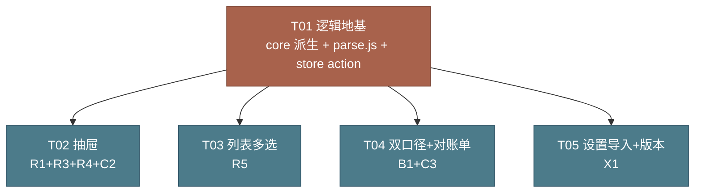

# 项目费用管理 · v1.3 增量设计（R1 / R3 / R4 / R5 / B1 / C2 / C3 / X1）

> 目标版本 **v1.3.0（录入 / 对账效率批次）**｜基线 **v1.2.0**
> 本文只做设计与任务分解。**不含实现代码，不修改 `src/` 下任何文件。**
> 设计前置：已逐行核对 v1.2 源码 `src/lib/*`、`src/views/*`、`src/sheets/*`、`src/components/*`、`src/App.vue`，并用 node 跑过 `seed.js` + `core.calc` 复算基线（见 §0）。
> 八条需求：R1 明细批量粘贴 · R3 品名历史单价联想 · R4 费用项复制（含明细 / 跨项目）· R5 列表多选与批量操作 · B1 预估与应付双口径 · C2 重复付款/费用项检测 · C3 收款方对账单 · X1 CSV 导入（三表回读）。

---

## 0. 基线核实（实测，不是引用需求文档）

| 断言 | 实测值 | 结论 |
| --- | --- | --- |
| 费用项 / 明细 / 付款 | 71 / 384 / 88 | ✅ 与 v1.2 一致 |
| 品类 / 预算键 / 收款方 | 14 / 13 / 14 | ✅ |
| 应付 `stats.payable` | **246,055.97** | ✅ |
| 已付 `stats.paid` | **188,529.11** | ✅ |
| 待付 `stats.remain` | **57,526.86** | ✅（全口径，含预估） |
| 预算合计 `stats.totalBudget` | **234,688.00** | ✅ |
| 结余 | **−11,367.97** | ✅ |
| `catRows()` 行数 | 14 | ✅ |
| 全部 71 项均有明细 | detailed=71 / non=0 | ✅（无手填总计项） |
| 明细金额合计 `ΣdetailSum` | 247,577.89 | ⚠️ 与应付差 1,521.92 = **Σ 优惠**（应付 = 明细合计 − 优惠，符合金额链） |

### B1 新增派生量基线（本批新增，实测）

| 派生量 | 实测值 | 说明 |
| --- | --- | --- |
| `estCount`（est='是' 明细条数） | **3** | 默认台账仅 3 条预估明细 |
| `estTotal`（预估合计 = Σ est 明细金额） | **14,875.00** | `calc().estTotal` |
| `confirmedPayable`（确定应付 = 应付 − 预估合计） | **231,180.97** | `calc().confirmedPayable = 246055.97 − 14875.00` |

> **红线**：`应付 246,055.97`、`已付 188,529.11`、`待付 57,526.86` 三项真源在 B1 上线后**字面不变**；`estTotal / confirmedPayable` 仅为新增派生展示值，不得反向写入任何真源字段、不得替代导出/待付里的"应付"。

---

## 1. 实现方案

### 1.1 R1 明细批量粘贴（P1 / M）

#### 改动点

- **新增** `src/lib/parse.js`：`parseDelimited(text)` 纯函数（无 vue/window 依赖，可 node 单测）。R1 与 X1 共用此解析器。
- **改** `src/sheets/ItemSheet.vue`：明细态（`mode==='detail'`）增加「批量粘贴」入口 → 抽屉内 `mode='batch'` 子态（复用 392px，textarea + 解析预览表 + 确认）。
- **复用**：`upsertDetail`（逐行落库）、`detailSum`（顶部合计）、`round2`（金额）、`pushUndo`（整批一次撤销）、`parseDelimited`（新）。

#### 数据结构 / 接口

```js
// src/lib/parse.js（纯函数）
export function parseDelimited(text) => string[][]
  // ① 按 \n / \r\n 切行，丢弃纯空白行；② 自动探测主分隔符：
  //    首个非空行若含 \t 则按 \t 切，否则按 CSV（含双引号转义，与 export.js 的 csvCell 对称）；
  //    ③ 每个单元格 trim；④ 返回二维数组（调用方按列映射）

// ItemSheet 本地状态（不改 store / 不加持久化字段）
const batchText = ref('')                                  // textarea 内容
const batchRows = computed(() => parsePastePreview(batchText.value))
  // parsePastePreview：parseDelimited → 取每行前 4 列 [name, unit, qty, price]
  //   → 每行 { name, unit, qty:+(||0), price:+(||0),
  //           amount: round2(qty*price), ok: !!name && qty>0 && price>0, err?:string }
const batchErrors = computed(() => batchRows.value.filter(r => !r.ok))
const batchGood   = computed(() => batchRows.value.filter(r => r.ok))
```

#### 调用流程（R1：粘贴 → 预览 → 落库）



#### 边界

| 边界 | 处理 |
| --- | --- |
| 粘贴 0 行 / 全部坏行 | 「确认导入」按钮 disabled；提示「没有可导入的有效行」 |
| 行只有品名无数量单价 | `ok=false`，预览表标红，不落库 |
| 数量/单价非数字 | `+( )` 为 NaN → `ok=false` |
| 单条明细金额被自动覆盖 | 金额恒 = `round2(qty*price)`，与逐条录入规则一致（amountLocked 同口径） |
| 粘贴后退出不导入 | 仅切回 `mode='detail'`/`view`，不落库 |

---

### 1.2 R3 品名历史单价联想（P1 / M）

#### 改动点

- **改** `src/lib/store.js`：新增 `namePriceIndex()`（内存索引，惰性构建 + 失效信号，不落库）。
- **改** `src/sheets/ItemSheet.vue`：明细态品名 input 加 `list="name-price-list"`，采纳后自动填 `unit` 与 `price`。
- **复用**：`round2`（无需）、`catRows` 思路（遍历明细建索引）。

#### 数据结构 / 接口

```js
// src/lib/store.js
let _nameIdx = null, _nameIdxSig = ''
export function namePriceIndex() => Map<string, { unit: string, price: number }>
  // 构建时机：首次访问惰性构建；信号 = 各 book.id + 项目数拼接串，books 变化即失效重建
  // 遍历所有 book（全局历史），项目按 date 降序 → 同品名只记"最近一条"（PRD Q4 锁定）
  //   map.set(d.name, { unit: d.unit||'', price: +d.price||0 })  // 先遇到即最近，已存在则跳过
```

#### 调用流程（R3：输入 → 联想 → 采纳）

```mermaid
sequenceDiagram
  participant U as 用户
  participant V as ItemSheet(detail 表单)
  participant S as store.namePriceIndex()

  U->>V: 品名框聚焦，输入「砂」
  V->>S: namePriceIndex().entries()
  S-->>V: [['砂子',{unit:'方',price:210}], ...]  → <datalist id="name-price-list">
  V-->>U: 下拉显示「砂子 · 方 / 210.00」
  U->>V: 选中/回车采纳「砂子」(@change)
  V->>V: dForm.unit = hint.unit; dForm.price = hint.price
  Note over V: 金额=数量×单价仍由 watch 自动算；不强制改已填数量
```

#### 边界

| 边界 | 处理 |
| --- | --- |
| 输入中联想但不想采纳 | 用 `@change`（失焦/回车）才填，输入过程不打断（避免边打字边被覆盖） |
| 品名首次出现 | 索引无该键，不联想、不填 |
| 同品名多条历史 | 取最近一条（date 降序优先），符合"上次记账"直觉 |
| 索引跨项目 | 全局遍历所有 book，历史最全；不区分当前项目 |

---

### 1.3 R4 费用项复制（含明细 / 跨项目）（P1 / M）

#### 改动点

- **改** `src/lib/store.js`：原 `cloneProject`（仅生成 prefill 给当前项目编辑态）**保留不动**；新增 `copyProject(targetBookId, sourceId, { includeDetails })` 直接落库。
- **改** `src/sheets/ItemSheet.vue`：详情态底部「复制」改为「复制到…」→ 抽屉内小浮层（目标项目下拉 + 「含明细」勾选默认勾选）。
- **复用**：`nextNo`（目标项目编号顺延）、`uid`、`clone`（深拷贝明细）、`ensurePayee`（同步收款方）、`pushUndo`（可整批撤销）。

#### 数据结构 / 接口

```js
// src/lib/store.js
export function copyProject(targetBookId, sourceId, { includeDetails = true } = {}) => { ok, msg, targetBookId, id }
  // src = book.value.projects.find(p => p.id === sourceId)        // 源恒为当前打开项目
  // target = state.books.find(b => b.id === targetBookId) || book.value
  // copy = {
  //   id: uid(), no: nextNo(target.projects),                      // ★ 按目标项目 nextNo 顺延，不重号
  //   date: todayLocal(), due: '', cat, sub, remark,
  //   total, discount, object,
  //   details: includeDetails ? clone(src.details||[]) : [],      // ★ 明细可带
  //   payments: [],                                               // ★ 付款绝不复制（R4 决策）
  // }
  // pushUndo(); target.projects.push(copy); ensurePayee(copy.object); persistNow()
```

#### 调用流程（R4：复制到 → 落库）

```mermaid
sequenceDiagram
  participant U as 用户
  participant V as ItemSheet(view 底部)
  participant S as store.copyProject
  participant B as 目标 book

  U->>V: 点「复制到…」→ 浮层(目标下拉 + 含明细✓)
  U->>V: 选「其他项目:门店B」+ 确认复制
  V->>S: copyProject('bookB', project.id, {includeDetails:true})
  S->>S: pushUndo()
  S->>B: 生成 copy(id 新/no 顺延/details 深拷贝/payments=[])
  S->>B: target.projects.push(copy); ensurePayee(object)
  S-->>V: {ok, targetBookId, id}
  V->>V: toast('已复制到 门店B')；若目标≠当前 → switchBook(targetBookId)
```

#### 边界

| 边界 | 处理 |
| --- | --- |
| 目标下拉为空（只有当前项目） | 仅显示「复制到当前项目」 |
| 含明细关 | `details: []`，仅复制费用项字段 |
| 跨项目写入 | 直接 push 到目标 book.projects，源 book 不受影响 |
| 复制后编号 | 严格 `nextNo(target.projects)`，不与源/其他项重号 |

---

### 1.4 R5 列表多选与批量操作（P1 / M）

#### 改动点

- **改** `src/lib/ui.js`：增 `selectedIds: []`（多选态存 UI，内存态，不进主键）。
- **改** `src/components/ItemRow.vue`：左侧加复选框（复用行内空间，**不新增列宽**），props 增 `selectable`/`checked`，emit `toggle(id, shiftKey)`；`@click.stop` + `@keydown.stop` 防穿透到行打开。
- **改** `src/views/ItemsView.vue`：维护 `selectedIds`（走 `ui`）；底部固定「批量操作条」（已选 N + 改品类 / 改收款方 / 改到期日 / 删除）；Shift 连选基于当前 `rows` 排序后可见行。
- **改** `src/lib/store.js`：新增 `batchSetCategory / batchSetPayee / batchSetDue / batchDelete(ids)`。
- **改** `src/App.vue`：Esc 分支追加 `ui.selectedIds = []`（与 `clearListFilters` 并列）。
- **复用**：`pushUndo`（批量改/删前各一次，5 秒撤销）、`ensureCategory`/`ensurePayee`、`filterProjects`（行序已定）、`useListNav`（J/K/Enter 不受影响）。

#### 数据结构 / 接口

```js
// src/lib/store.js
function withUndo(fn) { pushUndo(); const r = fn(); persistNow(); return r }
export function batchSetCategory(ids: string[], cat: string)   // 遍历 projects：ids 命中则 p.cat=cat；ensureCategory(cat)
export function batchSetPayee(ids: string[], payee: string)     // p.object=payee；ensurePayee(payee)
export function batchSetDue(ids: string[], due: string)         // p.due = normDate(due)
export function batchDelete(ids: string[])                       // book.projects = filter(!ids.includes)

// ItemsView（多选态本地逻辑）
const selectedIds = computed({ get: () => ui.selectedIds, set: v => ui.selectedIds = v })
let lastIndex = -1
function toggleSelect(id, shift) {
  const ids = rows.value.map(x => x.p.id); const i = ids.indexOf(id)
  if (shift && lastIndex >= 0) {                                  // Shift 连选：基于当前可见行
    const [a,b] = [Math.min(lastIndex,i), Math.max(lastIndex,i)]
    const range = ids.slice(a, b+1)
    const allOn = range.every(x => selectedIds.value.includes(x))
    range.forEach(x => allOn ? deselect(x) : select(x))
  } else { selectedIds.value.includes(id) ? deselect(id) : select(id) }
  lastIndex = i
}
```

#### 调用流程（R5：多选 → 批量改品类）

```mermaid
sequenceDiagram
  participant U as 用户
  participant L as ItemsView(列表)
  participant R as ItemRow(复选框)
  participant S as store.batchSetCategory
  participant DB as state/持久化

  U->>R: 勾选 20 条（含 Shift 连选）
  R->>L: emit('toggle', id, shiftKey) → toggleSelect 维护 ui.selectedIds
  U->>L: 底部操作条点「改品类」
  L->>L: 弹出品类 <select>
  U->>L: 选「泥瓦镶贴工程」→ 应用
  L->>S: batchSetCategory(ui.selectedIds, '泥瓦镶贴工程')
  S->>S: pushUndo()；projects 命中项 p.cat=cat；ensureCategory(cat)
  S->>DB: persistNow()
  S-->>L: {ok, n:20}
  L->>L: toast('已改 20 条品类')；ui.selectedIds=[]（清空选择）
  Note over L: 应付合计不变（只改标签字段）；J/K/Enter/⌘K 全程可用
```



#### 边界

| 边界 | 处理 |
| --- | --- |
| 复选框点击穿透 | `@click.stop` + `@keydown.stop`，不触发行的 open |
| 批量改不影响金额 | 只改 cat/object/due，不动任何金额字段 |
| 批量删除 | `pushUndo` 一次 → 5 秒撤销整批 |
| Shift 连选 | 基于 `rows`（当前筛选+排序后可见行）索引，跨筛选区归 -1 |
| 与键盘导航共存 | 单选导航用 `ui.selId`，多选用 `ui.selectedIds`，互不影响 |
| Esc | App 清 `selectedIds`（无抽屉时） |

---

### 1.5 B1 预估与应付双口径（P1 / M）

#### 改动点

- **改** `src/lib/core.js`：新增 `estAmountOf(p)`、`confirmedPayableOf(p)`；`calc` 扩展输出 `estTotal`/`confirmedPayable` 及 `byCat[].confirmed`/`byCat[].est`；`catBudgetHint` 的 `used` 改用 `confirmedPayableOf`（预警/占用按确定应付）；`buildAlerts` 的 over/near 改用 `byCat[].confirmed`。
- **改** `src/sheets/ItemSheet.vue`：编辑态 `budgetAmount` 改为 `round2((total−discount) − estAmountOf(project))`（抽屉内提示也按确定应付）。
- **改** `src/views/OverviewView.vue`：付款进度卡加「确定应付（不含预估）/ 其中预估」两行。
- **改** `src/views/BudgetView.vue`：品类行展示 `确定应付` 与 `预估`，占用率/进度条/超支 toast 改按 `confirmed`。
- **复用**：`payableOf`、`round2`、`catBudgetHint`、`buildAlerts`、`calc`。

#### 数据结构 / 接口（派生量，无新存储字段）

```js
// src/lib/core.js
export const estAmountOf = (p) =>
  round2((p?.details || []).reduce((s, d) => s + (d.est === '是' ? (+d.amount || 0) : 0), 0))
export const confirmedPayableOf = (p) => round2(payableOf(p) - estAmountOf(p))

// calc(book) 在现有基础上：
//   byCat[ck].confirmed += confirmedPayableOf(p)
//   byCat[ck].est       += estAmountOf(p)
//   顶层 estTotal       = Σ estAmountOf(p)               // 全局预估合计
//   顶层 confirmedPayable = round2(payable - estTotal)    // 全局确定应付
//   返回新增 { estTotal, confirmedPayable }
//   注：payable / paid / remain 三者真源零变化

// catRows(book) 每行新增 { confirmed, est }；rate/diff 改按 confirmed 计
// catBudgetHint(book, catName, amount, excludeId)：used += confirmedPayableOf(p)  // ★ 双口径核心
```

#### 调用流程（B1：真源不动，仅派生切换口径）



#### 边界

| 边界 | 处理 |
| --- | --- |
| 真源应付 | `stats.payable` 恒为含预估的 246,055.97，任何界面不得替换为确认应付 |
| 待付口径 | 全口径（= 应付 − 已付），与导出/X3 一致（决策 0.3.3） |
| 无预估台账 | `estTotal=0`、`confirmedPayable=payable`，行为与 v1.2 完全一致 |
| 编辑态提示 | `budgetAmount` 减 `estAmountOf(project)`，避免抽屉内"剩余"与预算页差预估额 |

---

### 1.6 C2 重复付款 / 重复费用项检测（P1 / S）

#### 改动点

- **改** `src/lib/store.js`：`upsertPayment(projectId, rec, index, opts={})` 与 `upsertProject(payload, opts={})` 增加 `opts.force`；保存前做重复校验，疑似重复返回 `{ ok:false, dup:true, msg }`（非 `force` 时）。
- **改** `src/sheets/ItemSheet.vue`：`savePay` / `saveProject` 命中 `r.dup` 时 `window.confirm` → 确认则带 `{ force:true }` 再调一次；取消则不写。
- **复用**：`paidOf`、`payableOf`、`round2`、`normDate`。

#### 数据结构 / 接口

```js
// src/lib/store.js
function dupPaymentExists(book, projectId, rec, index) {
  const p = book.projects.find(x => x.id === projectId); if (!p) return null
  return (p.payments || []).find((py, i) =>
    i !== index &&
    py.date === normDate(rec.date) &&
    round2(py.amount) === round2(rec.amount) &&
    (py.method || '') === (rec.method || '')) || null
}
function dupProjectExists(book, payload, id) {
  return book.projects.find(p =>
    p.id !== id &&
    (p.object || '') === (payload.object || '') &&
    round2(payableOf(p)) === round2((+payload.total||0) - (+payload.discount||0)) &&
    (p.remark || '') === (payload.remark || '')) || null
}
// upsertPayment：构建 item 后
//   if (!opts.force && dupPaymentExists(...)) return { ok:false, dup:true, msg:`疑似重复付款（${fmt(item.amount)} / ${item.date}），仍要记录？` }
// upsertProject：同理 dupProjectExists → { ok:false, dup:true, msg:'疑似重复支出（同收款方+同金额+同备注），仍要保存？' }
```

#### 调用流程（C2：保存前校验 → 二次确认）



#### 边界

| 边界 | 处理 |
| --- | --- |
| 编辑既有记录 | `index`/`id` 排除自身，不算重复 |
| 仅提示不强制 | 用户可确认写入（合理场景：真有两笔同日同额） |
| 不改已付 | 仅拦截写入时机，金额链不变 |

---

### 1.7 C3 收款方对账单（P1 / M）

#### 改动点

- **新建** `src/sheets/StatementSheet.vue`：抽屉内对账单（392px），含费用项表 + 付款流水 + 三行小计 + 「打印」「导出 CSV」。
- **改** `src/lib/export.js`：新增 `exportStatementCsv(payee, items, pays)`（复用模块内 `csvText`/`download`）。
- **改** `src/views/PayView.vue` / `src/views/BudgetView.vue`：收款方行加「对账单」入口 → `openDrawer({ type:'statement', payee })`。
- **复用**：`payeeRows`（聚合）、`payableOf`/`paidOf`/`dueOf`、`effectiveDue`、`export.js`、`openDrawer`。

#### 数据结构 / 接口

```js
// src/sheets/StatementSheet.vue（props: drawer）
//   items = book.projects.filter(p => p.object === drawer.payee)
//            .map(p => ({ no, remark, payable:payableOf(p), paid:paidOf(p), due:dueOf(p), dueDate:effectiveDue(p) }))
//   pays  = 上述项目全部付款，按日期升序
//   小计：Σ payable / Σ paid / Σ due
//   print：<style>（非 scoped）@media print 隐藏 .rail/.topbar/.alerts/.drawer-mask/.drawer-head/.drawer-foot/.toast-layer，仅显示 .statement
//   exportStatementCsv：构建「费用项 / 付款流水 / 小计」三段 CSV 下载

// src/lib/export.js
export function exportStatementCsv(payee, items, pays)   // 复用 csvText + download
```

#### 调用流程（C3：生成 → 打印）



#### 边界

| 边界 | 处理 |
| --- | --- |
| 数字一致性 | 全回源 `payableOf/paidOf/dueOf`，与列表/付款页逐分一致 |
| webview 打印 | 优先 `window.print()` + 打印 CSS；webview 不支持时降级为「导出 CSV / A4 友好 HTML」（PRD #7 锁定） |
| 不持久化 | 对账单生成即弃，不写 localStorage |

---

### 1.8 X1 CSV 导入（三表回读）（P1 / M）

#### 改动点

- **改** `src/lib/store.js`：新增 `importTable(table, rows, strategy)`（table: `'project'|'detail'|'pay'`；rows 为已映射对象数组；strategy: `'append'|'overwrite'|'skip'`）。落库前 `pushUndo()` + `snapshotNow('pre','import')`。
- **改** `src/lib/parse.js`：新增三表列规格 `TABLE_COLS` 与 `mapRow(table, cols)`（把 `string[][]` 映射为对象并校验）。
- **改** `src/views/SettingsView.vue`：导入区增「CSV 导入」卡片（选表类型 → 选文件 → 预览前 5 行 + 错误行 → 冲突策略 → 确认导入）。
- **复用**：`parseDelimited`（R1 共用）、`snapshotNow`/`pushUndo`（Q1 机制）、`upsert*` 思路、`nextNo`、`syncTotalFromDetails`、`round2`。

#### 数据结构 / 接口

```js
// src/lib/parse.js
export const TABLE_COLS = {
  project: ['项目号','项目分类','费用类型','费用备注','日期','到期日','总计','优惠','支付对象'],
  detail:  ['项目号','品名','单位','数量','单价','金额','工艺','备注','预估'],
  pay:     ['项目号','付款日期','付款方式','金额','备注','凭证号'],
}
export function mapRow(table, cells) => obj | { error }   // 按 TABLE_COLS 映射 + 基础校验（金额/必填）

// src/lib/store.js
export function importTable(table, rows, strategy = 'append') => { ok, msg, imported, overwritten, skipped }
  // pushUndo(); snapshotNow('pre','import')
  // project：按 项目号 匹配；skip=跳过已存在 no；overwrite=替换字段；否则 push 新（no=nextNo 或原号）
  // detail ：按 项目号 定位费用项；明细按 (项目号+品名+金额) 去重（PRD #8）；overwrite=替换同键
  // pay    ：按 项目号 定位；付款按 (项目号+日期+金额) 去重（PRD #8）；overwrite=替换同键
  // 仅填充数据，不重算/另存总额；persistNow()
```

#### 调用流程（X1：导入 → 冲突策略 → 落库前快照）



#### 边界

| 边界 | 处理 |
| --- | --- |
| 格式错误行 | 列出且不落库，不影响其余行 |
| 三表去重键 | 费用项=项目号；明细=项目号+品名+金额；付款=项目号+日期+金额（PRD #8 锁定） |
| 不创造第二真源 | 只填充 `details/payments/projects`，明细→总计→应付链不变 |
| 导入前快照 | `snapshotNow('pre','import')` + `pushUndo()`，双保险可回滚/撤销 |

---

## 2. 文件清单（改动点精确到函数名）

### 2.1 新建

| 文件 | 导出 / 内容 | 行数量级 |
| --- | --- | --- |
| `src/lib/parse.js` | `parseDelimited`、`TABLE_COLS`、`mapRow` | ~120 |
| `src/sheets/StatementSheet.vue` | 收款方对账单抽屉 + 打印 CSS + 导出 | ~180 |

`parse.js` **只依赖原生 JS**（不依赖 vue/window/localStorage），可 node 单测；`StatementSheet` 复用 `core`/`store`/`export`/`ui`。

### 2.2 改动

| 文件 | 函数 / 位置 | 改动 |
| --- | --- | --- |
| `src/lib/core.js` | `estAmountOf` / `confirmedPayableOf`（新增） | 预估合计、确定应付派生 |
| | `calc` L117 之后 | 累加 `byCat[ck].confirmed`/`est`；顶层返回 `estTotal`/`confirmedPayable` |
| | `catRows` L189 | 每行增 `confirmed`/`est`；`rate`/`diff` 改按 `confirmed` |
| | `catBudgetHint` L226 | `used += confirmedPayableOf(p)`（双口径） |
| | `buildAlerts` L508 | over/near 改用 `c.byCat[k].confirmed` |
| `src/lib/store.js` | 导入头部 | 追加 `estAmountOf, confirmedPayableOf` |
| | 新增 `namePriceIndex()` | 品名→最近单价内存索引（惰性+失效信号） |
| | 新增 `copyProject(targetBookId, sourceId, opts)` | R4 跨项目复制（不带付款） |
| | 新增 `batchSetCategory/Payee/Due/Delete(ids)` | R5 批量 |
| | 新增 `importTable(table, rows, strategy)` | X1 三表回读 |
| | `upsertPayment` L416 | 签名加 `opts={}`；保存前 `dupPaymentExists` 校验（非 force 返回 dup） |
| | `upsertProject` L345 | 签名加 `opts={}`；保存前 `dupProjectExists` 校验 |
| | `cloneProject` L370 | **不改**（R4 另起 `copyProject`） |
| `src/lib/export.js` | 末尾 | 新增 `exportStatementCsv(payee, items, pays)`（复用 `csvText`/`download`） |
| `src/lib/ui.js` | `ui` 对象 L4 | 增 `selectedIds: []` |
| `src/components/ItemRow.vue` | props / 模板 | 增 `selectable`/`checked` props、`toggle` emit；左侧复选框（`@click.stop`+`@keydown.stop`） |
| `src/views/ItemsView.vue` | script + 模板 | 维护 `ui.selectedIds`；底部批量操作条；Shift 连选；委托 `toggleSelect` |
| `src/sheets/ItemSheet.vue` | detail 态 | 增「批量粘贴」→ `mode='batch'` 子态（textarea+预览表+确认，复用 `parseDelimited`） |
| | detail 表单品名 input | 加 `list="name-price-list"` + `<datalist>`；`@change` 填 `unit`/`price`（R3） |
| | view 底部 | 「复制」改「复制到…」浮层（目标下拉 + 含明细勾选）→ `copyProject`（R4） |
| | `savePay` / `saveProject` | 命中 `r.dup` → `window.confirm` → `{force:true}` 重试（C2） |
| | edit 态 `budgetAmount` | 减 `estAmountOf(project)`（B1 抽屉提示口径） |
| `src/views/OverviewView.vue` | 付款进度卡 | 增「确定应付（不含预估）/ 其中预估」两行（B1） |
| `src/views/BudgetView.vue` | 品类行 | 展示 `确定应付`/`预估`；占用率/进度条/超支 toast 改按 `confirmed`（B1）；收款方行加「对账单」入口（C3） |
| `src/views/PayView.vue` | 收款方待付行 | 加「对账单」入口 → `openDrawer({type:'statement', payee})`（C3） |
| `src/views/SettingsView.vue` | 导入区 | 增「CSV 导入」卡片（表类型/文件/预览前 5 行/错误行/冲突策略/确认）→ `importTable`（X1） |
| `src/App.vue` | Esc 分支 L88 | 追加 `ui.selectedIds = []`（与 `clearListFilters` 并列，R5） |
| `package.json` | `version` | `1.2.0` → `1.3.0` |
| `plugin.json` | `version` | `1.2.0` → `1.3.0` |
| `README.md` | 功能段 | 补 R1/R3/R4/R5/B1/C2/C3/X1 一句话 + 版本号 |

**合计：新建 2 个 + 改动 13 个 = 15 个文件。**

---

## 3. 数据迁移结论

### 3.1 不升 KEY

- 主键仍为 `ztools_project_cost_v1`。
- **理由**：本批新增均为可选派生展示 / 交互增强 / 内存索引，无破坏性结构变更；`est` 字段（B1 依赖）在 v1.2 即已存在并写入明细，老数据天然兼容。
- `ui.selectedIds` 为内存态，关闭即弃，无迁移问题。

### 3.2 双口径不引入第二真源

- `confirmedPayable` / `estTotal` 是 `calc` 的**派生返回值**，由 `应付` 现算；任何时刻 `应付 − estTotal` 可重建。
- `catBudgetHint` / `buildAlerts` / 预算页占用率改读 `confirmed`，但**真源 `应付` 与 `待付（全口径）` 保持不变**（决策 0.3.3）。

### 3.3 反向兼容

- v1.3 写出的数据（明细 `est` 字段、不变的结构）降级回 v1.2 仍可正常装载（`est` 在 v1.2 即被导出/识别）。
- 降级后「确定应付」展示消失，但真源金额无差异。

---

## 4. 任务列表（实现顺序 = 执行顺序）

> 共 **5** 个任务。划分原则：**按层分组、接口先行**——T01 只出纯函数与 store action（可脱离 Vue 单测），T02–T05 各管一块界面，均只依赖 T01 的接口，可并行验收。

### T01 逻辑地基：core 派生量 + parse.js + store 新增 action
**P0**｜依赖：无｜新建 1 改 2

| 项 | 内容 |
| --- | --- |
| 文件 | `src/lib/core.js`（`estAmountOf`/`confirmedPayableOf`/`calc` 扩展/`catRows` 增 `confirmed`+`est`/`catBudgetHint` 改 `confirmed`/`buildAlerts` 改 `confirmed`）<br>`src/lib/parse.js`（新建：`parseDelimited`/`TABLE_COLS`/`mapRow`）<br>`src/lib/store.js`（`namePriceIndex`/`copyProject`/`batchSet*`/`importTable`/`dup*` 校验 + `upsertPayment`/`upsertProject` 加 `opts.force`） |
| 完成判据 | ① 三个文件在 node ESM 下可 import（不引用 `window`/`document`）；② `calc(默认台账).payable===246055.97`、`paid===188529.11`、`remain===57526.86`、`estTotal===14875.00`、`confirmedPayable===231180.97`；③ `catRows` 仍 14 行，新增 `confirmed`/`est` 字段且 `Σconfirmed===231180.97`；④ `catBudgetHint(book,'泥瓦镶贴工程',8000,'')` 的 `used` 为**确定应付**口径（不含该品类预估）；⑤ `parseDelimited('a\tb\n1\t2')` 返回 `[['a','b'],['1','2']]`，空行被丢弃；⑥ `namePriceIndex()` 返回 Map 且同品名只含最近一条；⑦ `dupPaymentExists` 在"同项目+同日期+同金额"时返回非 null；⑧ `importTable('detail', rows, 'overwrite')` 后对应明细被替换、`book` 总额由明细链重算不变 |

### T02 抽屉改造：R1 批量粘贴 + R3 联想 + R4 复制到 + C2 重复拦截
**P1**｜依赖：T01（parseDelimited / namePriceIndex / copyProject / dup 校验）｜改 1

| 项 | 内容 |
| --- | --- |
| 文件 | `src/sheets/ItemSheet.vue` |
| 完成判据 | ① 明细态点「批量粘贴」→ textarea 粘贴 10 行 4 列 → 预览 10 行且金额=数量×单价；确认后生成 10 条明细、费用项总计=粘贴合计、坏行未落库；② 品名输入「砂子」出现「方 / 210.00」联想，采纳后单位与单价自动填入；③ 详情态「复制到…」选其他项目 + 含明细✓ → 目标项目出现同金额同明细费用项、编号顺延不重号、付款为 0；④ 同日同额重复付款保存弹「疑似重复」确认，取消后已付不变；编辑既有付款排除自身 |

### T03 列表多选与批量：R5
**P1**｜依赖：T01（batchSet*）｜改 4

| 项 | 内容 |
| --- | --- |
| 文件 | `src/views/ItemsView.vue`、`src/components/ItemRow.vue`、`src/lib/ui.js`（selectedIds）、`src/App.vue`（Esc 清选择） |
| 完成判据 | ① 勾选 20 条 → 底部操作条显示「已选 20」；② 批量改品类一次成功、应付合计与操作前一致；③ 批量删除前 `pushUndo` → 5 秒可撤销整批；④ 改收款方同步 `ensurePayee`；⑤ Shift 连选基于当前可见行；⑥ 多选态下 J/K/Enter 导航与 ⌘K 搜索仍可用、复选框点击不穿透打开抽屉；⑦ Esc 清空选择（无抽屉时） |

### T04 双口径展示 + 对账单：B1 + C3
**P1**｜依赖：T01（confirmedPayable / calc 扩展）｜新建 1 改 3

| 项 | 内容 |
| --- | --- |
| 文件 | `src/sheets/StatementSheet.vue`（新建）、`src/views/OverviewView.vue`、`src/views/BudgetView.vue`、`src/views/PayView.vue`、`src/lib/export.js`（exportStatementCsv） |
| 完成判据 | ① 概览付款进度卡显示「确定应付 231,180.97 / 其中预估 14,875.00」；② 预算页品类行显示确定应付与预估、占用率按 confirmed、超支 toast 用 confirmed；③ 勾预估的明细不再触发该品类临界/超支预警；④ 收款方行「对账单」→ 费用项表+付款流水+三行小计，数字与列表/付款页一致；⑤ 点「打印」调用 `window.print()` 且打印 CSS 隐藏导航/按钮；⑥ 点「导出 CSV」下载对账单 CSV；⑦ `stats.payable/paid/remain` 三项仍字面 246055.97/188529.11/57526.86 |

### T05 设置导入面板 + 版本收尾：X1
**P1**｜依赖：T01（importTable / parseDelimited / mapRow）｜改 4

| 项 | 内容 |
| --- | --- |
| 文件 | `src/views/SettingsView.vue`、`package.json`、`plugin.json`、`README.md` |
| 完成判据 | ① 设置页「CSV 导入」卡片可选表类型+选文件→预览前 5 行+错误行列表+冲突策略；② 导出→手改 2 行金额→以「按编号覆盖」导入，改动生效且总条数不变；③ 格式错误行不落库；④ 导入前自动存快照（`reason==='import'` 的 pre 条目出现）且 `pushUndo`；⑤ 插件内显示 v1.3.0，`node build.cjs` 产出 `releases/project-cost-1.3.0.zpx` |

### 依赖图



关键路径：T01 → 其余四块（接口先行，T02–T05 可并行）。

---

## 5. 共享约定

### 5.1 命名（沿用 v1.2 §5.1）

| 模式 | 含义 | 示例（本批） |
| --- | --- | --- |
| `xxxOf(...)` | 纯派生、无副作用 | `estAmountOf`、`confirmedPayableOf` |
| `xxxHint(...)` | 返回提示对象 | `catBudgetHint`（改口径为 confirmed） |
| `xxxIndex(...)` | 内存索引 | `namePriceIndex` |
| `copyXxx` / `batchXxx` / `importXxx` | 批量/跨对象动作 | `copyProject`、`batchSetCategory`、`importTable` |
| `parseXxx` / `mapXxx` | 文本→结构 | `parseDelimited`、`mapRow` |

**禁止**新增 `getXxx` / `setXxx`（与现有风格冲突）。

### 5.2 数值 / 口径

- 金额一律过 `round2()`；比较容差 **`0.005`**（与 C2 校验、`savePay` 超付校验一致）。
- **B1 红线（跨文件）**：`calc().payable` 是唯一真源应付；`confirmedPayable`/`estTotal` 仅供预警/占用率/概览小字展示，**不得**写入 `p.total`/`book.budget`/导出/待付。
- **待付全口径**：`dueOf = payable − paid`（含预估），与导出/X3 一致（决策 0.3.3）。
- `catBudgetHint` 与 `calc().byCat` 必须同口径（都用 `confirmedPayableOf`），代码注释互指一句，防分叉。

### 5.3 金额链唯一真源

- 链：`明细合计 → 费用项总计 → 应付(=总计−优惠) → 已付(=Σ付款) → 待付(=应付−已付)` 不变。
- R4 复制、X1 导入只移动/填充数据，不重算或另存总额；C2/C3/R5 不动任何金额；B1 只派生不替换。

### 5.4 撤销 / 快照纪律

- 批量改/删（R5）、批量粘贴（R1）、跨项目复制（R4）、CSV 导入（X1）落库前均 `pushUndo()`（5 秒撤销）。
- X1 导入前额外 `snapshotNow('pre','import')`（跨会话可回滚），与 `importState` 同机制。
- 组件不得直接 `localStorage.*`；快照只经 `store.snapshotNow` 出口（沿用 v1.2 §5.5）。

### 5.5 多选态与导航共存（R5）

- 单选导航用 `ui.selId`（`useListNav`）；多选用 `ui.selectedIds`（独立数组）。
- 复选框 `@click.stop` + `@keydown.stop` 防穿透到行打开；⌘K / J / K / Enter 全程可用。

### 5.6 R3 取数规则（已锁 Q4）

- 同品名多条历史取**最近一条**（项目按 `date` 降序遍历，先遇到即最近）；用 `@change`（采纳）才填，不打断输入。

### 5.7 X1 三表去重键（已锁 #8）

- 费用项 = 项目号；明细 = 项目号 + 品名 + 金额；付款 = 项目号 + 日期 + 金额。

---

## 6. 风险与对策

| # | 风险 | 触发条件 | 对策 |
| --- | --- | --- | --- |
| 1 | **B1 双口径混用（最危险）** | 某处把"确定应付"写回真源，或待付改成不含预估 | ① `confirmedPayable` 仅 `calc` 派生返回值，无 setter；② 全站搜索 `stats.payable` 为真源，导出/待付/X3 一律用 `payable`；③ 代码评审专查"是否出现两处应付数"；④ 回归断言 §8 锁死三项真源 |
| 2 | **C3 webview 内打印不干净** | ZTools webview 不支持 `@media print` 或打印含导航 | ① 优先 `window.print()` + 打印 CSS 隐藏 `.rail/.topbar/.alerts/.drawer-head/.drawer-foot`；② 降级：检测打印异常/无预览时提供「导出 CSV / A4 友好 HTML」按钮（PRD #7）；③ 对账单数字纯聚合，降级不影响数据 |
| 3 | **R5 多选破坏滚动/导航** | 复选框穿透打开抽屉；Shift 连选与 J/K 冲突 | ① `@click.stop`+`@keydown.stop`；② 选择走 `ui.selectedIds`，导航走 `ui.selId`，互不干扰；③ 批量条固定底部、不新增列宽，列表滚动层不变；④ 完成判据 T03-⑥ 专验 |
| 4 | **X1 解析鲁棒性** | 用户 CSV 含引号/逗号/空列/错列数 | ① `parseDelimited` 内置引号感知切分（与 `csvCell` 对称）；② `mapRow` 逐行校验，坏行列出不落库；③ 预览前 5 行 + 错误行列表让用户先看见；④ 落库前快照可回滚 |
| 5 | **R4 跨项目复制虚增已付** | 误把源付款带过去 | ① `copyProject` 硬编码 `payments: []`；② 验收 T02-③ 专查目标项目付款为 0、源不受影响 |
| 6 | **R3 输入中被覆盖** | 边打字边联想填单价，打乱用户意图 | ① 仅在 `@change`（失焦/回车采纳）填 `unit`/`price`；② 数量不自动改，金额由 watch 算 |
| 7 | **C2 确认死循环 / 误拦** | 正常两笔同日同额被拦；force 重试又命中 dup | ① `force:true` 时跳过校验直接落库；② `dup` 仅 `window.confirm` 提示，取消即不写；③ 编辑排除自身 |
| 8 | **namePriceIndex 失效** | 复制/导入后索引未刷新 | ① 失效信号 = 各 book.id+项目数拼接串，books 变化即重建；② 索引只读，不缓存到 `state` |
| 9 | **B1 改 `catBudgetHint` 影响 v1.2 B2 提示** | 编辑态"本笔后剩"口径变化 | ① 这是 B1 预期行为（预警按确定应付）；② `budgetAmount` 同步减 `estAmountOf(project)`，避免与预算页差预估额；③ T04-② 验收 |
| 10 | **设置页撑破 618px** | C3 入口仅加按钮（不新增卡片），X1 新增卡片 | ① X1 卡片复用「导入与搬家」区相邻空间；② C3 对账单进 392px 抽屉（可滚动）；③ 设置页 `.content` 单层滚动 |
| 11 | **R5 批量改品类后预算页行数变化** | 改到新品类触发新建档案 | 与 v1.2 `ensureCategory` 同机制，预算页行数自然 +1，金额不变 |

---

## 7. 不做清单（本批明确排除，防止顺手扩范围）

| 排除项 | 说明 |
| --- | --- |
| 需求池其余 P2（A1/A2/A3/A4、B3/B4、C4/C5、M1/M2/M3、S1/S2/S3、X2/X4） | 不在 v1.3.0 范围，按反馈择机（A1/Q3 已后置 v1.4） |
| **R6** 列表搜索含明细品名 | 用户确认本次不纳入（决策 0.3.2） |
| **升 KEY**（`ztools_project_cost_v2`） | 无破坏性结构变更，沿用 v1.2 主键 |
| 图片/凭证附件持久化 | 与 5MB 配额冲突 |
| 改 `persistNow` 配额降级策略 | 现有策略正确，不动 |
| 新增第三方依赖 | 违反零运行时依赖（CSV/打印用原生） |
| B1 待付改不含预估 | 决策 0.3.3：待付保持全口径，仅预警/占用率用确定应付 |
| R4 跨项目复制带付款 | 决策 0.3.4：付款是真实资金动作，复制会虚增已付 |
| C3 另开页签 | 守 800×618，对账单进抽屉/打印视图 |

---

## 8. 回归基线（工程师自测 + QA 验证共用）

### 8.1 硬断言：升级后金额链零差异

在 v1.2.0 数据上升级到 v1.3.0，以下必须**字面完全相同**：

| 断言 | 期望值 |
| --- | --- |
| 费用项数 | `71` |
| 明细条数 | `384` |
| 付款笔数 | `88` |
| 品类数 / 预算键数 / 收款方数 | `14 / 13 / 14` |
| 应付 `stats.payable` | `246055.97` |
| 已付 `stats.paid` | `188529.11` |
| 待付 `stats.remain` | `57526.86` |
| 预算合计 `stats.totalBudget` | `234688` |
| 结余 `stats.balance` | `−11367.97` |
| `catRows()` 行数 | `14` |
| 无日期付款笔数 / 金额 | `6 / 4142` |

### 8.2 B1 新增派生量基线（必须复算一致）

| 断言 | 期望值 |
| --- | --- |
| `calc().estTotal`（预估合计） | `14875.00` |
| `calc().confirmedPayable`（确定应付 = 246055.97 − 14875.00） | `231180.97` |
| est='是' 明细条数 | `3` |
| 概览卡「确定应付 / 其中预估」 | `231,180.97 / 14,875.00` |
| 预算页各品类占用率 | 改按 `confirmed`（确定应付）计，与概览口径一致 |
| 顶栏 / 导出 / 待付 中的「应付」 | 仍为 `246055.97`（全口径，不被替换） |

### 8.3 交互基线

| 场景 | 断言 |
| --- | --- |
| R1 粘贴 10 行 4 列 | 预览 10 行、金额=数量×单价；确认后生成 10 条、费用项总计=粘贴合计；空/坏行未落库 |
| R3 输入「砂子」 | datalist 显示「方 / 210.00」；采纳后单位与单价自动填入 |
| R4 复制到「其他项目」含明细 | 目标项目出现同金额同明细费用项、编号顺延不重号、付款为 0、源不受影响 |
| R5 勾选 20 条批量改品类 | 一次成功、应付合计不变；批量删除可 5 秒撤销；J/K/Enter/⌘K 可用 |
| B1 勾预估明细 | 不再触发该品类临界/超支预警；`stats.payable` 仍 246055.97 |
| C2 同日同额重复付款 | 弹「疑似重复」确认；取消后已付不变 |
| C3 收款方对账单 | 费用项表+付款流水+三行小计一致；`window.print()` 隐藏导航/按钮；导出 CSV 成功 |
| X1 导出→手改 2 行→「按编号覆盖」导入 | 改动生效、总条数不变；导入前快照存在、`pushUndo` 可撤销 |
| 全站 | 无横向滚动条；`.content` 只有一层纵向滚动；抽屉不出滚动条溢出；窗口仍 800×618 |

### 8.4 打包基线

```
npx vite build            → 无 warning（除既有 chunk 体积提示）
node build.cjs            → releases/project-cost-1.3.0.zpx
插件内左下/设置页版本文案   → v1.3.0
plugin.json version       → 1.3.0
```
