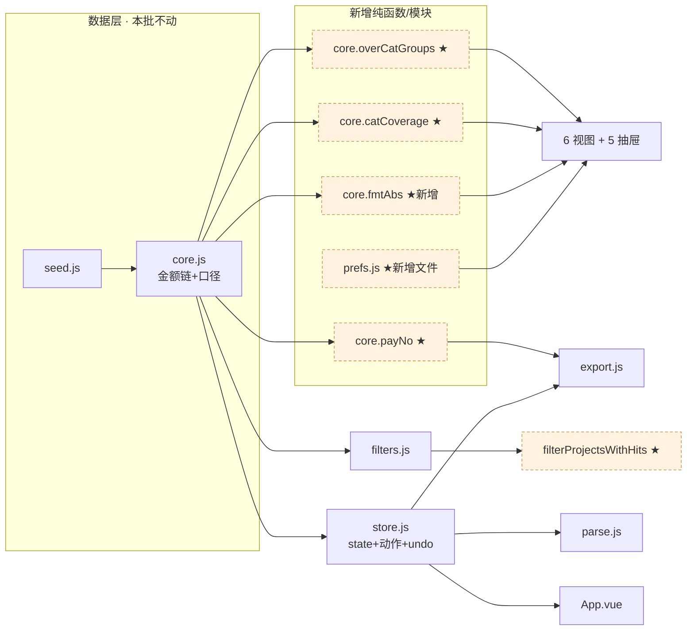
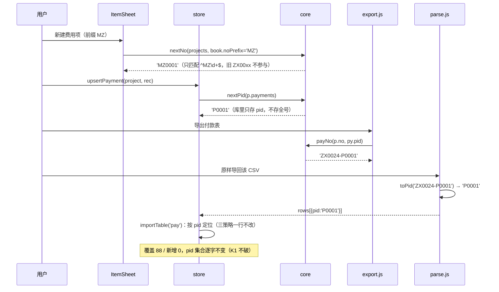

# 增量设计 v1.7 · 可信度批次（A1–A3 / B1–B4 / C1–C6）

> 输入：`docs/增量PRD-v1.7.md`（462 行，已定稿）+ `docs/增量说明-v1.6.md`
> 代码基线：v1.6.0，`node scripts/verify-all.mjs` = **12 套件 / 901 例全绿**（本机实测 2026-10-27）
> 本文件只做设计与任务分解，**不含业务代码**。所有行号为本机实测 `grep` 结果，可直接跳转核对。
> 不新增任何第三方依赖；`package.json` 的 `dependencies` 保持只有 `vue`。

## 0. 实测复核（与 PRD 的差异，先摆出来）

| 项 | PRD 口径 | 实测 | 处理 |
| --- | --- | --- | --- |
| `fmtNum` 调用点 | 「约 48 处」 | **实际 72 处**（`grep -on fmtNum src/` = 84，减 11 处 import + 1 处定义） | 以 72 为准，清单见 §2.2；说明 PRD 的 48 是旧版估计 |
| 必须改 `fmtAbs` | 8 组 | **10 处**（8 组里 ①⑧ 各含 2 处），另有 2 处同性质未列 → **共 12 处** | 12 处全改，多出的 2 处（`BudgetView:127`、`ItemsView:310`）在 §2.2 标 ▲ |
| `fmt(-0.001)` | 应为 `¥0.00` | **现状 `-¥0.00`（真 bug）** | `fmt` 也必须先 `round2` 再判符号，见 §2.1 |
| 基线金额链 | 246,055.97 / 188,529.11 / 57,526.86 / 234,688.00 / −11,367.97 | 实测逐分一致；`estTotal 14,875.00`、`confirmedPayable 231,180.97` 一致 | 冻结为门禁 |
| 预算键 / 品类 | 13 键 / 14 品类 | 实测 `budget` 13 键、`catRows` 14 行 | 不补键 |
| 超预算组 | 6 个 / +12,266.75 | 实测 6 个 / **12,266.75**（细部收口 2,688.00 · 卫浴 2,537.00 · 厨房 2,486.25 · 墙顶 1,987.50 · 楼梯 1,800.00 · 泥瓦 768.00） | PRD 文字列举顺序非降序，实现按降序 → 首屏 5 行 = 前 5 个，`还有 1 个`（泥瓦） |
| 未设预算组 | 1 个 / 9,514.00 | 实测 `其他费用` 9,514.00（3 项） | — |
| checkup | 1 条 → 2 条 | 实测基线仅有 `pay-no-date`（6 笔 / 4,142.00） | C4 追加后 = 2 条 |
| 超 30 天 | 5 笔 23,784.34；<100 元 1 笔 0.46 | 实测 severe 5 笔 / 23,784.34；≥100 4 笔 23,783.88；<100 1 笔 0.46（ZX0016，145 天） | — |
| 负数明细 / 负付款 | 63 条 / 2 笔 −974.88 | 实测 63 条；负付款 ZX0018 −580.00、ZX0024 −394.88；负应付费用项仅 ZX0018（−580.00） | — |
| 残缺收款方 | 2 条 / 26,780.00 | 实测 ZX0020 `泥工-` 14,980.00、ZX0061 `木工-` 11,800.00 | — |
| 编号 | 最大 ZX0071 → ZX0072 | 实测 `ZX0069/ZX0070/ZX0071` | — |

---

## 1. 整体策略与分层

### 1.1 为什么必须是「格式化层 → 口径层 → 交互层 → 编号契约」这个顺序

四层改造的耦合方向是**单向**的：所有上层都调用格式化函数、所有层都调用口径函数。若先动编号契约（C6）或文案（C1），再回头改 `fmtNum` 语义，就等于让 72 个调用点 + 全站文案在同一时刻一起漂移，`git bisect` 无法定位是哪一层把某个数字改错了。

| 顺序 | 层 | 内容 | 为什么必须先做 |
| --- | --- | --- | --- |
| ① | 格式化层 | A1（`fmtNum` 语义 + `fmtAbs` + `-0` 防护 + 颜色）、C2（精度） | 只有 3 个出口函数（`fmt/fmtNum/fmtW` + 新 `fmtAbs`），改完即全站生效。**此层不碰任何金额计算函数**，`calc/payableOf/paidOf/dueOf/detailSum` 一行不改 → 金额链在结构上不可能被动到 |
| ② | 口径层 | A2（`hasBudget/catCoverage/overCatGroups`）、C3（门槛常量 + 折叠）、C4（体检新规则） | 全部是**纯函数新增**，只读 `book`，不写。放在格式化层之后，是因为 A2 的「超 / 未设」分组和 C3 的折叠行都要用新的 `fmtAbs` 出文案；先改格式化层，这些新文案一次写对 |
| ③ | 交互层 | A3（撤销栈）、B1（搜索）、B2（排序）、B3（密度）、B4（备份） | 交互层会改视图模板与 `store` 的动作入口（补 `pushUndo`）。此时格式化/口径已稳定，视图改动的 diff 里不会混进数字语义变更，code review 只需看「有没有第二套口径」 |
| ④ | 编号契约 | C6（前缀 + 全号）、C5（pid 隐藏 + 联动提示） | 唯一会动**导出契约**的一层，且 `parse.js` 一处改动同时影响导入定位（v1.6 K1 的地基）。放最后，单一提交内跑「导出→原样导回」全链路；前面任何一层都没有碰 `parse.js` / `export.js` 的列定义 |
| ⑤ | 术语 | C1（全局替换） | **面广的机械改动**，必须放在格式化/口径/交互定型之后：此时所有新文案（`未设预算`、`超 30 天`、`命中：`、`编号 P0001`）都已存在，术语表一次扫全；若先做 C1，后面每加一处文案都要重扫一遍 |

### 1.2 三层防腐：金额链为什么中途不会破

```
明细 amount ──detailSum──> projectTotal ──−discount──> payableOf ──−paidOf(ΣactivePayments)──> dueOf
        (不动)                  (不动)                      (不动)            (不动)              (不动)
                                                                  │
                                       calc() / catRows() / overdueGroups() / agingRows()  ← 全部只读上面这 5 个
                                                                  │
   ┌──────────────────────────── 本批只改这三条支流 ────────────────────────────┐
   │ 显示支流：fmt / fmtNum / fmtAbs        （A1 · C2）                          │
   │ 口径支流：catCoverage / overCatGroups  （A2）                       均为只读新增 │
   │ 定位支流：payNo / nextNo / pid 剥离    （C6）  ——  不参与任何求和           │
   └──────────────────────────────────────────────────────────────────────────┘
```

三条硬约束（写进 §8 自检）：

1. `git diff src/lib/core.js` 内 `detailSum / projectTotal / payableOf / paidOf / dueOf / calc / catRows` **零改动**（只允许新增函数与 `fmt*` 改动）。
2. `git diff src/lib/store.js` 内 `state` 顶层键零新增（`noPrefix` 在 `book` 内，不是 `state` 顶层）；`book.budget` 永不写入。
3. 6 个单真源函数各只有 1 处实现：`filters.filterProjects`、`paidOf`、`catRows`/`catCoverage`、`overdueGroups`、`payNo`、`fmt/fmtNum/fmtAbs`。

### 1.3 分层依赖图（新增模块用虚线）



---

## 2. 格式化层设计（A1 + C2）

### 2.1 三个出口的最终形态（全部在 `core.js`，第 21–38 行区域）

```js
export const round2 = (n) => Math.round((+n || 0) * 100) / 100;           // 不动（core.js:21）

/** 带 ¥ 带符号：正值 `¥394.88`，负值 `-¥394.88`，零恒 `¥0.00`（round2 后判符号，永不出现 -¥0.00） */
export const fmt = (n) => {
  const v = round2(n);
  return (v < 0 ? '-¥' : '¥') + Math.abs(v).toLocaleString('zh-CN', { minimumFractionDigits: 2, maximumFractionDigits: 2 });
};

/** 无 ¥ 带符号：`-394.88`。语义由「取绝对值」改为「保留符号」（A1 的核心变更） */
export const fmtNum = (n) => {
  const v = round2(n);
  return v.toLocaleString('zh-CN', { minimumFractionDigits: 2, maximumFractionDigits: 2 });
};

/** 新增：无 ¥ 取绝对值。只给「文字/符号/颜色已表达方向」的位置用（见 §2.2 的 12 处） */
export const fmtAbs = (n) => Math.abs(round2(n)).toLocaleString('zh-CN', { minimumFractionDigits: 2, maximumFractionDigits: 2 });

export const fmtW = (n) => { ... }   // 不动（core.js:28–34）
```

关键点：

| 点 | 规则 |
| --- | --- |
| `-0` 防护 | 一律 `round2(n)` **之后**判 `v < 0`。`round2(-0.001) === -0`，`-0 < 0 === false` → `fmt(-0.001) = '¥0.00'`、`fmtNum(-0.001) = '0.00'`。**现状是 `-¥0.00`（bug），本步修掉** |
| `toLocaleString` 对 `-0` 的行为 | `(-0).toLocaleString('zh-CN',{min/maxFractionDigits:2})` 返回 `"-0.00"`，故 `fmtNum` **必须**先 `round2` 再走。稳妥写法：`const v = round2(n) \|\| 0;`（`-0 \|\| 0` → `0`）。**`fmtNum`/`fmtAbs` 内部统一用 `round2(n) \|\| 0`** |
| `fmt` 的 `n<0` 判定 | 同样改用 `round2(n) \|\| 0` 后的值判符号 |
| 颜色 | 明细行/合计/总计/待付的负数 → `var(--danger)`；**付款行负数例外**：保留「退款 394.88」文案 + `var(--ok)`；列表行负应付（ZX0018 −580.00）→ `var(--danger)`（PRD A1 #4 明确） |
| 现有 `.amount.neg` | `styles.css:548` 现为 `color: var(--ok)`（会误导）→ 改为 `var(--danger)`；`ItemRow` 新增 `:class="{ neg: stat.payable < 0 }"` |
| 新增 `.mrow .amt.neg` | `styles.css` 内 `.mrow .amt` 之后加 `.mrow .amt.neg { color: var(--danger); }` |

### 2.2 全部 `fmtNum` 调用点清单（72 处，实测行号）

> 判定口径：该处**有没有别的信号已经表达了方向**（文字「超/余/欠/多付/退款/超付」、显式 `+` 前缀、或颜色）。
> 有 → `fmtAbs`；无 → 保留 `fmtNum`（语义改带符号即自动正确）。
> **★ = 必改 `fmtAbs`（12 处）**；▲ = PRD 8 组未列、但同性质必须改（2 处）。

| 文件 | 行 | 该处用途 | 走哪个 | 备注 |
| --- | --- | --- | --- | --- |
| `components/ItemRow.vue` | 51 | 列表行金额 | `fmtNum` **+改条件** | `stat.payable > 0 ? … : '—'` → `stat.payable !== 0 ? … : '—'`，并加 `.neg`（A1 #4：ZX0018 显示 `-580.00`） |
| `components/ItemRow.vue` | 53 | 待付小字 | `fmtNum` | 多付时会显示 `-xxx`，正确 |
| `sheets/CatForm.vue` | 79 | 预算差额 | **★`fmtAbs`** | PRD 组⑤；颜色（ok/danger）已表方向 |
| `sheets/PayeeForm.vue` | 60（前半） | 欠款 | `fmtNum` | 值恒正 |
| `sheets/PayeeForm.vue` | 60（后半） | `'多付 ' + fmtNum(-row.owe)` | **★`fmtAbs`** | PRD 组④；用 `fmtAbs(row.owe)` |
| `sheets/ItemSheet.vue` | 438 | 金额卡·总计 | `fmtNum` | 负总计要带符号 |
| `sheets/ItemSheet.vue` | 439 | 金额卡·优惠 | `fmtNum` | — |
| `sheets/ItemSheet.vue` | 440 | 金额卡·已付 | `fmtNum` | 颜色保持 `--ok` |
| `sheets/ItemSheet.vue` | 441 | 金额卡·待付 | `fmtNum` + 色 | `due>0 accent : due<0 danger : muted` |
| `sheets/ItemSheet.vue` | 456 | 明细标题 `N 条 · 合计 X` | `fmtNum` + 色 | 负值加 danger（A1 #3：ZX0024 显示 `0.00`） |
| `sheets/ItemSheet.vue` | 470 | 明细行金额 `.amt` | `fmtNum` + 色 | 负值 `--danger`（A1 #3 的核心） |
| `sheets/ItemSheet.vue` | 507（×2） | 付款行 `'退款 ' + fmtNum(-py.amount)` / `fmtNum(py.amount)` | **★`fmtAbs`** | PRD 组⑧；负值 → `'退款 ' + fmtAbs(py.amount)`，颜色由 `--danger` 改 `--ok` |
| `sheets/ItemSheet.vue` | 612 | 明细表单顶部「本项已有…合计」 | `fmtNum` | — |
| `sheets/ItemSheet.vue` | 615 | 明细表单顶部「项目总计」 | `fmtNum` | — |
| `sheets/ItemSheet.vue` | 628 | 品名联想「上次记账…」 | `fmtNum` | price 恒正 |
| `sheets/ItemSheet.vue` | 692 | 批量粘贴预览金额 | `fmtNum` | — |
| `sheets/ItemSheet.vue` | 700 | 「有效合计」 | `fmtNum` | — |
| `sheets/ItemSheet.vue` | 713 | 付款表单·应付 | `fmtNum` | — |
| `sheets/ItemSheet.vue` | 714 | 付款表单·已付 | `fmtNum` | — |
| `sheets/ItemSheet.vue` | 715 | 付款表单·待付 | `fmtNum` | — |
| `sheets/StatementSheet.vue` | 96（×3） | A4 HTML 费用项三列 | `fmtNum` | 与屏幕同口径（带符号） |
| `sheets/StatementSheet.vue` | 97（×1） | A4 HTML 付款金额 | **★`fmtAbs`**（经局部 `payAmtText()`） | 与屏幕 186 统一：负数输出 `退款 394.88` |
| `sheets/StatementSheet.vue` | 159 | 费用项应付 | `fmtNum` | — |
| `sheets/StatementSheet.vue` | 160 | 已付小字 | `fmtNum` | — |
| `sheets/StatementSheet.vue` | 163 | 待付 | `fmtNum` | `due>0 ? … : '结清'` 保留既有语义 |
| `sheets/StatementSheet.vue` | 186（×2） | 屏幕付款行 | **★`fmtAbs`** | PRD 组⑧；`'退款 ' + fmtAbs(py.amount)` + `--ok` |
| `views/OverviewView.vue` | 124（×2） | 品类「超 / 余」 | **★`fmtAbs` ×2** | PRD 组① |
| `views/PayView.vue` | 96 | 卡头 `5 笔 · 23,784.34` | `fmtNum` | 卡头数字**不得变** |
| `views/PayView.vue` | 108 | 逾期行金额 | `fmtNum` | — |
| `views/PayView.vue` | 113 | 「另有 N 笔逾期 1–30 天（合计 X）」 | `fmtNum` | — |
| `views/PayView.vue` | 129 | 收款方待付 | `fmtNum` | 值恒正 |
| `views/BudgetView.vue` | 22 | toast「已超支 X」 | `fmtNum` | 值恒正（`confirmed > v` 才进分支） |
| `views/BudgetView.vue` | 89 | 品类行应付 | `fmtNum` | — |
| `views/BudgetView.vue` | 93 | 确定应付 | `fmtNum` | — |
| `views/BudgetView.vue` | 95 | 预估 | `fmtNum` | — |
| `views/BudgetView.vue` | 127 | 品类差额 `(diff>=0?'+':'') + fmtNum(diff)` | **▲`fmtAbs`** | 显式 `+` 前缀已表方向，再带 `-` 会出 `+-800`-类双信号 |
| `views/BudgetView.vue` | 142（前半） | `'欠 ' + fmtNum(p.owe)` | `fmtNum` | — |
| `views/BudgetView.vue` | 142（后半） | `'多付 ' + fmtNum(-p.owe)` | **★`fmtAbs`** | PRD 组③ |
| `views/BudgetView.vue` | 146 | 账目 | `fmtNum` | — |
| `views/BudgetView.vue` | 147 | 已付 | `fmtNum` | — |
| `views/ItemsView.vue` | 227 | 列表头·应付 | `fmtNum` | — |
| `views/ItemsView.vue` | 229 | 列表头·待付 | `fmtNum` | `sumDue` 已 `Math.max(...,0)` |
| `views/ItemsView.vue` | 308 | 批量付款·待付合计 | `fmtNum` | — |
| `views/ItemsView.vue` | 310 | `· 超付 X` | **▲`fmtAbs`** | `payPlan.over` 恒正，用 `fmtAbs` 表明「方向已由『超付』二字表达」 |
| `views/ItemsView.vue` | 316 | 分配 chips | `fmtNum` | — |
| `views/AnalysisView.vue` | 111 | 账龄收款方下拉 `name · owe` | `fmtNum` | — |
| `views/AnalysisView.vue` | 139 | 预算 vs 实际·预算 | `fmtNum` | — |
| `views/AnalysisView.vue` | 141 | 预算 vs 实际·应付 | `fmtNum` | — |
| `views/AnalysisView.vue` | 160 | 欠款排行 | `fmtNum` | — |
| `views/AnalysisView.vue` | 183 | 账龄桶金额 | `fmtNum` | — |
| `views/AnalysisView.vue` | 189 | 待付合计 | `fmtNum` | — |
| `views/AnalysisView.vue` | 211 | 账龄明细金额 | `fmtNum` | — |
| `views/AnalysisView.vue` | 226 | 收款方账龄下钻 | `fmtNum` | — |
| `views/AnalysisView.vue` | 257 | 材料排行金额 | `fmtNum` | — |
| `views/AnalysisView.vue` | 263 | 明细合计 | `fmtNum` | — |
| `views/AnalysisView.vue` | 265 | 其他 N 种 | `fmtNum` | — |
| `views/AnalysisView.vue` | 269 | Top 合计 | `fmtNum` | — |
| `views/AnalysisView.vue` | 270 | ＋其他 | `fmtNum` | — |
| `views/AnalysisView.vue` | 271 | ＝明细合计 | `fmtNum` | — |
| `views/AnalysisView.vue` | 308（×2） | 上月基准 应付/已付 | `fmtNum` | — |
| `views/AnalysisView.vue` | 313 | 变化最大品类 `(diff>=0?'+':'') + fmtNum(diff)` | **★`fmtAbs`** | 同 `BudgetView:127`，显式 `+` 前缀 |
| `views/SettingsView.vue` | 237 | 导入预览·费用项 | `fmtNum` | — |
| `views/SettingsView.vue` | 238 | 导入预览·明细 | `fmtNum` | — |
| `views/SettingsView.vue` | 239 | 导入预览·付款 | `fmtNum` | — |
| `views/SettingsView.vue` | 361 | 快照摘要应付 | `fmtNum` | — |
| `views/SettingsView.vue` | 390 | 体检「涉及 X」 | `fmtNum` | 差额可能为负，带符号正确 |

**分布统计**（供 QA 排人力）：

| 文件 | 处数 | 其中改 `fmtAbs` |
| --- | --- | --- |
| `ItemSheet.vue` | 16 | 1（507） |
| `AnalysisView.vue` | 17 | 2（299→见下、313） |
| `StatementSheet.vue` | 9 | 2（97 经 helper、186） |
| `BudgetView.vue` | 9 | 2（127▲、142） |
| `ItemsView.vue` | 5 | 1（310▲） |
| `SettingsView.vue` | 5 | 0 |
| `PayView.vue` | 4 | 0（另 72 是 `fmtW`→`fmtAbs`） |
| `ItemRow.vue` | 2 | 0 |
| `OverviewView.vue` | 2 | 2（124 ×2） |
| `PayeeForm.vue` | 2 | 1（60） |
| `CatForm.vue` | 1 | 1（79） |
| **合计** | **72** | **12** |

### 2.3 C2 精度：`fmtW` → `fmt` 的 9 处 + 万位白名单

`fmtW` 全站 34 处使用，**保留 25 处，改 9 处**：

| 改分精度（`fmtW`→`fmt`） | 位置 |
| --- | --- |
| 概览 4 张 KPI 主数字 | `OverviewView.vue:19,20,21,22` |
| 付款页 3 张 KPI 主数字 | `PayView.vue:71,76,81` |
| 分析页命令栏「应付合计」 | `AnalysisView.vue:114` |
| 分析页环比·本月值 | `AnalysisView.vue:297`（`r.unit==='条'` 分支不变） |
| 分析页环比·差额 | `AnalysisView.vue:299` → `fmtAbs(r.o.diff)`（★组⑥，带 ↑↓ 箭头） |
| 付款页 KPI 小字「含超付」 | `PayView.vue:72` → `'含超付 ' + fmtAbs(sum.due)`（★组⑦） |

**万位白名单（`万` 只允许出现在这 5 个位置，写进 `verify-v17-ui` 静态扫描）**：

| # | 位置 | 代码 |
| --- | --- | --- |
| 1 | 环形图中心 | `Donut.vue:40,50`（被 `AnalysisView:121,151,332` 使用） |
| 2 | 概览现金流 mini | `OverviewView.vue:144,145` |
| 3 | 预算页右栏三行 mini | `BudgetView.vue:51,52,54` |
| 4 | 顶栏双 mini + 项目卡片 meta + 品类抽屉预算 mini | `App.vue:189,190`、`BookManage.vue:75`、`CatForm.vue:85` |
| 5 | 微型柱图刻度 | `MiniBars.vue:30,31` |

> ⚠️ **需 PM 追认的口径补充**：#4 这 3 个位置 PRD 未列。理由：顶栏高 46px、`topstat .it b` 仅 12.5px 且与「项目名 chip + 新增按钮」并排，放 13 字符会挤压项目名；`BookManage` 卡片 meta 是 10px 单行；`CatForm` 是 10.5px 三行并排。若 PM 坚持这三处也到分，需同步改 `App.vue` 顶栏为两行布局（成本 +0.5 天）。
> 反向要求：`AnalysisView:114` 不在白名单里，必须改分精度（命令栏有 ~200px 余量）。

---

## 3. 口径层设计（A2 + C3 + C4）

### 3.1 A2：三个函数 + 一个判定，落点全部在 `core.js`

```js
/** 统一的「有没有预算」判定：缺键与 0/空同属未设预算（只有一套语义） */
export function hasBudget(book, name) {
  const b = book?.budget || {};
  return Object.prototype.hasOwnProperty.call(b, name) && +b[name] > 0;
}
```
> 用 `hasOwnProperty.call` 而非 `Object.hasOwn`：与 `core.js:900` 既有写法一致，且无需担心构建 target。

```js
/** 品类覆盖：三处（概览/预算页/分析页）品类数文案的唯一来源 */
export function catCoverage(book) {
  const names = [...new Set([
    ...(book?.categories || []).map((x) => x.name),
    ...Object.keys(book?.budget || {}),
  ])];
  const withBudget = names.filter((n) => hasBudget(book, n)).length;
  return { total: names.length, withBudget, missing: names.length - withBudget };
}
```
- 不调 `calc()`（`catRows` 会跑全量 71×384，放 computed 里没必要）。
- 基线：`{ total: 14, withBudget: 13, missing: 1 }`。
- **不补键、不写 0**：`Object.keys(book.budget).length` 必须仍为 13（`verify-t01` 断言禁止改）。

```js
/** 超支两类分组（PRD §2.2）：超预算 = 有预算且 confirmed>budget；未设预算 = 无预算且 confirmed>0 */
export function overCatGroups(book) {
  const rows = catRows(book);                     // 复用既有行构造，不新造品类集合
  const over = rows
    .filter((r) => r.budget > 0 && r.confirmed > r.budget)
    .map((r) => ({ ...r, over: round2(r.confirmed - r.budget) }))
    .sort((a, b) => b.over - a.over);             // 按超出额降序
  const noBudget = rows
    .filter((r) => !(r.budget > 0) && r.confirmed > 0)
    .sort((a, b) => b.confirmed - a.confirmed);   // 按确定应付降序
  const sum = (arr, k) => round2(arr.reduce((s, x) => s + (x[k] || 0), 0));
  return {
    over: { rows: over, count: over.length, sum: sum(over, 'over') },
    noBudget: { rows: noBudget, count: noBudget.length, sum: sum(noBudget, 'confirmed') },
  };
}
```
基线：`over.count=6, over.sum=12266.75`；`noBudget.count=1, noBudget.sum=9514.00`。

### 3.2 A2 四处文案（唯一来源 = `catCoverage`）

| 落点 | 现状 | 改后 | 文件 |
| --- | --- | --- | --- |
| 概览「项目总预算」卡片小字 | `${Object.keys(budget).length} 个品类` | `14 个品类 · 13 个已设预算` | `OverviewView.vue:19` |
| 预算页汇总行 | `{{ budgetCount }} 个品类已填预算`（`computed budgetCount` 在 `:13`） | `{{ cov.total }} 个品类 · {{ cov.withBudget }} 个已设预算`，删掉 `budgetCount` | `BudgetView.vue:13,60` |
| 预算页页签 | `品类预算 {{ cats.length }}` | **保留**（不改成 coverage，页签要的是行数） | `BudgetView.vue:68` |
| 分析页「预算 vs 实际」标题右侧 | `<span class="hint">前 8 项</span>` | `共 14 个品类 · 13 个已设预算` | `AnalysisView.vue:124` |

**禁止**：任何视图出现 `Object.keys(...budget...).length`。改完 `grep -rn "Object.keys(.*budget).length" src/views/` 必须为空。

### 3.3 A2 预算页「未设预算」行（`BudgetView.vue:99–129`）

| 元素 | 现状 | 改后 |
| --- | --- | --- |
| 预算输入框 `placeholder` | `未设` | `未设预算`（`:108`） |
| 预算输入框 `:value` | `c.budget \|\| ''` | 不变（空即空，**不写 0**） |
| 占用率列 | `c.rate == null ? '—'` | `c.rate == null ? '未设预算'`（`:121`） |
| 占用率列宽 | `.rate { width: 32px }`（`BudgetView.vue:199`） | `width: 52px`（4 字 10px ≈ 40px），`.diff` 保持 64px；行总宽 82+40+52+64+gaps ≈ 270px < 738px |
| 差额列 | `c.diff == null ? '—'` | 不变（`—`） |

### 3.4 A2 概览「需关注」两组（替换 `rateCats`）

`OverviewView.vue:44–54` 的 `rateCats`（`rate>=0.8` + `top5`）整体替换为：

```js
const groups = computed(() => overCatGroups(book.value));   // 来自 core
const LIMIT = 5;
const overShown = computed(() => groups.value.over.rows.slice(0, LIMIT));
const overRest  = computed(() => Math.max(0, groups.value.over.count - LIMIT));
const noShown   = computed(() => groups.value.noBudget.rows.slice(0, LIMIT));
const noRest    = computed(() => Math.max(0, groups.value.noBudget.count - LIMIT));
```

模板（`:118–137` 区域，`.rate-list` 内）：

| 元素 | 文案 / 结构 |
| --- | --- |
| 组头 1 | `超预算 6 · +12,266.75`（`.grp-head`，值用 `'+' + fmtAbs(over.sum)`） |
| 组内行 | 复用 `.rate-row`：名称 + `已用 x% · 超 <fmtAbs(confirmed-budget)>` + `.prog` |
| 组尾（超预算） | `还有 1 个`（`v-if="overRest"`） |
| 组头 2 | `未设预算 1 · 9,514.00`（值用 `fmtAbs(noBudget.sum)`，无 `+` 前缀） |
| 组内行 | 名称 + `未设预算 · 已花 <fmtAbs(confirmed)>`（**不显示 %**，与预算页同口径） |
| 保留 | 其下的「N 笔已逾期待付，合计 X」与「另有 N 笔 7 天内到期」两块**不动** |

> 口径变化说明：`rate>=0.8` 的「临界」品类不再出现在概览卡片里（PRD 只定义两组）。临界仍由顶部预警横幅 `临界 X 项` 承担 —— 这是 C1 之后「同一件事只有一处入口」的必然结果，写进 §5 假设。

### 3.5 C3：门槛常量与折叠

| 项 | 设计 |
| --- | --- |
| 常量 | `export const OVERDUE_MIN_AMOUNT = 100;` 紧跟 `SEVERE_DAYS`（`core.js:756` 之后），注释写明「只影响付款页超 30 天卡的显示行数，不参与任何金额计算」 |
| `overdueGroups` 返回扩展（**只加不改**） | `severeBig / severeSmall / smallAmount / smallCount / bigAmount`；`severe / severeAmount / all / count / normal` 一个不动（卡头计数与既有断言依赖它） |
| 视图 | `PayView.vue:99-110`：`v-for="x in od.severe"` → `v-for="x in shownSevere"`；`shownSevere = showSmall ? od.severe : od.severeBig` |
| 折叠行 | `另有 1 笔小额逾期（合计 0.46）· 展开`，`showSmall` 切换后文案变 `收起`，行原地追加在 4 行之后、`另有 N 笔逾期 1–30 天` 之前 |
| 顺序 | 两条「另有」并存且顺序固定：先小额折叠行，再 1–30 天行 |
| 卡头 | `{{ od.severe.length }} 笔 · {{ fmtNum(od.severeAmount) }}` → **一个字不改** |

基线锚点：默认渲染 4 行；展开 5 行；折叠行小数用 `fmtAbs`（`0.46`）。

### 3.6 C4：`checkup` 新增第 10 条规则

| 字段 | 值 |
| --- | --- |
| `code` | `'payee-name-suspect'`（加入 `CHECK_CODE` 常量表 `core.js:520–530`） |
| `level` | `'warn'` |
| `title` | `收款方名疑似不完整` |
| `count` | 命中费用项条数（基线 **2**） |
| `unit` | `'条'` |
| `amount` | `round2(Σ payableOf(p))`（基线 **26780.00**） |
| `samples` | 前 3 条 `sample(p, `${p.object} · ${fmt(payableOf(p))}`)` → `泥工- · ¥14,980.00` |
| `fix` / `fixLabel` | `null` / `''`（**只报不改**，不提供一键修复） |
| `note` | `仅提示，不改数据；建议在收款方档案里补全名称` |

判定（独立于 `orphan-payee`，可同时命中；基线因 `泥工-` 档案存在 → 只命中本条）：

```js
const PAYEE_BAD_RE = /^[-－—_]|[-－—_]$|--/;
const nameSuspect = projects.filter((p) => {
  const n = String(p.object || '').trim();
  if (!n) return false;                       // 空收款方归 orphan/未指定，不归本条
  return PAYEE_BAD_RE.test(n) || n.length <= 1;
});
```

插入位置：`issues` 末尾（第 ⑩ 条，`budget-total-drift` 之后）。理由：`SettingsView.checkSummary` 用 `issues.find(i => !i.fix)` 取第一条 warn —— 放末尾可保证概览摘要仍是「付款缺少日期」，不改变既有显示；`issues.length` 由 1 → 2。

---

## 4. 状态层设计（A3 撤销栈 + B3 密度 + B4 备份时间戳）

### 4.1 A3：撤销环形栈

**数据结构选择：普通数组（`string[]`），不用链表**
理由：上限 20，`push/pop` O(1)，淘汰最旧 `shift()` 在 n≤20 时成本可忽略；链表要额外维护节点与长度，且序列化/调试更麻烦。

```js
const UNDO_MAX = 20;
const UNDO_MAX_CHARS = 2000000;   // 2,000,000 字符（基线单快照 54,188 字符 ≈ 20 步 1.03MB）
let undoStack = [];               // 每项是一个 JSON 字符串，最旧在 [0]

function undoChars() { return undoStack.reduce((s, x) => s + x.length, 0); }

export function pushUndo() {
  try {
    const snap = JSON.stringify({ books: state.books, activeBookId: state.activeBookId, templates: state.templates });
    undoStack.push(snap);
    while (undoStack.length > UNDO_MAX || undoChars() > UNDO_MAX_CHARS) undoStack.shift();
    return true;
  } catch (_) { return false; }          // 序列化失败：不入栈，不破坏已有栈
}
export function canUndo() { return undoStack.length > 0; }
export function undoDepth() { return undoStack.length; }
export function clearUndo() { undoStack = []; }
export function undo() {
  if (!undoStack.length) return false;
  try {
    const d = JSON.parse(undoStack.pop());
    state.books = d.books.map(normalizeBook);
    state.activeBookId = d.activeBookId;
    state.templates = d.templates || [];
    persistNow();
    return true;
  } catch (_) { return false; }
}
```

| 决策点 | 结论 | 理由 |
| --- | --- | --- |
| 序列化策略 | 仍序列化 `{books, activeBookId, templates}`，**不加** `warnThreshold` | 与 v1.6 payload 逐字一致，`undo()` 语义不变；加字段会让「撤销」意外回滚阈值设置 |
| `undo()` 返回值 | 保持 `boolean`（不改成对象） | `App.vue:240` 与既有断言按 boolean 用；剩余步数另开 `undoDepth()` |
| 上限裁剪 | 先按条数 20，再按总字符 2,000,000，都从最旧淘汰 | PRD §2.3 |
| 持久化 | **不写 localStorage** | 与 Q1 日快照抢 5MB 配额 |
| 回滚快照 | `restoreSnapshot()` 内既有 `clearUndo()` 保持 | 避免撤到「回滚之前」 |
| 内存风险 | 20 步 ≈ 1.03MB，在 webview 内可接受；`importState`/`importTable` 前会 `pushUndo`，大账套首步即 ~53KB | 无需懒拷贝（`books` 已 JSON 化） |

**「批量算 1 步」的实现点**（现有已正确，逐个确认，不要重复 push）：

| 动作 | pushUndo 位置 | 说明 |
| --- | --- | --- |
| 批量改品类/收款方/到期日/删除 | `store.js:526 withUndo()` | 整批 1 次 |
| 批量付款 | `store.js:727 batchPay()` | 整批 1 次，内部不调 `upsertPayment` |
| 明细批量粘贴 | `ItemSheet.vue:285 confirmBatch()` | 1 次，之后循环调 `upsertDetail` |
| CSV/JSON 导入 | `store.js:933/858` | 1 次 |
| 清空/恢复默认 | `store.js:830` | 1 次 |

**必须新增 `pushUndo()` 的 7 个动作**（否则 A3 验收 #1「连续做 5 次改金额 → Ctrl+Z 5 次」做不到）：

`upsertProject`（新增/编辑各 1 次，放在校验通过、真正落库之前）、`upsertDetail`、`upsertPayment`、`upsertCategory`、`upsertPayee`、`setBudget`、`setBookMeta`。

> 冲突检查（已逐个核对，无嵌套双 push）：`batchSetCategory/batchSetPayee/batchSetDue/batchDelete/batchPay/importTable/fixCheckup/syncFromProjects` 都**直接改字段**，不经过上述 7 个函数。
> **一处必须顺手合并**：`CatForm.save()` 现在先 `upsertCategory` 再 `setBudget`（两次调用 = 2 步撤销）。改法：给 `upsertCategory(prevName, { name, color, note, budget })` 增加可选 `budget` 入参，内部一次 `pushUndo` 后同时写档案与预算；`CatForm.vue:30–33` 改为一次调用。

### 4.2 `Ctrl/Cmd+Z` 在 `App.vue` 的插入位置

现有顺序（`App.vue:91–118`）：`⌘K` 分支 → `Escape` 分支 → **`:109` 的 `if (inField || e.metaKey || e.ctrlKey || e.altKey) return;`（会拦掉 Cmd+Z）** → `/` `n` `1-6` `b`。

插入点：**`Escape` 分支之后、`:109` 之前**。

```js
// A3：撤销。必须在 :109 的 metaKey 拦截之前；输入框内交给浏览器原生撤销
if ((e.metaKey || e.ctrlKey) && !e.altKey && !e.shiftKey && e.key.toLowerCase() === 'z') {
  if (inField || ui.drawer) return;        // ① 输入框内走原生；② 抽屉打开时不抢（见下）
  e.preventDefault();
  doUndo();
  return;
}

function doUndo() {
  if (!canUndo()) { toast('没有可撤销的操作'); return; }
  if (!undo()) { toast('撤销失败，历史版本仍可用'); return; }
  const left = undoDepth();
  toast(left ? `已撤销（还可退 ${left} 步）` : '已撤销（已到最早）');
}
```

- **抽屉打开时不响应**：撤销可能删掉当前抽屉指向的费用项（`project` 变 null），半删态下 footer 按钮会抛错。这和现有 toast「撤销」按钮的行为一致（那条路径也有同样风险），但键盘连撤的误触概率高一个量级，故显式挡掉并写进 §5 假设。
- `App.vue:238–242` 的 toast 撤销按钮改为同走 `doUndo()`（`@click="doUndo(); dismissToast(t.id)"`），保证两处文案一致。
- `SettingsView.vue:511–518`「快捷键」表新增一行：`<div><kbd>⌘Z</kbd><span>撤销上一步（连撤 20 步）</span></div>`。

### 4.3 B3 密度（新建 `src/lib/prefs.js` 承载，`state` 不碰）

```js
// src/lib/prefs.js —— 只碰 localStorage，不依赖 store/core，可 node 单测
export const DENSITY_KEY = 'ztools_rc_density';
export const BACKUP_KEY = 'ztools_rc_last_backup';
export const DENSITY = { COMPACT: 'compact', COMFORT: 'comfort' };
export const DENSITY_DEFAULT = DENSITY.COMPACT;      // 主理人拍板：默认紧凑
export function getDensity() { /* 读不到/非法 → COMPACT */ }
export function setDensity(v) { /* 仅接受 compact|comfort，写失败静默 */ }
export function getLastBackup() { /* '' = 从未备份 */ }
export function setLastBackup(day) { /* ISO 日期，写失败静默 */ }
export function backupHint(today) { /* → {level:'never'|'stale'|'ok', days, text} */ }
```

| 项 | 设计 |
| --- | --- |
| 形态 | 舒适＝现状（`.item` padding `9px 12px`，标题 13px / 元信息 10.5px，行高 ≈57px）；紧凑＝两行、`padding: 3px 12px`、标题 12px / 元信息 9.5px、`.amt-col` 改**横排** |
| 层级 | 只在**列表容器**加类：`ItemsView.vue:236` `<div class="list" :class="'density-' + density">`；CSS 全部挂在 `.list.density-compact` 下，**不污染概览页的 `ItemRow`** |
| 关键 CSS（新增到 `styles.css` `.item .subline` 之后） | `.list.density-compact .item { padding: 3px 12px; gap: 2px 8px; }`<br>`.list.density-compact .item .title { font-size: 12px; line-height: 1.2; }`<br>`.list.density-compact .item .no { font-size: 9px; }`<br>`.list.density-compact .item .l2 { font-size: 9.5px; line-height: 1.2; gap: 5px; }`<br>`.list.density-compact .item .amt-col { flex-direction: row; align-items: baseline; gap: 4px; }`<br>`.list.density-compact .item .amount { font-size: 12px; }`<br>`.list.density-compact .item .subline { font-size: 9px; }` |
| 行高预算 | 3+3(padding) + 14.4(标题 12×1.2) + 2(gap) + 11.4(元信息 9.5×1.2) ≈ **34–37px ≤ 38** ✅ |
| 信息不删 | 8 项全部保留：标题/项目号/金额（第 1 行）+ 品类/收款方/日期/明细数/状态徽标（第 2 行）；`待付` 小字由「列内第二行」改为「金额右侧内联」→ 行数从 3 减到 2，字段一个不少 |
| 入口 | `ItemsView.vue:213` 之后（`.filters` 行尾）加 `<button class="chip" :class="{ on: density==='compact' }" @click="toggleDensity()">紧凑 / 舒适</button>`，24px 高；文字随当前态变化：紧凑态显示「紧凑」，点击切舒适 |
| 多选共存 | `.item.has-sel { padding-left: 32px }`（`ItemRow.vue:84`）不受影响；紧凑模式下保持 32px（不要改成 20px，复选框 + 勾选热区会挤） |
| 记忆 | 独立键 `ztools_rc_density`；**不进 `state`**（否则 deep watch 触发无意义 persist、污染 JSON 备份结构） |
| 范围 | 只作用于**列表页**（`ItemsView`）。付款页 88 行暂不加开关 —— PRD §2.6 只点名列表页，多一个入口就多一处口径；`prefs` 已备好，下批一行即可复用（写进 §5 假设） |

### 4.4 B4 备份出口

| 项 | 设计 | 文件 |
| --- | --- | --- |
| 出口 | 复用设置页既有「JSON 备份」按钮 → `doExportJson()` | `SettingsView.vue:155–158,402` |
| 文件名 | `项目费用备份_{项目名}_{YYYY-MM-DD}_{N}项{M}明细.json`；`项目名` 经 `replace(/[\\/:*?"<>\|\s]/g,'_')` | `export.js:157–160` |
| 函数签名（**向后兼容**） | `exportJson(state)` 保持单参；返回 `{ ok, name, day, items, details }`；内部从 `state.activeBookId` 找当前账套算条数 | 同上 |
| 日期 | 用 `todayLocal()`（改掉现在的 `toISOString()`：UTC 在东八区 0–8 点会写成前一天） | `export.js` 新增 `import { todayLocal }` |
| 内容 | 全量 `state`（books + templates + warnThreshold），与 `importState` 入参同构；**不含** `ztools_project_cost_snap_v1`（快照在独立键，天然不进） | 不变 |
| 时间戳 | `SettingsView.doExportJson()` 在 `r.ok` 后 `setLastBackup(r.day)`；写失败静默（`prefs` 内 try/catch） | `SettingsView` + `prefs` |
| 7 天提示 | `backupHint(today)`：从未 → `从未备份，建议现在导出一份`；`>7` → `已 12 天未备份，建议现在导出`；`≤7` → `上次备份 3 天前`。渲染在导出卡片**顶部**一条 warn 行 | `SettingsView.vue:399` 卡片内 |
| 固定文案 | 卡片底部常驻：`数据仅存本机（约 5MB），清缓存 / 换机 / 重装都会归零，请自行备份。` | `SettingsView.vue:406` 之后 |
| 自动导出 | 不做 | — |

---

## 5. 查询层设计（B1 搜索 + B2 排序）

### 5.1 B1：`filters.js` 扩展（保持「唯一真源」，不改导出路径）

**问题**：`filterProjects(projects, f)` 只返回数组，视图拿不到「命中详情」。若为命中提示在视图里再拼一次 `hay`，就出现第二套搜索口径（PRD 明令禁止）。

**方案：新增 `filterProjectsWithHits` 作为唯一实现，`filterProjects` 退化为 3 行的薄包装**（签名、返回值、默认行为全部不变，导出路径零改动）。

```js
/** 9 个参与字段（唯一实现，视图与导出一律经此） */
const FIELDS_P = ['remark', 'object', 'cat', 'no', 'date'];              // 费用项级
const FIELDS_D = ['name', 'unit', 'craft', 'note'];                      // 明细级

/**
 * @param {Array} projects
 * @param {{query?:string, cat?:string, status?:string, from?:string, to?:string}} f
 * @returns {{ rows: Array, hits: Map<string, {name:string,count:number,others:number,tip:string,title:string}|null> }}
 *   hits 只在 f.query 非空时有内容；key = 费用项 id
 */
export function filterProjectsWithHits(projects, f = {}) { ... }

/** 兼容包装：列表与导出仍只调这一个（唯一真源不分裂） */
export function filterProjects(projects, f = {}) {
  return filterProjectsWithHits(projects, f).rows;
}
```

命中结构（`hits.get(p.id)`）：

| 字段 | 含义 |
| --- | --- |
| `name` | 命中的品名（多条时取该费用项内**金额绝对值最大**的那一个） |
| `count` | 该品名在该费用项内的**明细条数**（品名按 `nameKey` 归一：去全部空白 + 小写，与 `materialRows` 同口径） |
| `others` | 命中品名的**种数**（含展示的那一个）；`>1` 时后缀 `等 N 种` |
| `tip` | 行内提示：`命中：砂子 ×2` / `命中：砂子 ×2 等 3 种`；品名 >12 字 → 前 11 字 + `…`；整段 >24 字 → 截断 + `…` |
| `title` | 未截断全文（`title` 属性用） |
| `null` | 只命中 `unit/craft/note` 或只命中费用项级字段 → **不出提示**（避免「命中：个 ×3」噪声） |

判定：明细任一字段含关键词 → 该费用项命中（OR）。**搜索不改变排序**（排序仍由 `sortKey` 决定）。

视图接线（`ItemsView.vue`）：

```js
const res  = computed(() => filterProjectsWithHits(book.value?.projects || [], f.value));
const rows = computed(() => res.value.rows.slice().sort(cmp).map((p) => ({ p, st: statOf(p), hit: res.value.hits.get(p.id) || null })));
```

- `doExportScope()` 仍用 `rows.value.map((x) => x.p)` → 与列表同一数组，`verify-v17` 的「导出 5 行合计 5,317.00」自动成立。
- `hasFilter/filterTag` 不动。
- `ItemRow`：新增 prop `hit`，第 2 行尾部渲染 `<span class="hit" :title="hit.title" data-hit @click.stop="emit('hit', item.id, hit.name)">{{ hit.tip }}</span>`；样式 `.item .hit { color: var(--accent); font-size: 10px; max-width: 300px; overflow: hidden; text-overflow: ellipsis; }`。
- 定位：`@hit` → `openDrawer({ type:'item', id, highlight: name })`；`ItemSheet` 读 `props.drawer.highlight`，`onMounted` 起 1.5s 后清空，命中行加 `.mrow.hl { background: var(--accent-soft); }`。

基线锚点：`砂子` 5 条（ZX0001/0007/0023/0025/0027）合计 5,317.00；`马贝胶泥` 2 条；`搬运费` 6 条；`个` >100 条且 0 条提示。**实现后必须用 `verify-v17` 断言这 4 条**（其中「个」的要反向断言：`rows.length > 100 && hitsForTip === 0`）。

### 5.2 B2：付款页三级兜底比较器

```js
const sortKey = ref('overdue');        // overdue | due | no
const SORTS = [
  { v: 'overdue', t: '按逾期天数' },
  { v: 'due', t: '按待付金额' },
  { v: 'no', t: '按项目号' },
];
// 逾期天数唯一来源 = overdueGroups（内部走 effectiveDue + bookDueDays），视图不另算
const daysById = computed(() => new Map(od.value.all.map((x) => [x.id, x.days])));

function cmp(a, b) {
  if (sortKey.value === 'due') return b.st.due - a.st.due || (a.p.no || '').localeCompare(b.p.no || '');
  if (sortKey.value === 'no') return (a.p.no || '').localeCompare(b.p.no || '');
  const da = daysById.value.get(a.p.id) ?? -1;      // 未逾期统一 -1 → 天然排最后
  const db = daysById.value.get(b.p.id) ?? -1;
  return db - da || b.st.due - a.st.due || (a.p.no || '').localeCompare(b.p.no || '');
}
const rows = computed(() => /* 先按状态段过滤，再 sort(cmp)，再 map */);
```

| 项 | 结论 |
| --- | --- |
| 选项 | 3 个，默认「按逾期天数」 |
| 入口 | `PayView.vue:136–146` `.list-head` 右侧：**替换** `<span class="mini">点条目记录付款</span>` 为 `<select v-model="sortKey" class="mini-select" data-pay-sort style="height:24px;width:104px">` |
| 状态筛选共存 | 先 `ui.payFilter` 过滤，再排序（`rows` 的两段式） |
| 被替换的旧排序 | 原「状态 rank → 项目号降序」整体删除（B2 定义了新默认；状态仍由分段按钮控制） |
| KPI 不受影响 | `sum` computed 只累加金额，与排序无关 |

---

## 6. 编号契约设计（C6 + C5）

### 6.1 C6 五个落点

| # | 项 | 设计 | 文件:行 |
| --- | --- | --- | --- |
| 1 | 数据字段 | `book.noPrefix: string`，缺省 `''` = 沿用 `ZX` | `store.js:42 mkBook`、`:59 normalizeBook` |
| 2 | 校验 | `PREFIX_RE = /^[A-Z]{1,4}$/`、`isValidPrefix(s) = s === '' \|\| PREFIX_RE.test(s)`；`normalizeBook` 对非法值兜底为 `''`（老数据/手改 JSON 不炸） | `core.js` 新增；`normalizeBook` |
| 3 | 生成 | `nextNo(projects, prefix = 'ZX')`：取匹配 `^${prefix}\d+$` 的最大序号 +1，4 位补零 | `core.js:930–937` 改写 |
| 4 | 全号 | `payNo(projectNo, pid)`：`` `${projectNo}-${pid}` ``；任一为空 → 返回另一个（防空 `-P0001`） | `core.js` 新增，紧跟 `PID_RE` |
| 5 | 设置入口 | `BookManage.vue` 项目卡片内 `.meta` 区新增 `.prefix-row`（面积行下方）：`编号前缀 [输入框 48px] `，`@change` → `setBookMeta({ noPrefix })`，返回 `ok:false` 时 `toast(msg)` 并把输入框回填原值 | `store.js:372 setBookMeta` 增加分支；`BookManage.vue:76–89` |

```js
export function nextNo(projects, prefix = 'ZX') {
  const p = String(prefix || 'ZX');            // '' → ZX（PRD：默认沿用 ZX）
  const re = new RegExp(`^${p}(\\d+)$`);       // 不匹配前缀的旧号不参与取号
  let max = 0;
  (projects || []).forEach((x) => {
    const m = re.exec(String(x.no || '').trim());
    if (m) max = Math.max(max, +m[1]);
  });
  return `${p}${String(max + 1).padStart(4, '0')}`;
}
```

**`nextNo` 的 4 个调用点全部要传前缀**（`grep -rn "nextNo(" src/`）：

| 文件:行 | 传参 |
| --- | --- |
| `store.js:472` `cloneProject` | `nextNo(book.value.projects, book.value.noPrefix)` |
| `store.js:500` `copyProject` | `nextNo(target.projects, target.noPrefix)`（**目标账套**的前缀） |
| `store.js:961` `importTable('project')` 新建分支 | `nextNo(b.projects, b.noPrefix)` |
| `sheets/ItemSheet.vue:58` 新建表单预填 | `nextNo(book.value?.projects \|\| [], book.value?.noPrefix)` |

**旧编号一律不动**：`nextNo` 只影响新建；`upsertProject` 用表单里的 `form.no` 原值保存（编辑态回填既有 `p.no`），不经过 `nextNo`。基线 71 条编号逐字不变（`verify-v17` 用 `JSON.stringify(projects.map(p=>p.no))` 前后比对）。

**`payNo` 唯一拼接点证明**：`grep -rn 'payNo' src/` 应只有 `core.js` 定义 1 处 + `export.js` 调用 1 处；`grep -rn '\${.*\.no}-\${.*\.pid}' src/` 必须为空。

### 6.2 `parse.mapRow('pay')` 剥前缀（三条硬要求）

```js
const PID_LOCAL_RE = /^P\d{4,}$/;                                  // 与 core.PID_RE 同形（parse 不 import core，避免循环）
const PAY_FULL_RE = /^(?:[A-Za-z]{1,8}\d{2,})?-(P\d{4,})$/;        // ZX0024-P0001 → P0001

function toPid(v) {
  const s = String(v || '').trim();
  if (PID_LOCAL_RE.test(s)) return s;         // 老格式直通（v1.6 导出 / 用户自建）
  const m = PAY_FULL_RE.exec(s);
  return m ? m[1] : '';                       // 剥离失败 → 视为未填（宁可回退旧规则，也不把前缀当编号写进库）
}
```

`mapRow` pay 分支**最前面**先 `obj.pid = toPid(obj.pid)`，再走原有校验：

| 顺序 | 原逻辑（`parse.js:131–141`） | 改后 |
| --- | --- | --- |
| ① | `if (!obj.no) return { error: '缺少项目号' }` | 不变 |
| ② | `if (!obj.date && !/^P\d{4,}$/.test(obj.pid)) return 缺日期` | 先剥前缀，再用 `!obj.pid` 判 |
| ③ | `obj.amount` 校验 | 不变 |
| ④ | `obj.pid = /^P\d{4,}$/.test(obj.pid) ? obj.pid : ''` | 由 `toPid` 提前完成，此行删除 |

### 6.3 `importTable('pay')` 为何一行不改（K1 不破的证明）

| 前提 | 结论 |
| --- | --- |
| `importTable` 拿到的 `rows[i].pid` 已由 `mapRow` 归一为 `P0001` | 三策略（① `pid` 命中 → 直接定位；② 无 pid → 旧日期/金额规则；③ 无 pid 的 overwrite 用「同日期第 k 条」）**全部只看 `pid` 形态**，与是否曾带前缀无关 |
| 新增行仍走 `nextPid(p.payments)` | 生成的是 `P\d{4,}`，库里永远不存全号 |
| 内部只存 `pid` + 所属项目 id | 项目号变更后全号自动跟着变（存了全号就会与项目号脱钩） |

验收：`verify-v16.mjs:131`「原样导回后 pid 集合不变」**保持不改**，作为本条的回归护栏；`:124` `PID_RE.test(r.pid)` 保持；`:111` 的「payRows 第 9 列 = pid」改为 `payNo(项目号, pid)`。

### 6.4 C5：pid 显示与联动提示

| 项 | 现状 | 改后 |
| --- | --- | --- |
| 抽屉详情态付款行 | `ItemSheet.vue:503` `<span v-if="py.pid" class="pid">{{ py.pid }}</span>` | **删除该 span**（`.mrow .pid` 样式保留备用，或一并删） |
| 付款编辑表单 | 无 | `mode==='pay' && payEditing>=0` 时在 `.pay-info` 顶部加一行 `<span class="mini num" data-pay-no>编号 {{ payments[payEditing].pid }}</span>` |
| 列表页 | 本来不显示 | 不变（`verify-v17-ui` 断言 `/P\d{4}/` 不出现） |
| 联动提示 | `ItemSheet.vue:473–480` 恒渲染，一致时显示 `✓ 明细合计 = 项目总计（自动联动）` | 一致时**整块不渲染**（`v-if="Math.abs(dSum - st.total) >= 0.5"`），保留不一致分支，文案改 `合计与总计不一致：相差 {{ fmtAbs(dSum - st.total) }}`（`fmtAbs` + 前面「相差」已表方向，避免 `相差 -¥12.00` 双信号） |
| 阈值 | `Math.abs(...) < 0.5` | 抽常量 `export const TOTAL_DRIFT_TOL = 0.5`（core），`checkup` 的 `CHECK_TOL`(0.005) 不动；两处语义不同不要合并 |

> 注意：`checkup` 用 `0.005` 判「明细合计 vs p.total」，抽屉用 `0.5` 判「dSum vs st.total」，两者口径不同（一个查字段漂移、一个查显示差异）。PRD §2.12 说「与 checkup 的 TOTAL_DRIFT 同口径」—— 实为容差不一致，本批**不改容差**（改会让基线少/多报），只在代码里注明两者用途不同。

### 6.5 编号链路时序（含导入回读）



---

## 7. 任务分解

### 7.0 硬约束

0. **开工第一步：`git init` + baseline commit**（本目录当前无 git 仓库，实测确认）。没有它就无法「每步一个 commit、坏了单步 revert」，也无法用 `git diff` 校验红线 ①（金额函数零改动）。
1. **每一步做完都必须**：`npx vite build` 通过（不允许编译错/白屏）+ `node scripts/verify-all.mjs` 可跑完（允许个别断言暂时红，不允许 suite 崩）。
2. 每步一个 commit；commit message 前缀 `v17/S0x`，便于单步回滚。
3. **U** = 该文件本步之后还会被后面的步骤改 → **必须串行**，不可与他人并发。
4. 唯一可并行组合：**S07 ∥ S08**（文件集不相交：S07 = `PayView` + `core` 的 C3 段；S08 = `store` + `App` + `SettingsView`）。其余全部串行。

### 7.1 步骤总表（10 步，按实现顺序）

| 步 | 目标 | 涉及文件（含函数/行） | 依赖 | 本步完成后必须能过 | 改动量 |
| --- | --- | --- | --- | --- | --- |
| **S01** | 格式化层：`fmtNum` 语义改带符号 + 新增 `fmtAbs` + `-0` 防护 + 负数颜色 | `core.js:23–38`（`fmt`/`fmtNum`/`fmtAbs`）；`ItemRow.vue:51,53`（含条件与 `.neg`）；`ItemSheet.vue:438-441,456,470,507,612,615,692,700,713-715`；`StatementSheet.vue:96,97,159,160,163,186` + 局部 `payAmtText()`；`styles.css:548`（`.amount.neg`→danger）+ 新增 `.mrow .amt.neg` **U** | — | 901 例仍全绿；`fmt(-394.88)==='-¥394.88'`、`fmt(-0.001)==='¥0.00'`、`fmtNum(-394.88)==='-394.88'`、`fmtAbs(-394.88)==='394.88'`；ZX0018 列表显示 `-580.00` | ~60 行（12 处 `fmtAbs` + 4 处颜色 + 2 处样式） |
| **S02** | 口径层 A2：`hasBudget`/`catCoverage`/`overCatGroups` + 四处文案 + 预算页未设预算行 + 概览两组 | `core.js` 新增 3 函数（紧跟 `catRows` 之后）；`OverviewView.vue:19,44-54,118-137`；`BudgetView.vue:13,60,107-128,199` **U** | S01（复用 `fmtAbs`） | `catCoverage(seed)` = 14/13/1；`sumBudget===234688 && Object.keys(budget).length===13`；概览两个组头 `超预算 6 · +12,266.75` / `未设预算 1 · 9,514.00` | ~90 行 |
| **S03** | C2 精度：9 处 `fmtW`→`fmt`/`fmtAbs` + 白名单声明 | `OverviewView.vue:19-22`；`PayView.vue:71,72,76,81`；`AnalysisView.vue:114,297,299`；`styles.css`（`.kpi .v` 已有 nowrap/ellipsis，无需改） **U** | S01、S02 | 概览 4 张主数字匹配 `/^¥\d{1,3}(,\d{3})*\.\d{2}$/`，含 `¥246,055.97`、`¥57,526.86`；付款页待付卡 = `¥57,526.86`；环比区块 `万` 出现 0 次 | ~15 行 |
| **S04** | 全局术语 C1（**先建 `data-*` 钩子，再改文案**），导入侧双名兼容 | 见 §7.2 逐词表；`ui.js:21`；`App.vue:192`；`ItemsView:54,163,191,250,278`；`BudgetView:35,69,97,150,153,157`；`OverviewView:20,148,156,170`；`AnalysisView:155,242,339`；`SettingsView:322,324,421,513`；`ItemSheet:377,406,412,415,596`；`PayeeForm:27,29,32,37,54`；`CatForm:38,50,73`；`BookManage:58,75,106`；`store.js:445,494,537,549,561,574,578,807,918`；`parse.js`（新增 `normalizeHeader`/`COL_ALIAS`，`alignByHeader` + `isHeaderRow` 前置归一） **U** | S01–S03 | `HEADS.proj.length===14`、`HEADS.pay.length===10`（钉子不许动）；表头写「收款方」的 CSV 可导入且 `object` 还原；`isHeaderRow` 对该表头返回 `true` | ~70 行（多为文案） |
| **S05** | 编号契约 C6 + C5 显示 | `core.js`（`PREFIX_RE`/`isValidPrefix`/`nextNo` 改写/`payNo`/`TOTAL_DRIFT_TOL`）；`store.js:42,59,372,472,500,961`；`export.js:124-131`（`payRows` 用 `payNo`）；`parse.js:131-141`（`toPid`）；`ItemSheet.vue:58,473-480,503`+付款表单；`BookManage.vue:76-89` **U** | S04（`parse.js` 同文件） | `verify-v16` 三处同步改后通过（`:111` 改 `payNo`；`:124/:131` 不动）；新建 `ZX0072`、设 `MZ` 后 `MZ0001`；导出→原样导回 88/0 | ~80 行 |
| **S06** | 搜索 B1：`filterProjectsWithHits` + 命中提示 + 定位高亮 | `filters.js`（新实现 + `filterProjects` 薄包装）；`ItemsView.vue:33-41`；`ItemRow.vue`（`hit` prop + `@hit`）；`ItemSheet.vue`（`drawer.highlight` + `.mrow.hl`）；`styles.css`（`.item .hit` / `.mrow.hl`） **U** | S05 | 搜 `砂子` 5 条；`个` >100 条且 0 条提示；`导出筛选` 明细 5 行合计 5,317.00；排序下拉改变顺序、条数不变 | ~85 行 |
| **S07** | 付款排序 B2 + C3 门槛折叠 | `PayView.vue:18-27,92-115,136-146`；`core.js`（`OVERDUE_MIN_AMOUNT` + `overdueGroups` 扩展字段）;`styles.css`（`.list-head .mini-select`） | S01（`fmtAbs`） | 默认前 5 行 `ZX0006/0016/0021/0020/0032`；卡头 `5 笔 · 23,784.34`；默认 4 行、展开 5 行；折叠行 `另有 1 笔小额逾期（合计 0.46）· 展开` | ~60 行 |
| **S08** | 撤销栈 A3 | `store.js:214-235`（栈化）+ 7 个动作补 `pushUndo` + `upsertCategory` 合并 budget；`App.vue:91-118,238-242`；`SettingsView.vue:511-518` | S01–S05（`store.js` 同文件） | 连撤 5 次金额逐次回退；第 21 次提示 `没有可撤销的操作`；批量删除 20 条 1 步全回；`restoreSnapshot` 后 `canUndo()===false` | ~70 行 |
| **S09** | 密度 B3 + 备份出口 B4 + 版本号 | 新建 `lib/prefs.js`；`ItemsView.vue:213,236`；`styles.css`（`.list.density-compact` 6 条）；`export.js:157-160`；`SettingsView.vue:155-158,399-407,531`；`package.json`/`plugin.json` → `1.7.0` | S06（`ItemsView` 同文件） | `.item` `offsetHeight ≤ 38`；618×800 首屏 `≥ 9` 行；文件名匹配 `/^项目费用备份_自宅装修_\d{4}-\d{2}-\d{2}_71项384明细\.json$/`；导出后 `ztools_rc_last_backup` 被写 | ~95 行 |
| **S10** | 测试资产修复（PRD §5 四处）+ 新增 v17 两套件 | `verify-t01.mjs:60`（`issues.length` **1→2**）+ `:61-65` 改为按 `code` 过滤取 `pay-no-date`；`:44` 预算键数 13 **不许动**；`verify-v16.mjs:111`（改 `payNo`），`:124/:131` 不动；`verify-v13-ui.mjs`/`verify-v16-ui.mjs`（选择器改 `data-*`）；新增 `verify-v17.mjs`/`verify-v17-ui.mjs`；`verify-all.mjs` 注册 2 套件 | 全部 | `node scripts/verify-all.mjs` = 14 套件全绿、总例数 ≥ 1,060 | ~400 行（新增用例） |

### 7.2 S04 逐词替换表（旧 → 新，含精确行号）

| 旧词 | 位置（文件:行） | 新词 |
| --- | --- | --- |
| 支出 → 费用项 | `ui.js:21`（左轨 label）；`App.vue:192`（title「新增支出（N）」）；`ItemsView:54,163,250`；`BudgetView:97,150,157`；`OverviewView:20,148,156,170`；`AnalysisView:242,339`；`ItemSheet:377,406,412,415`；`PayeeForm:27,54`；`CatForm:38,50,73`；`BookManage:58,75`；`SettingsView:322,421,513`；`store.js:445,494,537,549,561,574,578,918` | 费用项 |
| 支付对象 → 收款方 | `ItemSheet:596`（表单 label）；`PayeeForm:27,29,32,37`；`BudgetView:35,69,153`；`AnalysisView:155`；`PayView:124`；`SettingsView:324`；`BookManage:106`；`ItemsView:278`；`store.js:807` | 收款方 |
| 搜索占位符 | `ItemsView:191` `搜索事项 / 支付对象 / 项目号…` | `搜索费用备注 / 品名 / 收款方 / 项目号…` |
| **不改（刻意保留项，写进测试白名单）** | `export.js:174,181,193`（文件名/工作表名 `支出表`）；`export.js:95,100` 与 `parse.js:69,79`（列名 `支付对象`）；`SettingsView:403,165`（按钮文案 `支出表 CSV`）；`SettingsView:406`（`Excel 内含支出／明细／付款三张工作表`） | — |

- **`data-*` 钩子清单（S04 里与文案同一次提交加完，供 UI 测试用，避免后续按文本找元素）**：

| 钩子 | 挂点 |
| --- | --- |
| `data-view="items\|pay\|budget\|analysis\|settings\|overview"` | 各视图根 `.pane`/`.content` |
| `data-kpi="budget\|payable\|paid\|due"` | 概览 4 张卡片 |
| `data-kpi-pay="due\|paid\|payable\|rate"` | 付款页 4 张卡片 |
| `data-coverage` | 概览小字 / 预算页汇总行 / 分析页标题右 |
| `data-field="object"` | 费用项表单「收款方」label 的 `.field` |
| `data-pay-sort` | 付款页排序 select |
| `data-density` | 列表页密度 chip |
| `data-hit` | `ItemRow` 命中提示 |
| `data-pay-no` | 付款表单「编号 P0001」 |
| `data-link-hint` | 抽屉「合计与总计不一致」提示块 |
| `data-check-code="payee-name-suspect"` | 设置页体检行 |

### 7.3 归并为 5 个可投标任务（Engineer 视角）

| 任务 | 含步骤 | 主要文件集 | 备注 |
| --- | --- | --- | --- |
| **T01 显示层**（A1 + A2 + C2） | S01 → S02 → S03 | `core.js`、`ItemRow`、`ItemSheet`、`StatementSheet`、`OverviewView`、`BudgetView`、`PayView`、`AnalysisView`、`styles.css` | 全串行；金额链零改动 |
| **T02 契约层**（C1 + C6 + C5） | S04 → S05 | `parse.js`、`export.js`、`store.js`(部分)、`ItemSheet`、`BookManage`、全部视图文案 | 串行；本任务结束后跑一次「导出→原样导回」全链路 |
| **T03 查询层**（B1 + B2 + C3） | S06 → S07 | `filters.js`、`ItemsView`、`ItemRow`、`PayView`、`core.js`(C3 段) | S07 可与 S08 并行 |
| **T04 状态层**（A3 + B3 + B4） | S08 → S09 | `store.js`(undo)、`App.vue`、`prefs.js`(新)、`ItemsView`、`export.js`、`SettingsView`、`styles.css` | 与 T03 的 S07 可并行，其余串行 |
| **T05 测试资产** | S10 | `scripts/*` | 必须最后做，**不允许边改代码边改旧断言** |

---

## 8. 风险与自检点

### 8.1 本地可执行自检（照抄即可跑）

> 临时探针脚本约定：写在 `/tmp/p.mjs`，用绝对路径 import，`npx esbuild` 打包后 `node` 执行（与 `verify-all.mjs` 同套路）。正式版落进 `scripts/verify-v17.mjs`。

```bash
cd /Users/ztocwst/WorkBuddy/2026-10-22-10-09-52/ztools-project-cost
# 0-0) ⚠️ 本目录当前**没有 git 仓库**（实测 `git status` → fatal: not a git repository）。
#      开工前必须先做一步，否则 §8.3 的逐层回滚与 #10 的 diff 自检都无法执行：
git init && printf 'node_modules/\ndist/\nreleases/\n.DS_Store\n' > .gitignore \
  && git add -A && git commit -m "baseline: v1.6.0（901 例全绿）"
#      若不允许建库，退化为目录级备份：cp -a . /tmp/v16-baseline（node_modules 可排除）
# 0) 编译 + 全量回归（每步必跑）
npx vite build && node scripts/verify-all.mjs
```

| # | 自检 | 命令 / 断言 | 拦的是 |
| --- | --- | --- | --- |
| 1 | **金额链 7 项逐分不变** | 探针：`calc(seed)` → `payable 246055.97 / paid 188529.11 / remain 57526.86 / totalBudget 234688 / balance -11367.97 / estTotal 14875 / confirmedPayable 231180.97` | 任何动了 `payableOf/paidOf/dueOf/detailSum` 的改动 |
| 2 | **预算键不补** | `sumBudget(book) === 234688 && Object.keys(book.budget).length === 13 && hasBudget(book,'其他费用') === false` | 「顺手补键写 0」 |
| 3 | **63 条负数明细全部带符号** | 遍历 `projects[].details[]`，对每条 `amount < 0` 断言 `fmtNum(amount).startsWith('-') && !fmtNum(amount).includes('¥')`；并断言 `fmt(-394.88)==='-¥394.88'`、`fmt(-0.001)==='¥0.00'`、`fmt(-0)==='¥0.00'`、`fmtNum(-0.001)==='0.00'` | `fmtNum` 忘改语义 / `-0` 漏防 |
| 4 | **格式化函数内无 `Math.abs` 滥用** | `grep -n 'Math.abs' src/lib/core.js` → 期望 **4 处**：`fmt`（保留，绝对值用于拼接）、`fmtW`（保留）、`total-drift`（`:618`）、`budget-total-drift`（`:721`）。`fmtNum` 内 0 处 | 有人「顺手」把 `fmtAbs` 写成新的 `Math.abs` 出口 |
| 5 | **视图内不得自数预算键** | `grep -rn "Object.keys(.*budget" src/views/ src/sheets/ src/components/` → 期望 0 行 | A2 的四处口径分叉复发 |
| 6 | **全号单一拼接点** | `grep -rn "payNo" src/` → 恰好 2 处（`core.js` 定义、`export.js` 调用）；再加 `grep -rn '\${.*\.no}-\${.*\.pid}' src/` → 0 行 | C6 |
| 7 | **导出→原样导回无损** | 探针：`payRows` → `mapRow('pay')` 逐行 → `importTable('pay', rows, 'overwrite')` → `覆盖 88 / 新增 0`，且 `pid` 集合 `JSON.stringify` 前后相同 | C6 剥前缀漏了（v1.6 P0 复发） |
| 8 | **渲染文本五形态扫描** | `verify-v17-ui`：取 6 个视图 `innerText`，正则 `(\B--)\|(\+-)\|(¥-)\|(余 -)\|(超 -)` 必须 0 命中（`--` 用 `\B--` 起步，避开日期与连字符；`¥-` 覆盖 `¥-394`） | 双信号 |
| 9 | **精度不混排** | `verify-v17-ui`：`万` 出现位置 ⊆ 白名单 5 组（§2.3）；概览 4 张主数字与付款页 3 张均匹配 `/^¥\d{1,3}(,\d{3})*\.\d{2}$/` | C2 |
| 10 | **红线 diff 检查** | `git diff src/lib/core.js \| grep -E '^[+-].*(detailSum\|projectTotal\|payableOf\|paidOf\|dueOf\|function calc)'` → 空；`git diff src/lib/store.js \| grep -E '^\+.*state\s*='` → 空 | §7 三条红线 |
| 11 | **密度实测** | `verify-v17-ui`：默认进入列表页，`.item` 首个 `offsetHeight ≤ 38`；`Math.floor(.list-scroll.clientHeight / item.offsetHeight) ≥ 9`；切舒适后 `≈57`、首屏 6 行 | B3 行高被挤爆 |
| 12 | **撤销深度** | 探针（node 里用 fake-ls 驱动 store）：`pushUndo()` 21 次 → `undoDepth() === 20`；`undo()` 20 次后 `canUndo() === false` 且数据等于第 1 次改动前 | A3 |

### 8.2 最易出错的 5 个点（写进工程师纪律）

| # | 风险 | 具体表现 | 缓解 |
| --- | --- | --- | --- |
| 1 | `fmtNum` 语义切换时**漏改 `fmtAbs`** | 出现 `余 -1,234`、`超 -800`、`多付 -300` | 12 处清单（§2.2）逐行打勾；自检 #8 扫描 |
| 2 | C6 剥前缀只改了导出没改导入 | `mapRow` 放行 `ZX0024-P0001` → 库里存了全号 → 导回时 pid 失配 → 退回「日期+金额」猜行 → 同日多笔串账（v1.6 P0 复发） | 自检 #7 作为门禁；`verify-v16:131` 断言不许改 |
| 3 | A2「顺手补键写 0」 | 预算键 13→14，`hasBudget` 语义重新混成一种状态 | 自检 #2；`verify-t01.mjs:44` 的「预算键数 13」断言**禁止修改** |
| 4 | C1 文案改动连带 UI 测试连环失效 | 按文本找元素的用例一次性全红，工程师顺手放宽断言 | **先加 `data-*` 钩子、再改文案**（同一提交）；白名单（`支出表`/`支付对象` 列）显式声明 |
| 5 | A3 补 `pushUndo` 打出「一次动作两步撤销」 | 批量改品类后要按 2 次 Cmd+Z | 只给 7 个**叶子动作**加 `pushUndo`；`CatForm` 的 `upsertCategory+setBudget` 必须合并为一次 |

### 8.3 回滚点

> ⚠️ 前置：本批开工前必须 `git init` + 一次 baseline commit（见 §8.1 的 0-0）。没有 git 时下表「回滚」列退化为「还原 §8.1 准备的目录备份 `/tmp/v16-baseline`」，且无法按步回滚——这正是第一条纪律。

| 层次 | 变更 | 回滚 | 数据风险 |
| --- | --- | --- | --- |
| S01–S03（显示层） | `fmt*` + 视图文案/精度 | `git revert v17/S01..S03` | 无（不碰数据） |
| S04（术语） | 文案 + `parse` 双名兼容 | `git revert v17/S04` | 无（导出契约未动） |
| S05（编号） | `noPrefix` + 全号 + 剥离 | revert 后老 JSON 仍可导入；**已导出的全号文件新版本仍可读**（剥前缀向下兼容） | 无迁移脚本；`noPrefix` 缺省即旧行为 |
| S06/S07（查询） | `filters` 字段扩展 + 排序 + 门槛 | revert 即旧行为（`hits` 为空 → 不出提示） | 无 |
| S08（撤销） | 内存栈 | 内存态，刷新即清空；revert 回单快照 | 无 |
| S09（密度/备份） | 两个独立 localStorage 键 | 读不到即回落 `compact` / 「从未备份」；旧版本读到会忽略 | 无（不写主键） |

**发布门禁**：`verify-all` 12 旧套件 + 2 新套件全绿、总例数 ≥ 1,060、§8.1 的 #1/#2/#3/#7 手工断言通过、三件手工动作（导出一份备份 / 导出→原样导回 / 连撤 20 步）通过，才允许打 `project-cost-1.7.0.zpx`。

---

## 9. 假设与待确认（UNCLEAR）

| # | 项 | 我的取舍 | 需要谁确认 |
| --- | --- | --- | --- |
| 1 | C2 万位白名单需扩 3 处（顶栏 `App.vue:189,190`、`BookManage:75`、`CatForm:85`）+ `MiniBars` 刻度 | 这 5 处保留 `fmtW`，理由见 §2.3 | PM（若不同意，顶栏需改两行布局，+0.5 天） |
| 2 | 概览「需关注」原 `rate≥0.8` 的「临界」品类 | 不再单独成组，只保留 `超预算` / `未设预算` 两组；临界仍由顶部横幅承担 | PM（PRD 只定义两组） |
| 3 | B3 密度是否覆盖付款页 | 只做列表页（PRD 只点名列表页；多一个入口多一处口径） | PM（复用成本 ~5 行） |
| 4 | 抽屉打开时 `Cmd+Z` | 不响应键盘撤销（避免半删态），toast 里的「撤销」按钮仍可用 | 工程师执行即可 |
| 5 | `fmtNum` 的 `×N` 定义 | 取「该品名在该费用项内的明细条数」（品名归一后完全相等），不是「命中关键词的行数」 | PM（影响提示文案，不影响金额） |
| 6 | `checkup` 的 0.005 与抽屉联动提示 0.5 容差不同 | 本批不改容差，只加注释说明用途不同 | 不阻塞 |
| 7 | `exportJson` 日期从 `toISOString()`（UTC）改 `todayLocal()` | 改（否则东八区 0–8 点备份文件日期是昨天） | 工程师执行即可 |
| 8 | 版本号 | `package.json` / `plugin.json` / `SettingsView:531` 三处同步 → `1.7.0`（`verify-v16-ui` 断言版本文案与 package.json 一致） | 工程师执行即可 |

## 10. 新增 / 修改文件清单（给 Engineer 的落单表）

| 类型 | 文件 | 动作 |
| --- | --- | --- |
| 新增 | `src/lib/prefs.js` | 密度 + 备份时间戳两个键的读写（不依赖 store/core） |
| 新增 | `scripts/verify-v17.mjs` | 逻辑套件：A1 矩阵 / A2 口径 / A3 栈 / B1 命中 / B2 排序 / C3 折叠 / C4 体检 / C5 容差 / C6 nextNo+payNo+剥离 |
| 新增 | `scripts/verify-v17-ui.mjs` | UI 套件：B3 行高与首屏 / B4 文件名与时间戳 / C1 文案扫描 / C2 精度白名单 / C5 隐藏 pid / 负号五形态扫描 |
| 修改 | `src/lib/core.js` | `fmt/fmtNum/fmtAbs`、`hasBudget/catCoverage/overCatGroups`、`OVERDUE_MIN_AMOUNT`、`overdueGroups` 扩展、`PREFIX_RE/nextNo/payNo`、`CHECK_CODE` + 第 10 条规则、`TOTAL_DRIFT_TOL` |
| 修改 | `src/lib/store.js` | 撤销栈、7 个动作补 `pushUndo`、`upsertCategory` 并入 budget、`mkBook/normalizeBook` 的 `noPrefix`、`setBookMeta` 校验、4 处 `nextNo` 传前缀 |
| 修改 | `src/lib/filters.js` | `filterProjectsWithHits`（唯一实现）+ `filterProjects` 薄包装 |
| 修改 | `src/lib/parse.js` | `normalizeHeader`/`COL_ALIAS`（`alignByHeader` + `isHeaderRow` 前置）+ `toPid` 剥前缀 |
| 修改 | `src/lib/export.js` | `payRows` 用 `payNo`；`exportJson` 文件名与返回值（`todayLocal`） |
| 修改 | `src/lib/ui.js` | 左轨 label `支出`→`费用项` |
| 修改 | `src/App.vue` | `Cmd+Z` 分支 + `doUndo()` + toast 撤销改走 `doUndo` |
| 修改 | `src/views/*.vue`（6 个） | 格式化、精度、口径文案、分组、排序、密度、备份提示、术语 |
| 修改 | `src/sheets/*.vue`（5 个） | 格式化、颜色、`pid` 隐藏/显示、联动提示、术语、编号前缀入口 |
| 修改 | `src/components/ItemRow.vue` | 负金额条件与颜色、`hit` 提示 |
| 修改 | `src/styles.css` | `.amount.neg` 改色、`.mrow .amt.neg`、`.item .hit`、`.mrow.hl`、`.list.density-compact` 6 条、`.list-head .mini-select` |
| 修改 | `scripts/verify-t01.mjs` / `verify-v16.mjs` / `verify-v13-ui.mjs` / `verify-v16-ui.mjs` / `verify-all.mjs` | 4 处既有断言同步 + 注册 2 套新件 |
| 修改 | `package.json` / `plugin.json` / `SettingsView.vue` | 版本 `1.7.0` |
| 禁止 | `src/lib/seed.js` | 一个字节都不动（基线数据） |
