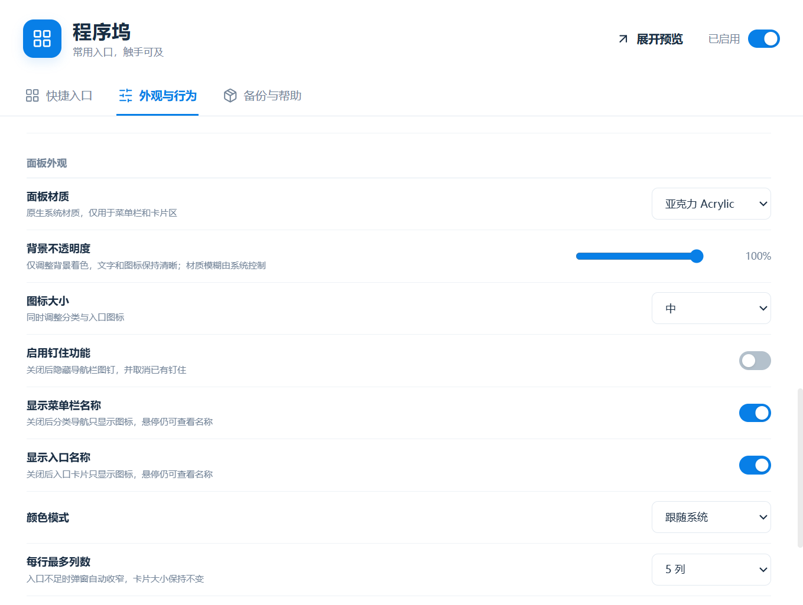
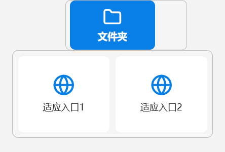
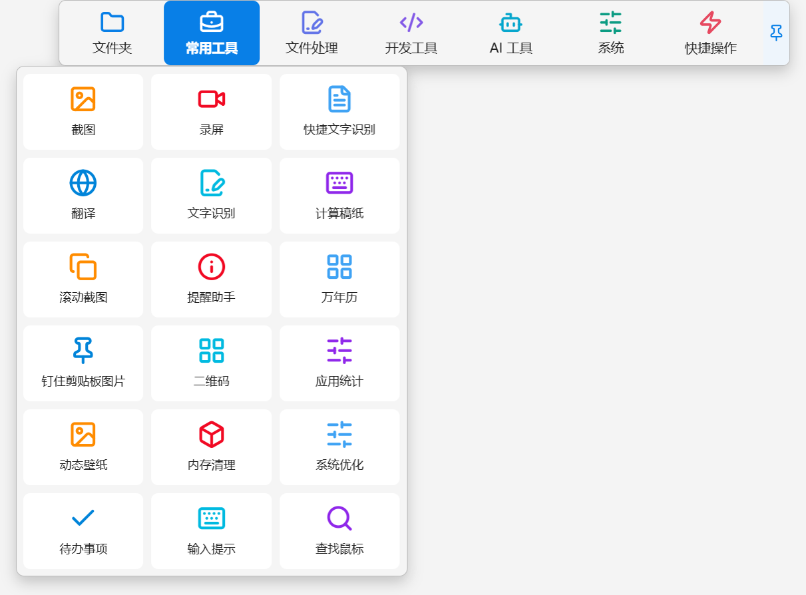
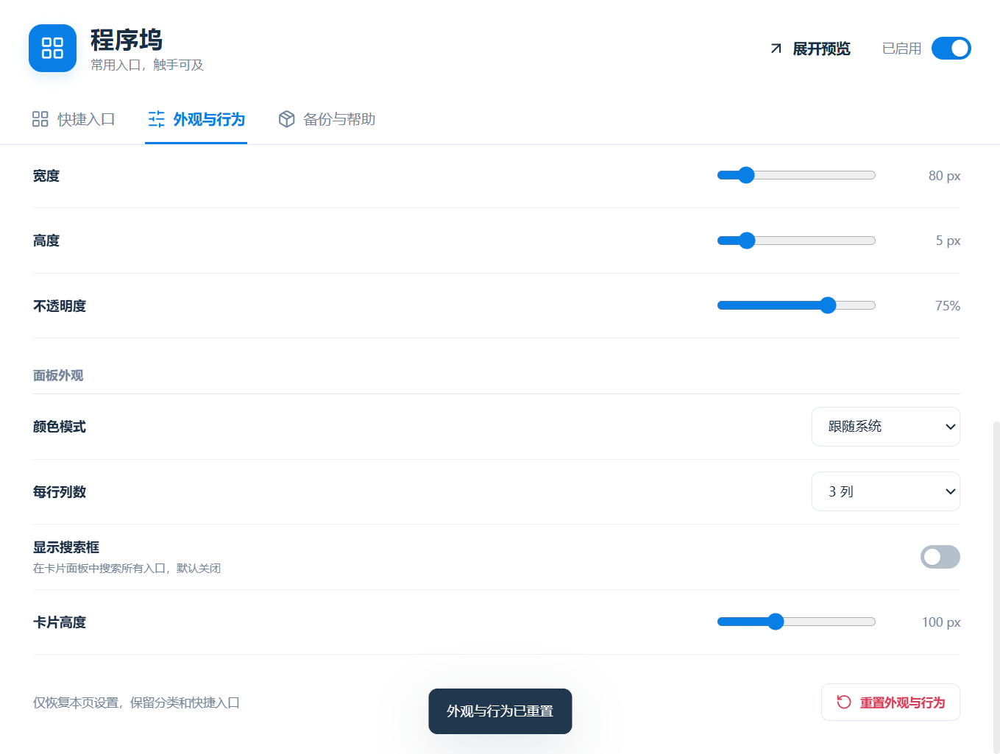
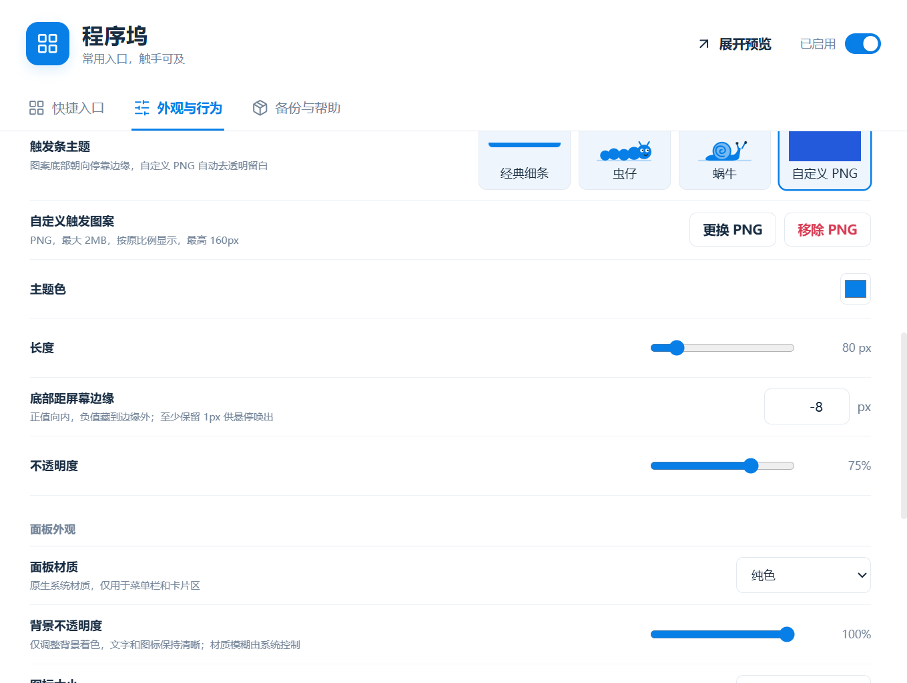
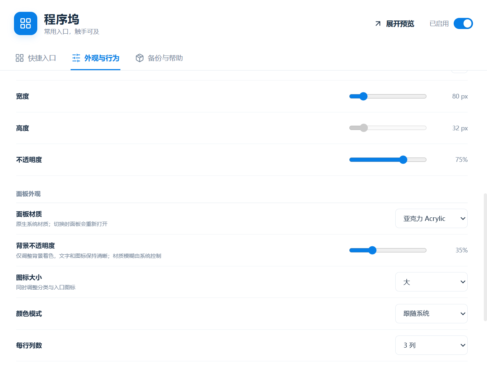
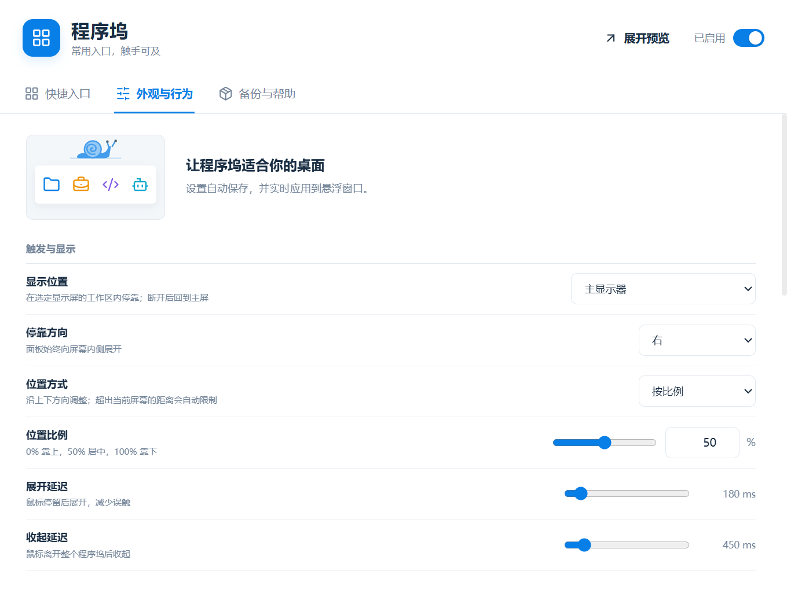
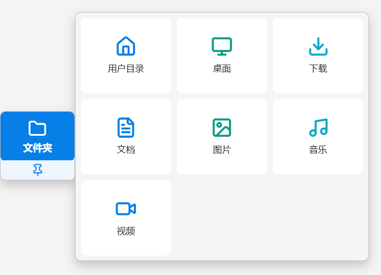
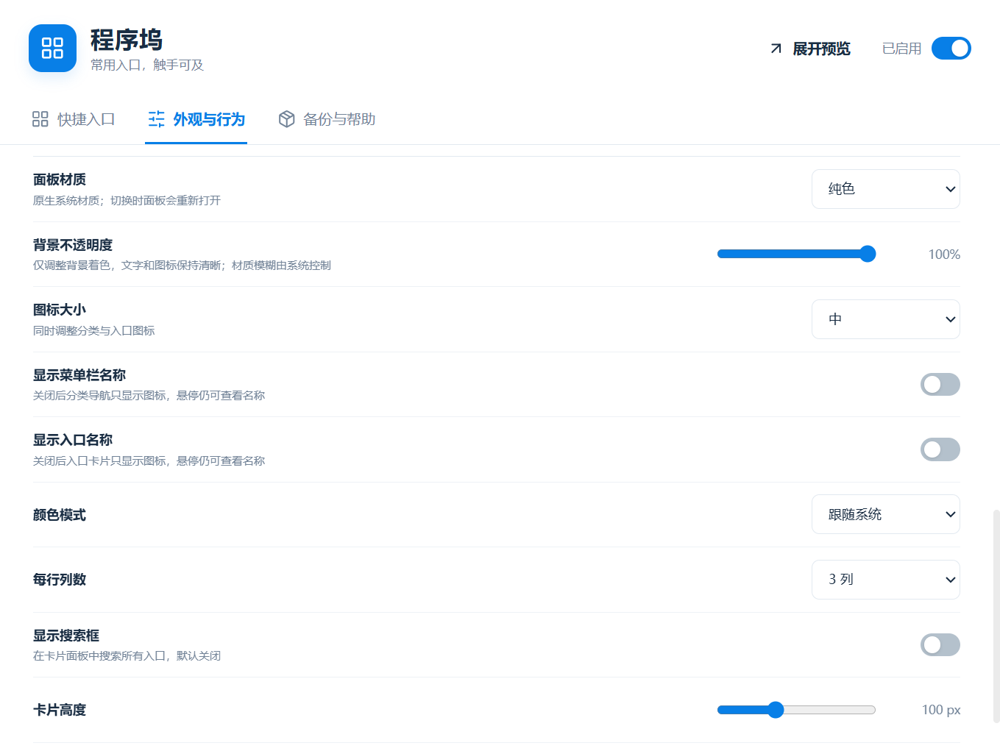
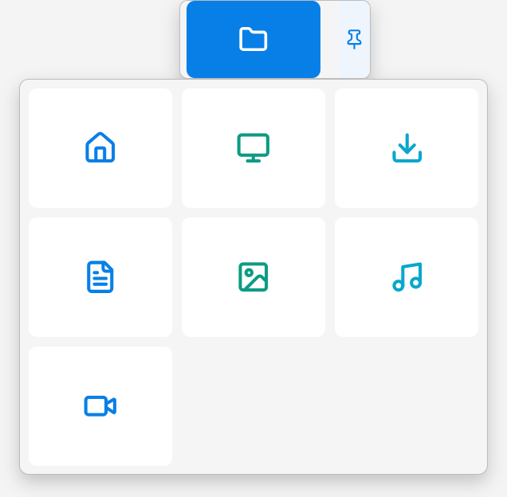

# 程序坞

Windows 屏幕边缘的分类启动器。悬停边缘触发条展开程序坞，按分类打开应用、文件、文件夹、网址和已安装的 ZTools 插件。

## 使用

- “外观与行为 → 启用钉住功能”控制导航栏图钉，默认开启。关闭后隐藏按钮并取消已有钉住，恢复整体自动收起。
- “每行最多列数”为上限：入口不足时按实际数量自动收窄弹窗，卡片大小保持不变；搜索结果也同步自适应。

- “外观与行为”中的“显示菜单栏名称”“显示入口名称”可以分别关闭分类导航和入口卡片文字，默认都开启。关闭后悬停提示、搜索和管理页面名称仍保留。

- 在“外观与行为”选择上/下/左/右停靠；支持比例定位（0% 起点、50% 居中、100% 终点），也可选择距左/右边的距离，侧边停靠对应距上/下边。距离为逻辑像素，超出工作区时自动限制。默认顶部居中，侧边分类纵向滚动。

- 在 ZTools 搜索“程序坞设置”管理分类和入口，搜索“程序坞”或“dock”展开面板。
- 分类栏右侧图钉可钉住导航条。鼠标离开后卡片区收起，移回导航条再次展开；取消钉住后整个程序坞自动收起。
- 右键顶部细条、导航栏或卡片面板打开设置。分类和入口可拖拽排序，空分类在设置中管理。
- 复制网址、应用、文件或文件夹后唤起 ZTools，选择“添加到程序坞”；也可粘贴到搜索框。宿主关闭复制内容自动匹配时，可手动粘贴或输入“添加到程序坞”。单项打开预填表单，批量添加先确认。
- 默认分类：网址 → 网址；应用 → 常用工具；文件 → 文件处理；文件夹 → 文件夹。可在表单中修改分类。
- 网址编辑页“获取图标”读取网站 favicon，并随配置保存；失败时可选择本地 PNG/JPG/WebP 图片。
- “外观与行为”可选择经典细条、虫仔、蜗牛触发主题，以及小、中、大图标。卡通主题为静态矢量图案，触发区高度为 32 px。
- 触发图案底边始终朝向所选屏幕边缘。“底部距屏幕边缘”默认为0，正数向内、负数藏到边缘外，至少保留1px供悬停唤出。可上传2MB以内PNG，自动裁掉透明留白、按比例显示，图案高度最多160px；图片随JSON备份保存。
- 面板支持纯色、原生云母、原生亚克力。原生材质需要 Windows 11 22H2+；不支持的系统使用纯色。背景不透明度只调整表面着色，不改变文字和图标的不透明度，系统模糊强度由 Windows 控制。
- 搜索默认关闭，可在“外观与行为”开启。开启后 Ctrl+F 聚焦搜索，Enter 打开首项。
- “外观与行为”页底部的重置仅恢复该页设置，保留分类、入口、图标、顺序和启用/暂停状态。
- 备份页可导出、导入 JSON 配置。退出 ZTools 会同时结束程序坞。

## 界面







上图为隔离配置中的示例入口，展示自定义分类、图标与卡片布局，不表示内置截图、录屏等工具。















## 范围

仅支持 Windows，在一个选定显示屏的工作区四边停靠。副屏断开后回退主屏。依赖 ZTools 后台运行，可按宿主提供的“退出即结束”“跟随启动”选项设置。

不包含全屏自动避让、多屏同时停靠、应用参数或自定义脚本。管理员窗口、UAC 安全桌面及独占全屏场景未保证兼容。插件跳转使用唯一插件标题和指令，同名插件无法区分。

## 构建与验证

```sh
npm ci
npm test
npm run build
```

正式安装目录为 `dist/`。源码 manifest 位于 `public/plugin.json`。`npm run pack` 可生成根布局的安装 ZIP，并排除旧哈希资源和 Vite 内部清单。

0.1.13已通过41项单元、44项生产ZIP隔离宿主检查。另1项最终桌面合成像素检查因Windows锁屏暂不可执行，没有计为通过；原生Mica/Acrylic属性、四向背景窗组件边界和生命周期检查通过。5项0.1.12→0.1.13升级/恢复检查通过。宿主验证环境为ZTools3.3.0-beta.2安装版app.asar + 独立Electron41.4.0，不能等同日常EXE完整人工验收。文件粘贴匹配及原生选择框使用受控适配器，本地PNG解码、文件读写和程序启动执行真实API。

宿主回归需设置 `ZTOOLS_EXECUTABLE`，另用 `ZTOOLS_APP` 指向 app.asar（若适用），执行 `npm run test:host`。测试使用独占临时 profile，不修改日常用户配置。

MIT 许可。Vue 与 Lucide 的许可随构建产物提供。
