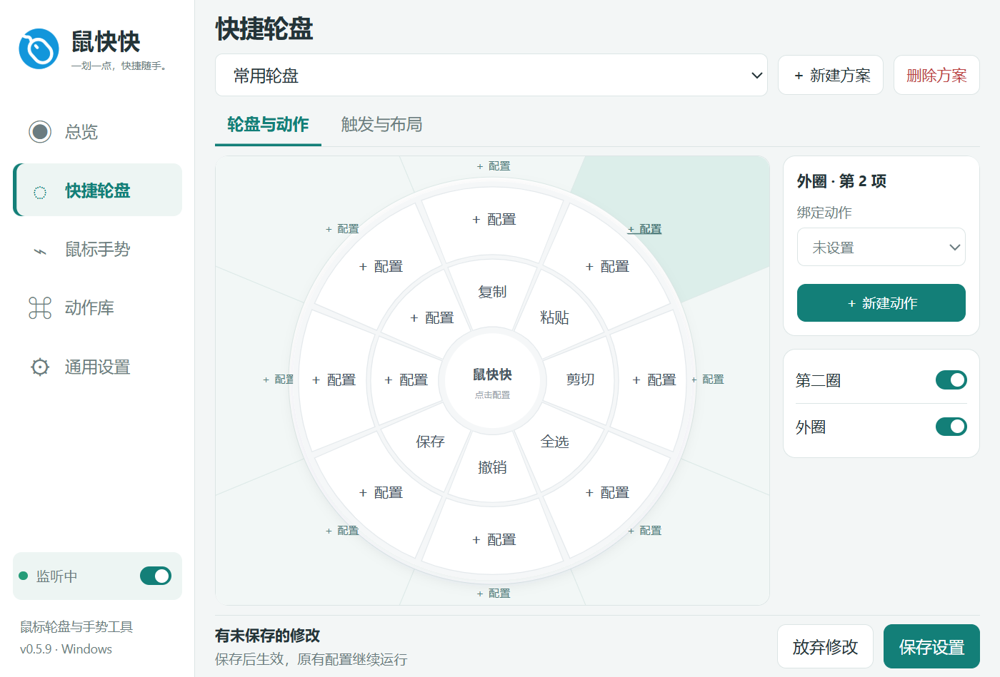
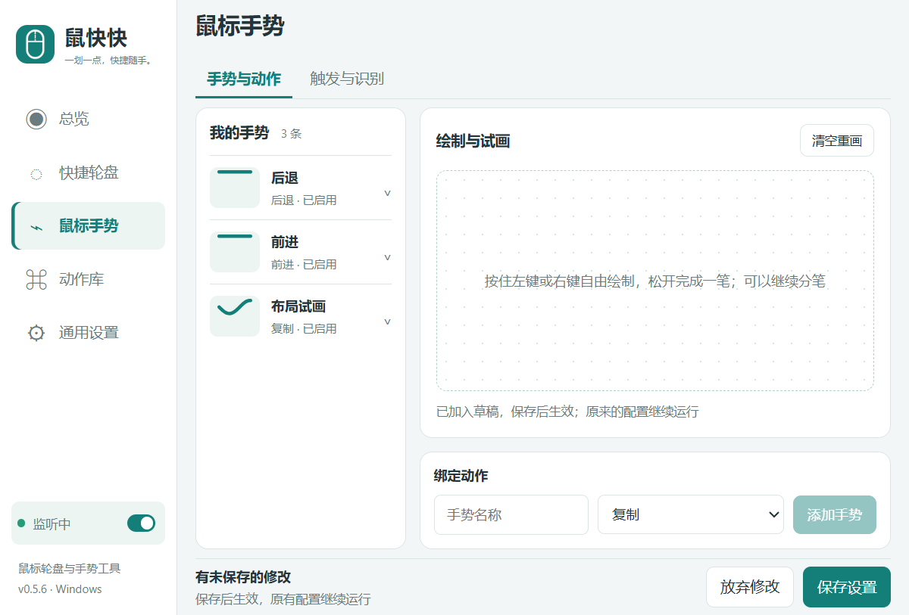
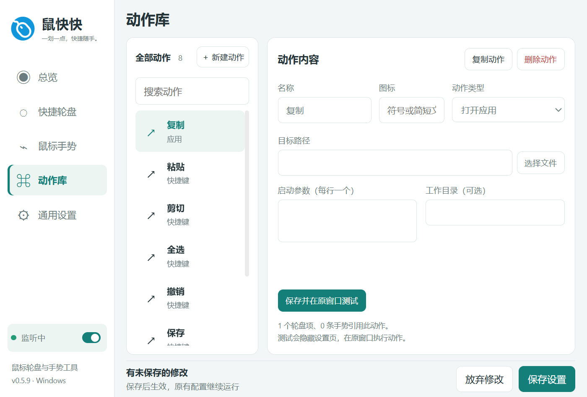

# 鼠快快 · 商店说明

一划一点，快捷随手。

将常用操作放到鼠标旁：按住唤起轮盘，移动选择、松开执行；或画下自己习惯的轨迹，直接调用绑定动作。

支持两圈可见扇区与轮盘之外的外圈动作，触发鼠标按键与修饰键可自行录入。自由手势支持分笔与试画反馈。动作库覆盖快捷键、应用、文件、网址和文本，配有配置备份、应用排除和暂停开关。

平台：Windows x64。请先在常用应用中确认效果；高权限窗口、游戏和受保护桌面存在系统输入限制。

源码与问题反馈：https://github.com/jiang66-so/ztools-shukuaikuai

