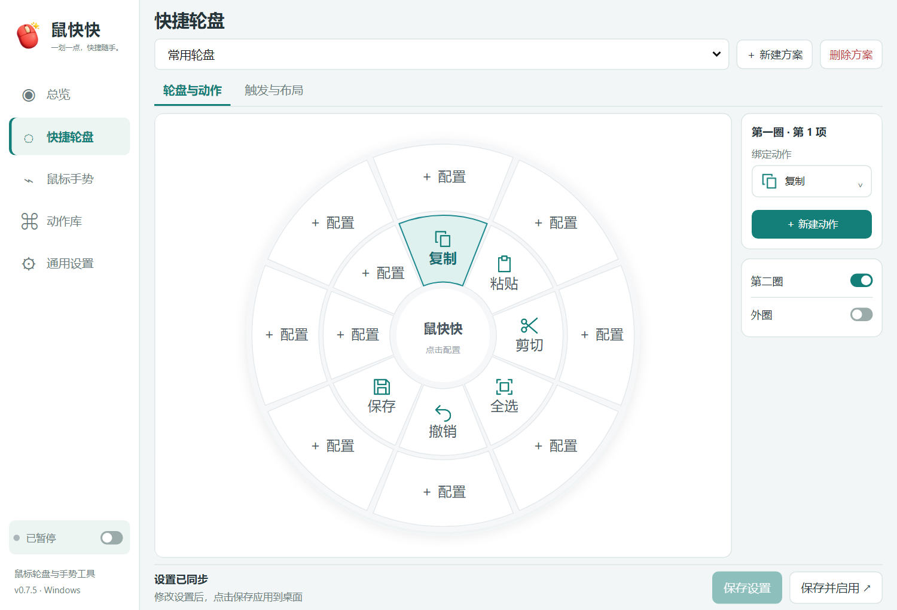
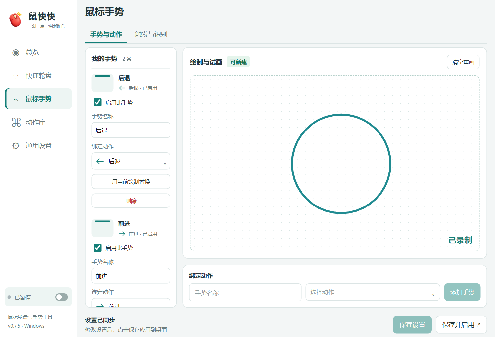

# 鼠快快

**一划一点，快捷随手。**

Windows x64 的 ZTools 鼠标轮盘与自由手势插件。把快捷键、应用、文件、网址、固定文本和插件指令绑定到轮盘扇区或自己绘制的轨迹。

## 安装与使用

从 [GitHub Releases](https://github.com/jiang66-so/ztools-shukuaikuai/releases) 下载 ZIP，在 ZTools 中导入插件包。商店提交审核通过后，也可从插件中心搜索“鼠快快”。当前版本：0.7.5。

在 ZTools 搜索“鼠快快”打开设置。轮盘默认使用鼠标中键，手势默认使用右键；两者的触发按键、Ctrl / Alt / Shift 组合均可修改或直接录入。左下角开关暂停或恢复监听。

- **轮盘**：点击预览扇区选择动作。支持两个可见圈层；外圈指可见轮盘之外的无限区域，可统一执行一个动作或按方向绑定。选择方案后保存即可启用该方案。实际轮盘大小可设置为 200—600 px，并随 Windows 显示缩放。
- **手势**：自由绘制轨迹，填写名称、绑定动作并添加。每个手势一笔画完，再次绘制会替换当前轨迹；标题旁以红色标签提示重复动作，绿色“可新建”表示可添加。默认相似度达到 50% 即可匹配，可在识别设置中调整。已有手势列表可修改、替换轨迹、启停或删除。
- **动作库**：支持键盘快捷键、打开应用、文件或目录、HTTP/HTTPS 网址、输入固定文本和执行 ZTools 插件指令。快捷键支持录入；选择文件、文件夹、应用、网址或插件指令后，动作名称默认带入目标名称，仍可自行修改。网址优先读取网页标题，失败时使用域名。文件、文件夹、应用、网址及插件指令自动读取目标图标。可切换内置图标或选择本地图片，轮盘与手势同步展示；共用动作修改会同步影响引用它的轮盘和手势。
- **设置**：排除特定应用、导入导出配置。编辑只修改草稿，原配置继续运行；点击底部“保存设置”后生效。Esc 可取消当前轮盘或手势。





新建“执行 ZTools 插件指令”动作时，选择插件名称和具体指令。首次选择需在 ZTools 中批准读取插件列表及停用状态；批准后刷新列表。只支持可直接打开的文本指令，保存后可绑定轮盘或手势。

## 数据与兼容性

配置保存在 ZTools userData 下的 `shukuaikuai/config.json`，原配置有 `.bak` 备份；暂停状态单独存入 `runtime.json`。插件不需要账号；为网址动作读取标题和图标时会访问填写的网址及其图标地址，读取失败使用域名和默认图标。打开网址动作交给系统浏览器。导出配置会包含你填写的文本、网址和路径，请按需要保管。

仅支持 Windows x64。原生服务使用 Win32 鼠标钩子、透明绘制窗口和系统模拟输入；运行包不需要安装 Node.js 或 .NET SDK。高权限应用、受保护桌面以及部分游戏可能拒绝模拟输入，复杂轨迹和多屏缩放效果仍取决于实际环境。可通过应用排除避免接管特定程序的鼠标操作。

## 从源码构建

需要 Windows x64、Node.js 20 或以上，以及系统 .NET Framework 4.x 的 C# 编译器（Windows 常见环境已提供）。

```powershell
npm ci
npm run package
```

运行目录为 `dist/plugin`，安装包输出到 `artifacts/鼠快快-0.7.5.zip`。`npm test` 提供纯逻辑检查。日常修改默认只验证直接相关内容，完整回归按需执行。

源码包含可读的 preload 与 C# 服务实现；构建时生成原生服务，无需从外部下载可执行文件。项目发布快照不包含个人配置、日常宿主数据库、临时安装工具或本机测试 profile。

## 许可

[MIT](LICENSE)。Vue 的许可保留在 `public/THIRD_PARTY_NOTICES.txt` 中。
